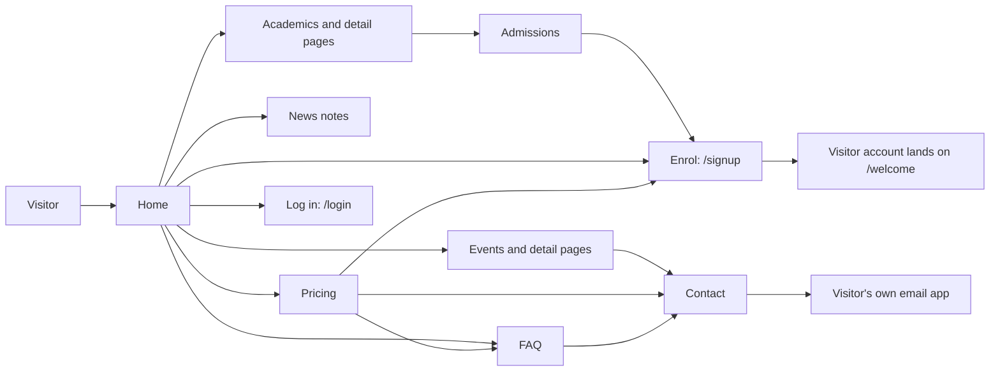

import { Aside, Steps, Card, CardGrid, LinkCard, Badge } from '@astrojs/starlight/components';
import Pipeline from '../../../components/Pipeline.astro';
import ScreenAnatomy from '../../../components/ScreenAnatomy.astro';
import SourceFile from '../../../components/SourceFile.astro';
import Roles from '../../../components/Roles.astro';
import Route from '../../../components/Route.astro';
import DemoLogin from '../../../components/DemoLogin.astro';
import Screenshot from '../../../components/Screenshot.astro';
import { Tabs as ShotTabs, TabItem as ShotTab } from '@astrojs/starlight/components';

The public website is Schola's front door: the pages anyone can read at `https://schola.reactbd.com` without an account. It explains what Schola is, shows sample programs and bookable sessions, lists the price plans, answers common questions, and sends people on to the two doors that matter — **Enrol** (create an account at `/signup`) and **Log in**. Every page ships complete search-engine metadata (titles, canonical links, social cards, a sitemap and structured data) and works in light and dark mode, from a 360px phone to a wide desktop. None of these pages call the API: their text lives in the web app's source code, so they render fast and never depend on a school's data.

## At a glance

<CardGrid>
  <Card title="Who uses it" icon="star">
    <Roles list={['public', 'user']} note="Anyone. A signed-in member sees an account menu in the header instead of Log in / Enrol." />
  </Card>
  <Card title="Where to find it" icon="laptop">
    <Route path="/" /> <Route path="/academics" /> <Route path="/admissions" /> <Route path="/events" /> <Route path="/news" /> <Route path="/faq" /> <Route path="/features" /> <Route path="/pricing" /> <Route path="/about" /> <Route path="/contact" /> <Route path="/legal/terms" /> <Route path="/legal/privacy" />
  </Card>
  <Card title="Permissions" icon="approve-check">
    None. These pages are public and read no tenant data. They live in the `(marketing)` route group of the web app.
  </Card>
  <Card title="Search engines" icon="magnifier">
    Unique title and description, absolute canonical, Open Graph and Twitter cards, `sitemap.xml`, `robots.txt` and JSON-LD on every page.
  </Card>
</CardGrid>

You do not need an account to record this tour — open `http://localhost:3000/` in a private window. To show the signed-in header (the account menu that replaces **Log in** and **Enrol**), sign in with any demo account and click the Home icon in the dashboard's top bar:

<DemoLogin as="Parent (Sofia Singh)" email="parent@greenfield.example" go="/" />

## How it works

The site is a set of static pages that funnel a visitor toward one of four places:



<Pipeline
  caption="The path a new school owner takes from the public site into Schola."
  steps={[
    { label: 'Read', icon: 'book-open', note: 'Home, features, pricing' },
    { label: 'Enrol', icon: 'user-plus', note: 'Create an account at /signup' },
    { label: 'Verify', icon: 'mail', note: 'Confirm the email' },
    { label: 'Register', icon: 'building', note: 'Register the school' },
    { label: 'Approval', icon: 'badge-check', note: 'Super Admin reviews it' },
  ]}
/>

Three things are worth knowing before you film:

- **The content is code.** Programs, courses, events, news notes and FAQ answers are constants in <SourceFile path="apps/web/src/components/marketing/content.ts" />. Changing a page means editing that file and redeploying — there is no CMS.
- **The site speaks for Schola, not for one school.** The pages read like a school's prospectus ("Programs for kindergarten through grade 12"), but they are Schola's own marketing. Greenfield International School and other tenants have no public page of their own.
- **The calls to action lead to sign-up, log-in or email.** **Enrol**, **Get started**, **Apply now** and **Start your school** all open `/signup`. **Talk to the school**, **Talk to sales**, **Get in touch** and **Join this session** open `/contact`. Nothing on the public site submits data to the API.

### Every public page

| Route | Browser title | What is on it | Structured data |
|---|---|---|---|
| `/` | Schola — Smart education that helps you grow | Hero, pillars, programs, session carousel, events, ways to learn, stats, sample courses, journal | `Organization` (site-wide) + `WebSite` |
| `/academics` | Academics · Schola | The three grade bands, then six sample courses | `BreadcrumbList` |
| `/academics/[slug]` | *Program or course name* · Schola | One band (Elementary, Middle school, High school) or one sample course | `BreadcrumbList` (3 levels) |
| `/admissions` | Admissions · Schola | "A family joining" and "A school opening" step lists | `BreadcrumbList` |
| `/events` | Events · Schola | Four bookable sessions | `BreadcrumbList` |
| `/events/[slug]` | *Event name* · Schola | When, Format, Length, what the session covers | `BreadcrumbList` (3 levels) |
| `/news` | News · Schola | Four short notes for school teams | `BreadcrumbList` |
| `/news/[slug]` | *Note title* · Schola | The note, with a link to the page it describes | `BreadcrumbList` (3 levels) |
| `/faq` | FAQ · Schola | 18 answers in 6 groups, with search | `BreadcrumbList` + `FAQPage` |
| `/features` | Features · Schola | "Nine modules, one login" — the school desk | `BreadcrumbList` |
| `/pricing` | Pricing · Schola | Starter, Growth, Enterprise and a comparison table | `BreadcrumbList` + `Product` with two `Offer`s |
| `/about` | About · Schola | The story and four values | `BreadcrumbList` |
| `/contact` | Contact · Schola | Contact form and the three desks to write to | `BreadcrumbList` + `Organization` with `ContactPoint`s |
| `/legal/terms` | Terms of Service · Schola | 11 numbered sections, last updated 2026-05-17 | `BreadcrumbList` |
| `/legal/privacy` | Privacy Policy · Schola | 11 numbered sections, last updated 2026-05-17 | `BreadcrumbList` |

The dynamic routes are built ahead of time with `generateStaticParams`: 9 academics pages (3 programs + 6 courses), 4 events and 4 news notes. An unknown slug shows the site's 404 page ("This page is not on the roster").

## The screens

Real screenshots from the seeded demo school (switch the docs theme to see dark mode):

<ShotTabs>
  <ShotTab label="Home">
    <Screenshot name="public-home" alt="The public home page" path="/" />
  </ShotTab>
  <ShotTab label="Features">
    <Screenshot name="public-features" alt="The Features page" path="/features" />
  </ShotTab>
  <ShotTab label="Pricing">
    <Screenshot name="public-pricing" alt="The Pricing page" path="/pricing" />
  </ShotTab>
  <ShotTab label="Admissions">
    <Screenshot name="public-admissions" alt="The public Admissions page" path="/admissions" />
  </ShotTab>
  <ShotTab label="Contact">
    <Screenshot name="public-contact" alt="The Contact page" path="/contact" />
  </ShotTab>
</ShotTabs>


### Site header and footer (every page)

<ScreenAnatomy
  title="Site header and footer"
  path="/"
  regions={[
    { label: 'Logo', desc: 'The Schola lockup; links to the home page ("Schola home")', area: 'top' },
    { label: 'Primary nav', desc: 'Home, Academics, Admissions, Events, Pricing, News, Contact — a pill bar from 1280px up', area: 'top', tone: 'accent' },
    { label: 'Header actions', desc: 'Theme toggle, "Log in" (from 640px), yellow "Enrol"; or the "Account menu" chip when signed in', area: 'top' },
    { label: 'Page content', desc: 'The page itself', size: 3 },
    { label: 'Closing band', desc: '"Learn. Dream. Succeed." on indigo, with "Get started"', tone: 'warn' },
    { label: 'Footer card', desc: '"Get in touch", link columns School, Campus, Company, Connect, and the copyright line', tone: 'muted' },
  ]}
/>

Below 1280px the nav bar is replaced by a round menu button (screen-reader label "Open menu"). It slides in a drawer titled **Menu** from the left with the same seven links and, for signed-out visitors, **Log in** and **Enrol today** buttons at the bottom. Press <kbd>Esc</kbd>, tap the backdrop, or tap the close button to dismiss it; following a link closes it too.

The footer columns are:

| Column | Links |
|---|---|
| School | Our school (`/about`), Academics, Admissions, Pricing |
| Campus | Events, News, FAQ, Enrol today (`/signup`), Log in (`/login`) |
| Company | About, Contact, Terms, Privacy |
| Connect | `hello@schola.reactbd.com`, `support@schola.reactbd.com` (both `mailto:` links) |

### Home

<ScreenAnatomy
  title="Home"
  path="/"
  regions={[
    { label: 'Site header', desc: 'Logo, nav, theme toggle, Log in, Enrol', area: 'top' },
    { label: 'Hero', desc: '"Smart education that helps you grow", "Get started", and the Programs card with Live classes, Gradebook and Family access tiles', size: 2, tone: 'accent' },
    { label: 'Who we are', desc: 'Four pillars: World-class programs, Expert teachers, Flexible live classes, Grades that stay put' },
    { label: 'Programs', desc: 'Middle school, Elementary and High school cards with "Learn more"' },
    { label: 'Sessions now booking', desc: 'A scrolling carousel of the four events, then "Tutorials & webinars" with "View all events"' },
    { label: 'Ways to learn and stats', desc: '"Apply for enrollment", then K–12, 9, 1 and 8 stat tiles' },
    { label: 'Explore sample programs', desc: 'Six course cards with "Program detail" and "View all programs"' },
    { label: 'Enrol band and journal', desc: '"Apply now", "Talk to the school", then "Latest notes for school teams"', tone: 'warn' },
  ]}
/>

### FAQ

<ScreenAnatomy
  title="FAQ"
  path="/faq"
  regions={[
    { label: 'Site header', desc: 'Shared header', area: 'top' },
    { label: 'Intro', desc: '"Questions, grouped the way a school asks them" and the live count: 18 answers in 6 groups' },
    { label: 'Search questions', desc: 'Filters every group as you type', tone: 'accent' },
    { label: 'Question groups', desc: 'Opening a school, Pricing, The school day, Families, Records and privacy, Live sessions' },
    { label: 'Answers', desc: 'One collapsible row per question', size: 3 },
    { label: 'Still unsure', desc: '"Ask about your roster" with "Write to the team" and "Read admissions"', tone: 'muted' },
  ]}
/>

### Pricing

<ScreenAnatomy
  title="Pricing"
  path="/pricing"
  regions={[
    { label: 'Site header', desc: 'Shared header', area: 'top' },
    { label: 'Intro', desc: '"Free during early access" and "Plans that follow the roster"' },
    { label: 'Plan cards', desc: 'Starter (Free), Growth ($1.50, "Most schools"), Enterprise (Custom), each with a button and "Compare all features"', size: 2, tone: 'accent' },
    { label: 'A package of your own', desc: 'Multi-campus band with "Talk to us"' },
    { label: 'Facts', desc: '1 login, 0 seat fee, 30 days notice, CSV export' },
    { label: 'Compare the plans', desc: 'Feature table grouped by The school day, People, The school, Price', size: 2 },
    { label: 'Questions before you choose', desc: '"Open the FAQ" jumps to the Pricing group', tone: 'muted' },
  ]}
/>

### Contact

<ScreenAnatomy
  title="Contact"
  path="/contact"
  regions={[
    { label: 'Site header', desc: 'Shared header', area: 'top' },
    { label: 'Contact us', desc: 'Heading, reply-time promise and three desks: Chat to the team, Support, Admissions' },
    { label: 'Contact form', desc: 'First name, Last name, Email, Phone, Message, privacy checkbox, "Send message"', size: 3, tone: 'accent' },
    { label: 'Where to write', desc: 'The same three desks as cards', tone: 'muted' },
  ]}
/>

## Ads

The marketing pages carry Google AdSense **Auto ads**: each page loads the
AdSense script and Google places the ads. Only these public pages do — sign-in
pages, `/app`, `/platform` and "Page not found" never load ads. The site also
serves `/ads.txt` from `apps/web/public/ads.txt`. Ads are on in production
builds only (`NEXT_PUBLIC_ADSENSE_CLIENT` in `apps/web/.env.production`), never
under `pnpm dev`. Setup, policy and troubleshooting:
[Google AdSense](/setup/services/adsense/).

## Step by step

A complete tour of the public site, in the order a viewer would take it:

<Steps>

1. Open `http://localhost:3000/` signed out. The hero reads **"Smart education that helps you grow"**. Point out the yellow **Enrol** button and the **Log in** button in the header, and the **Get started** button under the headline — all three lead to an account.

2. Click the sun or moon button in the header to switch between light and dark themes. The page repaints with a wipe animation; with "reduce motion" turned on in the operating system, it switches instantly.

3. Scroll the home page: the four pillars, the three program cards, the scrolling **Sessions now booking** carousel, **Tutorials & webinars**, the stat tiles (K–12, 9 modules, 1 record per student, 8 roles), **Explore sample programs** and **Latest notes for school teams**.

4. On the **Middle school programs** card, click **Learn more**. The detail page shows the band, "How this band runs" and "Sample courses in this band". Click **How to enrol** to go to the admissions page.

5. On **Admissions**, read the two columns: **A family joining** (the school enrols the student — there is no public application form) and **A school opening** (create an account, confirm the email, register the school, wait for approval, invite people).

6. Click **Events** in the nav, then **Session detail** on "English literature circle". The page lists **When**, **Format** and **Length** and a **Join this session** button that opens the contact page.

7. Click **Pricing**. Compare the three plans, then click **Compare all features** to jump to the comparison table. On a phone, the table scrolls sideways ("Swipe sideways to compare Growth and Enterprise.").

8. Click **Open the FAQ** at the bottom of the pricing page. The FAQ opens on the **Pricing** group (the link is `/faq#pricing`). Type `parents` into **Search questions** — the list filters across all groups. Click a question to expand its answer.

9. Click **Contact** in the nav. Fill in **First name**, **Last name**, **Email** and **Message**, tick **I agree to the privacy policy**, and click **Send message**. A toast says "Opening your email app with this message." and your mail program opens a pre-filled draft to `hello@schola.reactbd.com`.

10. Narrow the browser below 1280px. The nav bar becomes a menu button; click it to open the **Menu** drawer, then follow **Pricing** — the drawer closes on navigation.

11. Finally, sign in as the parent demo account, then click the Home icon in the dashboard top bar. The public header now shows the **Account menu** chip instead of **Log in** and **Enrol**; hover or click it to see **Dashboard**, **Notifications**, **My profile** and **Log out**.

</Steps>

## Every action on this screen

### "Log in" and "Enrol" (header)

**Log in** (outline button, shown from 640px up) opens `/login`. **Enrol** (yellow) opens `/signup`. In the mobile **Menu** drawer they appear as **Log in** and **Enrol today**. Both disappear once the auth check finds a signed-in user; while that check is still loading, the header shows an empty placeholder of the same size so the layout does not jump. See [Sign up and sign in](/features/accounts/sign-up-and-sign-in/).

### "Account menu" (header, signed in)

A signed-in visitor sees their avatar chip. It opens on hover with a mouse, or on click or tap. The menu shows the person's name, then the **first and last** groups of their own navigation, then **Log out**, which asks for confirmation before signing out:

| Who is signed in | Links in the menu |
|---|---|
| School member (any tenant role) | Dashboard (plus Reports if they can read school-wide data), Notifications, My profile |
| Visitor (account with no school yet) | Dashboard (`/welcome`), Register a school, Pricing, Contact |
| Super Admin | Dashboard (`/platform`), Settings, Branding, Locale, Email, Feature flags |

### Theme toggle

The round sun/moon button switches between light and dark. Its label reads "Switch to dark theme" or "Switch to light theme". The choice is remembered in the browser under the key `schola-theme`; until someone picks, the site follows the operating system (`defaultTheme: "system"`). Where the browser supports view transitions, the change plays as a wipe across the page.

### "Get started", "Apply now", "Start your school"

All open `/signup`. They appear in the hero, the indigo closing band ("Learn. Dream. Succeed."), the enrol bands at the foot of most pages, and the Starter and Growth plan cards.

### "Learn more", "Program detail", "Session detail", "Continue reading"

Card links into the detail pages: `/academics/[slug]` for programs and courses, `/events/[slug]` for sessions, `/news/[slug]` for notes. The three hero tiles (**Live classes**, **Gradebook**, **Family access**) all link to `/features`.

### "Apply for enrollment", "How to enrol", "Read admissions"

Open the public `/admissions` page. It explains the process; it does not collect an application. The staff-side applications pipeline is a different screen inside the school app — see [Admissions](/features/campus/admissions/).

### "Talk to the school", "Talk to sales", "Talk to us", "Get in touch", "Join this session", "Write to the team"

All open `/contact`.

### "Compare all features" and "Open the FAQ" (pricing)

**Compare all features** scrolls to the `#compare` table on the same page. **Open the FAQ** opens `/faq#pricing`, which preselects the Pricing group.

### FAQ: "Search questions" and the group buttons

Typing matches the text of questions **and** answers across **all** groups (case-insensitive); while a search is active, no group button is highlighted. Clearing the search returns to the selected group. Clicking a group button clears the search, shows only that group and writes its id into the address bar (`#opening`, `#pricing`, `#school-day`, `#families`, `#records`, `#sessions`), so the URL can be shared. If nothing matches, the page shows "Nothing matches that search" and a **Contact the team** button.

### Contact form: "Send message"

| Field | Rule | Error text |
|---|---|---|
| First name | Required | "Enter your first name." |
| Last name | Required | "Enter your last name." |
| Email | A valid email | "Enter a valid email." |
| Phone | Optional ("Include a country code if you add one.") | — |
| Message | At least 10 characters | "Write at least a short note." |
| I agree to the privacy policy | Must be ticked | "Agree to the privacy policy to send this." |

Errors appear when you leave a field (`mode: "onTouched"`) and again on submit. A valid form builds a `mailto:` link to `hello@schola.reactbd.com` with the subject "Schola — message from *First Last*" and a body made of the message, name, email and phone. The browser hands that link to the visitor's email program, a toast says "Opening your email app with this message.", and the form clears.

:::caution[The contact form does not send anything itself]
"Send message" never reaches the Schola API, and no copy is stored. If the visitor has no email program set up, nothing happens apart from the toast, and the form has already been cleared. The page's own text ("We reply within one business day") assumes the message arrives. Source: <SourceFile path="apps/web/src/app/(marketing)/contact/contact-form.tsx" symbol="onSubmit" />.
:::

## Who sees what

| Visitor | What changes on the public site |
|---|---|
| Anyone, signed out | Every page. Header shows **Log in** and **Enrol**; the mobile menu adds **Log in** and **Enrol today**. |
| Signed-in visitor (no school yet) | Same pages. Header shows the **Account menu** with links back to `/welcome` and **Register a school**. |
| Signed-in school member | Same pages. **Account menu** links to their dashboard, notifications and profile. |
| Super Admin | Same pages. **Account menu** links to the platform console. |
| Search engines | Everything listed in `sitemap.xml`. `robots.txt` blocks `/app/`, `/platform/`, `/api/` and the auth pages. |

No page on the public site changes its content by role — only the header does.

## SEO

The original spec makes search-readiness a hard requirement. Here is how each part is met.

### Page metadata

- The root layout (<SourceFile path="apps/web/src/app/layout.tsx" />) sets `metadataBase` to `NEXT_PUBLIC_APP_URL`, the default title "Schola — Smart education that helps you grow", the title template `%s · Schola`, keywords, default Open Graph and Twitter cards, `robots: index, follow` (with large image previews), icons, the web manifest, and Google Search Console verification when `GOOGLE_SITE_VERIFICATION` is set.
- Every other public page calls `pageMetadata()` from <SourceFile path="apps/web/src/lib/seo.ts" symbol="pageMetadata" /> with a title, a description and a path. That one helper produces the canonical link (`alternates.canonical`, made absolute by `metadataBase`), an Open Graph card (`type: website`, `locale: en_US`, the 1200×630 image) and a `summary_large_image` Twitter card using `NEXT_PUBLIC_TWITTER_HANDLE` (default `@schola`).
- Dynamic pages (`/academics/[slug]`, `/events/[slug]`, `/news/[slug]`) build the same metadata in `generateMetadata` from the matching item. An unknown slug gets `noindex, nofollow` before the 404 page renders.
- Everything behind a sign-in is `noindex, nofollow`: the `(auth)`, `(tenant)/app` and `(super-admin)/platform` layouts, plus `/welcome`, `/onboarding/school`, `/admin-transfer` and the 404 page.

### Social images and icons

| File | What it produces |
|---|---|
| <SourceFile path="apps/web/src/app/opengraph-image.tsx" /> | A 1200×630 PNG drawn with `next/og`: the Schola mark, "Online School", the headline "Smart education that helps you grow" on an indigo-to-cyan gradient, and `schola.reactbd.com`. |
| <SourceFile path="apps/web/src/app/twitter-image.tsx" /> | Re-exports the same image for Twitter cards. |
| `icon.tsx`, `apple-icon.tsx` | Generated favicon and 180×180 Apple touch icon. |
| <SourceFile path="apps/web/src/app/manifest.ts" /> | `/manifest.webmanifest`: name, short name "Schola", `display: standalone`, theme colour `#27c4e5`. |

The browser theme colour follows the system: `#27c4e5` (Schola cyan) in light mode and `#121820` (navy) in dark mode.

### Sitemap and robots

<SourceFile path="apps/web/src/app/sitemap.ts" /> serves `/sitemap.xml` with **29 URLs**: the 12 static pages plus every academics, event and news slug read straight from `content.ts`, so a new item appears in the sitemap automatically.

| Priority | Pages | Change frequency |
|---|---|---|
| 1.0 | `/` | weekly |
| 0.8 | `/academics`, `/admissions`, `/pricing` | monthly |
| 0.7 | `/features`, `/about`, `/events` | monthly (`/events` weekly) |
| 0.6 | `/news` | weekly |
| 0.5 | `/faq`, each academics page, each event | monthly (events weekly) |
| 0.4 | `/contact`, each news note | yearly / monthly |
| 0.2 | `/legal/terms`, `/legal/privacy` | yearly |

<SourceFile path="apps/web/src/app/robots.ts" /> serves `/robots.txt`: allow `/`, disallow `/app/`, `/platform/`, `/api/`, `/login`, `/signup`, `/forgot-password`, `/reset-password` and `/verify`, and point to the sitemap. It matches the original spec line for line.

### Structured data (JSON-LD)

All JSON-LD goes through one Server Component, <SourceFile path="apps/web/src/components/seo/json-ld.tsx" symbol="JsonLd" />, which escapes `<` so the data can never close its own `<script>` tag.

| Block | Where | Contents |
|---|---|---|
| `Organization` | Root layout — every page | Name, URL, logo (`/icon`), Twitter profile, description |
| `WebSite` | Home | Name and URL only — no `SearchAction`, because the site has no search page |
| `BreadcrumbList` | Every nested page | Home → section (→ item on detail pages) |
| `FAQPage` | `/faq` | All 18 questions and answers |
| `Product` + `Offer` | `/pricing` | Starter `0` USD and Growth `1.50` USD |
| `Organization` + `ContactPoint` | `/contact` | Sales and customer-support email addresses |

### Quick check after a deploy

```sh
curl -s https://schola.reactbd.com/ | grep -E '<title|og:|twitter:|application/ld'
curl -s https://schola.reactbd.com/sitemap.xml | head -n 30
curl -s https://schola.reactbd.com/robots.txt
```

## Theming and layout

- **One set of tokens.** The public site and the school app share the same OKLCH design tokens in <SourceFile path="apps/web/src/app/globals.css" />: cyan primary, yellow accent, indigo headings and a navy dark mode.
- **Fonts.** Lexend (UI), Merriweather (editorial) and Ubuntu Mono (IDs), loaded with `next/font/google` in the root layout and exposed as CSS variables.
- **Theme switching.** `next-themes` puts a `dark` class on `<html>` (<SourceFile path="apps/web/src/components/theme-provider.tsx" />). <SourceFile path="apps/web/src/components/theme-toggle.tsx" /> applies the class inside a view transition so the snapshot catches it, and skips the animation for reduced motion.
- **Motion.** Sections fade up as they scroll into view, and the header's active-link pill glides between items. Every animation checks `prefers-reduced-motion`.
- **Responsive.** Every page is built mobile-first with a `max-w-7xl` content column. The nav collapses to the **Menu** drawer below 1280px, grids drop to one column on phones, and wide tables (pricing) scroll inside their own box. The Playwright test `the public menu opens on a tablet` checks the drawer at 1100px.

## Under the hood

- <SourceFile path="apps/web/src/app/(marketing)/layout.tsx" /> — wraps every public page in `SiteHeader`, `<main>` and `SiteFooter`.
- <SourceFile path="apps/web/src/components/layout/site-header.tsx" /> — nav links, mobile drawer (rendered in a portal after hydration).
- <SourceFile path="apps/web/src/components/layout/header-actions.tsx" /> — Log in / Enrol, or the `ProfileMenu` from the dashboard shell.
- <SourceFile path="apps/web/src/components/layout/site-footer.tsx" /> — closing band and link columns.
- <SourceFile path="apps/web/src/components/marketing/home.tsx" />, `home-hero.tsx`, `session-carousel.tsx`, `enroll-band.tsx`, `page-hero.tsx`, `academic-detail.tsx`, `story-layout.tsx` — the page building blocks.
- <SourceFile path="apps/web/src/components/marketing/content.ts" /> — `PROGRAMS`, `COURSES`, `EVENTS`, `NOTES`, `FAQ_GROUPS`, `STATS`, `WAYS`, `TICKER`, plus `findBySlug`, `academicBySlug` and `ACADEMIC_SLUGS`. Unit-tested in `content.test.ts` (unique slugs, note links, FAQ counts).
- <SourceFile path="apps/web/src/app/(marketing)/faq/faq-browser.tsx" /> and <SourceFile path="apps/web/src/app/(marketing)/contact/contact-form.tsx" /> — the only interactive (client) parts of the page bodies.
- Environment variables read: `NEXT_PUBLIC_APP_URL` (canonical and sitemap host; `http://localhost:3000` in the dev template, `https://schola.reactbd.com` when unset), `NEXT_PUBLIC_APP_NAME`, `NEXT_PUBLIC_TWITTER_HANDLE`, `GOOGLE_SITE_VERIFICATION`. See [Environment variables](/reference/environment-variables/).

## Edge cases and gotchas

:::caution[Marketing copy that the code does not back]
- **Pricing plans are not enforced.** The School model has no plan or billing field, so nothing limits a Starter school to 250 students or hides fees and payroll from it. The plans exist only on `/pricing`.
- **"A school can narrow what each role is allowed to do"** (`/features`, "Roles & permissions"). There is no screen or endpoint for editing a role's permissions per school; [Members & roles](/features/school/members-and-roles/) only grants or revokes roles.
- **"Email when something in the school day needs a person"** (`/features`, "Notifications"). Only a few events notify anyone — see [Notifications](/features/communication/notifications/).
- **"The school sends an invite to the parent email"** (`/admissions`). Enrolling an applicant creates a Parent record without a sign-in or an invite — see [Admissions](/features/campus/admissions/).
:::

- **"Apply now" is not a student application.** The enrol band's **Apply now** and the header's **Enrol** both open `/signup`. A parent who signs up there gets a visitor account with no school, which lands on `/welcome` and can only register a new school. Families join through their school instead (the `/admissions` page says so).
- **`/features` is not in the header or footer.** Visitors reach it from the three hero tiles, the Academics page, the first news note, and the visitor's `/welcome` page.
- **The public `/admissions` page and the staff Admissions pipeline are not connected.** No link or form on the public site creates an application; staff type every application into `/app/admissions`.
- **Inherited canonical.** The root layout's `alternates.canonical: "/"` is inherited by any page that does not set its own. All public pages set one, but the 404 page and the noindex app/auth pages inherit `/`. Harmless for noindex pages; keep it in mind if you add a public page without `pageMetadata()`.
- **`robots.txt` versus `noindex`.** Because `/app/` and the auth pages are disallowed in `robots.txt`, crawlers never fetch them and so never see their `noindex` tag. A page that is linked from elsewhere can still be listed by URL alone. `/welcome`, `/onboarding` and `/admin-transfer` are not disallowed; they rely on their `noindex` tag.
- **Two `Organization` blocks on `/contact`.** The root layout's block and the page's own block (with contact points) both render. Search engines accept this, but they describe the same organization twice.
- **Legal breadcrumbs.** The middle "Legal" crumb on `/legal/terms` and `/legal/privacy` points to the page itself, because there is no `/legal` index page.
- **Sitemap dates.** Every `lastModified` is the moment the sitemap was generated, not when a page last changed.
- **Fonts in the SEO notes.** `docs/seo.md` and the original spec still say "Inter + JetBrains Mono". The code follows the original spec (Lexend, Merriweather, Ubuntu Mono).
- **Events have no dates.** Every event says "Book a date"; the copy states that sessions are formats, not a public calendar. **Join this session** opens the contact page.

## Related pages

<CardGrid>
  <LinkCard title="Sign up and sign in" description="Where Enrol and Log in lead: accounts, email verification and social sign-in." href="/features/accounts/sign-up-and-sign-in/" />
  <LinkCard title="Onboarding and welcome" description="What a new visitor account sees, and how a school is registered." href="/features/accounts/onboarding-and-welcome/" />
  <LinkCard title="Admissions (school app)" description="The staff pipeline for applications, from submitted to enrolled." href="/features/campus/admissions/" />
  <LinkCard title="Web app architecture" description="Route groups, layouts, Server Components and the API proxy." href="/architecture/web-app/" />
  <LinkCard title="Platform settings" description="Branding, locale and email settings the Super Admin controls." href="/features/platform/settings/" />
  <LinkCard title="Web routes" description="Every route in the web app, public and private." href="/reference/web-routes/" />
</CardGrid>
