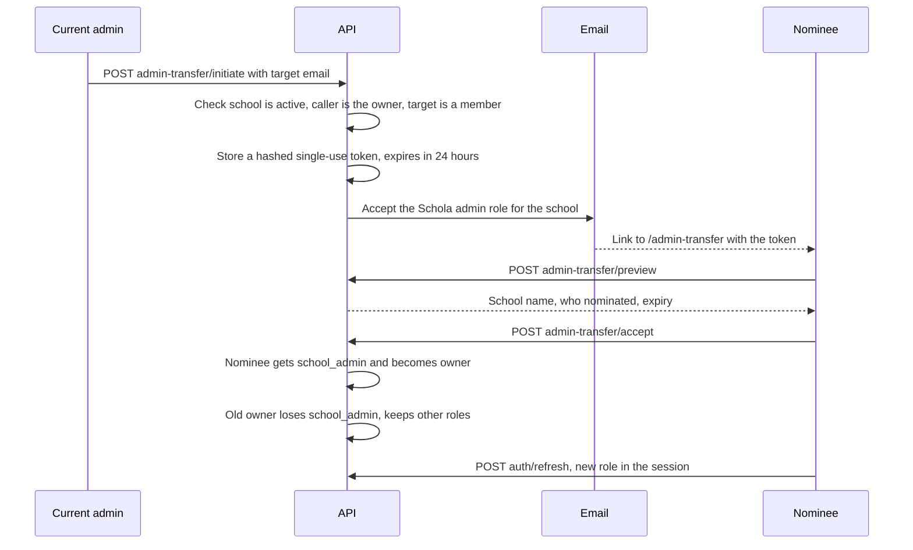

import { Aside, Steps, Card, CardGrid, LinkCard } from '@astrojs/starlight/components';
import ScreenAnatomy from '../../../../components/ScreenAnatomy.astro';
import SourceFile from '../../../../components/SourceFile.astro';
import Api from '../../../../components/Api.astro';
import Perm from '../../../../components/Perm.astro';
import Roles from '../../../../components/Roles.astro';
import Route from '../../../../components/Route.astro';
import DemoLogin from '../../../../components/DemoLogin.astro';

Each school has exactly one **owner**: the School Admin who applied for it or
was set up by the Super Admin. When that person leaves, the role has to move
to someone else — and because the School Admin controls everything, Schola
never moves it silently. The current admin **nominates** another member by
email; the nominee gets a single-use link that is valid for **24 hours** and
must **accept** it while signed in as themselves. If the admin is gone and
cannot nominate anyone, the **Super Admin** can force the transfer instead.

## At a glance

<CardGrid>
  <Card title="Who uses it" icon="star">
    <Roles list={['school_admin']} note="starts it" /> <Roles list={['principal', 'teacher']} note="any member can accept" /> <Roles list={['super_admin']} note="can force it" />
  </Card>
  <Card title="Where to find it" icon="laptop">
    <Route path="/app/settings" label="School settings → Transfer admin role" /> <Route path="/admin-transfer" label="Acceptance page" />
  </Card>
  <Card title="Permissions" icon="approve-check">
    Start: <Perm name="school:update:tenant" /> **and** being the owner. Accept: being the person the link was sent to. Force: <Perm name="admin_transfer:force" />.
  </Card>
</CardGrid>

<DemoLogin as="School Admin" email="admin@greenfield.example" go="/app/settings">
Nominate `principal@greenfield.example` (Richard Okafor), then accept as him
in a second browser.
</DemoLogin>

## How it works

What changes on acceptance:

| | Before | After |
|---|---|---|
| School owner | the current admin | the nominee |
| Nominee's roles | e.g. Principal | Principal **and** School Admin |
| Old admin's roles | School Admin (and any others) | Any others only |
| Audit log | `admin_transfer.initiate` (by the admin) | `admin_transfer.complete` (by the nominee, with old and new owner) |

## The screens

<ScreenAnatomy
  title="Transfer admin role"
  path="/app/settings"
  regions={[
    { label: 'School profile card', desc: 'The school details form (see School settings).', tone: 'muted' },
    { label: 'Transfer admin role card', desc: '"Nominate another existing user from your school to become the school admin. They\'ll receive an email with a link to accept it." — the field "Target user\'s email" and the button "Send transfer email". After sending: a green box "Transfer email sent. The new admin must accept before the link in it expires."', size: 3, tone: 'accent' },
  ]}
/>

<ScreenAnatomy
  title="Accept the admin role"
  path="/admin-transfer?token=…"
  regions={[
    { label: 'Card header', desc: 'The Schola mark and "Accept the admin role". The page has no sidebar.' },
    { label: 'Offer', desc: '"Amira Hossain has nominated you as the admin of Greenfield International School. As admin you manage every part of the school, including billing and roles. Amira Hossain will lose the admin role when you accept." — and "This link expires date."', size: 2, tone: 'accent' },
    { label: 'Buttons', desc: '"Accept admin role" (shield icon) and "Not now".' },
    { label: 'Other states', desc: '"This link is incomplete", "This link can\'t be used" (expired or used — "Ask the current admin to send a new one."), or "This transfer is for someone else" (shows which account you are signed in as) — each with "Go to my dashboard".', size: 2, tone: 'warn' },
  ]}
/>

## Step by step

### Nominate a new admin

<Steps>

1. Sign in as `admin@greenfield.example` and open **Administration →
   School settings**.
2. Scroll to **Transfer admin role**.
3. Type `principal@greenfield.example` in **Target user's email**.
4. Click **Send transfer email**. The button reads "Sending…", a toast says
   "Transfer email sent." and the card shows "Transfer email sent. The new
   admin must accept before the link in it expires." The email itself says
   how long: `ADMIN_TRANSFER_TTL_HOURS` (24 hours by default).
5. The nominee receives "Accept the Schola admin role for Greenfield
   International School". With no Resend key or SMTP host configured, the API
   prints the email to its console — copy the `/admin-transfer?token=…` link
   from there.

</Steps>

### Accept as the nominee

<Steps>

1. In a second browser (or a private window), open the link from the email.
   Signed out, you are sent to `/login` with the whole link, token included,
   kept in `?next=`. Sign in as `principal@greenfield.example`.
2. You land back on `/admin-transfer` with the token. The card "Accept the
   admin role" shows who nominated you, for which school, and when the link
   expires. (Already signed in? The link opens this card directly.)
3. Click **Accept admin role**. The button reads "Accepting…", then a toast
   says "You are now the school admin." The session is refreshed and you land
   on `/app` with the School Admin sidebar — Members & roles, Fees, Payroll
   and the rest.
4. Open **Members & roles**: Richard now shows **Principal** and **School
   admin · owner**. Amira's School Admin chip is gone.

</Steps>

<Aside type="danger" title="This changes the demo school">
Amira Hossain holds no other Greenfield role, so after the transfer she
loses access to the school. To hand it back, Richard nominates her — but she
is no longer a member, so that fails. Restore the demo with
`pnpm seed -- --reset`, or have the Super Admin grant Amira a Greenfield role
on [Platform users](/features/platform/users/) first.
</Aside>

### When the admin is unavailable: force it

<Steps>

1. Sign in as the Super Admin and open the school on **All schools**.
2. Click **Actions → Force admin transfer…**.
3. Enter the **New admin's email** (an existing member) and a **Reason**.
4. Click **Transfer ownership**. Ownership moves at once — no email, no
   acceptance — and every pending owner-initiated link for the school is
   cancelled. Full details on [Schools](/features/platform/schools/).

</Steps>

## Every action on this screen

### "Send transfer email"

<Api method="POST" path="admin-transfer/initiate" perm="school:update:tenant" />

Body `{ "targetEmail" }`. The API refuses when:

| Message | Why |
|---|---|
| Active school not found. | The school is not `active` (for example suspended). |
| Only the current school admin can initiate a transfer. | You hold School Admin but are not the school's owner. |
| Target user does not exist on this school. | No account (or a deleted one) uses that email. |
| Target user is not a member of this school. | The account holds no role here. |
| We couldn't email *address*, so the transfer wasn't started. Try again in a few minutes. | `503`: the email provider failed. The email is the only way the link reaches the nominee, so the token is deleted and nothing is audited; trying again issues a fresh link. |

On success it stores a hashed token (purpose `admin_transfer`) that expires
after `ADMIN_TRANSFER_TTL_HOURS` (24 hours by default), emails the link — the
email states that lifetime — and writes `admin_transfer.initiate`.

### Opening the link

The page first makes sure you are signed in (any school role or a visitor;
a Super Admin is sent to `/platform`), then asks for a preview. Only the
addressee sees the school and the nominator's name; anyone else is told the
transfer is for someone else.

<Api method="POST" path="admin-transfer/preview" />

The token travels in the request body, never in an API URL, so it stays out
of server logs.

### "Accept admin role"

<Api method="POST" path="admin-transfer/accept" />

Checks that the token exists, is unused and unexpired ("Invalid or expired
transfer token.") and that it was issued to you ("This transfer was issued to
a different user."). Then it gives you `school_admin`, removes it from the
nominator, sets you as the school's owner, marks the token used and writes
`admin_transfer.complete`. The page calls `POST auth/refresh` so your session
carries the new role, and sends you to `/app`.

### "Not now"

Goes to `/app` without accepting. The link stays usable until it expires.

### "Force admin transfer…" (Super Admin)

<Api method="POST" path="platform/schools/:id/force-admin-transfer" perm="admin_transfer:force" />

Audit action `school.force_admin_transfer`, with the reason. See
[Schools](/features/platform/schools/).

## Who sees what

| Role | Transfer card on School settings | Acceptance page |
|---|---|---|
| School Admin (owner) | Yes — can send | — |
| School Admin (not owner) | Yes, but sending is refused | — |
| Principal, Vice Principal, Accountant | No (they can view School settings, not edit) | Can accept a link addressed to them |
| Teacher, Student, Parent, Staff | No | Can accept a link addressed to them |
| Super Admin | — | Redirected to `/platform`; uses force transfer instead |

## Under the hood

- <SourceFile path="apps/web/src/app/(tenant)/app/settings/page.tsx" symbol="TransferForm" />.
- <SourceFile path="apps/web/src/app/admin-transfer/accept-transfer.tsx" symbol="AcceptTransfer" /> — the acceptance page and its states.
- <SourceFile path="apps/web/src/components/platform/force-transfer-dialog.tsx" symbol="ForceTransferDrawer" />.
- <SourceFile path="apps/api/src/modules/admin-transfer/admin-transfer.routes.ts" /> — `initiate`, `preview`, `accept`.
- <SourceFile path="apps/api/src/modules/admin-transfer/admin-transfer.service.ts" /> — `initiate`, `accept`, `preview`, `force` and `swapOwner`.
- <SourceFile path="apps/api/src/services/email/templates.ts" symbol="adminTransferTemplate" />.
- <SourceFile path="packages/validation/src/admin.ts" /> — `initiateAdminTransferSchema`, `acceptAdminTransferSchema`, `forceAdminTransferSchema`.
- <SourceFile path="packages/db/src/models/single-use-token.ts" /> — the token, its payload (school, from, to) and `consumedAt`.

The link lifetime comes from `ADMIN_TRANSFER_TTL_HOURS` (default 24).

## Edge cases and gotchas

- **Any member can be nominated.** The API only checks that the target holds
  a role at the school — a teacher, parent or even a student account would
  qualify.
- **No status page for pending transfers.** The admin cannot see or cancel a
  link once it is sent, and nobody is notified when it is accepted.
- **The old admin's open session.** If the old admin had no other role at the
  school, their requests start failing with "No active roles for this
  context". After signing in again they land on `/welcome` as a visitor.

<Aside type="caution" title="Older links stay valid">
Sending a second transfer email does not cancel the first, and accepting
one does not cancel the others — only a forced transfer does. If the admin
sends links to two people and both accept, the second acceptance moves
ownership to the second person, while the first keeps the School Admin role
(the code removes School Admin only from the original nominator). The result
is two School Admins. Send one link at a time.
</Aside>

## Related pages

<CardGrid>
  <LinkCard title="School settings and my profile" description="Where the Transfer admin role card lives." href="/features/school/settings-and-profile/" />
  <LinkCard title="Schools" description="The Super Admin's forced transfer." href="/features/platform/schools/" />
  <LinkCard title="Members and roles" description="See who owns the school after a transfer." href="/features/school/members-and-roles/" />
  <LinkCard title="Email and notifications" description="How the transfer email is sent." href="/architecture/email-and-notifications/" />
</CardGrid>
