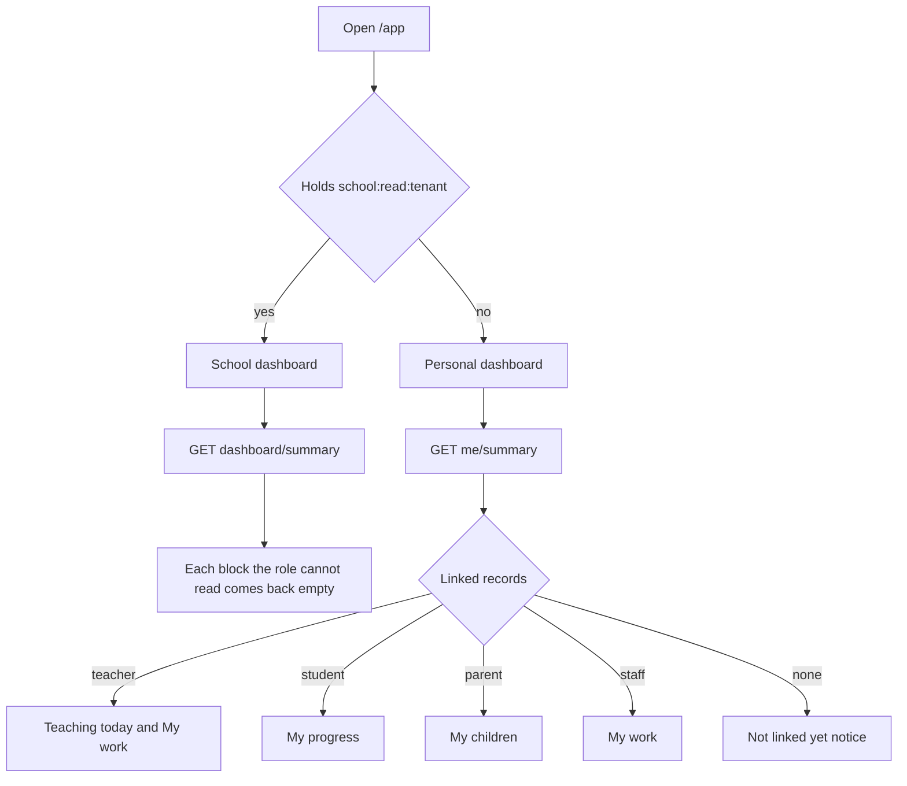

import { Aside, Steps, Tabs, TabItem, Card, CardGrid, LinkCard } from '@astrojs/starlight/components';
import ScreenAnatomy from '../../../../components/ScreenAnatomy.astro';
import SourceFile from '../../../../components/SourceFile.astro';
import Api from '../../../../components/Api.astro';
import Perm from '../../../../components/Perm.astro';
import Roles from '../../../../components/Roles.astro';
import Route from '../../../../components/Route.astro';
import DemoLogin from '../../../../components/DemoLogin.astro';
import Screenshot from '../../../../components/Screenshot.astro';
import { Tabs as ShotTabs, TabItem as ShotTab } from '@astrojs/starlight/components';

`/app` is the first page everyone inside a school sees after signing in, and
it is **two different dashboards**. People who look after the whole school —
the School Admin, Principal, Vice Principal and Accountant — get the **school
dashboard**: headcounts, fees, today's attendance and shortcuts, with a
set-up checklist for a brand-new school. Everyone else — Teachers, Students,
Parents and Staff — gets a **personal dashboard** built from the records their
sign-in is linked to: my sections, my progress, my children, my work.

## At a glance

<CardGrid>
  <Card title="Who uses it" icon="star">
    <Roles list={['school_admin', 'principal', 'vice_principal', 'accountant', 'teacher', 'student', 'parent', 'staff']} />
  </Card>
  <Card title="Where to find it" icon="laptop">
    <Route path="/app" /> — sidebar **Overview → Dashboard**
  </Card>
  <Card title="Permissions" icon="approve-check">
    <Perm name="school:read:tenant" /> decides which dashboard you get. Blocks inside the school dashboard need <Perm name="fee:read:tenant" /> or <Perm name="attendance:read:all" />.
  </Card>
</CardGrid>

<DemoLogin as="School Admin" email="admin@greenfield.example" go="/app" />

## How it works

The **school dashboard** makes one request. The API computes only the blocks
your permissions allow and returns `null` for the rest, so the page lays
itself out per role:

| Block | Needs | Shown as |
|---|---|---|
| Headcounts, set-up progress | <Perm name="school:read:tenant" /> | Students, Teachers tiles; People meters; checklist |
| Fees collected this month, outstanding, 14-day trend | <Perm name="fee:read:tenant" /> | Two money tiles and the "Fees collected" chart |
| Today's attendance | <Perm name="attendance:read:all" /> | "Attendance today" donut |

The **personal dashboard** asks for your own summary. A person can be linked
to more than one record — a teacher who is also a parent sees both blocks.

## The screens

Real screenshots from the seeded demo school (switch the docs theme to see dark mode):

<ShotTabs>
  <ShotTab label="School Admin">
    <Screenshot name="admin-dashboard" alt="School Admin dashboard" path="/app" />
  </ShotTab>
  <ShotTab label="Principal">
    <Screenshot name="principal-dashboard" alt="Principal dashboard" path="/app" />
  </ShotTab>
  <ShotTab label="Vice Principal">
    <Screenshot name="viceprincipal-dashboard" alt="Vice Principal dashboard" path="/app" />
  </ShotTab>
  <ShotTab label="Accountant">
    <Screenshot name="accountant-dashboard" alt="Accountant dashboard" path="/app" />
  </ShotTab>
  <ShotTab label="Teacher">
    <Screenshot name="teacher-dashboard" alt="Teacher dashboard" path="/app" />
  </ShotTab>
  <ShotTab label="Student">
    <Screenshot name="student-dashboard" alt="Student dashboard" path="/app" />
  </ShotTab>
  <ShotTab label="Parent">
    <Screenshot name="parent-dashboard" alt="Parent dashboard" path="/app" />
  </ShotTab>
  <ShotTab label="Staff">
    <Screenshot name="staff-dashboard" alt="Staff dashboard" path="/app" />
  </ShotTab>
</ShotTabs>

<ScreenAnatomy
  title="School dashboard"
  path="/app"
  regions={[
    { label: 'Sidebar', desc: 'The links your role can see; "Dashboard" highlighted.', area: 'sidebar' },
    { label: 'Top bar', desc: 'Breadcrumb "School / Dashboard", Home, "Load sample", notification bell, theme toggle, account menu.', area: 'top' },
    { label: 'Greeting', desc: '"Welcome, first name." — "Fees, attendance, and people for this school." Below it, for a new school, the "Get your school running" checklist.' },
    { label: 'Stat tiles', desc: 'Students, Teachers, then either "Collected this month" and "Fees outstanding" or "Classes" and "Present today".', tone: 'accent' },
    { label: 'Charts', desc: '"Fees collected — Last 14 days." (area chart) and "Attendance today — Marks recorded for today." (donut: Present, Absent, Late, Excused).', size: 2 },
    { label: 'People and shortcuts', desc: '"People — Headcount in this school." with bars for Students, Teachers, Parents, Staff; then shortcut cards: Take attendance, Classes & sections, Add a teacher, Add a student.', size: 2, tone: 'muted' },
  ]}
/>

<ScreenAnatomy
  title="Personal dashboard"
  path="/app"
  regions={[
    { label: 'Sidebar', desc: 'A short sidebar: Dashboard, the "My school" links, and the few modules the role can open.', area: 'sidebar' },
    { label: 'Greeting', desc: '"Welcome, first name." — "Your day at Greenfield International School."' },
    { label: 'Teaching today', desc: 'Teachers only: My sections, Students and Registers to take tiles, and a "My sections" list with a Register button per section.', size: 2, tone: 'accent' },
    { label: 'My progress / My children', desc: 'Students: four tiles about themselves. Parents: one card per child.', size: 2 },
    { label: 'My work', desc: 'Teachers and Staff: today\'s staff attendance, this month\'s days present and the latest payslip.', tone: 'muted' },
  ]}
/>

## What each role sees

<Tabs>
<TabItem label="School Admin">

<DemoLogin as="School Admin" email="admin@greenfield.example" go="/app" />

- **Checklist** "Get your school running" while any of its eight steps is
  open (it needs <Perm name="class:create" />).
- **Tiles**: Students (500), Teachers (30), Collected this month, Fees
  outstanding — in dollars.
- **Charts**: "Fees collected" over the last 14 days and "Attendance today".
- **People** meters for Students, Teachers, Parents and Staff.
- **Shortcuts**: Take attendance, Classes & sections, Add a teacher, Add a
  student.

</TabItem>
<TabItem label="Principal">

<DemoLogin as="Principal" email="principal@greenfield.example" go="/app" />

- **Checklist** while set-up is incomplete (the Principal can create classes).
- **Tiles**: Students, Teachers, Classes (10), Present today — the Principal
  has no finance permission, so the money tiles are replaced.
- **Charts**: only "Attendance today", full width.
- **People** meters.
- **Shortcuts**: Classes & sections, Add a student.

</TabItem>
<TabItem label="Vice Principal">

<DemoLogin as="Vice Principal" email="viceprincipal@greenfield.example" go="/app" />

- **No checklist** — the Vice Principal cannot create classes.
- **Tiles**: Students, Teachers, Classes, Present today.
- **Charts**: "Attendance today", full width.
- **People** meters.
- **Shortcuts**: Classes & sections only.

</TabItem>
<TabItem label="Accountant">

<DemoLogin as="Accountant" email="accountant@greenfield.example" go="/app" />

- **No checklist.**
- **Tiles**: Students, Teachers, Collected this month, Fees outstanding.
- **Charts**: "Fees collected", full width — the Accountant cannot read
  school-wide attendance, so there is no donut.
- **People** meters.
- **Shortcuts**: Classes & sections only — the Accountant reads classes and
  sections (read only), which the Fees screen needs to bill a section.

</TabItem>
<TabItem label="Teacher">

<DemoLogin as="Teacher" email="teacher@greenfield.example" go="/app">
Grace Mensah is the class teacher of Grade 3 and leads Grade 3 · A.
</DemoLogin>

- **Teaching today**: tiles **My sections** (2 — Grade 3 · A and B, because a
  class teacher owns every section of the class), **Students** (the enrolled
  total) and **Registers to take** (amber with "Not marked yet today", green
  with "All marked").
- **My sections** card — "Take attendance or enter marks." Each row: "Grade
  3 · Section A", "25 students", a "Marked today" or "Not marked" pill and a
  **Register** button that opens `/app/attendance?section=…`.
- **My work**: **Today** (your own staff attendance, or "Not marked"), **This
  month** ("days present / days marked", hint "Days present (incl. late)"),
  **Latest payslip** (net amount, month, year and status), with **My
  attendance** and **My payslips** buttons.

</TabItem>
<TabItem label="Student">

<DemoLogin as="Student" email="student@greenfield.example" go="/app" />

- **My progress**, four tiles:
  - **Today** — your attendance pill or "Not marked", with "Grade 8 ·
    *section*" underneath.
  - **Attendance this year** — a percentage and "x of y days"; green at 90%
    or more, amber from 75%, red below.
  - **Latest exam** — the percentage and "Term 1 — Midterm · Grade *letter*",
    or "No marks yet".
  - **Fees due** — the amount, with "Next due *date*", "Overdue since *date*"
    (red) or "Nothing due".
- Buttons **Attendance**, **Grades** and **Fees** open `/app/my/attendance`,
  `/app/my/grades` and `/app/my/fees`.

</TabItem>
<TabItem label="Parent">

<DemoLogin as="Parent" email="parent@greenfield.example" go="/app" />

- **My children** — one card per child (the demo parent has two). The card
  header shows the child's initials, name and "Grade · Section", and opens
  `/app/children/[id]`.
- Three cells per card: **Today** (attendance pill), **Attendance** (this
  year's rate) and **Fees due** (red when an invoice is overdue).
- With no children linked: "No children linked yet — The school links
  children to your parent record."

</TabItem>
<TabItem label="Staff">

<DemoLogin as="Staff" email="staff@greenfield.example" go="/app">
Ruby Novak, Librarian.
</DemoLogin>

- **My work** only: **Today**, **This month** and **Latest payslip** tiles,
  with **My attendance** and **My payslips** buttons.

</TabItem>
</Tabs>

## Step by step

<Steps>

1. Sign in as `admin@greenfield.example`. You land on `/app` and see
   "Welcome, Amira."
2. Point at the four tiles: Students, Teachers, Collected this month and Fees
   outstanding.
3. Hover the **Fees collected** chart to read a day's total, then the
   **Attendance today** donut for present, absent, late and excused counts.
4. Scroll to **People** and compare the four headcount bars.
5. Click the **Take attendance** shortcut — it opens the register at
   `/app/attendance`. Go back.
6. Click **Load sample** in the top bar. The dashboard reloads with an
   in-browser demo school and a "Demo school." banner. Click **Show real
   data** to return.
7. Sign out and sign in as `teacher@greenfield.example`. The same `/app`
   now shows "Teaching today" with Grace's two sections and a **Register**
   button on each.

</Steps>

## Every action on this screen

### Loading the school dashboard

<Api method="GET" path="dashboard/summary" />

No single permission guards the route — it needs a school context, and each
block checks its own permission. Response blocks: `counts` (students,
teachers, staff, parents, classes, sections), `finance` (outstanding,
collected this month, payroll pending this month and its count),
`attendance` (today's present, absent, late, excused and the number of
sections marked), `setup` (academic years, current year name, subjects,
enrolled students) and `feesTrend` (daily totals for 14 days).

### Loading the personal dashboard

<Api method="GET" path="me/summary" />

Returns the school's name, currency and locale, which records you are linked
to, and the snapshot blocks `student`, `children`, `teaching` and `employee`.

### The "Get your school running" checklist

Eight steps, each a link, worked top to bottom. The next open step is
highlighted; done steps are struck through. The card disappears once all are
done.

| Step | Done when | Opens |
|---|---|---|
| 1. Create the academic year | at least one academic year | `/app/academic-years` |
| 2. Add subjects | at least one subject | `/app/subjects` |
| 3. Create classes | at least one class | `/app/classes` |
| 4. Add sections to each class | at least one section | `/app/classes` |
| 5. Add teachers | at least one teacher | `/app/teachers` |
| 6. Add students | at least one student | `/app/students` |
| 7. Enroll students in sections | at least one active enrolment | `/app/classes` |
| 8. Take today's attendance | at least one section marked today | `/app/attendance` |

### Shortcut cards

| Card | Shown with | Opens |
|---|---|---|
| Take attendance | <Perm name="attendance:mark" /> | `/app/attendance` |
| Classes & sections | <Perm name="class:create" /> or <Perm name="class:read" /> | `/app/classes` |
| Add a teacher | <Perm name="teacher:create" /> | `/app/teachers` |
| Add a student | <Perm name="student:create" /> | `/app/students` |

### "Register" (Teacher)

Opens the attendance register already filtered to that section. See
[Attendance](/features/daily/attendance/).

## Who sees what

| Role | Dashboard | Money tiles and fee chart | Attendance donut | Checklist |
|---|---|---|---|---|
| School Admin | School | Yes | Yes | Yes |
| Principal | School | — | Yes | Yes |
| Vice Principal | School | — | Yes | — |
| Accountant | School | Yes | — | — |
| Teacher | Personal: Teaching today, My work | — | — | — |
| Student | Personal: My progress | — | — | — |
| Parent | Personal: My children | — | — | — |
| Staff | Personal: My work | — | — | — |

## Under the hood

- <SourceFile path="apps/web/src/app/(tenant)/app/page.tsx" symbol="AppHome" /> — picks the dashboard; `SchoolDashboard`, `SetupChecklist`, `SHORTCUTS`.
- <SourceFile path="apps/web/src/components/dashboard/member-dashboard.tsx" symbol="MemberDashboard" /> — the personal dashboard.
- <SourceFile path="apps/web/src/components/dashboard/charts.tsx" /> — `TrendChart`, `SplitChart`, `fillRecentDays`.
- <SourceFile path="apps/api/src/modules/dashboard/dashboard.routes.ts" /> — `GET /dashboard/summary`.
- <SourceFile path="apps/api/src/modules/me/me.routes.ts" /> — `GET /me/summary`.
- <SourceFile path="apps/api/src/services/scopes/teacher-scope.ts" symbol="resolveOwnSectionIds" /> — a teacher's sections: those they lead plus every section of a class they are class teacher of.

The dashboard only reads, so it writes nothing to the audit log.

## Edge cases and gotchas

- **"Today" is a UTC day.** Attendance counts and "Registers to take" use the
  current UTC date.
- **The demo checklist depends on the day.** The seed takes today's
  attendance on the day it runs. On a later day step 8 is open again, so the
  School Admin and Principal see "7 of 8 steps done" until someone takes a
  register.
- **Payroll pending is fetched but not shown.** The summary includes this
  month's pending payroll, but no tile displays it.
- **"Load sample" covers the school dashboard only.** The personal dashboard
  always reads the real API.
- **Not linked yet.** A Teacher, Student, Parent or Staff sign-in without a
  matching record sees "Your account isn't linked to a record yet — Ask the
  school office to link your sign-in…".

<Aside type="caution" title="School dashboard money is always in dollars">
The school dashboard formats amounts with a fixed `en-US` / `USD` formatter
(`money` in `apps/web/src/app/(tenant)/app/page.tsx`), whatever currency the
school chose in [School settings](/features/school/settings-and-profile/).
The personal dashboard uses the school's currency and locale. A school that
switches to, say, `EUR` will see euros for families and dollar signs for
staff.
</Aside>

## Related pages

<CardGrid>
  <LinkCard title="Features overview" description="Which sidebar links each role gets." href="/features/overview/" />
  <LinkCard title="Set up academics (tutorial)" description="Work through the checklist on a new school." href="/tutorial/set-up-academics/" />
  <LinkCard title="Teacher portal" description="Everything behind 'Teaching today'." href="/features/portals/teacher/" />
  <LinkCard title="Parent portal" description="Everything behind 'My children'." href="/features/portals/parent/" />
</CardGrid>
