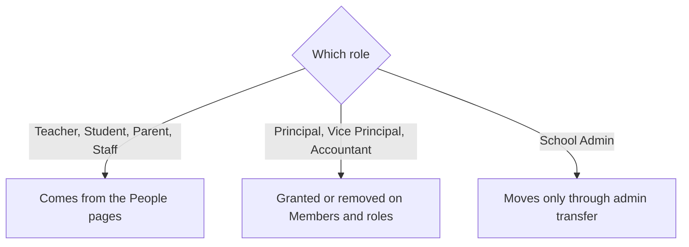

import { Aside, Steps, Card, CardGrid, LinkCard } from '@astrojs/starlight/components';
import Pipeline from '../../../../components/Pipeline.astro';
import ScreenAnatomy from '../../../../components/ScreenAnatomy.astro';
import SourceFile from '../../../../components/SourceFile.astro';
import Api from '../../../../components/Api.astro';
import Perm from '../../../../components/Perm.astro';
import Roles from '../../../../components/Roles.astro';
import Route from '../../../../components/Route.astro';
import DemoLogin from '../../../../components/DemoLogin.astro';
import Screenshot from '../../../../components/Screenshot.astro';

Every person who can sign in to a school is a **member**: they hold at least
one role there. Most roles come from a people record — adding a teacher on
the Teachers page creates their sign-in with the Teacher role, and the same
goes for students, parents and staff. Three roles have no record of their
own: **Principal**, **Vice Principal** and **Accountant**. They are given to
someone who is already a member, and **Members & roles** is where the School
Admin does that. The page also shows every member's roles at a glance and
when they last signed in.

## At a glance

<CardGrid>
  <Card title="Who uses it" icon="star">
    <Roles list={['school_admin']} />
  </Card>
  <Card title="Where to find it" icon="laptop">
    <Route path="/app/members" /> — sidebar **Administration → Members & roles**
  </Card>
  <Card title="Permissions" icon="approve-check">
    <Perm name="user:assign_role:tenant" /> — the whole page and all three endpoints.
  </Card>
</CardGrid>

<DemoLogin as="School Admin" email="admin@greenfield.example" go="/app/members" />

## How it works

<Pipeline
  caption="How a person ends up with a staff role."
  steps={[
    { label: 'Add a record', icon: 'user-plus', note: 'Teachers, Staff, Students or Parents page' },
    { label: 'Sign-in created', icon: 'mail', note: 'Set-password email' },
    { label: 'Member', icon: 'users', note: 'Listed on Members & roles' },
    { label: 'Grant role', icon: 'user-cog', note: 'Principal, Vice Principal or Accountant' },
    { label: 'New permissions', icon: 'shield', note: 'Next request, next reload' },
  ]}
/>

A person can hold several roles at once. Their permissions are the union of
all of them, and their **primary role** — the one shown in the sidebar
footer and recorded in the audit log — is the highest-ranking one: School
Admin, then Principal, Vice Principal, Accountant, Teacher, Staff, Parent,
Student.

## The screen

<Screenshot name="admin-members" alt="Everyone with access to the school" path="/app/members" />

<ScreenAnatomy
  title="Members & roles"
  path="/app/members"
  regions={[
    { label: 'Sidebar', desc: '"Members & roles" highlighted under Administration.', area: 'sidebar' },
    { label: 'Top bar', desc: 'Breadcrumb "School / Members & roles".', area: 'top' },
    { label: 'Page header', desc: '"Members & roles" — "Everyone with a sign-in at this school. Give staff the principal, vice principal or accountant role here."' },
    { label: 'Toolbar', desc: 'Search "Search name or email" and a role filter: All roles, School admin, Principal, Vice principal, Teacher, Accountant, Student, Parent, Staff.', tone: 'muted' },
    { label: 'Members table', desc: 'Member (name, "(you)", email), Roles (chips; "School admin · owner"; an × on removable staff roles), Last sign-in (a date or "Never"), Add role (a role picker and "Add", or "All staff roles held"). A pager below.', size: 4, tone: 'accent' },
    { label: 'Footnote', desc: '"Teachers, students, parents and staff get their sign-in from the People pages. The school admin role moves only through Settings → Transfer admin role."', tone: 'muted' },
  ]}
/>

## Step by step

### Give a teacher the Vice Principal role

<Steps>

1. Sign in as the School Admin and click **Administration → Members &
   roles**.
2. Type `farida` in **Search name or email**. Farida Begum appears with one
   chip: **Teacher**.
3. In her **Add role** cell, open the picker and choose **Vice principal**.
4. Click **Add**. A toast says "Role added." Her Roles cell now shows
   **Teacher** and **Vice principal**, and the Vice principal chip has a small
   **×**.
5. When Farida next loads a page, she has the Vice Principal permissions too
   — Academic years, Reports, Admissions and the rest appear in her sidebar —
   and her primary role becomes Vice Principal.

</Steps>

### Remove the role again

<Steps>

1. Click the **×** on Farida's **Vice principal** chip.
2. The dialog asks "Remove Vice principal from Farida?" — "They keep their
   other roles at this school."
3. Click **Remove role** (or **Cancel**). The button reads "Removing…", then a
   toast says "Role removed."

</Steps>

### Filter by role

<Steps>

1. Open the role filter and choose **Teacher**. Only members holding the
   Teacher role are listed (30 at Greenfield), 25 per page.
2. Use the pager to move between pages. The search and filter are kept in the
   page URL, so you can share or bookmark a filtered view.

</Steps>

## Adding and removing members

There is no "invite member" button on this page, by design:

| To… | Do this |
|---|---|
| Give someone a sign-in as Teacher, Staff, Student or Parent | Add their record with an email on [Teachers](/features/people/teachers/), [Staff](/features/people/staff/), [Students](/features/people/students/) or [Parents](/features/people/parents/). They receive a set-password email. |
| Make someone Principal, Vice Principal or Accountant | They must be a member first (usually a Teacher or Staff record), then **Add** the role here. |
| Make someone School Admin | Use [Admin transfer](/features/school/admin-transfer/). |
| Remove someone from the school | Delete their people record. This page refuses to remove a member's last role. |

## Every action on this screen

### Loading the list

<Api method="GET" path="members" perm="user:assign_role:tenant" />

Query: `q` (name or email), `role` (any school role), `page`, `pageSize`
(25). Every account holding a role at this school is included, sorted by
first name. Each row says whether the person is the school's owner and
whether it is you.

### "Add" (grant a role)

<Api method="POST" path="members/:id/roles" perm="user:assign_role:tenant" />

Body `{ "role": "principal" | "vice_principal" | "accountant" }`. The person
must already hold a role at this school ("That person is not a member of
this school."). Adding a role they already have changes nothing. Audit
action `user_role.grant` with the role list before and after.

### "×" → "Remove role" (revoke a role)

<Api method="DELETE" path="members/:id/roles/:role" perm="user:assign_role:tenant" />

Only the three staff roles can be removed here. The API refuses a role the
person does not hold ("Role not held.") and refuses to remove their **only**
role: "This is their only role here. Give them another role first, or remove
them from People." Audit action `user_role.revoke`.

## Who sees what

| Role | Members & roles |
|---|---|
| <Roles list={['school_admin']} /> | The page, all actions |
| Principal, Vice Principal, Accountant | Not in the sidebar; the API answers "Missing permission: user:assign_role:tenant" |
| Teacher, Student, Parent, Staff | No access |
| Super Admin | Uses [Platform users](/features/platform/users/) → Manage roles for any school |

## Under the hood

- <SourceFile path="apps/web/src/app/(tenant)/app/members/page.tsx" symbol="MembersPage" /> — the table, `AddRole` and the confirm dialog.
- <SourceFile path="apps/api/src/modules/members/members.routes.ts" /> — list, grant and revoke.
- <SourceFile path="apps/api/src/repositories/membership.repo.ts" /> — `grantTenantRole`, `removeTenantMembership`, `tenantRoleKeysByUser`.
- <SourceFile path="apps/api/src/services/rbac/sync-role-keys.ts" symbol="syncUserRoleKeys" /> — keeps the role cache on the user in step after each change.
- <SourceFile path="packages/validation/src/admin.ts" symbol="TENANT_ASSIGNABLE_ROLES" /> — `memberRoleSchema`, `listMembersQuery`.
- <SourceFile path="apps/api/src/services/rbac/resolver.ts" /> — permissions are re-resolved from the database on every request.

## Edge cases and gotchas

- **The × only appears with two or more roles.** A member whose only role is
  Principal (like the demo's Richard Okafor) shows no ×. They also have no
  people record, so the School Admin cannot remove them from the school at
  all — only a Super Admin can, on [Platform users](/features/platform/users/).
- **Instant on the server, on reload in the browser.** The API resolves
  permissions from the database on every request, so a granted role works at
  once. The person's sidebar changes when their page reloads the session.
- **You can change your own roles.** Nothing stops the School Admin adding or
  removing a staff role on their own row.
- **Last sign-in.** The column shows the last successful sign-in (password or
  social). It is hidden on phones.
- **Removing a role does not end sessions.** The person stays signed in; they
  simply lose that role's permissions on their next request.

## Related pages

<CardGrid>
  <LinkCard title="Admin transfer" description="The only way the School Admin role moves." href="/features/school/admin-transfer/" />
  <LinkCard title="Staff" description="Add a non-teaching member — then grant Accountant here." href="/features/people/staff/" />
  <LinkCard title="Roles reference" description="What each role can do by default." href="/reference/roles/" />
  <LinkCard title="Role-based access control" description="Roles, permissions and the primary role." href="/architecture/rbac/" />
</CardGrid>
