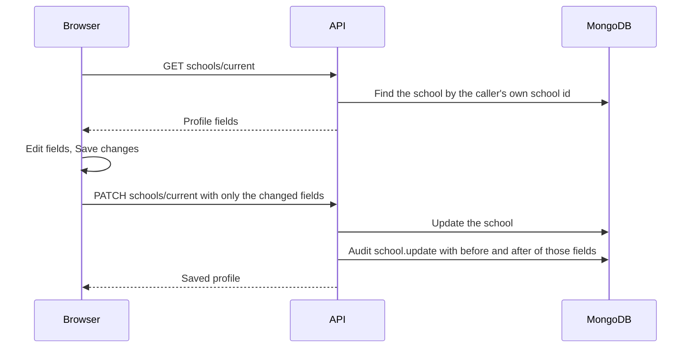

import { Aside, Steps, Tabs, TabItem, Card, CardGrid, LinkCard } from '@astrojs/starlight/components';
import ScreenAnatomy from '../../../../components/ScreenAnatomy.astro';
import SourceFile from '../../../../components/SourceFile.astro';
import Api from '../../../../components/Api.astro';
import Perm from '../../../../components/Perm.astro';
import Roles from '../../../../components/Roles.astro';
import Route from '../../../../components/Route.astro';
import DemoLogin from '../../../../components/DemoLogin.astro';
import Screenshot from '../../../../components/Screenshot.astro';
import { Tabs as ShotTabs, TabItem as ShotTab } from '@astrojs/starlight/components';

Two pages hold "settings" in the school app, and they answer different
questions. **School settings** (`/app/settings`) is about the *school*: its
name, type, address, contact details, and the locale and currency used on
receipts, payslips and family-facing amounts. Only the School Admin can
change it; senior staff can read it. **My profile** (`/app/profile`) is about
*you*: your name and phone, your password, and the devices where you are
signed in. Every member of the school has it.

## At a glance

<CardGrid>
  <Card title="Who uses it" icon="star">
    School settings: <Roles list={['school_admin', 'principal', 'vice_principal', 'accountant']} /> · My profile: <Roles list={['school_admin', 'teacher', 'student', 'parent', 'staff']} note="every school role" />
  </Card>
  <Card title="Where to find it" icon="laptop">
    <Route path="/app/settings" /> (Administration → School settings) · <Route path="/app/profile" /> (Account → My profile)
  </Card>
  <Card title="Permissions" icon="approve-check">
    <Perm name="school:read:tenant" /> to view and <Perm name="school:update:tenant" /> to edit the school. My profile needs only a signed-in school member.
  </Card>
</CardGrid>

<DemoLogin as="School Admin" email="admin@greenfield.example" go="/app/settings" />

## How it works

The school is never looked up by an id from the request — always by the
school id in your session — so a School Admin can only ever edit their own
school. Status, approval and ownership are not editable here: those belong to
the [Super Admin](/features/platform/schools/) and the
[admin transfer](/features/school/admin-transfer/).

**My profile** talks to the `me` endpoints, which act only on the signed-in
account.

## The screens

Real screenshots from the seeded demo school (switch the docs theme to see dark mode):

<ShotTabs>
  <ShotTab label="School settings">
    <Screenshot name="admin-settings" alt="School settings" path="/app/settings" />
  </ShotTab>
  <ShotTab label="My profile">
    <Screenshot name="admin-profile" alt="The signed-in user’s profile" path="/app/profile" />
  </ShotTab>
</ShotTabs>

<ScreenAnatomy
  title="School settings"
  path="/app/settings"
  regions={[
    { label: 'Sidebar', desc: '"School settings" highlighted under Administration.', area: 'sidebar' },
    { label: 'Page header', desc: '"School settings" — "School details and admin transfer. Your own account lives in My profile."' },
    { label: 'School profile card', desc: '"School profile — Shown on receipts, payslips, report cards and emails." School name, Type, Expected students, Address, Contact email, Contact phone, Locale ("Dates and numbers, e.g. en-US"), Currency ("3-letter code, e.g. USD") and "Save changes".', size: 4, tone: 'accent' },
    { label: 'Transfer admin role card', desc: 'School Admin only: "Nominate another existing user from your school to become the school admin. They\'ll receive an email with a link to accept it." Target user\'s email and "Send transfer email".', size: 2, tone: 'warn' },
  ]}
/>

<ScreenAnatomy
  title="My profile"
  path="/app/profile"
  regions={[
    { label: 'Page header', desc: '"My profile" — "Your account, password and signed-in devices."' },
    { label: 'Account card', desc: '"Account — How your name appears across the school." First name, Last name, Phone ("Stored encrypted. Leave empty to remove."), Email (read-only, hint Verified or Not verified yet), then Role, School and Member since, and "Save changes".', size: 2, tone: 'accent' },
    { label: 'Password card', desc: '"Change password — Other devices are signed out when you change it." Current password, New password, a strength meter and "Change password". Google-only accounts see "Set a password" instead.', size: 2 },
    { label: 'Signed-in devices card', desc: '"Where your account is signed in right now." One row per device: browser and system (e.g. "Chrome on macOS"), "This device", IP and last active date, a "Sign out" button per other device, and "Sign out of all other devices".', size: 2, tone: 'warn' },
  ]}
/>

## Step by step

<Tabs>
<TabItem label="Edit the school profile">

<Steps>

1. Sign in as `admin@greenfield.example` and click **Administration →
   School settings**.
2. The **School profile** card loads Greenfield's details. The **Save
   changes** button is greyed out until you change something.
3. Change **Contact phone** to `+1 555 010 2001`.
4. Click **Save changes**. The button reads "Saving…", then a toast says
   "School profile saved." and the button greys out again.
5. To see the read-only view, sign in as `principal@greenfield.example` and
   open the same page: every field is disabled and the card ends with "Only
   the school admin can change these details." The transfer card is not
   shown.

</Steps>

</TabItem>
<TabItem label="Update my name and phone">

<Steps>

1. Click your avatar → **My profile** (or **Account → My profile** in the
   sidebar).
2. In **Account**, change **First name** or **Phone**. Leave Phone empty to
   remove the number.
3. Click **Save changes**. A toast says "Profile saved." Your new name shows
   in the sidebar footer and the account menu straight away.

</Steps>

</TabItem>
<TabItem label="Change my password">

<Steps>

1. On **My profile**, find the **Change password** card.
2. Type your **Current password** (`Schola@2026` for demo accounts) and a
   **New password**. The strength meter appears once you start typing.
3. Click **Change password**. A toast says "Password changed." — or "Password
   changed. Signed out of 2 other devices." when other sessions existed.
4. A wrong current password shows "Current password is incorrect." under the
   field.

</Steps>

</TabItem>
<TabItem label="Sign out other devices">

<Steps>

1. Sign in to the same account in a second browser.
2. In the first browser, open **My profile → Signed-in devices**. Two rows
   appear; yours is marked **This device**.
3. Click **Sign out** on the other row. A toast says "Device signed out." and
   the row disappears.
4. Or click **Sign out of all other devices**. A toast says "Signed out of 1
   device." (or "No other devices were signed in.").

</Steps>

</TabItem>
</Tabs>

## Every action on this screen

### Loading the school profile

<Api method="GET" path="schools/current" perm="school:read:tenant" />

Returns name, type, address, contact email and phone, expected student count,
locale, currency, status, approval date and creation date.

### "Save changes" (School profile)

<Api method="PATCH" path="schools/current" perm="school:update:tenant" />

The page sends **only the fields you changed**. Rules:

| Field | Rule |
|---|---|
| School name | 2–120 characters |
| Type | `school`, `college`, `institute` or `coaching` (shown as School, College, Institute, Coaching centre) |
| Address | 2–240 characters |
| Contact email | a valid email |
| Contact phone | 7–20 digits, spaces or dashes, optional leading `+` |
| Expected students | whole number, 0–1,000,000 |
| Locale | like `en-US` — "Use a locale like en-US." |
| Currency | three letters, upper-cased — "Use a 3-letter currency code like USD." |

The audit entry `school.update` holds the before and after values of just the
changed fields. Field errors from the API appear under the matching input.

### "Send transfer email"

Starts the School Admin hand-over. Covered on [Admin transfer](/features/school/admin-transfer/).

<Api method="POST" path="admin-transfer/initiate" perm="school:update:tenant" />

### Loading my profile

<Api method="GET" path="me/profile" />

Returns your account, your role, your school and whether you have a password.

### "Save changes" (Account)

<Api method="PATCH" path="me/profile" />

First and last name 1–80 characters; phone a valid number or empty to clear
it. The phone is stored encrypted. Audit action `user.profile.update`. The
email cannot be changed here.

### "Change password" / "Set password"

<Api method="POST" path="me/password" />

With a password on file, the current one is checked first. The new one must
pass the usual rule (8+ characters, upper, lower, digit). On success the API
also clears any login lock, adds "password" to your sign-in methods and
revokes every **other** session — this device stays signed in. Audit action
`auth.password.change` with the number of sessions revoked.

### "Sign out" and "Sign out of all other devices"

<Api method="GET" path="me/sessions" /> <Api method="DELETE" path="me/sessions/:id" /> <Api method="POST" path="me/sessions/revoke-others" />

A session is one refresh token. Signing a device out revokes its refresh
token (audit `auth.session.revoke`); "all other devices" revokes every one
except the current (audit `auth.session.revoke_others`). The current device
has no **Sign out** button — use **Log out** in the account menu.

## Who sees what

| Role | School settings | Transfer card | My profile |
|---|---|---|---|
| School Admin | View and edit | Yes | Yes |
| Principal, Vice Principal, Accountant | View only | — | Yes |
| Teacher, Student, Parent, Staff | Not in the sidebar; the API refuses | — | Yes |
| Super Admin | — | — | Not available (the platform has no profile page) |

## Under the hood

- <SourceFile path="apps/web/src/app/(tenant)/app/settings/page.tsx" /> — the page and `TransferForm`.
- <SourceFile path="apps/web/src/components/school/school-profile-form.tsx" symbol="SchoolProfileCard" /> — the profile form; sends only dirty fields.
- <SourceFile path="apps/web/src/app/(tenant)/app/profile/page.tsx" /> — `DetailsCard`, `PasswordCard`, `SessionsCard`.
- <SourceFile path="apps/api/src/modules/schools/school-profile.routes.ts" /> — `GET` and `PATCH /schools/current`.
- <SourceFile path="apps/api/src/modules/me/me.routes.ts" /> — profile, password and sessions.
- <SourceFile path="packages/validation/src/schools.ts" symbol="updateSchoolProfileSchema" /> and <SourceFile path="packages/validation/src/me.ts" /> (`updateMyProfileSchema`, `changeMyPasswordSchema`).
- <SourceFile path="packages/db/src/models/school.ts" /> — `locale` and `currency` default to `en-US` and `USD`.

### Where locale and currency are used

The school's currency and locale feed the PDFs (receipts, payslips, report
cards), fee invoices, Stripe checkout, payroll and reports on the API side,
and the family-facing amounts on the personal dashboard and portals.

## Edge cases and gotchas

- **No logo, no colours.** The school profile has no logo or branding field;
  the app always shows the Schola mark.
- **Platform defaults do not flow in.** The Super Admin's
  [Locale setting](/features/platform/settings/) is not read when a school is
  created; schools start at `en-US` and `USD` and change it here.
- **The school dashboard still shows dollars.** Its money tiles use a fixed
  USD formatter; see [School dashboard](/features/school/dashboard/#edge-cases-and-gotchas).
- **"Last active" is the last token refresh.** The devices list shows when
  that session's refresh token was issued, which is updated each time the
  session renews.
- **Signing a device out is not instant.** The other device keeps its
  15-minute access token and is signed out when that expires and the refresh
  is refused.
- **Super Admins have no profile page.** `/app/profile` lives in the school
  app; a Super Admin changes their password with **Forgot?** on the login
  page.

## Related pages

<CardGrid>
  <LinkCard title="Admin transfer" description="Hand the School Admin role to another member." href="/features/school/admin-transfer/" />
  <LinkCard title="Sign up and sign in" description="Password rules, reset links and logout." href="/features/accounts/sign-up-and-sign-in/" />
  <LinkCard title="Encryption" description="How phone numbers and other personal data are encrypted." href="/setup/services/encryption/" />
  <LinkCard title="Authentication" description="Sessions, refresh tokens and revocation." href="/architecture/authentication/" />
</CardGrid>
