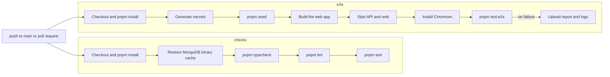

import { Aside, Card, CardGrid, LinkCard, Steps } from '@astrojs/starlight/components';
import Pipeline from '../../../components/Pipeline.astro';
import SourceFile from '../../../components/SourceFile.astro';

**Continuous integration (CI)** means a server runs the project's checks on
every push and pull request, so a broken change is caught before it is merged.
Schola has one CI workflow for GitHub Actions. It runs two jobs side by side:
**checks** (type-check, lint, unit and integration tests) and **e2e** (the
Playwright suite against a real API, a real web build and a seeded MongoDB).

:::danger[CI is not running today]
GitHub only runs workflows stored in `.github/workflows/`. In this repository
the folder is named **`_.github`** — the workflow is at
`_.github/workflows/ci.yml`. Commit `dff8604` ("github revoked", 1 November
2026) renamed `.github` to `_.github`, which switched CI off without deleting
it. Until the folder is renamed back, pushes and pull requests run **no**
checks; run them yourself before merging (see
[Run the same checks locally](#run-the-same-checks-locally)).
:::

## At a glance

<CardGrid>
  <Card title="Where" icon="document">
    `_.github/workflows/ci.yml` (inactive). Rename the folder to `.github` to
    turn it on.
  </Card>
  <Card title="When" icon="clock">
    Every push to `main` and every pull request. A newer run on the same ref
    cancels the older one.
  </Card>
  <Card title="Jobs" icon="list-format">
    `checks` (30 min limit) and `e2e` (40 min limit), in parallel on
    `ubuntu-latest`.
  </Card>
  <Card title="Secrets" icon="padlock">
    None. The e2e job generates throwaway secrets per run and switches every
    external service off.
  </Card>
</CardGrid>

## The workflow

<SourceFile path="_.github/workflows/ci.yml" />



Top-level settings:

| Setting | Value | Why |
| --- | --- | --- |
| `on` | `push: branches: [main]`, `pull_request` | Every PR and every commit that lands on `main`. |
| `concurrency` | `group: ci-${{ github.ref }}`, `cancel-in-progress: true` | A new push to the same branch stops the run that is now out of date. |
| `permissions` | `contents: read` | The jobs only read the repository. |

### Job 1 — checks

"Typecheck, lint, unit + integration tests". `ubuntu-latest`, 30-minute limit.

| Step | What it does |
| --- | --- |
| `actions/checkout@v4` | Check out the commit. |
| `pnpm/action-setup@v4` | Install pnpm. The version comes from `packageManager` in the root `package.json` (`pnpm@9.15.0`). |
| `actions/setup-node@v4` with `node-version: 22`, `cache: pnpm` | Install Node 22 and restore the pnpm store cache. |
| `pnpm install --frozen-lockfile` | Install exactly what `pnpm-lock.yaml` says; fail if the lockfile is out of date. |
| `actions/cache@v4` on `~/.cache/mongodb-binaries` | Restore the MongoDB binary that `mongodb-memory-server` downloads for the integration suites. |
| `pnpm typecheck` | `tsc --noEmit` in every package and app, and `astro check` for the docs. |
| `pnpm lint` | ESLint in every workspace. |
| `pnpm test` | Vitest: API unit + integration, web unit, `@schola/db`, `@schola/validation`. |

### Job 2 — e2e

"End-to-end (Playwright)". `ubuntu-latest`, 40-minute limit.

**Service container.** `mongo:8` on port `27017`, with a health check
(`mongosh --quiet --eval 'db.runCommand({ ping: 1 })'` every 5 s, up to 20
retries), so the job only starts once MongoDB answers.

**Environment.** Every key the API reads is set on the job, so nothing falls
back to the committed root `.env` (dotenv never overrides a variable that is
already set):

| Variables | Value in CI |
| --- | --- |
| `NODE_ENV`, `LOG_LEVEL` | `development`, `warn` |
| `MONGODB_URI` | `mongodb://127.0.0.1:27017/schola_e2e` |
| `APP_URL`, `CORS_ORIGIN`, `NEXT_PUBLIC_APP_URL`, `E2E_BASE_URL` | `http://localhost:3000` |
| `COOKIE_DOMAIN` | `localhost` |
| `API_PORT`, `INTERNAL_API_URL`, `NEXT_PUBLIC_API_BASE_URL` | `8000`, `http://127.0.0.1:8000`, `/api/v1` |
| `DATABASE_URL`, `RESEND_API_KEY`, `SMTP_HOST`, `STRIPE_*`, `IMAGEKIT_*`, `GOOGLE_OAUTH_*`, `FACEBOOK_OAUTH_*`, `FIREBASE_*` | empty — email goes to the console transport; payments, media, Neon and social sign-in stay off |
| `E2E_PASSWORD` | the demo password |

**Steps.**

<Steps>

1. Check out, set up pnpm and Node 22 (pnpm cache), `pnpm install
   --frozen-lockfile` — the same as the checks job.

2. **Generate throwaway secrets for this run.** `openssl rand -hex 32` for
   `JWT_ACCESS_SECRET`, `JWT_REFRESH_SECRET` and `CSRF_SECRET`, and
   `openssl rand -base64 32` for `ENCRYPTION_MASTER_KEY`, written to
   `$GITHUB_ENV` so later steps see them.

3. **Seed the demo school** — `pnpm seed`. Greenfield International School with
   500 students and every role, the same data as local development.

4. **Build the web app** — `pnpm --filter @schola/web build` (a production
   `next build --webpack`).

5. **Start the API and the web app** in the background — the API with
   `pnpm exec tsx src/index.ts` (logs to `api.log`), the web app with
   `pnpm start --port 3000` (logs to `web.log`). The step then polls
   `GET http://127.0.0.1:8000/api/v1/health` and `GET http://localhost:3000/login`
   every 2 seconds, up to 60 times, and fails with both logs printed if they
   never answer.

6. **Install Chromium for Playwright** —
   `pnpm --filter @schola/web exec playwright install --with-deps chromium`.

7. **Run Playwright** — `pnpm --filter @schola/web test:e2e`. With `CI` set,
   Playwright retries a failed test once and writes an HTML report.

8. **On failure only**, upload an artifact named `playwright-report` with
   `apps/web/playwright-report`, `apps/web/test-results` (traces,
   screenshots), `api.log` and `web.log`, kept for 7 days.

</Steps>

## Caching

| Cache | Key | Used by |
| --- | --- | --- |
| pnpm store | managed by `actions/setup-node` (`cache: pnpm`), keyed on `pnpm-lock.yaml` | both jobs |
| MongoDB binary (`~/.cache/mongodb-binaries`) | `mongodb-binaries-<runner OS>-<hash of pnpm-lock.yaml>` | checks — saves the ~66 MB download `mongodb-memory-server` makes on a cold run |

Not cached: Playwright's Chromium (downloaded every e2e run) and Turborepo's
task cache (no remote cache is configured, so `turbo` starts cold on every
runner).

## Secrets and settings to configure

**None are required.** The workflow never reads `secrets.*`:

- The JWT, CSRF and encryption secrets are random per run and thrown away.
- Every external service is blanked, so no Resend, Stripe, ImageKit, Firebase,
  Google, Facebook or Neon credentials are needed.
- The only token in play is the default `GITHUB_TOKEN`, limited to
  `contents: read`.

If you later want CI to exercise a real service (for example Stripe in test
mode), add the key as a repository secret and map it in the job's `env:` —
never commit it.

## Turn CI back on

<Steps>

1. Rename the folder back:

   ```sh
   git mv _.github .github
   git commit -m "Re-enable CI"
   ```

2. Push to a branch and open a pull request. Both jobs should appear under
   the PR's **Checks** tab.

3. Optional: in the repository's **Settings → Branches**, protect `main` and
   require the `Typecheck, lint, unit + integration tests` and
   `End-to-end (Playwright)` checks before merging.

</Steps>

## Run the same checks locally

While CI is off, this is the pre-merge routine:

```sh
pnpm install --frozen-lockfile
pnpm typecheck && pnpm lint && pnpm test

# End-to-end, against your local stack
pnpm seed -- --reset
pnpm dev                      # in one terminal
pnpm test:e2e                 # in another
```

See [Testing](/operations/testing/) for what each suite covers.

## Edge cases and gotchas

:::caution[Differences from the written plan]
- **E2E runs on every pull request.** The original spec says
  "E2E on `main` and release branches"; the workflow runs both jobs on every
  PR as well. There is no release-branch trigger.
- **No Lighthouse job.** The planned Lighthouse CI budget (SEO ≥ 95,
  performance ≥ 90) is not in the workflow.
- **The API is started from source in CI** (`tsx src/index.ts`), not from a
  compiled `dist/`. See [Deployment](/operations/deployment/) for why that
  matters in production.
- **Comments still point at `.github/`.** `apps/web/playwright.config.ts` and
  `docs/testing.md` refer to `.github/workflows/ci.yml`, which does not exist
  until the folder is renamed back.
:::

- **The seed runs before the web build.** Both use the same job environment,
  so `pnpm seed` writes to `schola_e2e` with the per-run
  `ENCRYPTION_MASTER_KEY` that the API then reads.
- **A slow runner** can exhaust the 2-minute start-up wait (60 × 2 s). The
  failure prints `Servers did not start` followed by both logs.

## Related pages

<CardGrid>
  <LinkCard title="Testing" description="The suites CI runs, and how to write new ones." href="/operations/testing/" />
  <LinkCard title="Scripts and tooling" description="pnpm, Turborepo and the root scripts." href="/setup/scripts-and-tooling/" />
  <LinkCard title="Deployment" description="Production hosting and the go-live checklist." href="/operations/deployment/" />
  <LinkCard title="Demo data" description="What pnpm seed creates." href="/setup/demo-data/" />
</CardGrid>
