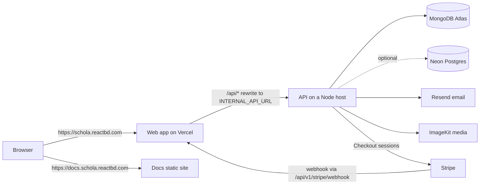

import { Aside, Card, CardGrid, LinkCard, Steps, Tabs, TabItem, FileTree } from '@astrojs/starlight/components';
import SourceFile from '../../../components/SourceFile.astro';
import Api from '../../../components/Api.astro';
import Perm from '../../../components/Perm.astro';

Schola runs as three deployed pieces plus a database. The **web app**
(`apps/web`, Next.js) serves every page at `https://schola.reactbd.com`. The
**API** (`apps/api`, Express) holds all business logic and is reached through
the web app at `https://schola.reactbd.com/api/v1`. **MongoDB Atlas** stores
the data. The **docs** (`apps/docs`, this site) are a separate static site.
This page explains how the pieces connect, what each needs, and the order to
bring them up.

The recommended hosts come from `docs/deployment.md`. Nothing in
the code ties Schola to them — any Node 22 host works for the API and any
static host for the docs.

## Live setup on Vercel

Production runs today as **three Vercel projects** in the `reactbd` team, all
built from the private GitHub repository `noorjsdivs/schola`. A push to `main`
deploys production; any other branch gets preview deployments.

| Project | Domain | Root Directory | Framework | What it serves |
| --- | --- | --- | --- | --- |
| `schola-web` | `https://schola.reactbd.com` | `apps/web` | Next.js | Public site, sign-in, `/app`, `/platform`; proxies `/api/*` to the API |
| `schola-api` | `https://api.schola.reactbd.com` | `apps/api` | Express | The API as one Vercel Function (`/api/v1/*`) |
| `schola-docs` | `https://docs.schola.reactbd.com` | `apps/docs` | Astro | This site, static |

DNS for all three is on Vercel (`reactbd.com` uses Vercel's nameservers): each
subdomain has an `A` record to `76.76.21.21`, and each domain is attached to its
project.

### How a deploy runs

<Steps>

1. You push to `main`. Vercel builds only the projects the push affects
   ("skip unaffected projects" is on); the others show **Canceled** and keep
   their current deployment.
2. Each app's `vercel.json` installs and builds from the repo root:
   `cd ../.. && pnpm install --frozen-lockfile`, then
   `pnpm --filter @schola/<app> build` (the API runs `build:vercel`).
3. The root `.vercelignore` keeps `.env`, `test.env`, `*.local` files and local
   build output out of CLI uploads.

</Steps>

### The API as a Vercel Function

- **Bundle.** `pnpm --filter @schola/api build:vercel`
  (<SourceFile path="apps/api/scripts/build-vercel.mjs" />) bundles
  <SourceFile path="apps/api/src/vercel-entry.ts" /> with the `@schola/*`
  workspace packages into `apps/api/index.mjs`. Every npm package the API lists
  stays external, so Vercel installs and traces it (native `argon2`, Mongoose,
  `@react-pdf/renderer`). Vercel's Express support picks `index.mjs` because
  it imports `express` and default-exports the app.
- **Why bundle.** The shared packages ship TypeScript source, and Vercel's
  Express builder type-checks TypeScript with CommonJS-style settings this ESM
  codebase doesn't use.
- **Boot.** <SourceFile path="apps/api/src/serverless.ts" /> connects to MongoDB
  and seeds permissions once per instance, on the first request; the tenant
  role sync and the index build run in the background.
- **Traced extras.** <SourceFile path="apps/api/src/vercel-assets.cjs" />
  points the tracer at pdfkit's standard fonts, which it would otherwise miss.
- **Firebase.** `firebase-admin` loads only when `POST /auth/google` is used:
  its `jwks-rsa` dependency `require()`s the ESM-only `jose`, which Vercel's
  function loader rejects at start-up.
- **Local check.** `src/index.ts` (`app.listen`) is still what `pnpm dev` and
  other Node hosts run.

### Environment variables

Set in each project's **Settings → Environment Variables** (Production).
Names only — secrets are encrypted in Vercel and were never committed for
production:

| Project | Variables |
| --- | --- |
| `schola-api` | `APP_URL`, `CORS_ORIGIN` (both `https://schola.reactbd.com`), `COOKIE_DOMAIN` (`.schola.reactbd.com`), `LOG_LEVEL`, `APP_NAME`, `EMAIL_FROM`, the TTL and lockout settings, `MONGODB_URI`, `JWT_ACCESS_SECRET`, `JWT_REFRESH_SECRET`, `CSRF_SECRET`, `ENCRYPTION_MASTER_KEY`, `RESEND_API_KEY`, `IMAGEKIT_*`, `FIREBASE_*`, `GOOGLE_OAUTH_CLIENT_ID` / `_SECRET`, `STRIPE_SECRET_KEY`, `STRIPE_WEBHOOK_SECRET` |
| `schola-web` | `NEXT_PUBLIC_APP_URL` (`https://schola.reactbd.com`), `INTERNAL_API_URL` (`https://api.schola.reactbd.com`, read at build time by the `/api/*` rewrite), `NEXT_PUBLIC_FIREBASE_*`. The rest comes from the committed `apps/web/.env.production`. |
| `schola-docs` | None in Vercel — `PUBLIC_ADSENSE_CLIENT` comes from the committed `apps/docs/.env.production`. |

<Aside type="caution" title="Changing a variable needs a new deployment">
Vercel applies environment variables at build time. After changing one,
redeploy: push a commit, or **Deployments → … → Redeploy** on the latest
production deployment. `ENCRYPTION_MASTER_KEY` must stay the key the database
was written with.
</Aside>

### Cookies, CORS and the proxy

The browser only talks to `schola.reactbd.com`. Next.js rewrites `/api/*` to
`https://api.schola.reactbd.com/api/*`, so session cookies stay first-party;
the API sets them for `.schola.reactbd.com` with `Secure`, `HttpOnly` and
`SameSite=Lax`. OAuth callbacks use the same origin
(`https://schola.reactbd.com/api/v1/auth/oauth/<provider>/callback`).

### Stripe

A test-mode webhook endpoint on the account that owns `STRIPE_SECRET_KEY`
sends `checkout.session.completed`, `checkout.session.async_payment_succeeded`
and `checkout.session.async_payment_failed` to
`https://api.schola.reactbd.com/api/v1/stripe/webhook`; its signing secret is
`STRIPE_WEBHOOK_SECRET` in `schola-api`. When you move Stripe to live mode,
create the same endpoint in live mode and replace both keys.

### Operating it

- **Logs:** Vercel → project → **Logs**, or `vercel logs <deployment-url>`.
- **Roll back:** **Deployments → … → Promote** on an earlier production deployment (or `vercel rollback`).
- **Health:** `https://api.schola.reactbd.com/api/v1/health` (also through the web app at `https://schola.reactbd.com/api/v1/health`).

## At a glance

<CardGrid>
  <Card title="Web — Vercel" icon="laptop">
    `apps/web`. Next.js 16, built with `next build --webpack`. Rewrites
    `/api/*` to the API. Reads `apps/web/.env.production`.
  </Card>
  <Card title="API — a Node host" icon="server">
    `apps/api` on Render, Railway, Fly or a container. Node 22, one service,
    listens on `API_PORT`. Reads `apps/api/.env.production`.
  </Card>
  <Card title="Database — MongoDB Atlas" icon="database">
    M0 for staging, M10+ for production, daily snapshots. Optionally Neon
    Postgres for the identity mirror (`DATABASE_URL`).
  </Card>
  <Card title="Docs — any static host" icon="open-book">
    `apps/docs/dist/`, plain HTML. Planned at
    `https://docs.schola.reactbd.com`. Reads one non-secret variable,
    `PUBLIC_ADSENSE_CLIENT`, at build time.
  </Card>
</CardGrid>

## How the pieces connect



### Same host, `/api/v1` path

The browser only ever talks to `https://schola.reactbd.com`. Pages are served
by Next.js; anything under `/api/*` is forwarded to the API by the rewrite in
<SourceFile path="apps/web/next.config.ts" />:

```ts
const INTERNAL_API_URL = process.env.INTERNAL_API_URL || "http://localhost:8000";
// …
async rewrites() {
  return [{ source: "/api/:path*", destination: `${INTERNAL_API_URL}/api/:path*` }];
}
```

Because the API answers on the same origin:

- the session cookies (`schola_access`, `schola_refresh`, `schola_csrf`) are
  first-party, `HttpOnly` (except the CSRF cookie), `Secure` in production and
  `SameSite=Lax`, scoped to `COOKIE_DOMAIN`;
- there is no cross-origin request, so `CORS_ORIGIN` only needs the public site;
- the browser bundle keeps `NEXT_PUBLIC_API_BASE_URL=/api/v1` (relative).

`INTERNAL_API_URL` is the API's address **as seen from the web server** — a
private network URL if your hosts have one (`http://schola-api.internal:8000`),
or a public one (`https://api.schola.reactbd.com`).

:::caution[Set `INTERNAL_API_URL` for the build, not only at runtime]
Next.js evaluates `rewrites()` when it builds and writes the result into the
build output. If `INTERNAL_API_URL` is missing when `next build` runs, the
rewrite points at `http://localhost:8000` and every API call from the deployed
site fails. On Vercel, add it as an environment variable available to the
**Build** step, and redeploy after changing it.
:::

:::caution[`proxy.ts` does not run]
`apps/web/proxy.ts` also contains an `/api/*` rewrite and edge redirects, but
Next.js never loads it — it sits at `apps/web/proxy.ts` while the app lives in
`apps/web/src/app`, so Next looks for `apps/web/src/proxy.ts`. Production
relies on the `next.config.ts` rewrite above. See
[Web routes](/reference/web-routes/#how-access-is-decided).
:::

## Environment files per app

In development every app shares the repo-root `.env` (committed template) and
`test.env` (gitignored, your secrets). In production each app has its own
committed template listing only the keys it reads, with **blank secrets**.

| App | Committed template | Real values | Loaded by |
| --- | --- | --- | --- |
| `apps/api` | `apps/api/.env.production` | `apps/api/.env.production.local` (gitignored) or host variables | <SourceFile path="apps/api/src/load-env.ts" /> when `NODE_ENV=production` |
| `apps/web` | `apps/web/.env.production` | `apps/web/.env.production.local` (gitignored) or Vercel variables | Next.js itself, for `next build` and `next start` |
| `apps/docs` | `apps/docs/.env.production` | — | `PUBLIC_ADSENSE_CLIENT` (committed, not a secret) — see [AdSense](/setup/services/adsense/) |

The platform console (`/platform`) is part of `apps/web` and needs no keys of
its own.

### Precedence

`load-env.ts` calls dotenv once per file, and dotenv never overwrites a key
that is already set, so the first source that defines a key wins:

| Mode | 1st (wins) | 2nd | 3rd |
| --- | --- | --- | --- |
| `NODE_ENV=production` | host environment variables | `apps/api/.env.production.local` | `apps/api/.env.production` |
| anything else | host environment variables | `test.env` (repo root) | `.env` (repo root) |

Paths resolve from the file itself, so the same order applies whether the API
runs from `src/` (tsx) or `dist/` (node). The `grant-role`, `seed-demo` and
`sync-role-keys` jobs import `load-env.ts` too, so they follow the same rules.

:::danger[Never put a secret in a committed file]
`.env.production` files are committed. Secrets — marked `SECRET` in each
file — go in the host dashboard or the gitignored `.env.production.local`.
:::

## Production-required variables

### API

<SourceFile path="packages/config/src/server.ts" symbol="loadServerEnv" />
validates every variable with Zod. With `NODE_ENV=production` it also refuses
to start unless these are set, and exits with
`Production env missing required values: …`:

| Variable | Why it is required | Production value |
| --- | --- | --- |
| `MONGODB_URI` | The database. Its dev default is `localhost`. | Atlas connection string — **secret** |
| `APP_URL` | Links in emails, Stripe return URLs, OAuth callbacks. | `https://schola.reactbd.com` |
| `COOKIE_DOMAIN` | Session cookie scope. | `.schola.reactbd.com` |
| `JWT_ACCESS_SECRET` | Signs access tokens. At least 32 characters. | `openssl rand -hex 32` — **secret** |
| `JWT_REFRESH_SECRET` | Checked at start-up (at least 32 characters), but no code reads it today: refresh tokens are opaque random values stored as plain SHA-256 hashes. Set it anyway. | `openssl rand -hex 32` — **secret** |
| `CSRF_SECRET` | CSRF tokens. At least 32 characters. | `openssl rand -hex 32` — **secret** |
| `ENCRYPTION_MASTER_KEY` | Encrypts phone, date of birth and address. Must decode to 32 bytes. | `openssl rand -base64 32`, **once** — **secret** |
| `RESEND_API_KEY` | Transactional email. | Resend key — **secret** |
| `IMAGEKIT_PUBLIC_KEY`, `IMAGEKIT_PRIVATE_KEY`, `IMAGEKIT_URL_ENDPOINT` | Media uploads. | from ImageKit — the private key is **secret** |

Strongly recommended, though not enforced:

| Variable | Without it |
| --- | --- |
| `NODE_ENV=production` | `.env.production` is not loaded at all, cookies are not `Secure`, the auth rate limit is 60 instead of 10 a minute, and the required-value check is skipped. |
| `CORS_ORIGIN` | Defaults to `http://localhost:3000`. Set `https://schola.reactbd.com`. |
| `EMAIL_FROM` | Must be on a domain verified in Resend. |
| `STRIPE_SECRET_KEY`, `STRIPE_WEBHOOK_SECRET` | Online payment buttons answer `503`; the webhook answers `503`. |
| `SMTP_*` | No fallback transport if Resend is down. |
| `GOOGLE_OAUTH_*`, `FACEBOOK_OAUTH_*`, `FIREBASE_*` | The social sign-in buttons send people to `/login?error=oauth_unconfigured` (Firebase: `503`). |
| `DATABASE_URL` | The Neon identity mirror stays off. If you set it, run `pnpm --filter @schola/db db:migrate` once. |
| `API_PORT` | The API listens on `8000`. It does **not** read `PORT` — map your host's port to `API_PORT`. |

The full list with defaults is in
[Environment variables](/reference/environment-variables/).

### Web

| Variable | Required | Notes |
| --- | --- | --- |
| `NEXT_PUBLIC_APP_URL` | yes | `https://schola.reactbd.com`. Canonical URLs, Open Graph, sitemap. Baked in at build time. |
| `INTERNAL_API_URL` | yes | Where `/api/*` is forwarded. Server-side only. Needed at **build** time (see above). |
| `NEXT_PUBLIC_API_BASE_URL` | no | Keep `/api/v1`. |
| `NEXT_PUBLIC_APP_NAME`, `NEXT_PUBLIC_TWITTER_HANDLE`, `GOOGLE_SITE_VERIFICATION` | no | Branding and SEO. |
| `NEXT_PUBLIC_FIREBASE_API_KEY`, `…_AUTH_DOMAIN`, `…_PROJECT_ID`, `…_APP_ID` | no | All four, or none (the Firebase Google button hides). Public by design. |

Every `NEXT_PUBLIC_*` value is inlined into the browser bundle at build time:
**rebuild** after changing one.

## Building

From the repo root:

```sh
pnpm install --frozen-lockfile
pnpm build
```

`pnpm build` runs `turbo run build`, which builds every workspace that has a
`build` script, dependencies first:

| Workspace | Script | Output |
| --- | --- | --- |
| `@schola/web` | `next build --webpack` | `apps/web/.next/` |
| `@schola/api` | `tsc -p tsconfig.json` | `apps/api/dist/` |
| `@schola/docs` | `astro build` | `apps/docs/dist/` |

The shared packages (`@schola/types`, `@schola/validation`, `@schola/db`,
`@schola/config`, `@schola/ui`) have no build step: they ship TypeScript
sources, which the web app compiles through `transpilePackages`.

:::caution[Starting the API from `dist/`]
`pnpm --filter @schola/api start` runs `node dist/index.js`. The compiled API
still imports the workspace packages, whose `exports` point at `.ts` files that
use `.js` import specifiers (`./models/index.js`). Plain Node cannot load those,
so expect `node dist/index.js` to fail with a module-not-found error. This was
not verified by running it. CI sidesteps the problem by starting the API from
source with **`pnpm exec tsx src/index.ts`** (`tsx` is a dev dependency of
`@schola/api`). Until the packages are compiled, run production the same way:
install with dev dependencies and start with `tsx`.
:::

The web build uses webpack on purpose: Turbopack does not honour the
`experimental.extensionAlias` setting that maps those `.js` imports to `.ts`.

## Deploy the web app (Vercel)

<Steps>

1. Import the repository in Vercel and set the **Root Directory** to
   `apps/web`. Vercel detects pnpm from the root `pnpm-lock.yaml`.

2. Make the build run the package script — `pnpm build` inside `apps/web`, which
   is `next build --webpack`. A bare `next build` would use Turbopack and fail
   to resolve the workspace packages.

3. Add the variables from the table above (Production and Preview). Mark
   `INTERNAL_API_URL` available at build time.

4. Deploy, then add the domain `schola.reactbd.com` in the project's
   **Domains** settings.

</Steps>

## Deploy the API (Node host)

<Steps>

1. Create one Node 22 service from the repository. Install command:
   `pnpm install --frozen-lockfile` at the repo root (dev dependencies
   included, for `tsx`).

2. Start command, from `apps/api`: `NODE_ENV=production pnpm exec tsx
   src/index.ts`. Set `API_PORT` to the port the host expects.

3. Add every required variable (above) as a host variable, or upload
   `apps/api/.env.production.local`. Host variables win.

4. Health check path: `/api/v1/health`.

5. On first start the API connects to MongoDB, seeds the permission list and
   the platform roles, re-applies role bundles to every approved school, then
   listens. A failure here exits the process with `failed to start` in the
   logs.

</Steps>

The app sets `trust proxy` to `1`, so `req.ip` is taken from the last hop in
`X-Forwarded-For`. Behind both Vercel's rewrite and the host's own load
balancer there are two hops; check that the audit log records visitors' IPs
rather than a proxy's, because the auth rate limit (10 a minute in production)
is keyed by IP.

## Set up MongoDB Atlas

<Steps>

1. Create a cluster (M0 is fine for staging, M10+ for production) and turn on
   backups.

2. **Database Access** → add a user with read/write on the `schola` database.
   URL-encode special characters in its password.

3. **Network Access** → allow the API host's outbound IP addresses (or
   `0.0.0.0/0` only if your host has no fixed IPs and you accept the risk).

4. **Connect → Drivers** → copy the `mongodb+srv://…` string into
   `MONGODB_URI` on the API host.

5. Nothing to do for indexes: the API builds them on its first boot — see
   the note below.

</Steps>

:::note[Indexes are built on boot]
`connectDb` turns Mongoose's `autoIndex` **off** when `NODE_ENV=production`
(<SourceFile path="packages/db/src/connection.ts" />), so the API builds the
indexes itself: on every production boot `ensureIndexesOnBoot()`
(<SourceFile path="apps/api/src/services/db-indexes.ts" />) calls
`createIndexes()` for every model. The unique indexes are what make invoice and
payslip generation idempotent, keep one enrollment per student per year and one
bed per student; the TTL indexes clean up old tokens. Building only adds
missing indexes and never drops one. A failure is logged as "index build failed
for some models — unique / TTL guarantees may be missing" and the API keeps
serving.
:::

:::caution[Upgrading an existing database: drop the old token index]
Databases created before this release have a plain `expiresAt_1` index on
`refreshtokens` and `singleusetokens`. It blocks the TTL index of the same
name, so the boot log reports an index failure for those two models and old
tokens are never cleaned up. Drop it once with
`db.refreshtokens.dropIndex("expiresAt_1")` and
`db.singleusetokens.dropIndex("expiresAt_1")`, then restart the API.
:::

## Grant the first Super Admin

A fresh platform has no Super Admin, and no screen can create the first one.
The `grant-role` CLI does it.

<Steps>

1. Open `https://schola.reactbd.com/signup` and create a **personal account**
   with your own email and a strong password.

2. On a machine with the repository and access to the production database, put
   the production values in `apps/api/.env.production.local` (or export them in
   the shell). The CLI runs the same production check as the API, so every
   required variable must be present.

3. Run:

   ```sh
   NODE_ENV=production pnpm --filter @schola/api run grant-role -- \
     --email you@yourdomain.com --role super_admin
   ```

   It fails if no account has that email. It adds the `super_admin`
   membership, sets `isActive` and `isPlatformUser`, marks the email verified
   and clears any lockout. It does not touch the password. The grant is
   written to the audit log as `user.role.grant` with actor role `cli`.

4. Sign in at `/login`. You land on `/platform`.

</Steps>

Later Super Admins can be invited from `/platform/users`
(<Perm name="user:invite_platform" />).

## Stripe webhook in production

Stripe tells Schola that a Checkout payment succeeded by calling a webhook.
The success page in the browser does not move any money.

<Steps>

1. In the Stripe Dashboard → **Developers → Webhooks**, add an endpoint:
   `https://schola.reactbd.com/api/v1/stripe/webhook`.

2. Subscribe to `checkout.session.completed`,
   `checkout.session.async_payment_succeeded` and
   `checkout.session.async_payment_failed`.

3. Copy the endpoint's signing secret (`whsec_…`) into `STRIPE_WEBHOOK_SECRET`
   on the API host, set `STRIPE_SECRET_KEY` (a live `sk_live_…` key for
   production), and restart the API.

4. Pay a small invoice to test. The endpoint answers `200 { received: true }`;
   a `400` means the signing secret doesn't match.

</Steps>

The route is registered before the JSON parser so Stripe's signature can be
checked against the raw body; it reaches the API through the same `/api/*`
rewrite. Checkout's return URLs are built from `APP_URL`
(`/app/fees?checkout=success`, …), so `APP_URL` must be the public site. See
[Stripe](/setup/services/stripe/) and [Online payments](/features/finance/online-payments/).

## Social sign-in in production

Register these redirect URIs with the providers (the API builds them from the
request's allowed origin, falling back to `APP_URL`):

- Google: `https://schola.reactbd.com/api/v1/auth/oauth/google/callback`
- Facebook: `https://schola.reactbd.com/api/v1/auth/oauth/facebook/callback`

The allowed origins are hard-coded in `apps/api/src/modules/auth/oauth-urls.ts`:
`http://localhost:3000`, `http://127.0.0.1:3000`, `https://schola.reactbd.com`
and whatever `APP_URL` is. A staging host must be its own `APP_URL`. See
[Social sign-in](/setup/services/social-sign-in/).

## DNS

| Record | Points to |
| --- | --- |
| `schola.reactbd.com` (A / AAAA or CNAME, as Vercel instructs) | the web app on Vercel |
| `docs.schola.reactbd.com` (CNAME) | the docs host — `site` in `apps/docs/astro.config.mjs` |
| `api.schola.reactbd.com` (CNAME, optional) | the API host, only if `INTERNAL_API_URL` uses a public URL |
| TXT / CNAME for Resend | domain verification, SPF and DKIM for `EMAIL_FROM` |
| TXT `google-site-verification` (optional) | Google Search Console (`GOOGLE_SITE_VERIFICATION`) |
| DMARC TXT (recommended) | email reputation |

## Health checks

| Check | Expect |
| --- | --- |
| `GET https://<api-host>/api/v1/health` | `200 { "success": true, "data": { "ok": true, "service": "schola-api", "version": "…", "timestamp": "…" } }` — the host's health probe. `version` is `0.0.0` unless the API is started through a pnpm/npm script. |
| `GET https://schola.reactbd.com/api/v1/health` | The same body — proves the web → API rewrite works. |
| `GET https://schola.reactbd.com/login` | `200` — the web app is up (CI uses this one). |
| API logs | `mongodb connected`, `tenant role permissions synced`, `Schola API listening`. Logs are pino JSON; ship them to your host's log drain. |

## Go-live checklist

<Steps>

1. `pnpm typecheck && pnpm lint && pnpm test` pass locally (CI is currently
   switched off — see [CI](/operations/ci/)).

2. `pnpm test:e2e` passes against a staging deploy
   (`E2E_BASE_URL=https://staging…`) seeded with `pnpm seed`.

3. Atlas cluster created, backups on, Network Access allows the API host,
   `MONGODB_URI` set. After the first boot the API log shows "indexes ensured"
   (not "index build failed …").

4. No real secret in any committed file (the root `.env` and every
   `.env.production` are templates). Anything that was ever committed is
   rotated at its provider first.

5. Secrets generated **once** and stored safely: three `openssl rand -hex 32`
   values and one `openssl rand -base64 32` for `ENCRYPTION_MASTER_KEY`.
   Losing the encryption key makes every encrypted phone number, birthday and
   address unreadable.

6. API host: every required variable set, `NODE_ENV=production`,
   `CORS_ORIGIN=https://schola.reactbd.com`, `COOKIE_DOMAIN=.schola.reactbd.com`,
   `API_PORT` matched to the host, start command uses `tsx`; `/api/v1/health`
   answers.

7. Web on Vercel: `NEXT_PUBLIC_APP_URL` and `INTERNAL_API_URL` set for the
   build, build command runs `next build --webpack`; `/api/v1/health` answers
   through the site.

8. Resend domain verified and `EMAIL_FROM` on it; send yourself a
   password-reset email to test.

9. Stripe webhook endpoint added, `STRIPE_*` set, one test payment recorded.

10. OAuth redirect URIs registered (if social sign-in is on).

11. DNS records live, HTTPS certificates issued (cookies are `Secure` — sign-in
    does not work over plain HTTP).

12. First Super Admin granted with `grant-role`; sign in and check `/platform`.

13. Do **not** run `pnpm seed` against production. It refuses to unless given
    `--allow-production` and a custom `--password`, and it creates demo
    accounts.

</Steps>

## Deploy the docs site

The docs are a fully static Astro + Starlight build with no server code and no
environment variables.

```sh
pnpm --filter @schola/docs build      # → apps/docs/dist/
pnpm --filter @schola/docs preview    # check it on http://localhost:3002
```

Upload `apps/docs/dist/` to any static host — Vercel (a second project with
Root Directory `apps/docs`, output `dist`), Netlify, Cloudflare Pages, an S3
bucket or nginx. `astro.config.mjs` sets `site: 'https://docs.schola.reactbd.com'`,
used for canonical URLs; change it if the docs live elsewhere. Search works
without a server: the index is the static file `/search-index.json`. See
[Editing the docs](/operations/editing-the-docs/).

## Related pages

<CardGrid>
  <LinkCard title="Environment variables" description="Every key, its default and where it is read." href="/reference/environment-variables/" />
  <LinkCard title="MongoDB" description="Local MongoDB and Atlas setup." href="/setup/services/mongodb/" />
  <LinkCard title="Encryption" description="The master key and what it protects." href="/setup/services/encryption/" />
  <LinkCard title="Troubleshooting" description="What to do when a deploy misbehaves." href="/operations/troubleshooting/" />
</CardGrid>
