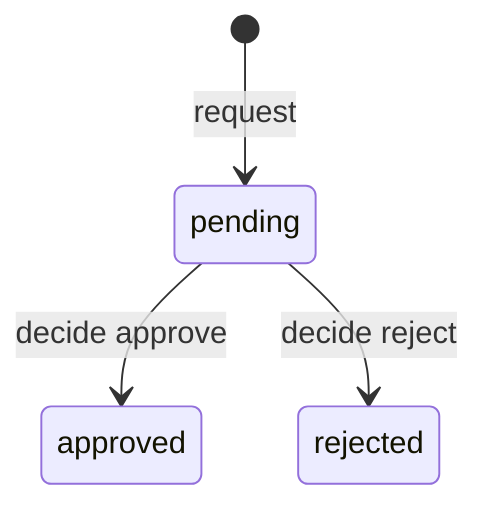
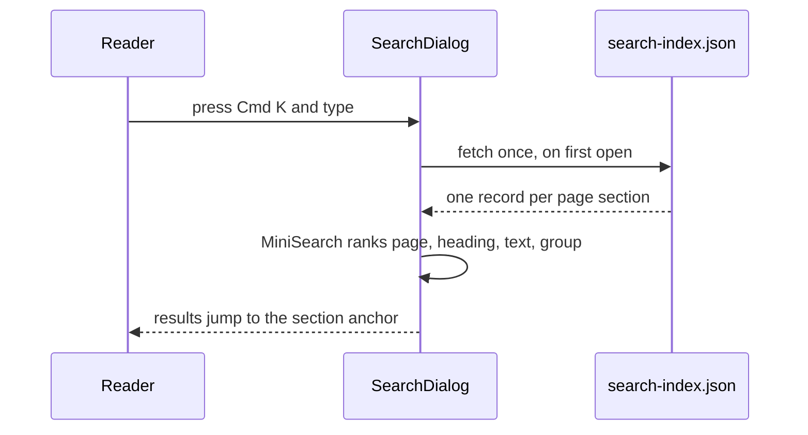

import { Aside, Card, CardGrid, LinkCard, Steps, FileTree, Tabs, TabItem } from '@astrojs/starlight/components';
import Pipeline from '../../../components/Pipeline.astro';
import SourceFile from '../../../components/SourceFile.astro';
import Perm from '../../../components/Perm.astro';
import Api from '../../../components/Api.astro';
import Route from '../../../components/Route.astro';
import Roles from '../../../components/Roles.astro';

You are reading `apps/docs`: an [Astro](https://astro.build) site built with
the [Starlight](https://starlight.astro.build) documentation theme. Pages are
MDX files — Markdown that can also use components. The site is fully static:
`astro build` turns every page into plain HTML, so it can be hosted anywhere,
and it has its own search that works without a server. This page is for anyone
who wants to change or add a page.

Before writing, read <SourceFile path="apps/docs/WRITING_GUIDE.md" />. It is
binding: voice, page template, component rules and diagram rules. This page
summarises it and explains the machinery around it.

## At a glance

<CardGrid>
  <Card title="Run it" icon="rocket">
    `pnpm --filter @schola/docs dev` → `http://localhost:3002`. It also starts
    with everything else under `pnpm dev`.
  </Card>
  <Card title="Pages" icon="document">
    `apps/docs/src/content/docs/**.mdx`. The folder path is the URL.
  </Card>
  <Card title="Sidebar" icon="list-format">
    Hand-ordered in `apps/docs/astro.config.mjs`. A page that is not listed
    there is not in the sidebar.
  </Card>
  <Card title="Output" icon="server">
    `apps/docs/dist/` — static HTML, CSS and JS. No environment variables.
  </Card>
</CardGrid>

## Run, build and check

| Command (from the repo root) | What it does |
| --- | --- |
| `pnpm --filter @schola/docs dev` | Dev server with live reload on `http://localhost:3002` (`astro dev --port 3002`). |
| `pnpm dev` | Starts the API, the web app **and** the docs through Turborepo. |
| `pnpm --filter @schola/docs build` | Builds the static site into `apps/docs/dist/`. Fails on broken MDX, a bad import path or an invalid `<Steps>`. |
| `pnpm --filter @schola/docs preview` | Serves the built `dist/` on port 3002, to check a build before publishing. |
| `pnpm --filter @schola/docs check` | `astro check` — type-checks `.astro` and TypeScript files. Also what `pnpm typecheck` runs for the docs. |
| `pnpm --filter @schola/docs lint` | ESLint on the React islands, shadcn/ui components and search index (`.astro` and `.mdx` are ignored; the build checks them). |

Extra flags go to Astro after `--`, for example
`pnpm --filter @schola/docs dev -- --host` to open the dev server to your
network.

## How the site is built

<Pipeline
  caption="From an MDX file to a page in the browser."
  steps={[
    { label: 'MDX page', icon: 'file-text', note: 'src/content/docs' },
    { label: 'Content collection', icon: 'database', note: 'Starlight docsLoader' },
    { label: 'Markdown', icon: 'workflow', note: 'Sätteri + table-wrap' },
    { label: 'Mermaid', icon: 'chart', note: 'astro-mermaid' },
    { label: 'Static HTML', icon: 'server', note: 'apps/docs/dist' },
  ]}
/>

- **Starlight** provides the layout, sidebar, table of contents, pagination
  and asides. `src/content.config.ts` registers the `docs` collection with
  Starlight's loader and schema, so every page's frontmatter is validated.
- **Markdown** is processed by Sätteri (`@astrojs/markdown-satteri`). The
  `table-wrap` plugin (<SourceFile path="apps/docs/src/plugins/table-wrap.mjs" />)
  wraps every table in a bordered `div.table-wrap` that scrolls sideways on a
  phone.
- **Mermaid** code fences become diagrams through `astro-mermaid`, registered
  **before** Starlight so it sees the fences first. Mermaid's core is one
  lazily loaded chunk, fetched only on pages that have a diagram.
- **React** (`@astrojs/react`) powers a handful of islands: ⌘K search, the theme
  toggle, "Copy page", the mobile outline and the landing hero. Reading pages
  ship almost no JavaScript otherwise.
- **Tailwind CSS 4** (via `@tailwindcss/vite` and `@astrojs/starlight-tailwind`)
  styles the custom components.

## Where things live

<FileTree>

- apps/docs/
  - astro.config.mjs site config, integrations and the **sidebar order**
  - WRITING_GUIDE.md binding rules for every page
  - README.md
  - src/
    - content/docs/ the pages; folder path = URL
      - index.mdx the landing page (splash template)
      - start-here/
      - setup/
      - tutorial/
      - architecture/
      - features/
      - operations/
      - reference/
    - content.config.ts the docs collection
    - components/ doc components (Pipeline, ScreenAnatomy, Api, Perm, …)
      - ui/ shadcn/ui components
      - react/ React islands (search, theme toggle, copy page, …)
      - overrides/ Starlight overrides (Header, PageTitle, Sidebar, …)
    - lib/icons.ts lucide icons available to Pipeline and FeatureGrid
    - pages/
      - search-index.json.ts the search index
      - md/[...slug].md.ts raw Markdown of each page
    - plugins/table-wrap.mjs
    - styles/
      - global.css Schola tokens, Tailwind, fonts
      - custom.css Starlight ↔ token bridge and layout tweaks
      - shadcn.css shadcn/ui base styles
    - assets/ the Schola mark (light and dark)
  - public/ favicon
  - scripts/capture-screens.mjs screenshot and smoke-test script

</FileTree>

## Add or change a page

<Steps>

1. **Read the writing guide** — <SourceFile path="apps/docs/WRITING_GUIDE.md" />.
   Pages go from simple to detailed: a plain explanation, a picture, the steps
   a person takes, the code-level detail, then edge cases.

2. **Create or edit the file** under `src/content/docs/`. The path is the URL:
   `src/content/docs/features/daily/leave.mdx` is `/features/daily/leave/`.
   Start with frontmatter — a `title` and a one-sentence `description` — and no
   `# H1` (Starlight renders the title):

   ```mdx
   ---
   title: Leave
   description: Ask for leave, approve it, and see it turn into excused attendance.
   ---
   ```

3. **Import the components you use**, with the right number of `../` for the
   file's depth. A wrong depth fails the build with *Could not resolve*:

   | Page file | Import prefix |
   | --- | --- |
   | `src/content/docs/index.mdx` | `../../components/…` |
   | `src/content/docs/operations/testing.mdx` | `../../../components/…` |
   | `src/content/docs/features/daily/leave.mdx` | `../../../../components/…` |

4. **Add a new page to the sidebar.** Put its slug (the path without
   `src/content/docs/` and `.mdx`) in the right group of `sidebar` in
   `astro.config.mjs`:

   ```js
   {
     label: 'Daily operations',
     items: [
       'features/daily/attendance',
       'features/daily/leave',
     ],
   },
   ```

5. **Link with absolute paths and a trailing slash** —
   `[Leave](/features/daily/leave/)` — and only to pages that are in the
   sidebar.

6. **Build** with `pnpm --filter @schola/docs build` and fix every error it
   reports.

</Steps>

## The components

All custom components live in `src/components/`. In MDX, pass props like JSX.

| Component | Use it for | Example |
| --- | --- | --- |
| `Pipeline` (`steps`, `caption`) | An animated left-to-right flow, 3–9 steps. Each step has `label`, `icon` (from `src/lib/icons.ts`), optional `note`. Stacks vertically on phones. | a status journey |
| `ScreenAnatomy` (`title`, `path`, `regions`) | A browser-window sketch with numbered regions and a legend. Regions have `label` and `area`: `top`, `sidebar` or `main`. Every screen page should have one. | the Students screen |
| `FeatureGrid` (`items`) | Linked tiles with icons; `tone` `cyan`, `yellow` or `indigo`. | the landing page |
| `BarChart` (`data`, `title`, `unit`) | An animated comparison of numbers. | counts per status |
| `Roles` (`list`, `note?`) | Role chips. Keys: the nine role keys, plus `user` and `public`. | <Roles list={['school_admin', 'teacher']} /> |
| `Route` (`path`, `label?`) | A page of the web app. | <Route path="/app/leave" /> |
| `Api` (`method`, `path`, `perm?`) | An API endpoint. `path` is relative to `/api/v1`. | <Api method="POST" path="leave/:id/decide" perm="leave:approve" /> |
| `Perm` (`name`) | A permission key. | <Perm name="leave:approve" /> |
| `SourceFile` (`path`, `symbol?`) | A file in the repo, from the repo root. | <SourceFile path="apps/api/src/app.ts" /> |
| `DemoLogin` (`as`, `email`, `go?`) | A "Try it with the demo data" box. The password is always `Schola@2026`. | — |

Starlight's own components work too: `Aside`, `Steps`, `Tabs` / `TabItem`,
`Card` / `CardGrid`, `LinkCard`, `Badge`, `FileTree`. Card icons must be
Starlight built-ins (`star`, `laptop`, `approve-check`, `information`,
`rocket`, `setting`, `puzzle`, `open-book`, `document`, `list-format`,
`padlock`, `database`, `server`, `email`, `warning`, `pencil`, `analytics`,
`clock`, `magnifier`, `random`, `comment`, `notes`). Asides can also be written
as `:::note`, `:::tip`, `:::caution` and `:::danger` blocks.

### Rules that break the build

- `<Steps>` must wrap **exactly one** ordered list (`1.` items) and nothing else
  at its top level.
- Import paths must match the page's depth (table above).
- A `Pipeline` or `FeatureGrid` icon must be a key in `src/lib/icons.ts`.

### Diagrams

Use fenced `mermaid` code blocks: `flowchart` for decisions,
`sequenceDiagram` for browser ↔ web ↔ API ↔ database conversations,
`stateDiagram-v2` for status lifecycles, `erDiagram` for data. Keep labels
short; avoid parentheses, colons and slashes in unquoted node labels, or put
the label in quotes.

````md

````

## Search

Press <kbd>⌘K</kbd> (<kbd>Ctrl K</kbd> on Windows and Linux) or <kbd>/</kbd>
anywhere. The search button sits in the header.



- <SourceFile path="apps/docs/src/pages/search-index.json.ts" /> builds the
  index from every page in the `docs` collection. It splits each page at its
  `##` and `###` headings, so a result links straight to the section. Anchors
  use `github-slugger`, the same slugger Starlight uses for heading ids.
- Body text is extracted from the MDX: Mermaid sources, imports and JSX
  comments are dropped; code blocks are kept (identifiers are good search
  terms); readable props of components (`label`, `title`, `note`,
  `description`, `caption`, `name`, `path`) are included. A page's
  description is indexed with its intro.
- The endpoint is prerendered, so it is a static file in builds and is served
  on request in `astro dev`. That is why search works in development —
  Starlight's built-in Pagefind is switched off (`pagefind: false`) because it
  only works after a production build.
- <SourceFile path="apps/docs/src/components/react/SearchDialog.tsx" /> is a
  shadcn/ui Command dialog. It fetches the index on first open and ranks with
  MiniSearch, boosting page titles over headings over body text.

## "Copy page" and Markdown

Every page title has a **Copy page** button
(<SourceFile path="apps/docs/src/components/react/CopyPage.tsx" />, placed by
the `PageTitle` override) with a menu:

| Action | What it does |
| --- | --- |
| Copy page / Copy page as Markdown | Fetches `/md/<page-id>.md` and copies it to the clipboard — handy for pasting a page into a chat or an issue. |
| View as Markdown | Opens `/md/<page-id>.md` in a new tab. |
| Copy link to page | Copies the page URL without the `#section`. |

The Markdown comes from <SourceFile path="apps/docs/src/pages/md/[...slug].md.ts" />:
it prerenders one `.md` file per page with the title as `# H1`, the
description as a quote, and the MDX body with `import` lines removed.
Components stay in the text as JSX.

## Theme and styling

The docs use the **same design tokens as the web app**, so they look like the
product: a cyan primary, a yellow accent, indigo display headings, a navy dark
mode, Lexend for text and Ubuntu Mono for code.

| File | Role |
| --- | --- |
| <SourceFile path="apps/docs/src/styles/global.css" /> | The Schola tokens (`--background`, `--primary`, `--brand`, …) in OKLCH for light and dark, Tailwind layers, and the Lexend / Ubuntu Mono fonts (`@fontsource`). The values mirror `apps/web/src/app/globals.css`. |
| <SourceFile path="apps/docs/src/styles/custom.css" /> | Maps Starlight's `--sl-color-*` variables onto those tokens, and holds global tweaks: tables, chips, Mermaid cards, spacing. |
| `src/styles/shadcn.css` | Base styles for the shadcn/ui components in `src/components/ui/`. |

When a token changes in the web app, change it in `global.css` too. Custom components use Tailwind utilities
on those tokens (`bg-card`, `border-border`, `text-muted-foreground`,
`text-brand`) and add `not-content` to their root so Starlight's prose styles
don't leak in. Animated components carry `doc-animate`: their entrance plays
when they scroll into view and is switched off for readers who prefer reduced
motion.

Starlight overrides in `src/components/overrides/`:

| Override | Adds |
| --- | --- |
| `Header` | The ⌘K search button and the theme toggle. |
| `ThemeSelect` | The shadcn-style light / dark toggle (`ModeToggle`). |
| `PageTitle` | The title plus the "Copy page" menu. |
| `Sidebar` | A quick-jump grid of the seven sections on phones and tablets, and animated groups. |
| `MobileTableOfContents` | A drawer outline on small screens. |
| `Hero` | The animated landing hero (`LandingHero`) on the home page. |

## Deploying the docs

```sh
pnpm --filter @schola/docs build
```

Upload `apps/docs/dist/` to any static host — Vercel, Netlify, Cloudflare
Pages, an S3 bucket, nginx. `site` in `astro.config.mjs` is
`https://docs.schola.reactbd.com`; change it if the docs live elsewhere. The
site reads one environment variable at build time, `PUBLIC_ADSENSE_CLIENT`
(committed in `apps/docs/.env.production`; see
[AdSense](/setup/services/adsense/)). `astro dev` does not read that file, so
local previews never load ads. See [Deployment](/operations/deployment/#deploy-the-docs-site).

## Keep the docs in step with the code

- **Change the docs in the same pull request as the code.** A new route, field,
  permission or status needs its page updated before merge.
- **Code wins.** If a page and the code disagree, fix the page — or, if the
  code looks wrong, say so in a `:::caution` box rather than describing the
  intended behaviour.
- **The reference pages are derived from source** — re-check them when these
  files change:

  | Reference page | Source of truth |
  | --- | --- |
  | [Web routes](/reference/web-routes/) | every `page.tsx` under `apps/web/src/app/`, `APP_GROUPS` in `dashboard-shell.tsx`, the layouts |
  | [API endpoints](/reference/api-endpoints/) | `apps/api/src/app.ts` and every `*.routes.ts` |
  | [Permissions](/reference/permissions/) | `packages/types/src/permissions.ts`, `apps/api/src/services/rbac/permissions.ts` |
  | [Roles](/reference/roles/) | `packages/types/src/roles.ts`, the role bundles, `ROLE_LABEL` |
  | [Environment variables](/reference/environment-variables/) | `packages/config/src/server.ts`, `.env`, `apps/*/.env.production` |
  | [Statuses](/reference/statuses/) | the `enum:` fields in `packages/db/src/models/` |

- **Demo accounts** in examples always use the seeded Greenfield school and the
  password `Schola@2026`.

## Edge cases and gotchas

- **Search result groups** follow the sidebar: `search-index.json.ts` maps the
  top folder (`start-here`, `setup`, `tutorial`, `architecture`, `features`,
  `operations`, `reference`) and the feature sub-folders to the group names
  shown in the ⌘K results.
- **Screenshots** come from `pnpm --filter @schola/docs screens`
  (`node scripts/capture-screens.mjs`, with `@playwright/test` as a docs dev
  dependency). Run it with the stack up on seeded data; the images land in
  `src/assets/screens/`.
- The sidebar's **pagination** ("Next" / "Previous" at the bottom of a page)
  follows the sidebar order, so place new pages where a reader should meet
  them.
- Headings feed the right-hand table of contents (levels 2 and 3 only) and the
  search anchors. Renaming a heading changes its anchor and breaks links that
  point at it.

## Related pages

<CardGrid>
  <LinkCard title="Project structure" description="Where apps/docs sits in the monorepo." href="/setup/project-structure/" />
  <LinkCard title="Scripts and tooling" description="pnpm, Turborepo and the root scripts." href="/setup/scripts-and-tooling/" />
  <LinkCard title="Deployment" description="Hosting the web app, the API and the docs." href="/operations/deployment/" />
  <LinkCard title="Introduction" description="Start reading from the beginning." href="/start-here/introduction/" />
</CardGrid>
