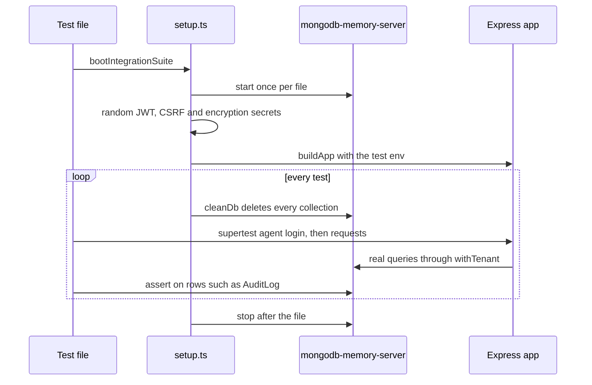

import { Aside, Card, CardGrid, LinkCard, Steps, Tabs, TabItem, FileTree } from '@astrojs/starlight/components';
import Pipeline from '../../../components/Pipeline.astro';
import SourceFile from '../../../components/SourceFile.astro';
import Api from '../../../components/Api.astro';

Schola is tested in three layers. **Unit tests** check one function on its own
— a schema, a money helper, an access rule. **Integration tests** start the
real Express app against a throwaway MongoDB that lives in memory and call it
over HTTP, so they prove the routes, permissions, tenant isolation and audit
log really work together. **End-to-end (E2E) tests** drive a real browser
through the real web app and API on a database filled by `pnpm seed`. The
project rule is simple: *features without tests do not
ship*.

## At a glance

| Layer | Tool | Where the files live | Needs |
| --- | --- | --- | --- |
| Unit | [Vitest](https://vitest.dev) 5 | next to the source, `*.test.ts` | nothing |
| Integration | Vitest + [Supertest](https://github.com/ladjs/supertest) + `mongodb-memory-server` | `apps/api/src/**/__tests__/*.integration.test.ts` | a one-time MongoDB binary download (~66 MB) |
| E2E | [Playwright](https://playwright.dev) | `apps/web/e2e/*.spec.ts` | API + web running, database seeded with `pnpm seed` |

<Pipeline
  caption="What `pnpm test` and `pnpm test:e2e` cover, from fastest to slowest."
  steps={[
    { label: 'Unit', icon: 'terminal', note: 'Pure functions, schemas' },
    { label: 'Integration', icon: 'server', note: 'Express + in-memory Mongo' },
    { label: 'E2E', icon: 'workflow', note: 'Browser + seeded school' },
  ]}
/>

## Run the tests

| Command (from the repo root) | What it runs |
| --- | --- |
| `pnpm test` | Every workspace's `test` script through Turborepo: the API (unit + integration), the web app's unit tests, `@schola/db` and `@schola/validation`. |
| `pnpm --filter @schola/api test` | API unit and integration tests only (`vitest run`). |
| `pnpm --filter @schola/api test:watch` | The same, re-running on save (`vitest`). |
| `pnpm --filter @schola/api exec vitest run src/modules/fees` | One folder or file — any Vitest filter works. |
| `pnpm --filter @schola/web test` | Web unit tests (`vitest run --passWithNoTests`). |
| `pnpm --filter @schola/db test` | Encryption tests. |
| `pnpm --filter @schola/validation test` | Zod schema tests. |
| `pnpm test:e2e` | Playwright, through Turborepo (only `@schola/web` has the script). |
| `pnpm --filter @schola/web test:e2e -- --ui` | Playwright's interactive UI mode. |

The documentation site has no `test` script; it is checked by `pnpm typecheck`
(`astro check`) and its build. Before a merge, run
`pnpm typecheck && pnpm lint && pnpm test` together.

## Unit tests

Unit tests sit next to the code they test and import it directly. They need no
database and no server.

| File | What it proves |
| --- | --- |
| <SourceFile path="apps/api/src/middleware/error-handler.test.ts" /> | A Mongo duplicate-key error (`11000`) becomes a `409 CONFLICT` with a readable field name. |
| <SourceFile path="apps/api/src/modules/auth/oauth-urls.test.ts" /> | Google and Facebook authorize URLs, the callback URL and the allowed OAuth origins. |
| <SourceFile path="apps/api/src/services/scopes/__tests__/student-access.test.ts" /> | `decideStudentAccess` — who may read which part of a student record (8 cases). |
| <SourceFile path="apps/api/src/services/stripe/money.test.ts" /> | Dollars to cents for Stripe, and that only paid Checkout sessions are fulfilled. |
| <SourceFile path="apps/api/src/services/stripe/fulfill.salary.test.ts" /> | Marking a payslip paid from a Stripe Checkout session. |
| <SourceFile path="apps/api/src/utils/regex.test.ts" /> | `searchPattern` escapes user input before it reaches a Mongo regex. |
| <SourceFile path="apps/api/src/seed/demo-school.test.ts" /> | The demo dataset's shape, that every row passes its Mongoose schema, and that no unique index is violated. |
| <SourceFile path="packages/db/src/__tests__/crypto.test.ts" /> | Envelope encryption round-trips, gives different ciphertexts for the same input, detects tampering, and throws without a master key. |
| <SourceFile path="packages/validation/src/patch-schema.test.ts" /> | Update (`PATCH`) schemas never inject `.default()` values, so an edit can't silently reset other fields. |
| <SourceFile path="apps/web/src/components/marketing/content.test.ts" /> | The marketing catalogue (slugs, events, news) is well-formed. |
| <SourceFile path="apps/web/src/lib/demo/server.test.ts" /> | The in-browser "Load sample" demo school and its fake API. |
| <SourceFile path="apps/api/src/middleware/validate.test.ts" /> | `validate({ query })` hands the handler Zod defaults and coerced types, and rejects invalid values. |
| <SourceFile path="apps/api/src/services/csv.service.test.ts" /> | CSV formula injection: cells starting with `=`, `+`, `-`, `@`, tab or CR get a leading `'`; plain numbers and text are untouched. |
| <SourceFile path="apps/api/src/utils/server-env.test.ts" /> | `envBoolean` (used by `SMTP_SECURE`): `true` / `false` / `1` / `0`, default `false`, anything else rejected. |
| <SourceFile path="packages/validation/src/common.test.ts" /> | `queryBoolean` reads `"false"` as `false` and rejects other strings. |
| <SourceFile path="apps/web/src/lib/audit-diff.test.ts" /> | The audit log's Before / After rows: only changed fields, bookkeeping fields left out. |
| <SourceFile path="apps/web/src/lib/blank-rows.test.ts" /> | Blank transport stop rows are dropped before validation. |
| <SourceFile path="apps/web/src/lib/demo/mode.test.ts" /> | `isDemoPage` — which pages "Load sample" applies to. |
| <SourceFile path="apps/web/src/lib/form.test.ts" /> | The admissions form accepts a blank date of birth. |
| <SourceFile path="apps/web/src/lib/safe-next.test.ts" /> | `safeNextPath` keeps a relative path's query and hash and rejects anything that could leave the origin. |

The web app's Vitest config only includes `src/**/*.test.{ts,tsx}`, so
Playwright specs in `e2e/` are never picked up by `pnpm test`.

## Integration tests

Integration tests are the heart of the suite. Each file boots the real Express
app (`buildApp`) once, connects it to a MongoDB that runs in memory, and sends
real HTTP requests with Supertest — cookies, CSRF header and all.



### The harness

<SourceFile path="apps/api/src/test/setup.ts" />

| Export | What it does |
| --- | --- |
| `startTestEnv()` | Sets `NODE_ENV=test`, generates fresh `JWT_ACCESS_SECRET`, `JWT_REFRESH_SECRET`, `CSRF_SECRET` and `ENCRYPTION_MASTER_KEY`, removes `RESEND_API_KEY` and `SMTP_HOST` (so email goes to the console transport), starts `MongoMemoryServer`, connects Mongoose, syncs every model's indexes, and builds the app. Returns `{ app }`. Safe to call repeatedly — it reuses the server and app. |
| `cleanDb()` | Deletes every document in every collection. |
| `teardownTestEnv()` | Disconnects and stops the in-memory server. |
| `bootIntegrationSuite()` | Registers the three hooks: `beforeAll(startTestEnv)`, `beforeEach(cleanDb)`, `afterAll(teardownTestEnv)`. Call it once at the top of a test file. |

<SourceFile path="apps/api/src/test/factories.ts" /> builds the people a test needs:

| Factory | Creates |
| --- | --- |
| `ensureBaseSeed()` | The permission rows and platform roles. |
| `makeSuperAdmin(email?, password?)` | A verified, active Super Admin. Default password `Secret123!`. |
| `makeActiveSchool({ name, adminEmail, adminPassword? })` | An `active` school, its eight roles and its School Admin. |
| `makeMember({ schoolId, role, email, password? })` | A signed-in-able member holding one school role. |
| `freshObjectId()` | A random id that matches nothing — for "not found" and cross-tenant checks. |

### The Vitest config

<SourceFile path="apps/api/vitest.config.ts" />

- `include`: `src/**/*.test.ts` and `src/**/__tests__/**/*.test.ts`.
- `hookTimeout: 120_000` — the first run downloads the MongoDB binary (about
  66 MB); the default 10 s would time out.
- `testTimeout: 30_000`.
- `fileParallelism: false` — files run one after another, because each starts
  its own in-memory server and the in-process rate limiters are shared.
- `coverage` (provider `v8`) is scoped to `src/modules/**`, `src/services/**`
  and `src/utils/**`.

### The suites

| File | Tests | Covers |
| --- | --- | --- |
| `modules/health/__tests__/health.integration.test.ts` | 1 | <Api method="GET" path="health" /> answers inside the envelope. |
| `modules/auth/__tests__/auth.integration.test.ts` | 6 | Login (including `EMAIL_NOT_VERIFIED`), `GET /auth/me`, registration. |
| `modules/auth/__tests__/google.integration.test.ts` | 7 | `POST /auth/google` with a mocked Firebase verifier, including the refusal of an inactive account. |
| `modules/schools/__tests__/schools.integration.test.ts` | 8 | Signup → Super Admin approval → login; tenant isolation; platform dashboard endpoints. |
| `modules/schools/__tests__/quick-signup.integration.test.ts` | 4 | A signed-in visitor registering a school. |
| `modules/academics/__tests__/school-setup.integration.test.ts` | 16 | Year → class → section → enrollment; delete refusals; section capacity; duplicate keys as `409`; literal search; never resolving another school's ids; new permissions reaching existing schools. |
| `modules/people/__tests__/people.integration.test.ts` | 3 | Students happy path and cross-tenant isolation; academic years. |
| `modules/attendance/__tests__/attendance.integration.test.ts` | 2 | Bulk marking and cross-tenant isolation. |
| `modules/fees/__tests__/fees.integration.test.ts` | 2 | Structure → invoice → partial payment → full payment; invoices name their student, filter by student and stay in their school. |
| `modules/notifications/__tests__/notifications.integration.test.ts` | 2 | Notifications created on school approval. |
| `modules/me/__tests__/self-service.integration.test.ts` | 13 | Dashboard gating by permission, `/me`, `/student-records` own-scope rules. |
| `modules/operations/__tests__/operations.integration.test.ts` | 7 | Timetable, leave and admissions. |
| `seed/__tests__/demo-seed.integration.test.ts` | 3 | The demo seed builds a school every role can sign in to, refuses to run twice, and `--reset` replaces only demo data. |
| `modules/auth/__tests__/session-guards.integration.test.ts` | 14 | A suspended school refuses sign-in and ends sessions (sign-out still works); reactivation; another active school; Super Admins and visitors unaffected; lockout restarts after a lock; signed-out verification resend; reset adds the `password` provider; CSRF exempt paths match the full path; the dev log prints cookie names, never values. |
| `modules/audit-logs/__tests__/audit-logs.integration.test.ts` | 3 | The audit `to` date includes the whole day; validated query defaults and `unreadOnly=false` reach the handler. |
| `modules/gradebook/__tests__/date-ranges.integration.test.ts` | 5 | Exam and academic-year PATCH refuse an end before the start. |
| `modules/payroll/__tests__/salary-pay.integration.test.ts` | 2 | Paying a cancelled payslip is a `409`; a pending one still pays. |
| `modules/reports/__tests__/exports.integration.test.ts` | 3 | Each CSV export needs its read key as well as `report:export`. |
| `modules/people/__tests__/people-regressions.integration.test.ts` | 7 | Deleting a student removes their sign-in role; re-enrolling a withdrawn student; duplicate employee IDs refused before any account is made. |
| `modules/schools/__tests__/school-emails.integration.test.ts` | 4 | The rejection email reaches the owner; signup, approval and rejection carry on when email fails. |
| `services/db-indexes.integration.test.ts` | 2 | `ensureIndexesOnBoot` builds missing unique indexes in production only. |
| `services/rbac/__tests__/role-bundles.integration.test.ts` | 4 | The Accountant reads the school structure, a Teacher lists academic years, a linked Accountant reads their own attendance, and boot sync adds new grants to existing schools. |

## End-to-end tests (Playwright)

The E2E suite drives Chromium through the real web app, talking to the real API,
on a database filled by `pnpm seed`. It signs in as the
[demo accounts](/reference/demo-accounts/), so it needs that seed — there are no
mocks.

### The config

<SourceFile path="apps/web/playwright.config.ts" />

- `testDir: ./e2e`, one worker, `fullyParallel: false` — specs share one
  seeded school and some of them change it, so they run one at a time, in file
  order.
- `retries`: 1 on CI, 0 locally. `timeout`: 45 s per test; `expect` 10 s.
- `baseURL`: `E2E_BASE_URL`, default `http://localhost:3000`.
- Traces are kept on failure, screenshots taken on failure.
- Two projects: **desktop** (Desktop Chrome) runs every spec except
  `responsive.spec.ts`; **phone** (Pixel 7) runs only `responsive.spec.ts`.
- Reporter: `list` locally; `list` + HTML report on CI.

<SourceFile path="apps/web/e2e/helpers.ts" /> holds the demo accounts
(`ACCOUNTS`), the password (`E2E_PASSWORD`, default `Schola@2026`), `login(page,
email)` — fills the login form and waits for `/app`, `/platform` or
`/welcome` — and `expectNav(page, visible, hidden)` to assert sidebar links.

### What each spec covers

| Spec | Tests |
| --- | --- |
| `01-auth.spec.ts` | A wrong password is refused · the Super Admin lands on the platform console · the School Admin sees the whole school · the Accountant sees finance but not academics · a Teacher gets their own classes, not the school's money · a Parent gets their children · a Student gets their own record · Staff see their own attendance and pay. |
| `02-security.spec.ts` | Own-scope data stays own-scope even when the API is called directly: students get `null` school-wide numbers from `/dashboard/summary` · a student gets `403` on `/fee-invoices` and only their own rows from `/attendance/history` · a parent gets `404` on a child who isn't theirs · a teacher gets `403` on `/members` and on creating a library book · signed-out visitors are sent to `/login?next=`. |
| `03-portals.spec.ts` | A parent moves through a child's record tabs · a student sees marks and a report-card link · a teacher's classes and week · staff download a payslip · everyone can update their profile. |
| `04-school-day.spec.ts` | The admin adds a section and enrolls an offered applicant into it · a teacher takes the register for their section · an approver approves leave and the days become excused · the accountant records a cash payment and the receipt opens. |
| `05-operations.spec.ts` | The admin edits a period in a section's timetable · the library issues a copy and takes it back · transport and hostel show capacity · a parent asks for leave for their child. |
| `responsive.spec.ts` | Seven admin pages (`/app`, students, attendance, timetable, reports, library, hostel) don't scroll sideways on a phone · the public menu opens on a 1100 px tablet · the header menu opens on a phone. |

### Run it locally

<Steps>

1. Start from a fresh demo school. The suite changes data, so re-seed before
   every full run:

   ```sh
   pnpm seed -- --reset
   ```

2. Start the API (port 8000) and the web app (port 3000):

   ```sh
   pnpm dev
   ```

3. In a second terminal, install the browser once, then run the suite:

   ```sh
   pnpm --filter @schola/web exec playwright install chromium
   pnpm test:e2e
   ```

4. On a failure, open the trace or the HTML report:

   ```sh
   pnpm --filter @schola/web exec playwright show-report
   ```

</Steps>

Set `E2E_BASE_URL` to test another host (a staging deploy, say) and
`E2E_PASSWORD` if you seeded with `--password`.

## Writing a new test

The checklist for every new or changed feature:

<Steps>

1. **Unit-test the pure parts.** Put `my-thing.test.ts` next to `my-thing.ts`.
   Schemas, helpers, access rules and money maths belong here.

2. **Integration-test every endpoint.** Add or extend
   `apps/api/src/modules/<module>/__tests__/<module>.integration.test.ts` with,
   at minimum:
   - the happy path, signed in with cookies and the CSRF header;
   - a `403` for a role without the permission;
   - **tenant isolation** — school A's admin asking for school B's record gets
     `404`, exactly like a record that doesn't exist;
   - a `400 VALIDATION_ERROR` with `details` for bad input;
   - an `audit_logs` row for every mutation.

3. **Cover the critical flow in E2E** when the feature is part of one: add a
   test to the matching numbered spec in `apps/web/e2e/`, using the demo
   accounts and `login()`.

4. **Run** `pnpm typecheck && pnpm lint && pnpm test` before you commit.

</Steps>

### A real integration test, annotated

This is the shape every suite in the repo uses (trimmed from the attendance
suite):

```ts
import { describe, it, expect } from "vitest";
import request from "supertest";
import { bootIntegrationSuite, startTestEnv } from "../../../test/setup.js";
import { makeActiveSchool, freshObjectId } from "../../../test/factories.js";
import { AuditLog } from "@schola/db";

bootIntegrationSuite(); // in-memory Mongo, clean DB before each test

async function signIn(email: string, password: string) {
  const agent = request.agent((await startTestEnv()).app); // keeps cookies
  await agent.post("/api/v1/auth/login").send({ email, password });
  const csrf = await agent.get("/api/v1/auth/csrf");
  return { agent, csrf: csrf.body.data.csrfToken as string };
}

describe("subjects", () => {
  it("creates a subject and writes an audit row", async () => {
    const { school } = await makeActiveSchool({ name: "A", adminEmail: "a@a.test" });
    const { agent, csrf } = await signIn("a@a.test", "Secret123!");
    const res = await agent
      .post("/api/v1/subjects")
      .set("x-csrf-token", csrf) // every write needs it
      .send({ name: "Maths", code: "MATH" });
    expect(res.status).toBe(201);
    expect(await AuditLog.countDocuments({ schoolId: school._id, action: "subject.create" })).toBe(1);
  });

  it("can't see another school's record", async () => {
    await makeActiveSchool({ name: "A", adminEmail: "a@a.test" });
    const { agent } = await signIn("a@a.test", "Secret123!");
    const res = await agent.get(`/api/v1/students/${freshObjectId()}`);
    expect(res.status).toBe(404);
  });
});
```

### Rules

- Never mock Mongoose models in an integration test — use the in-memory
  server. That is the point of the layer.
- No snapshot tests on volatile output (ids, timestamps).
- Assert observable behaviour (status, body, rows written), not
  implementation details.
- A bug fix without a regression test is incomplete.

## Edge cases and gotchas

:::caution[Where the written plan and the repo differ]
- **Coverage is configured but not runnable as-is.** The API config names the
  `v8` provider, but `@vitest/coverage-v8` is not a dependency, so
  `vitest run --coverage` asks to install it. The budgets in
  `docs/testing.md` (≥ 70 % on modules and services, ≥ 90 % on repositories)
  are not enforced anywhere.
- **No Lighthouse CI yet.** `docs/testing.md` and spec list a
  `lighthouse-ci` budget; nothing in the repo runs it.
- **The original spec's main E2E journey is split.** "Signup → approval → login" is
  covered by the schools integration suite, not by Playwright; the E2E specs
  start from the already-approved demo school. Marketing metadata, the sitemap
  and `robots.txt` have no automated test.
:::

- **First run is slow.** `mongodb-memory-server` downloads MongoDB into
  `~/.cache/mongodb-binaries`. Behind a proxy or offline, the API suite fails in
  `beforeAll`; run it once with a connection to warm the cache.
- **Re-seed between E2E runs.** `04-school-day` enrolls an applicant and
  approves leave; a second run against the same data fails. `pnpm seed --
  --reset` restores it.
- **Rate limits are in-process.** Many logins inside one test file can hit the
  auth limiter (60 a minute outside production). Spread logins or reuse an
  agent.

## Related pages

<CardGrid>
  <LinkCard title="CI" description="How the same suites run on GitHub Actions." href="/operations/ci/" />
  <LinkCard title="Demo data" description="What pnpm seed creates for the E2E suite." href="/setup/demo-data/" />
  <LinkCard title="Multi-tenancy" description="The isolation every integration test checks." href="/architecture/multi-tenancy/" />
  <LinkCard title="Troubleshooting" description="Fixes for common test and dev-server problems." href="/operations/troubleshooting/" />
</CardGrid>
