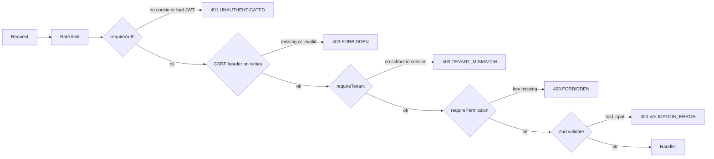

import { Aside, Card, CardGrid, LinkCard } from '@astrojs/starlight/components';
import Api from '../../../components/Api.astro';
import Perm from '../../../components/Perm.astro';
import SourceFile from '../../../components/SourceFile.astro';

This page lists **every endpoint** of the Schola API — all 197 of them. The API
is the Express 5 server in `apps/api`. It listens on port 8000 in development
and is mounted at `/api/v1` on the same host as the web app in production
(`https://schola.reactbd.com/api/v1`). The browser never calls it directly in
either case: the web app proxies `/api/*` to it, so cookies stay first-party.

The list was built by reading the mount points in
<SourceFile path="apps/api/src/app.ts" /> and every `*.routes.ts` file under
`apps/api/src/modules/`. When code and this page disagree, the code wins —
please fix the page.

## At a glance

<CardGrid>
  <Card title="Base URL" icon="server">
    `http://localhost:8000/api/v1` in development (the web app proxies
    `http://localhost:3000/api/v1` to it). `https://schola.reactbd.com/api/v1`
    in production.
  </Card>
  <Card title="Sessions" icon="padlock">
    Cookie-based. `schola_access` (JWT, 15 min), `schola_refresh` (opaque, 30
    days, rotated) and `schola_csrf`. No `Authorization` header is used.
  </Card>
  <Card title="CSRF" icon="approve-check">
    Every `POST`, `PUT`, `PATCH` and `DELETE` on a signed-in route must send the
    `schola_csrf` cookie value back in the `x-csrf-token` header.
  </Card>
  <Card title="Envelope" icon="document">
    Success: `{ success: true, data, meta? }`. Failure:
    `{ success: false, error: { code, message, details?, requestId? } }`. PDFs,
    CSV exports and the Stripe webhook are the only exceptions.
  </Card>
</CardGrid>

## How a request is checked

Each route stacks the same small set of guards. They run in this order, and the
first one that fails ends the request with an error envelope.

- **Rate limit** — `authRateLimit` (10 requests a minute in production, 60 in
  development, per IP) on most `/auth/*` routes; `generalRateLimit` (120 a
  minute, per account or per IP) on tenant routes; `superAdminRateLimit` (60 a
  minute) on `/platform/*`. Over the limit the API answers `429
  RATE_LIMITED`.
- **`requireAuth`** — verifies the `schola_access` JWT, loads the user, rejects
  an inactive or deleted account (`401 INACTIVE_ACCOUNT`), rejects a session
  whose school is no longer `active` (`401 INACTIVE_ACCOUNT`; the school's
  status is cached for 10 seconds), resolves the account's roles in the
  session's school, and checks the CSRF header on writes.
- **`requireTenant`** — the session must carry a `schoolId`. A Super Admin
  (no school) gets `403 TENANT_MISMATCH` on school routes.
- **`requirePermission(a, b)`** — the caller must hold **every** listed key.
  **`requireAnyPermission(a, b)`** — the caller must hold **at least one**.
- **`requireSuperAdmin`** — the caller's primary role must be `super_admin`.

See [Request lifecycle](/architecture/request-lifecycle/) and
[RBAC](/architecture/rbac/) for the full story.

## Reading the tables

| In the "Access" column | Means |
| --- | --- |
| **public** | No session needed. |
| **session** | Any signed-in account, including a visitor with no school. |
| **tenant** | A signed-in account whose session has a school (`requireTenant`). No permission key. |
| `key` | `requirePermission` — the caller needs this key (and a school, unless noted). |
| `a` + `b` | The caller needs both keys. |
| any of `a`, `b` | `requireAnyPermission` — one of the keys is enough. |
| **super admin** + `key` | `/platform/*`: the primary role must be `super_admin` and the key is checked too. |
| *(checked in handler)* | No route-level key; the handler decides from the caller's permissions and people links. The rule is in the purpose column. |

Paths are written in full. In the other docs pages the
<Api method="GET" path="students" perm="student:read" /> chip leaves off the
`/api/v1` prefix.

## Health

<SourceFile path="apps/api/src/modules/health/health.routes.ts" />

| Method | Path | Access | Purpose |
| --- | --- | --- | --- |
| `GET` | `/api/v1/health` | public | Liveness probe. Returns `{ ok: true, service: "schola-api", version, timestamp }` inside the envelope. Use it for load balancer and uptime checks. |

## Auth

Sign-up, sign-in, sessions, email verification, password reset and the Google /
Facebook redirect flow. See [Authentication](/architecture/authentication/) and
[Sign up and sign in](/features/accounts/sign-up-and-sign-in/).

<SourceFile path="apps/api/src/modules/auth/auth.routes.ts" />

| Method | Path | Access | Purpose |
| --- | --- | --- | --- |
| `POST` | `/api/v1/auth/login` | public | Email + password sign-in. Sets the three session cookies and returns the user with `role`, `schoolId` and `permissions`. Fails with `EMAIL_NOT_VERIFIED`, `INACTIVE_ACCOUNT` (inactive account, or every school of the account is suspended, pending or rejected — the message names which), or a lockout message. |
| `POST` | `/api/v1/auth/register` | public | Create a personal account (no school). It gets the platform `user` role and a verification email (link + 6-digit code). |
| `POST` | `/api/v1/auth/google` | public | Sign in with a Firebase Google ID token. Needs the three `FIREBASE_*` server keys, otherwise `503`. |
| `POST` | `/api/v1/auth/logout` | session | Revoke the refresh token and clear the cookies. Works even when the session's school was suspended, so the member can still sign out. |
| `POST` | `/api/v1/auth/refresh` | public (refresh cookie) | Rotate the refresh token and issue a new access token and CSRF cookie. The web client calls it once on the first `401`, then retries. Answers `401 INACTIVE_ACCOUNT` when none of the account's schools is `active`. |
| `GET` | `/api/v1/auth/me` | session | The signed-in user: profile, primary role, school, permission keys, `emailVerifiedAt`. |
| `GET` | `/api/v1/auth/csrf` | public | Issue a fresh `schola_csrf` cookie and return `{ csrfToken }`. |
| `POST` | `/api/v1/auth/forgot-password` | public | Email a password-reset link. Always answers the same way — also when the email can't be delivered — so an email address can't be probed. |
| `POST` | `/api/v1/auth/reset-password` | public | Set a new password with the reset token. Also clears a login lockout, marks the email verified and adds `password` to the account's `authProviders`. |
| `POST` | `/api/v1/auth/verify-email` | public | Verify an email address with the token from the link. |
| `POST` | `/api/v1/auth/verify-email/code` | public | Verify an email address with `{ email, code }` (the 6-digit code). |
| `POST` | `/api/v1/auth/verify-email/resend` | public or session | Send a new verification email. Signed in: to the session's account, no body needed. Signed out: body `{ email }`. Signed out it always answers `202`, whether or not the address has an account or the email could be delivered, and sends at most one email per address per minute. Signed in, a failed send answers `503`. |
| `GET` | `/api/v1/auth/oauth/:provider` | public | Start the Google or Facebook redirect flow (`:provider` = `google` or `facebook`). Sets a short-lived `schola_oauth` state cookie and redirects to the provider. |
| `GET` | `/api/v1/auth/oauth/:provider/callback` | public | The provider redirects here. Exchanges the code, signs the person in and redirects into the app, or to `/login?error=oauth_…` on failure. |

## Schools: sign-up and profile

<SourceFile path="apps/api/src/modules/schools/schools.routes.ts" />
<SourceFile path="apps/api/src/modules/schools/school-profile.routes.ts" />

| Method | Path | Access | Purpose |
| --- | --- | --- | --- |
| `POST` | `/api/v1/schools/signup` | public | Apply for a school: creates the owner account and a school in `pending_approval`. Not CSRF-checked (no session). |
| `POST` | `/api/v1/schools/quick-signup` | session | A signed-in visitor registers a school in one step (used by `/onboarding/school`). |
| `GET` | `/api/v1/schools/mine` | session | The school the caller owns (any status), or `null`. Drives the application card on `/welcome`. |
| `GET` | `/api/v1/schools/current` | tenant + `school:read:tenant` | The caller's own school profile (name, type, contact, locale, currency, status). |
| `PATCH` | `/api/v1/schools/current` | tenant + `school:update:tenant` | Edit the school profile. Status, approval and ownership are never editable here. Audited as `school.update`. |

## Admin transfer

Moving the School Admin role to another member. See
[Admin transfer](/features/school/admin-transfer/).

<SourceFile path="apps/api/src/modules/admin-transfer/admin-transfer.routes.ts" />

| Method | Path | Access | Purpose |
| --- | --- | --- | --- |
| `POST` | `/api/v1/admin-transfer/initiate` | tenant + `school:update:tenant` | The current School Admin offers the role to `{ targetEmail }`, a member of the same school. Answers `202`. Only the school's owner may initiate. If the email can't be delivered the transfer is not started (`503`). |
| `POST` | `/api/v1/admin-transfer/preview` | session | Show which school a transfer `{ token }` is for, before accepting. `POST` so the token stays out of URLs and logs. |
| `POST` | `/api/v1/admin-transfer/accept` | session | Accept the transfer with `{ token }`. The token must have been issued to the caller. |

## Platform console (Super Admin)

Every `/platform/*` route runs `requireAuth`, `requireSuperAdmin` and the
super-admin rate limit first, then checks its own key. See the
[platform console](/features/platform/dashboard/) pages.

<SourceFile path="apps/api/src/modules/platform/platform.routes.ts" />

### Schools

| Method | Path | Access | Purpose |
| --- | --- | --- | --- |
| `GET` | `/api/v1/platform/stats` | super admin + `school:read_all` | Platform dashboard numbers: school counts per status, the five newest sign-ups, and sign-ups per month for the last six months. |
| `GET` | `/api/v1/platform/schools` | super admin + `school:read_all` | Every school, optionally filtered by `?status=`. |
| `GET` | `/api/v1/platform/schools/pending` | super admin + `school:read_all` | Schools in `pending_approval`, newest first. No web page calls it — `/platform/approvals` uses `GET /platform/schools?status=pending_approval`. |
| `GET` | `/api/v1/platform/schools/:id` | super admin + `school:read_all` | One school's detail. |
| `POST` | `/api/v1/platform/schools` | super admin + `school:create_direct` | Create an **active** school and its owner account directly, skipping approval. |
| `POST` | `/api/v1/platform/schools/:id/approve` | super admin + `school:approve` | `pending_approval` → `active`. Seeds the school's roles, makes the owner School Admin, marks their email verified, emails and notifies them. |
| `POST` | `/api/v1/platform/schools/:id/reject` | super admin + `school:reject` | `pending_approval` → `rejected` with `{ reason }`. Deactivates the owner account and emails them. |
| `POST` | `/api/v1/platform/schools/:id/suspend` | super admin + `school:suspend` | `active` → `suspended` with `{ reason }`. Notifies the owner in-app. |
| `POST` | `/api/v1/platform/schools/:id/reactivate` | super admin + `school:suspend` | `suspended` → `active`. |
| `POST` | `/api/v1/platform/schools/:id/force-admin-transfer` | super admin + `admin_transfer:force` | Move school ownership to `{ targetEmail }` with a `{ reason }` when the current admin can't hand over. |

### Users

| Method | Path | Access | Purpose |
| --- | --- | --- | --- |
| `GET` | `/api/v1/platform/users` | super admin + `user:read_all` | Platform-wide user directory. Query: `scope` (`platform`/`all`), `status` (`active`/`inactive`/`all`), `schoolId`, `search`, `page`, `pageSize`. |
| `POST` | `/api/v1/platform/users/invite` | super admin + `user:invite_platform` | Invite another platform user (Super Admin). |
| `POST` | `/api/v1/platform/users/:id/suspend` | super admin + `user:suspend` | Deactivate an account (`isActive: false`) with an optional reason. The person can no longer sign in. |
| `POST` | `/api/v1/platform/users/:id/reactivate` | super admin + `user:suspend` | Re-activate a suspended account. |
| `POST` | `/api/v1/platform/users/:id/roles` | super admin + `user:assign_role` | Grant `{ role, schoolId? }` to a user. |
| `POST` | `/api/v1/platform/users/:id/roles/revoke` | super admin + `user:assign_role` | Revoke `{ role, schoolId? }`. A `POST`, not `DELETE`, so the pair is validated as a body. |

### Settings and audit

<SourceFile path="apps/api/src/modules/audit-logs/audit-logs.routes.ts" />

| Method | Path | Access | Purpose |
| --- | --- | --- | --- |
| `GET` | `/api/v1/platform/settings` | super admin + `system_setting:read` | All four setting categories at once. |
| `GET` | `/api/v1/platform/settings/:category` | super admin + `system_setting:read` | One category: `branding`, `locale`, `email_templates` or `feature_flags`. |
| `PATCH` | `/api/v1/platform/settings/:category` | super admin + `system_setting:write` | Save one category. The body is validated per category in the service. |
| `GET` | `/api/v1/platform/audit-logs` | super admin + `audit_log:read:all` | Audit entries from every school and the platform. Query: `page`, `pageSize`, `from`, `to`, `actorId`, `action` (matches the start of the action name); `to` includes that whole day (UTC). |

## Academics

School structure: academic years, subjects, classes and sections. Every route
needs a school (`requireTenant`). See [Academic years](/features/academics/academic-years/),
[Subjects](/features/academics/subjects/) and
[Classes and sections](/features/academics/classes-and-sections/).

### Academic years

<SourceFile path="apps/api/src/modules/academics/academic-years.routes.ts" />

| Method | Path | Access | Purpose |
| --- | --- | --- | --- |
| `GET` | `/api/v1/academic-years` | `academic_year:read` | List the school's academic years (paginated). |
| `POST` | `/api/v1/academic-years` | `academic_year:create` | Create a year with start and end dates; can be marked current. |
| `PATCH` | `/api/v1/academic-years/:id` | `academic_year:update` | Edit a year or make it the current one. `400` if the end date is not after the start date (a single changed date is checked against the stored one). |
| `DELETE` | `/api/v1/academic-years/:id` | `academic_year:delete` | Soft-delete a year. Refused with `409 CONFLICT` while any class still uses it. |

### Subjects

<SourceFile path="apps/api/src/modules/academics/subjects.routes.ts" />

| Method | Path | Access | Purpose |
| --- | --- | --- | --- |
| `GET` | `/api/v1/subjects` | `subject:read` | List subjects; `q` searches name and code. |
| `POST` | `/api/v1/subjects` | `subject:create` | Create a subject (`name`, unique `code`, description). |
| `PATCH` | `/api/v1/subjects/:id` | `subject:update` | Edit a subject. |
| `DELETE` | `/api/v1/subjects/:id` | `subject:delete` | Soft-delete a subject. |

### Classes

<SourceFile path="apps/api/src/modules/academics/classes.routes.ts" />

| Method | Path | Access | Purpose |
| --- | --- | --- | --- |
| `GET` | `/api/v1/classes` | `class:read` | List classes, optionally for one `academicYearId`. |
| `GET` | `/api/v1/classes/:id` | `class:read` | One class. |
| `POST` | `/api/v1/classes` | `class:create` | Create a class in an academic year, with subjects and an optional class teacher. Every id must belong to the school. |
| `PATCH` | `/api/v1/classes/:id` | `class:update` | Edit a class. |
| `POST` | `/api/v1/classes/:id/assign-teacher` | `class:assign_teacher` | Set the class (homeroom) teacher. No web page calls it — the class form sets the teacher through `PATCH`. |
| `DELETE` | `/api/v1/classes/:id` | `class:delete` | Soft-delete a class. Refused with `409` while it still has sections. |

### Sections

<SourceFile path="apps/api/src/modules/academics/sections.routes.ts" />

| Method | Path | Access | Purpose |
| --- | --- | --- | --- |
| `GET` | `/api/v1/sections` | `section:read` | List sections, optionally for one `classId`. |
| `GET` | `/api/v1/sections/:id` | `section:read` | One section. |
| `POST` | `/api/v1/sections` | `section:create` | Create a section in a class with a capacity (`0` = no limit) and an optional section teacher. |
| `PATCH` | `/api/v1/sections/:id` | `section:update` | Edit a section. |
| `DELETE` | `/api/v1/sections/:id` | `section:delete` | Soft-delete a section. Refused with `409` while students are actively enrolled. |

## People

Teachers, students, parents, staff and enrollments. Personal data (phone, date
of birth, address) is encrypted at rest and decrypted on read. See the
[People](/features/people/students/) pages.

### Teachers

<SourceFile path="apps/api/src/modules/people/teachers.routes.ts" />

| Method | Path | Access | Purpose |
| --- | --- | --- | --- |
| `GET` | `/api/v1/teachers` | `teacher:read` | List teachers (paginated, searchable). |
| `GET` | `/api/v1/teachers/:id` | `teacher:read` | One teacher. |
| `GET` | `/api/v1/teachers/:id/overview` | `teacher:read` | Profile page data: teaching load, attendance and pay. The attendance and pay blocks appear only for callers who hold `staff_attendance:read:all` / `salary:read:all`. |
| `POST` | `/api/v1/teachers` | `teacher:create` | Create a teacher **and** a login account with the `teacher` role; a set-password invite goes out (best-effort: an email failure is logged, the request still answers `201`). `409` if the email or the employee ID (soft-deleted records included) is taken — checked before the account is made, and the account is removed again if the record still fails. |
| `PATCH` | `/api/v1/teachers/:id` | `teacher:update` | Edit a teacher. |
| `DELETE` | `/api/v1/teachers/:id` | `teacher:delete` | Soft-delete a teacher. |

### Students

<SourceFile path="apps/api/src/modules/people/students.routes.ts" />

| Method | Path | Access | Purpose |
| --- | --- | --- | --- |
| `GET` | `/api/v1/students` | `student:read` | List students with their current class and section. |
| `GET` | `/api/v1/students/:id` | `student:read` | One student. |
| `POST` | `/api/v1/students` | `student:create` | Admit a student (unique admission number, linked parents). |
| `PATCH` | `/api/v1/students/:id` | `student:update` | Edit a student. |
| `DELETE` | `/api/v1/students/:id` | `student:delete` | Soft-delete a student, withdraw their active enrollment and remove their `student` sign-in role at this school. |

### Parents

<SourceFile path="apps/api/src/modules/people/parents.routes.ts" />

| Method | Path | Access | Purpose |
| --- | --- | --- | --- |
| `GET` | `/api/v1/parents` | `parent:read` | List parents. |
| `GET` | `/api/v1/parents/:id` | `parent:read` | One parent. |
| `GET` | `/api/v1/parents/:id/overview` | `parent:read` | Profile page data: linked children and where each one sits. |
| `POST` | `/api/v1/parents` | `parent:create` | Create a parent and link children of this school. When an email is given, a login account with the `parent` role is created too and sent a set-password invite (an existing account is linked instead, with no email). |
| `PATCH` | `/api/v1/parents/:id` | `parent:update` | Edit a parent and their linked children. |
| `DELETE` | `/api/v1/parents/:id` | `parent:delete` | Soft-delete a parent. |

### Staff

<SourceFile path="apps/api/src/modules/people/staff.routes.ts" />

| Method | Path | Access | Purpose |
| --- | --- | --- | --- |
| `GET` | `/api/v1/staff` | `staff:read` | List non-teaching staff. |
| `GET` | `/api/v1/staff/:id` | `staff:read` | One staff member. |
| `GET` | `/api/v1/staff/:id/overview` | `staff:read` | Profile page data: attendance and pay (each block needs the matching `:all` read key). |
| `POST` | `/api/v1/staff` | `staff:create` | Create a staff member. When an email is given, a login account with the `staff` role is created too and sent a set-password invite (`409` if the email is taken). The employee ID is checked first, as for teachers. |
| `PATCH` | `/api/v1/staff/:id` | `staff:update` | Edit a staff member. |
| `DELETE` | `/api/v1/staff/:id` | `staff:delete` | Soft-delete a staff member. |

### Enrollments

<SourceFile path="apps/api/src/modules/people/enrollments.routes.ts" />

| Method | Path | Access | Purpose |
| --- | --- | --- | --- |
| `GET` | `/api/v1/enrollments` | `student:read` | List enrollments (who sits in which section, per academic year). |
| `POST` | `/api/v1/enrollments` | `student:create` | Enroll a student in a section. One enrollment per student per year: an `active` one answers `409`, a `withdrawn` or `transferred` one is reopened in the new section (audited as `enrollment.reactivate`). The section must have a free seat (capacity `0` = no limit). |
| `PATCH` | `/api/v1/enrollments/:id` | `student:update` | Move to another section, change the roll number, or set the status (`active`, `transferred`, `graduated`, `withdrawn`). |

## Student records

One student's whole record, read by everyone who may see it: school staff with
`:all` / `:tenant` keys, teachers for students in their own sections, the
student, and linked parents. Each area is decided by `studentAccess()`. A caller
who may see nothing about the student gets `404`, so ids from other families
can't be probed; a caller who may see the student but not this area gets `403`.

<SourceFile path="apps/api/src/modules/student-records/student-records.routes.ts" />
<SourceFile path="apps/api/src/services/scopes/student-access.ts" />

| Method | Path | Access | Purpose |
| --- | --- | --- | --- |
| `GET` | `/api/v1/student-records/:id` | tenant *(checked in handler: profile)* | Profile, current placement and the caller's `access` map. |
| `GET` | `/api/v1/student-records/:id/services` | tenant *(profile)* | Bus route and stop, hostel room, open library loans. |
| `GET` | `/api/v1/student-records/:id/attendance` | tenant *(attendance)* | Attendance records and a summary for a date range (`from`, `to`). |
| `GET` | `/api/v1/student-records/:id/grades` | tenant *(grades)* | Marks grouped by exam. |
| `GET` | `/api/v1/student-records/:id/remarks` | tenant *(remarks)* | Remarks filtered to the visibilities the caller may read. |
| `GET` | `/api/v1/student-records/:id/fees` | tenant *(fees)* | Invoices and payments. |
| `POST` | `/api/v1/student-records/:id/invoices/:invoiceId/checkout` | tenant *(pay)* | Start a Stripe Checkout for one of the student's invoices; `returnTo` picks the page Stripe returns to (`my-fees`, `child`, `fees`). |
| `GET` | `/api/v1/student-records/:id/payments/:paymentId/receipt.pdf` | tenant *(fees)* | The payment receipt PDF. |
| `GET` | `/api/v1/student-records/:id/report-card.pdf` | tenant *(grades)* | The report card PDF for `?examId=`. Never prints `private` remarks. |

How the areas are decided (from `decideStudentAccess`):

| Area | Granted when |
| --- | --- |
| profile | `student:read`, or the caller is the student or a linked parent. |
| attendance | `attendance:read:all`, or `attendance:read:own_classes` and the caller teaches, is, or is a parent of the student. |
| grades | `grade:read:all`, or `grade:read:own_classes` and the same relation. |
| remarks | `remark:read:all` or teaching with `remark:read:own_classes` → all three visibilities; parent → `parent` + `public`; the student → `public`. |
| fees | `fee:read:tenant`, or `fee:read:own` and the caller is the student or a parent. |
| pay | `fee:collect`, or `fee:read:own` and the caller is the student or a parent. |

## Self-service (`/me`)

Everything about the caller: their account, their linked people records and
their own-scope data. Nothing here accepts another user's id.

<SourceFile path="apps/api/src/modules/me/me.routes.ts" />

| Method | Path | Access | Purpose |
| --- | --- | --- | --- |
| `GET` | `/api/v1/me/profile` | session | Account, school and linked student / parent / teacher / staff records. |
| `PATCH` | `/api/v1/me/profile` | session | Change own name and phone. |
| `POST` | `/api/v1/me/password` | session | Change password (current + new). Signs out every other device. |
| `GET` | `/api/v1/me/sessions` | session | Signed-in devices (refresh tokens) for this account. |
| `DELETE` | `/api/v1/me/sessions/:id` | session | Sign one device out. |
| `POST` | `/api/v1/me/sessions/revoke-others` | session | Sign every other device out. |
| `GET` | `/api/v1/me/summary` | tenant | Role-aware dashboard data for members (students, parents, teachers, staff). |
| `GET` | `/api/v1/me/students` | tenant | Students the caller follows: themself and/or their children. |
| `GET` | `/api/v1/me/sections` | tenant + any of `attendance:read:own_classes`, `grade:read:own_classes`, `remark:read:own_classes` | Sections the caller teaches or leads. |
| `GET` | `/api/v1/me/staff-attendance` | tenant + `staff_attendance:read:own` | The caller's own attendance as an employee. |
| `GET` | `/api/v1/me/payslips` | tenant + `salary:read:own` | The caller's own salary records. |
| `GET` | `/api/v1/me/payslips/:id/payslip.pdf` | tenant + `salary:read:own` | One of the caller's own payslips as a PDF. |

## Attendance

<SourceFile path="apps/api/src/modules/attendance/attendance.routes.ts" />
<SourceFile path="apps/api/src/modules/attendance/staff-attendance.routes.ts" />

| Method | Path | Access | Purpose |
| --- | --- | --- | --- |
| `GET` | `/api/v1/attendance` | any of `attendance:read:all`, `attendance:read:own_classes` | One section's register for `?date=&sectionId=`. Teachers are limited to their own sections. |
| `GET` | `/api/v1/attendance/summary` | any of `attendance:read:all`, `attendance:read:own_classes` | Per-section progress for `?date=` (school-wide with `:all`, own sections otherwise). |
| `POST` | `/api/v1/attendance` | `attendance:mark` | Bulk-mark one section for one date (upsert per student: `present`, `absent`, `late`, `excused`). |
| `GET` | `/api/v1/attendance/history` | any of `attendance:read:all`, `attendance:read:own_classes` | Paginated history (`studentId`, `sectionId`, `from`, `to`). Without `:all` it is narrowed to own sections, self and own children. Used by the E2E suite; no web page calls it. |
| `GET` | `/api/v1/staff-attendance` | `staff_attendance:read:all` | Every teacher's and staff member's mark for `?date=`. |
| `POST` | `/api/v1/staff-attendance` | `staff_attendance:mark` | Bulk-mark teachers and staff for one date. |

## Exams, grades and remarks

<SourceFile path="apps/api/src/modules/gradebook/exams.routes.ts" />
<SourceFile path="apps/api/src/modules/gradebook/grades.routes.ts" />
<SourceFile path="apps/api/src/modules/gradebook/remarks.routes.ts" />

| Method | Path | Access | Purpose |
| --- | --- | --- | --- |
| `GET` | `/api/v1/exams` | `exam:read` | List exams, optionally for one `academicYearId`. |
| `POST` | `/api/v1/exams` | `exam:create` | Create an exam (name, dates, max marks, subjects, classes). |
| `PATCH` | `/api/v1/exams/:id` | `exam:update` | Edit an exam. `400` if it would end before it starts (a single changed date is checked against the stored one). |
| `DELETE` | `/api/v1/exams/:id` | `exam:delete` | Soft-delete the exam **and every mark entered for it**. |
| `GET` | `/api/v1/grades` | any of `grade:read:all`, `grade:read:own_classes` | A section's roster with marks for `?examId=&sectionId=&subjectId=`. Teachers only for their own sections. |
| `POST` | `/api/v1/grades` | `grade:enter` | Bulk-enter marks; each entry upserts the (exam, section, subject, student) row and stores the percentage and letter grade. |
| `GET` | `/api/v1/remarks` | any of `remark:read:all`, `remark:read:own_classes` | List remarks (`studentId`, `examId`, `sectionId`). Without `:all`, limited to students in own sections. |
| `POST` | `/api/v1/remarks` | `remark:create` | Write a remark (`behavior`, `academic`, `attendance`, `general`) with a visibility (`private`, `parent`, `public`). Without `remark:read:all`, only about students in your own sections. |
| `DELETE` | `/api/v1/remarks/:id` | `remark:create` *(+ author or admin, checked in handler)* | Delete a remark. Allowed for its author, or anyone holding `school:update:tenant`. |

## Fees

See [Fees](/features/finance/fees/) and [Online payments](/features/finance/online-payments/).

<SourceFile path="apps/api/src/modules/fees/fee-structures.routes.ts" />
<SourceFile path="apps/api/src/modules/fees/fee-invoices.routes.ts" />
<SourceFile path="apps/api/src/modules/fees/fee-payments.routes.ts" />

| Method | Path | Access | Purpose |
| --- | --- | --- | --- |
| `GET` | `/api/v1/fee-structures` | `fee_structure:read` | List fee structures, optionally for one `academicYearId`. |
| `POST` | `/api/v1/fee-structures` | `fee_structure:create` | Create a structure (lines, frequency `one_time` / `monthly` / `quarterly` / `yearly`, classes). |
| `PATCH` | `/api/v1/fee-structures/:id` | `fee_structure:update` | Edit a structure. |
| `GET` | `/api/v1/fee-invoices` | `fee:read:tenant` | List invoices (`studentId`, `academicYearId`, `status`). Each item carries `student: { name, admissionNumber }`. |
| `POST` | `/api/v1/fee-invoices/generate` | `fee_structure:create` | Generate invoices from a structure for a `periodKey`. Idempotent per (student, structure, period). |
| `POST` | `/api/v1/fee-invoices/:id/waive` | `fee:waive` | Waive `{ amount, reason }` of the remaining balance. |
| `POST` | `/api/v1/fee-invoices/:id/checkout` | `fee:collect` | Open a Stripe Checkout for the remaining balance. `409` if the invoice is `paid`, `waived` or `cancelled`; `503` if Stripe is off. |
| `GET` | `/api/v1/fee-payments` | `fee:read:tenant` | List payments (`studentId`, `invoiceId`, `from`, `to`). |
| `POST` | `/api/v1/fee-payments` | `fee:collect` | Record an offline payment (`cash`, `bank_transfer`, `online`, `cheque`, `other`). Updates the invoice to `partial` or `paid`. |
| `GET` | `/api/v1/fee-payments/:id/receipt.pdf` | `fee:read:tenant` | The receipt PDF, streamed inline. |

## Payroll

See [Payroll](/features/finance/payroll/).

<SourceFile path="apps/api/src/modules/payroll/salary-structures.routes.ts" />
<SourceFile path="apps/api/src/modules/payroll/salary-records.routes.ts" />

| Method | Path | Access | Purpose |
| --- | --- | --- | --- |
| `GET` | `/api/v1/salary-structures` | `salary_structure:read` | List salary structures. |
| `POST` | `/api/v1/salary-structures` | `salary_structure:create` | Create a structure (earning and deduction components). |
| `PATCH` | `/api/v1/salary-structures/:id` | `salary_structure:update` | Edit a structure. |
| `GET` | `/api/v1/salary-records` | `salary:read:all` | List payslips (`year`, `month`, `status`, `teacherId`, `staffId`). Each row carries `employee: { name, employeeId }` (or `null`). |
| `POST` | `/api/v1/salary-records/generate` | `salary_structure:create` | Generate payslips for `{ year, month, structureId }` and chosen teachers / staff. Idempotent per (person, year, month). |
| `POST` | `/api/v1/salary-records/:id/pay` | `salary:pay` | Mark a payslip paid with a method and reference (the **Mark paid** drawer on Payroll). `409` if already paid or cancelled. |
| `POST` | `/api/v1/salary-records/:id/checkout` | `salary:pay` | Pay a payslip through Stripe Checkout. |
| `GET` | `/api/v1/salary-records/:id/payslip.pdf` | `salary:read:all` | Any payslip as a PDF. |

## Stripe webhook

<SourceFile path="apps/api/src/modules/stripe/stripe.webhook.ts" />

| Method | Path | Access | Purpose |
| --- | --- | --- | --- |
| `POST` | `/api/v1/stripe/webhook` | Stripe signature | Registered **before** the JSON body parser so the raw body can be verified with `STRIPE_WEBHOOK_SECRET`. Handles `checkout.session.completed` and `checkout.session.async_payment_succeeded` (records a fee payment or marks a payslip paid, by `metadata.kind`), and logs `checkout.session.async_payment_failed`. Answers `503` when the secret is not set and `400` on a bad signature. No session, no envelope: `{ received: true }`. |

## Timetable

See [Timetable](/features/daily/timetable/).

<SourceFile path="apps/api/src/modules/operations/timetable.routes.ts" />

| Method | Path | Access | Purpose |
| --- | --- | --- | --- |
| `GET` | `/api/v1/timetable` | any of `timetable:manage`, `timetable:read` + `section:read` | One section's week for `?sectionId=`. |
| `GET` | `/api/v1/timetable/mine` | `timetable:read` | The signed-in teacher's own week. |
| `GET` | `/api/v1/timetable/student/:id` | `timetable:read` *(+ profile access, checked in handler)* | A student's week, through their current section. `404` unless the caller may see the student (self, parent, or staff with `student:read`). |
| `PUT` | `/api/v1/timetable/slots` | `timetable:manage` | Create or replace one period (`sectionId`, `dayOfWeek` 1–7, `period` 1–16, times, subject, teacher, room). A teacher can't be in two places at once. |
| `DELETE` | `/api/v1/timetable/slots/:id` | `timetable:manage` | Remove a period. |

## Leave

See [Leave](/features/daily/leave/).

<SourceFile path="apps/api/src/modules/operations/leave.routes.ts" />

| Method | Path | Access | Purpose |
| --- | --- | --- | --- |
| `GET` | `/api/v1/leave` | tenant *(checked in handler)* | `?scope=mine` (needs `leave:request`) or `?scope=all` (needs `leave:read:all`), optional `status`. |
| `POST` | `/api/v1/leave` | `leave:request` | Ask for leave for yourself, or — as a parent — for a linked child. |
| `POST` | `/api/v1/leave/:id/cancel` | `leave:request` | Cancel your own `pending` request. |
| `POST` | `/api/v1/leave/:id/decide` | `leave:approve` | Approve or reject a `pending` request (never your own). Approval writes `excused` attendance for each school day it covers, unless the day is already `present` or `late`. |

## Admissions

See [Admissions](/features/campus/admissions/).

<SourceFile path="apps/api/src/modules/operations/admissions.routes.ts" />

| Method | Path | Access | Purpose |
| --- | --- | --- | --- |
| `GET` | `/api/v1/admissions` | `admission:read` | List applications (`status`, `q`). |
| `GET` | `/api/v1/admissions/summary` | `admission:read` | Counts per status for the pipeline header. |
| `GET` | `/api/v1/admissions/:id` | `admission:read` | One application, with decrypted applicant details. |
| `POST` | `/api/v1/admissions` | `admission:manage` | Create an application (status `submitted`). |
| `PATCH` | `/api/v1/admissions/:id` | `admission:manage` | Edit an application that is not yet `enrolled`. |
| `POST` | `/api/v1/admissions/:id/status` | `admission:manage` | Move it through the pipeline (`submitted`, `reviewing`, `interview`, `offered`, `rejected`, `withdrawn`), with an optional interview time and note. |
| `POST` | `/api/v1/admissions/:id/enroll` | `admission:manage` + `student:create` | Create the Student, a Parent for the guardian and an active Enrollment in a section; the application becomes `enrolled`. Uses the same seat check as enrollments (capacity `0` = no limit). |
| `DELETE` | `/api/v1/admissions/:id` | `admission:manage` | Soft-delete an application that is not `enrolled`. |

## Library

See [Library](/features/campus/library/).

<SourceFile path="apps/api/src/modules/operations/library.routes.ts" />

| Method | Path | Access | Purpose |
| --- | --- | --- | --- |
| `GET` | `/api/v1/library/books` | `library:read` | The catalogue with copies available (`q` searches). |
| `POST` | `/api/v1/library/books` | `library:manage` | Add a book. |
| `PATCH` | `/api/v1/library/books/:id` | `library:manage` | Edit a book. |
| `DELETE` | `/api/v1/library/books/:id` | `library:manage` | Remove a book. |
| `GET` | `/api/v1/library/loans` | `library:manage` | Every loan, filtered by `status` (`out`, `overdue`, `returned`). |
| `GET` | `/api/v1/library/loans/mine` | `library:read` | The caller's own loans (as a student, teacher or staff member). |
| `POST` | `/api/v1/library/loans` | `library:manage` | Issue a copy to a student, teacher or staff member with a due date. `409` when no copy is free. |
| `POST` | `/api/v1/library/loans/:id/return` | `library:manage` | Take a copy back. `409` if already returned. |

## Transport

See [Transport](/features/campus/transport/).

<SourceFile path="apps/api/src/modules/operations/transport.routes.ts" />

| Method | Path | Access | Purpose |
| --- | --- | --- | --- |
| `GET` | `/api/v1/transport/routes` | `transport:read` | Bus routes with stops, driver and rider counts. |
| `POST` | `/api/v1/transport/routes` | `transport:manage` | Create a route. |
| `PATCH` | `/api/v1/transport/routes/:id` | `transport:manage` | Edit a route. |
| `DELETE` | `/api/v1/transport/routes/:id` | `transport:manage` | Remove a route. |
| `GET` | `/api/v1/transport/routes/:id/riders` | `transport:read` | Students on a route and their stops. |
| `POST` | `/api/v1/transport/routes/:id/riders` | `transport:manage` | Put `{ studentId, stopName }` on the route. |
| `DELETE` | `/api/v1/transport/routes/:id/riders/:subId` | `transport:manage` | Take a rider off (`:subId` is the assignment id). |

## Hostel

See [Hostel](/features/campus/hostel/).

<SourceFile path="apps/api/src/modules/operations/hostel.routes.ts" />

| Method | Path | Access | Purpose |
| --- | --- | --- | --- |
| `GET` | `/api/v1/hostel/rooms` | `hostel:read` | Rooms with capacity and occupancy. |
| `POST` | `/api/v1/hostel/rooms` | `hostel:manage` | Create a room. |
| `PATCH` | `/api/v1/hostel/rooms/:id` | `hostel:manage` | Edit a room. |
| `DELETE` | `/api/v1/hostel/rooms/:id` | `hostel:manage` | Remove a room. |
| `GET` | `/api/v1/hostel/rooms/:id/occupants` | `hostel:read` | Who sleeps in a room. |
| `POST` | `/api/v1/hostel/rooms/:id/occupants` | `hostel:manage` | Allocate `{ studentId }` to the room; a student who already has a bed is moved. |
| `POST` | `/api/v1/hostel/rooms/:id/occupants/:subId/vacate` | `hostel:manage` | End an allocation (sets `vacatedAt`). |

## Members and roles

A School Admin grants and revokes the staff roles that have no people record:
`principal`, `vice_principal` and `accountant`. The whole router is guarded by
<Perm name="user:assign_role:tenant" />. See
[Members and roles](/features/school/members-and-roles/).

<SourceFile path="apps/api/src/modules/members/members.routes.ts" />

| Method | Path | Access | Purpose |
| --- | --- | --- | --- |
| `GET` | `/api/v1/members` | `user:assign_role:tenant` | Every account in the school with its roles here (`q`, `role`, pagination). |
| `POST` | `/api/v1/members/:id/roles` | `user:assign_role:tenant` | Grant `{ role }` (`principal`, `vice_principal`, `accountant`). |
| `DELETE` | `/api/v1/members/:id/roles/:role` | `user:assign_role:tenant` | Revoke one of those three roles. |

## Notifications and announcements

The notification routes run `requireAuth` only, so they also work for the Super
Admin and for visitors. See [Notifications](/features/communication/notifications/)
and [Announcements](/features/communication/announcements/).

<SourceFile path="apps/api/src/modules/notifications/notifications.routes.ts" />

| Method | Path | Access | Purpose |
| --- | --- | --- | --- |
| `GET` | `/api/v1/notifications` | `notification:read:own` | The caller's notifications (paginated, `unreadOnly=true` / `false` / `1` / `0`). |
| `GET` | `/api/v1/notifications/unread-count` | `notification:read:own` | The badge count for the bell. |
| `PATCH` | `/api/v1/notifications/:id/read` | `notification:read:own` | Mark one notification read. |
| `POST` | `/api/v1/notifications/mark-all-read` | `notification:read:own` | Mark all read. |
| `POST` | `/api/v1/notifications/announce` | tenant + `notification:send:tenant` | Send an announcement `{ title, body, audience[], sendEmail }` to everyone in the chosen roles: one in-app notification each, and email after the response when asked. |
| `GET` | `/api/v1/notifications/announcements` | tenant + `notification:send:tenant` | What this school has sent, newest first. |

## Audit log (school)

<SourceFile path="apps/api/src/modules/audit-logs/audit-logs.routes.ts" />

| Method | Path | Access | Purpose |
| --- | --- | --- | --- |
| `GET` | `/api/v1/audit-logs` | `audit_log:read:tenant` | The school's own audit entries (`page`, `pageSize`, `from`, `to`, `actorId`, `action`; `action` matches the start of the action name; `to` includes that whole day, UTC). The platform-wide list is `/api/v1/platform/audit-logs`. |

## Dashboard and reports

<SourceFile path="apps/api/src/modules/dashboard/dashboard.routes.ts" />
<SourceFile path="apps/api/src/modules/reports/reports.routes.ts" />

| Method | Path | Access | Purpose |
| --- | --- | --- | --- |
| `GET` | `/api/v1/dashboard/summary` | tenant *(blocks gated in handler)* | The school dashboard. Each block is `null` unless the caller holds its key: counts need `school:read:tenant`, finance needs `fee:read:tenant`, payroll needs `salary:read:all`, attendance needs `attendance:read:all`. |
| `GET` | `/api/v1/reports/overview` | any of `attendance:read:all`, `fee:read:tenant`, `grade:read:all` | Charts and tables for `/app/reports`; each part is filled only for the keys the caller holds. |
| `GET` | `/api/v1/reports/fees/export.csv` | `report:export` + `fee:read:tenant` | Invoices as CSV (`academicYearId`, `status`). |
| `GET` | `/api/v1/reports/attendance/export.csv` | `report:export` + `attendance:read:all` | Attendance as CSV. |
| `GET` | `/api/v1/reports/payroll/export.csv` | `report:export` + `salary:read:all` | Salary records as CSV. |

## Endpoint count by module

| Module | Endpoints |
| --- | --- |
| Health | 1 |
| Auth | 14 |
| Schools (sign-up, mine, current) | 5 |
| Admin transfer | 3 |
| Platform (schools, users, settings, audit) | 20 |
| Academics | 19 |
| People (incl. enrollments) | 26 |
| Student records | 9 |
| Self-service `/me` | 12 |
| Attendance + staff attendance | 6 |
| Exams, grades, remarks | 9 |
| Fees | 10 |
| Payroll | 8 |
| Stripe webhook | 1 |
| Timetable | 5 |
| Leave | 4 |
| Admissions | 8 |
| Library | 8 |
| Transport | 7 |
| Hostel | 7 |
| Members | 3 |
| Notifications + announcements | 6 |
| Audit log (school) | 1 |
| Dashboard + reports | 5 |
| **Total** | **197** |

That is 196 routes declared on module routers plus the Stripe webhook, which
is registered directly on the app in `app.ts`.

## Error codes

Every error comes back in the envelope with one of these `code` values
(<SourceFile path="packages/types/src/envelope.ts" />).

| Code | HTTP | Typical cause |
| --- | --- | --- |
| `UNAUTHENTICATED` | 401 | No or expired access cookie; wrong email or password; account locked; missing refresh token. |
| `FORBIDDEN` | 403 | A permission key is missing (`Missing permission: …`), the CSRF header is missing or invalid, or an own-scope rule refuses (for example "Cannot mark attendance for this section."). |
| `TENANT_MISMATCH` | 403 | A school route was called without a school in the session (typically by a Super Admin). |
| `NOT_FOUND` | 404 | Unknown id, an id from another school, or an unknown route (`Route not found: METHOD /path`). |
| `VALIDATION_ERROR` | 400 | Zod rejected the input (`details` holds the flattened issues), or a business rule failed (for example "Payment exceeds remaining balance"). |
| `CONFLICT` | 409 | Wrong status for the action, a duplicate unique key (`Another record already uses this …`), a full section. |
| `RATE_LIMITED` | 429 | Too many requests in a minute. |
| `INACTIVE_ACCOUNT` | 401 / 403 | The account is deactivated, deleted or still waiting for school approval, or the session's school is suspended, pending or rejected (403 at sign-in, 401 on requests and refresh). |
| `EMAIL_NOT_VERIFIED` | 403 | Password sign-in before the email address was verified. |
| `INTERNAL_ERROR` | 500 / 503 | Unhandled error (`Something went wrong.`), or an external service that is not configured (Stripe, Google sign-in). |

## Edge cases and gotchas

:::caution[Things the code does that you might not expect]
- **`/api/v1/platform/audit-logs` passes two guard stacks.** It is mounted after
  the `/api/v1/platform` router, whose `use(requireAuth, requireSuperAdmin, …)`
  runs for every path under `/platform` first. The result is the same, but the
  super-admin rate limit is counted twice per request.
:::

:::note[Remark deletion: the author or the School Admin]
"Admin" in `DELETE /remarks/:id` means "holds `school:update:tenant`". This is
intended: the author can delete their own remark, the School Admin can delete
any, and a Principal who wrote no remark cannot delete one even though they hold
`remark:read:all`.
:::

## Related pages

<CardGrid>
  <LinkCard title="Permissions" description="Every permission key and which roles hold it." href="/reference/permissions/" />
  <LinkCard title="Web routes" description="Every page of the web app and who can open it." href="/reference/web-routes/" />
  <LinkCard title="API conventions" description="Envelope, pagination, validation and errors in depth." href="/architecture/api-conventions/" />
  <LinkCard title="Statuses" description="Every enum and lifecycle the endpoints move through." href="/reference/statuses/" />
</CardGrid>
