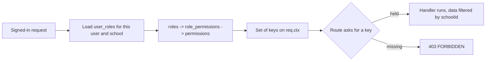

import { Aside, Card, CardGrid, LinkCard } from '@astrojs/starlight/components';
import Perm from '../../../components/Perm.astro';
import Roles from '../../../components/Roles.astro';
import SourceFile from '../../../components/SourceFile.astro';

A [permission](/start-here/glossary/#permission) is a short key, like
<Perm name="student:create" />, that names one thing a person may do. A
[role](/start-here/glossary/#role) is a bundle of keys. The server never asks
"is this person a Principal?" — every API route asks "does this person hold
this key in this school?". This page lists all **95 keys** and shows, for each
one, which roles hold it.

Two files are the source of truth, and this page is generated from them:

- <SourceFile path="packages/types/src/permissions.ts" symbol="PERMISSIONS" /> — the list of keys. TypeScript
  rejects any key that is not in it.
- <SourceFile path="apps/api/src/services/rbac/permissions.ts" symbol="ROLE_PERMISSIONS" /> — the default bundle for each role.

## At a glance

<CardGrid>
  <Card title="95 keys" icon="list-format">
    13 platform keys (Super Admin only) and 82 school keys.
  </Card>
  <Card title="10 bundles" icon="puzzle">
    Super Admin 14 · School Admin 77 · Principal 43 · Vice Principal 23 ·
    Teacher 18 · Accountant 27 · Student 7 · Parent 6 · Staff 5 · `user` 1.
  </Card>
  <Card title="Every key is enforced" icon="approve-check">
    Each of the 95 keys is checked by at least one API route or handler. There
    are no dead keys.
  </Card>
  <Card title="Seeded on every boot" icon="setting">
    The API re-applies the bundles to every approved school at start-up
    (additive only), so a new key reaches existing schools without a migration.
  </Card>
</CardGrid>

## How keys are named

Keys read `resource:action` or `resource:action:scope`.

| Part | Examples | Meaning |
| --- | --- | --- |
| resource | `student`, `fee`, `salary`, `timetable` | The thing being acted on. |
| action | `create`, `read`, `update`, `delete`, `mark`, `enter`, `collect`, `waive`, `pay`, `manage`, `approve`, `request` | What is done to it. `manage` covers every write in a module. |
| scope `:all` | `attendance:read:all` | Everything in the school. |
| scope `:tenant` | `fee:read:tenant`, `school:update:tenant` | Everything in the caller's own school (same reach as `:all`, older naming). |
| scope `:own_classes` | `grade:read:own_classes` | Only sections the caller teaches or leads — or, for students and parents, their own or their children's records. |
| scope `:own` | `salary:read:own`, `fee:read:own` | Only records that belong to the caller (or their children, for fees). |
| `_all` suffix | `school:read_all`, `user:read_all` | Platform-wide (every school). |

## How a key is checked

1. On every request `requireAuth` calls `resolveUserPermissions(userId,
   schoolId)`. It loads the person's `user_roles` rows for the school in their
   session, then the `role_permissions` of those roles, and returns the union
   of keys plus the highest-ranked role as the primary role.
2. A route declares what it needs with `requirePermission(...)` (all keys) or
   `requireAnyPermission(...)` (one is enough). A missing key answers
   `403 FORBIDDEN` with the message `Missing permission: <key>`.
3. `:own` and `:own_classes` keys only open the door. The handler then narrows
   the data through the people records — see
   [Own-scope reads](#own-scope-reads) below.
4. The web app receives the same key list from `GET /auth/me` and uses it only
   to hide menu items and buttons (`<Can>` and `useCan()`). Hiding is never the
   security boundary; the API is.

[RBAC](/architecture/rbac/) explains the model and the database tables in depth.

## The matrix

Columns are the eight school roles. "VP" is the Vice Principal. A tick means
the role's default bundle contains the key.

### Platform — super_admin only

| Key | What it allows | Held by |
| --- | --- | --- |
| `school:approve` | Approve a school application (`pending_approval` → `active`). | `super_admin` |
| `school:reject` | Reject a school application with a reason. | `super_admin` |
| `school:suspend` | Suspend an active school, and reactivate a suspended one. | `super_admin` |
| `school:read_all` | Read every school, the pending queue and the platform stats. | `super_admin` |
| `school:create_direct` | Create an active school and its owner directly, skipping approval. | `super_admin` |
| `audit_log:read:all` | Read the audit log of the whole platform. | `super_admin` |
| `admin_transfer:force` | Force a school's ownership onto another account. | `super_admin` |
| `user:read_all` | Read the platform-wide user directory. | `super_admin` |
| `user:invite_platform` | Invite another platform user (Super Admin). | `super_admin` |
| `user:suspend` | Suspend and reactivate any account. | `super_admin` |
| `user:assign_role` | Grant or revoke any role for any user, in any school. | `super_admin` |
| `system_setting:read` | Read platform settings (branding, locale, email templates, feature flags). | `super_admin` |
| `system_setting:write` | Change platform settings. | `super_admin` |

### Tenant — schools & academics

| Key | What it allows | Admin | Principal | VP | Teacher | Accountant | Student | Parent | Staff |
| --- | --- | --- | --- | --- | --- | --- | --- | --- | --- |
| `school:read:tenant` | Read the own school's profile; unlocks the school-wide counts on the dashboard. | ✓ | ✓ | ✓ |  | ✓ |  |  |  |
| `school:update:tenant` | Edit the school profile, start an admin transfer, delete anyone's remark. | ✓ |  |  |  |  |  |  |  |
| `academic_year:create` | Create academic years. | ✓ |  |  |  |  |  |  |  |
| `academic_year:update` | Edit academic years and set the current one. | ✓ |  |  |  |  |  |  |  |
| `academic_year:delete` | Delete an academic year no class uses. | ✓ |  |  |  |  |  |  |  |
| `academic_year:read` | List academic years. | ✓ | ✓ | ✓ | ✓ | ✓ |  |  |  |
| `class:create` | Create classes. | ✓ | ✓ |  |  |  |  |  |  |
| `class:update` | Edit classes. | ✓ | ✓ |  |  |  |  |  |  |
| `class:delete` | Delete a class with no sections. | ✓ |  |  |  |  |  |  |  |
| `class:read` | List and open classes. | ✓ | ✓ | ✓ | ✓ | ✓ |  |  |  |
| `class:assign_teacher` | Set a class's homeroom teacher through the dedicated endpoint. | ✓ | ✓ |  |  |  |  |  |  |
| `section:create` | Create sections. | ✓ | ✓ |  |  |  |  |  |  |
| `section:update` | Edit sections. | ✓ | ✓ |  |  |  |  |  |  |
| `section:delete` | Delete a section with no active students. | ✓ |  |  |  |  |  |  |  |
| `section:read` | List and open sections; also needed to read a section's timetable. | ✓ | ✓ | ✓ | ✓ | ✓ |  |  |  |
| `subject:create` | Create subjects. | ✓ | ✓ |  |  |  |  |  |  |
| `subject:update` | Edit subjects. | ✓ | ✓ |  |  |  |  |  |  |
| `subject:delete` | Delete subjects. | ✓ |  |  |  |  |  |  |  |
| `subject:read` | List subjects. | ✓ | ✓ | ✓ | ✓ | ✓ |  |  |  |

### Tenant — people

| Key | What it allows | Admin | Principal | VP | Teacher | Accountant | Student | Parent | Staff |
| --- | --- | --- | --- | --- | --- | --- | --- | --- | --- |
| `student:create` | Admit students, enroll them, and enroll an admissions applicant. | ✓ | ✓ |  |  |  |  |  |  |
| `student:read` | List and open students and enrollments; see any student's profile. | ✓ | ✓ | ✓ | ✓ | ✓ |  |  |  |
| `student:update` | Edit students and change enrollments. | ✓ | ✓ |  |  |  |  |  |  |
| `student:delete` | Delete students. | ✓ |  |  |  |  |  |  |  |
| `teacher:create` | Create teachers (with a login account). | ✓ |  |  |  |  |  |  |  |
| `teacher:read` | List and open teachers. | ✓ | ✓ | ✓ |  | ✓ |  |  |  |
| `teacher:update` | Edit teachers. | ✓ | ✓ |  |  |  |  |  |  |
| `teacher:delete` | Delete teachers. | ✓ |  |  |  |  |  |  |  |
| `parent:create` | Create parents. | ✓ |  |  |  |  |  |  |  |
| `parent:read` | List and open parents. | ✓ | ✓ | ✓ |  | ✓ |  |  |  |
| `parent:update` | Edit parents and their linked children. | ✓ |  |  |  |  |  |  |  |
| `parent:delete` | Delete parents. | ✓ |  |  |  |  |  |  |  |
| `staff:create` | Create non-teaching staff. | ✓ |  |  |  |  |  |  |  |
| `staff:read` | List and open staff. | ✓ | ✓ |  |  | ✓ |  |  |  |
| `staff:update` | Edit staff. | ✓ |  |  |  |  |  |  |  |
| `staff:delete` | Delete staff. | ✓ |  |  |  |  |  |  |  |

### Tenant — attendance & academics

| Key | What it allows | Admin | Principal | VP | Teacher | Accountant | Student | Parent | Staff |
| --- | --- | --- | --- | --- | --- | --- | --- | --- | --- |
| `attendance:mark` | Take a section's register (teachers: own sections only). | ✓ |  |  | ✓ |  |  |  |  |
| `attendance:read:own_classes` | Read attendance for own sections, self or own children. |  |  |  | ✓ |  | ✓ | ✓ |  |
| `attendance:read:all` | Read every section's attendance; dashboard and reports attendance. | ✓ | ✓ | ✓ |  |  |  |  |  |
| `staff_attendance:mark` | Mark teachers' and staff's daily attendance. | ✓ |  |  |  |  |  |  |  |
| `staff_attendance:read:own` | Read your own attendance as an employee (needs a linked teacher or staff record). | ✓ | ✓ | ✓ | ✓ | ✓ |  |  | ✓ |
| `staff_attendance:read:all` | Read every employee's attendance. | ✓ |  |  |  |  |  |  |  |
| `grade:enter` | Enter marks (teachers: own sections only). | ✓ |  |  | ✓ |  |  |  |  |
| `grade:read:own_classes` | Read marks for own sections, self or own children. |  |  |  | ✓ |  | ✓ | ✓ |  |
| `grade:read:all` | Read every section's marks; reports. | ✓ | ✓ | ✓ |  |  |  |  |  |
| `remark:create` | Write remarks (without `remark:read:all`: own students only) and delete own remarks. | ✓ | ✓ | ✓ | ✓ |  |  |  |  |
| `remark:read:own_classes` | Read remarks about students in own sections. |  |  |  | ✓ |  |  |  |  |
| `remark:read:all` | Read every remark in the school, all visibilities. | ✓ | ✓ | ✓ |  |  |  |  |  |
| `exam:create` | Create exams. | ✓ | ✓ |  |  |  |  |  |  |
| `exam:update` | Edit exams. | ✓ | ✓ |  |  |  |  |  |  |
| `exam:delete` | Delete an exam and all its marks. | ✓ | ✓ |  |  |  |  |  |  |
| `exam:read` | List exams. | ✓ | ✓ | ✓ | ✓ |  |  |  |  |

### Tenant — finance

| Key | What it allows | Admin | Principal | VP | Teacher | Accountant | Student | Parent | Staff |
| --- | --- | --- | --- | --- | --- | --- | --- | --- | --- |
| `fee_structure:create` | Create fee structures and generate invoices from them. | ✓ |  |  |  | ✓ |  |  |  |
| `fee_structure:update` | Edit fee structures. | ✓ |  |  |  | ✓ |  |  |  |
| `fee_structure:read` | List fee structures. | ✓ |  |  |  | ✓ |  |  |  |
| `fee:collect` | Record payments, start Checkout for any invoice. | ✓ |  |  |  | ✓ |  |  |  |
| `fee:read:own` | Read and pay the fees of self or own children. |  |  |  |  |  | ✓ | ✓ |  |
| `fee:read:tenant` | Read every invoice and payment, receipts; dashboard finance. | ✓ |  |  |  | ✓ |  |  |  |
| `fee:waive` | Waive part or all of an invoice balance. | ✓ |  |  |  | ✓ |  |  |  |
| `salary_structure:create` | Create salary structures and generate payslips. | ✓ |  |  |  | ✓ |  |  |  |
| `salary_structure:update` | Edit salary structures. | ✓ |  |  |  | ✓ |  |  |  |
| `salary_structure:read` | List salary structures. | ✓ |  |  |  | ✓ |  |  |  |
| `salary:read:own` | Read and download your own payslips. |  |  |  | ✓ |  |  |  | ✓ |
| `salary:read:all` | Read every payslip and PDF; dashboard payroll; pay blocks on profiles. | ✓ |  |  |  | ✓ |  |  |  |
| `salary:pay` | Mark payslips paid, or pay them through Checkout. | ✓ |  |  |  | ✓ |  |  |  |

### Tenant — timetable, leave, admissions

| Key | What it allows | Admin | Principal | VP | Teacher | Accountant | Student | Parent | Staff |
| --- | --- | --- | --- | --- | --- | --- | --- | --- | --- |
| `timetable:read` | See timetables (a section's week needs `section:read` too). | ✓ | ✓ | ✓ | ✓ |  | ✓ | ✓ |  |
| `timetable:manage` | Create, replace and delete timetable periods. | ✓ | ✓ |  |  |  |  |  |  |
| `leave:request` | Ask for leave (self, or a linked child) and cancel it while pending. | ✓ | ✓ | ✓ | ✓ | ✓ | ✓ | ✓ | ✓ |
| `leave:approve` | Approve or reject someone else's pending leave. | ✓ | ✓ | ✓ |  |  |  |  |  |
| `leave:read:all` | See every leave request in the school. | ✓ | ✓ | ✓ |  |  |  |  |  |
| `admission:read` | See applications and the pipeline summary. | ✓ | ✓ | ✓ |  |  |  |  |  |
| `admission:manage` | Create, edit, move, enroll and delete applications. | ✓ | ✓ |  |  |  |  |  |  |

### Tenant — library, transport, hostel

| Key | What it allows | Admin | Principal | VP | Teacher | Accountant | Student | Parent | Staff |
| --- | --- | --- | --- | --- | --- | --- | --- | --- | --- |
| `library:read` | Browse the catalogue and see your own loans. | ✓ | ✓ | ✓ | ✓ | ✓ | ✓ |  | ✓ |
| `library:manage` | Manage books, issue and return copies, see every loan. | ✓ | ✓ |  |  |  |  |  |  |
| `transport:read` | See bus routes and riders. | ✓ | ✓ | ✓ |  | ✓ |  |  |  |
| `transport:manage` | Manage routes and riders. | ✓ |  |  |  |  |  |  |  |
| `hostel:read` | See rooms and occupants. | ✓ | ✓ | ✓ |  | ✓ |  |  |  |
| `hostel:manage` | Manage rooms; allocate, move and vacate students. | ✓ |  |  |  |  |  |  |  |

### Tenant — meta

| Key | What it allows | Admin | Principal | VP | Teacher | Accountant | Student | Parent | Staff |
| --- | --- | --- | --- | --- | --- | --- | --- | --- | --- |
| `user:assign_role:tenant` | Grant or revoke Principal, Vice Principal and Accountant in the own school. | ✓ |  |  |  |  |  |  |  |
| `audit_log:read:tenant` | Read the own school's audit log. | ✓ | ✓ |  |  |  |  |  |  |
| `report:export` | Download the CSV exports. Each export also needs the matching read key: fees `fee:read:tenant`, attendance `attendance:read:all`, payroll `salary:read:all`. | ✓ | ✓ |  |  | ✓ |  |  |  |
| `notification:read:own` | Read and mark your own notifications. | ✓ | ✓ | ✓ | ✓ | ✓ | ✓ | ✓ | ✓ |
| `notification:send:tenant` | Send announcements to the school and see what was sent. | ✓ | ✓ |  |  |  |  |  |  |

### Keys outside the school bundles

Two roles have no school:

- <Roles list={['super_admin']} /> holds the 13 platform keys above plus
  <Perm name="notification:read:own" />, so it can read the sign-up
  notifications addressed to it. It holds **no** school key, and every school
  route also needs a school in the session, so a Super Admin cannot open
  `/app/*` data.
- The platform `user` role (a [visitor](/start-here/glossary/#visitor) — signed
  in, no school yet) holds only <Perm name="notification:read:own" />.

## Own-scope reads

The `:own` and `:own_classes` keys are resolved through the people records, in
<SourceFile path="apps/api/src/services/scopes/student-access.ts" /> and
<SourceFile path="apps/api/src/services/scopes/teacher-scope.ts" />:

| Who | What "own" means | Link used |
| --- | --- | --- |
| Teacher | Sections they lead (`Section.teacherId`), sections of classes they are homeroom teacher for (`Class.classTeacherId`), and the students actively enrolled there. | `Teacher.userId` |
| Student | Their own `Student` record. | `Student.userId` |
| Parent | Every student whose `parentIds` contains their `Parent` record. | `Parent.userId` |
| Anyone as an employee | Their own `StaffAttendance` and `SalaryRecord` rows — for any role holding the `:own` key whose account is linked to a teacher or staff record (for example the demo Accountant, linked to staff record `STF-002`). | `Teacher.userId` / `Staff.userId` |

Remarks also carry a visibility: parents read `parent` and `public` remarks
about their children, students read `public` remarks about themselves, and
holders of `remark:read:all` (or a teacher of the student) read all three.
Report cards never print `private` remarks.

Students and parents see the student's bus route, hostel room and open library
loans on the student record (`GET /student-records/:id/services`) through the
same link check — no extra key.

## Who can change the bundles

- **Nobody, from the UI.** There is no screen that edits a role's bundle. The
  bundles are code; change `ROLE_PERMISSIONS` and restart the API.
- **Granting roles to people** is separate. A School Admin grants or revokes
  `principal`, `vice_principal` and `accountant` on `/app/members`
  (<Perm name="user:assign_role:tenant" />). Teacher, student, parent and staff
  roles follow the people records. `school_admin` only moves by
  [admin transfer](/features/school/admin-transfer/). The Super Admin can grant
  any role with <Perm name="user:assign_role" />.

### Adding a key

In short:

1. Add the key to `PERMISSIONS` in `packages/types/src/permissions.ts`.
2. Add it to the right bundles in `apps/api/src/services/rbac/permissions.ts`.
   A start-up check throws if a bundle names an unknown key.
3. Guard the route with `requirePermission("your:key")`.
4. Gate the menu item or button in the web app with `permission` /
   `<Can permission="…">`.
5. Restart the API — `seedPermissions()` inserts the key and
   `syncExistingTenantRoles()` wires it into every `active` and `suspended`
   school's roles.
6. Update this page and `docs/permissions.md`.

:::caution[Sync is additive only]
Start-up sync only **adds** grants. Removing a key from a bundle in code does
not remove it from schools that already have it — the old `role_permissions`
rows stay until someone deletes them in the database.
:::

## Edge cases and gotchas

:::note[Export needs export and read]
Each CSV export checks two keys: <Perm name="report:export" /> **and** the read
key for that data. In practice the School Admin can download all three, the
Accountant the fees and payroll CSVs, and the Principal the attendance CSV only.
:::

:::note[Deleting someone else's remark]
`DELETE /remarks/:id` lets the remark's author delete it, and otherwise
requires <Perm name="school:update:tenant" /> — in practice the School Admin.
This is intended: Principals and Vice Principals can write remarks about any
student but can only delete their own.
:::

:::caution[Differences between the code and the written spec]
- **`user:impersonate`** is listed in `docs/permissions.md` as a future key. It
  does not exist in the code.
- **The Vice Principal bundle is fixed.** The original spec calls it "a configurable
  subset of principal", but there is no configuration — it is a hard-coded list
  of 23 keys.
- **Staff attendance for everyone is School Admin only.** Among the management
  roles only the School Admin holds `staff_attendance:mark` and
  `staff_attendance:read:all`, so Principals and Vice Principals do not see the
  Staff attendance page (they can read their own record if their account is
  linked to a teacher or staff record).
:::

## Related pages

<CardGrid>
  <LinkCard title="Roles" description="Each role's scope, landing page, menu and bundle size." href="/reference/roles/" />
  <LinkCard title="API endpoints" description="Which route checks which key." href="/reference/api-endpoints/" />
  <LinkCard title="RBAC" description="How roles, permissions and memberships fit together." href="/architecture/rbac/" />
  <LinkCard title="Roles at a glance" description="A plain-language tour of who does what." href="/start-here/roles-at-a-glance/" />
</CardGrid>
