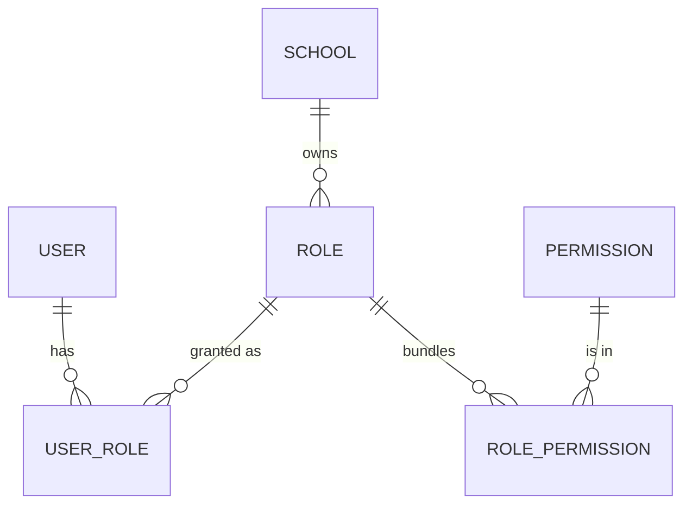

import { Aside, Card, CardGrid, LinkCard } from '@astrojs/starlight/components';
import Roles from '../../../components/Roles.astro';
import Route from '../../../components/Route.astro';
import Perm from '../../../components/Perm.astro';
import SourceFile from '../../../components/SourceFile.astro';
import DemoLogin from '../../../components/DemoLogin.astro';

A [role](/start-here/glossary/#role) is a named bundle of
[permissions](/start-here/glossary/#permission). Schola has **nine roles**
from the original spec — one on the platform and eight inside a school — plus a tenth,
technical role called `user` for people who have signed up but belong to no
school yet. This page is the reference for all ten.

The role keys live in <SourceFile path="packages/types/src/roles.ts" />, the
bundles in <SourceFile path="apps/api/src/services/rbac/permissions.ts" />, and
the display names in <SourceFile path="apps/api/src/services/rbac/seed.ts" symbol="ROLE_LABEL" />.

## At a glance

| Key | Name | Scope | Lands on | Keys | In one line |
| --- | --- | --- | --- | --- | --- |
| `super_admin` | Super Admin | Platform | `/platform` | 14 | Owns the platform. Approves, suspends and audits schools; manages platform users and settings. |
| `school_admin` | School Admin | School | `/app` | 77 | Owns one school. Manages every part of it and can hand ownership over. |
| `principal` | Principal | School | `/app` | 43 | Academic head. Runs classes, exams, timetable, admissions, library. No billing, no admin transfer. |
| `vice_principal` | Vice Principal | School | `/app` | 23 | Read-mostly academic access; approves leave and writes remarks. |
| `teacher` | Teacher | School | `/app` | 18 | Their own sections only: registers, marks, remarks; own attendance and payslips. |
| `accountant` | Accountant | School | `/app` | 27 | Fees, payroll and financial reports. Reads the school's structure and people; edits nothing academic. |
| `student` | Student | School | `/app` | 7 | Reads their own attendance, grades, fees and timetable. |
| `parent` | Parent | School | `/app` | 6 | Reads their linked children's records and pays their fees. |
| `staff` | Staff | School | `/app` | 5 | Non-teaching staff. Their own attendance and payslips. |
| `user` | User | Platform (no school) | `/welcome` | 1 | A signed-in [visitor](/start-here/glossary/#visitor). Can register a school or wait to be added to one. |

"Lands on" is where the login form sends the person. Tenant roles go to the
`?next=` path if there is one, otherwise `/app`.

## How roles are stored

- `roles` — one row per role **per school**. Tenant roles are created for a
  school when it is approved (`seedTenantRoles`), with `schoolId` set. The two
  platform roles (`super_admin`, `user`) have `schoolId: null` and are seeded
  on every API start.
- `user_roles` — `{ userId, roleId, schoolId }`. One person can hold several
  roles in a school.
- `role_permissions` — links a role row to permission rows. Re-applied
  additively on every API start for every `active` and `suspended` school.

### The primary role

When a person holds more than one role, the highest-ranked one becomes their
**primary role** (`ctx.role`, returned as `role` by `GET /auth/me`). The web app
uses it to pick the console; the permissions of **all** their roles are merged.

| Rank | 100 | 90 | 80 | 70 | 60 | 50 | 40 | 20 | 10 | 5 |
| --- | --- | --- | --- | --- | --- | --- | --- | --- | --- | --- |
| Role | `super_admin` | `school_admin` | `principal` | `vice_principal` | `accountant` | `teacher` | `staff` | `parent` | `student` | `user` |

### Which school the session uses

At sign-in the API walks the person's membership rows and takes the **first
school whose status is `active`**, then puts it in the access token (`sid`).
There is no school switcher yet, so a person who belongs to two active schools
always works in the first one found.

If none of their schools is `active` — every one is `suspended`,
`pending_approval` or `rejected` — sign-in is refused with `403
INACTIVE_ACCOUNT` and a message naming the reason (for example "This school is
suspended, so sign-in is paused for everyone there."). A Super Admin falls back
to the platform context instead. The same check runs on every school request
and on refresh, which answer `401`, so an open session ends as soon as its
school is suspended. See [Statuses](/reference/statuses/#school-status).

### Which console a role opens

| Console | Layout guard | Roles allowed | Wrong role is sent to |
| --- | --- | --- | --- |
| School app `/app/*` | `RequireRole` in `(tenant)/app/layout.tsx` | the eight school roles | `/welcome` |
| Platform console `/platform/*` | `RequireRole` in `(super-admin)/platform/layout.tsx` | `super_admin` | `/welcome` |
| `/admin-transfer` | `RequireRole` in `accept-transfer.tsx` | the eight school roles and `user` | `/platform` |
| `/welcome`, `/onboarding/school` | in-page redirect | `user` | `super_admin` → `/platform`, others → `/app` |

## Platform roles

### Super Admin

<Roles list={['super_admin']} />

- **Scope:** the whole platform. No school (`schoolId: null`), so every school
  route answers `403 TENANT_MISMATCH`.
- **Lands on:** <Route path="/platform" />.
- **Keys (14):** all 13 platform keys plus <Perm name="notification:read:own" />.
- **Sidebar:** Dashboard · All schools · Approvals · Users · Audit log ·
  Notifications · Settings · Branding · Locale · Email · Feature flags. The
  platform menu has no permission conditions — every item is shown.
- **How someone gets it:** the `grant-role` CLI
  (`pnpm --filter @schola/api run grant-role -- --email you@example.com --role super_admin`),
  an invite from another Super Admin (`/platform/users`, <Perm name="user:invite_platform" />),
  or a grant from another Super Admin (<Perm name="user:assign_role" />). The CLI
  also sets `isActive`, `isPlatformUser` and `emailVerifiedAt`.

<DemoLogin as="Super Admin" email="superadmin@schola.example" go="/platform" />

### User (visitor)

<Roles list={['user']} />

- **Scope:** platform, but no school and no school data.
- **Lands on:** <Route path="/welcome" />.
- **Keys (1):** <Perm name="notification:read:own" />.
- **Sidebar:** Dashboard (`/welcome`) · Register a school · Pricing · Contact.
- **How someone gets it:** every account created through `POST /auth/register`
  gets it. Login also self-heals: a non-platform account with no role rows at
  all is given `user` so it can reach `/welcome`.

A *visitor* is the original spec's word for this state — "signed in, no school". It is a
label, not one of the nine spec roles. When a visitor's school is approved, or a
school adds them, they gain a school membership. From then on sign-in picks
that school, the session holds only that school's roles (the `user` row has no
school, so it is not part of a school session), and they land on `/app`. See
[Onboarding and welcome](/features/accounts/onboarding-and-welcome/).

## School roles

All eight land on <Route path="/app" />. The sidebar is built per person from
their permissions **and** their people links (whether a Teacher, Student, Parent
or Staff record points at their account). The lists below assume the usual
case: the School Admin, Principal, Vice Principal and Accountant have no people
record; a Teacher has a teacher record, and so on. Every role also sees
"Notifications" and "My profile".

The dashboard at `/app` depends on one key: people with
<Perm name="school:read:tenant" /> get the school dashboard, everyone else gets
their own member dashboard.

### School Admin

<Roles list={['school_admin']} />

- **Keys (77):** every school key except five own-scope reads
  (`attendance:read:own_classes`, `grade:read:own_classes`,
  `remark:read:own_classes`, `salary:read:own`, `fee:read:own`). It does hold
  `staff_attendance:read:own`, for an admin who is also on the payroll.
- **Sidebar:** Dashboard, Reports · Academic years, Subjects, Classes &
  sections · Students, Teachers, Parents, Staff, Admissions · Timetable, Leave ·
  Student attendance, Staff attendance · Exams, Gradebook, Remarks · Library,
  Transport, Hostel · Fees, Payroll · Announcements, Members & roles, Audit log,
  School settings.
- **Only this role can:** edit the school profile, start an
  [admin transfer](/features/school/admin-transfer/), grant staff roles,
  delete students / teachers / parents / staff, mark staff attendance, manage
  transport and hostel, and delete other people's remarks.
- **How someone gets it:** the owner of an approved school application; an
  accepted admin transfer; a forced transfer by the Super Admin.

<DemoLogin as="School Admin" email="admin@greenfield.example" go="/app" />

### Principal

<Roles list={['principal']} />

- **Keys (43):** reads the school profile, audit log and every academic area;
  creates and edits classes, sections, subjects, students and exams (and
  deletes exams); manages the timetable, admissions and library; approves leave;
  sends announcements; exports the attendance CSV; reads their own staff
  attendance. No fees, payroll, staff attendance for others or member
  management.
- **Sidebar:** Dashboard, Reports · Academic years, Subjects, Classes &
  sections · Students, Teachers, Parents, Staff, Admissions · Timetable, Leave ·
  Student attendance · Exams, Gradebook, Remarks · Library, Transport, Hostel ·
  Announcements, Audit log, School settings.
- **How someone gets it:** granted by the School Admin on
  <Route path="/app/members" />.

<DemoLogin as="Principal" email="principal@greenfield.example" go="/app" />

### Vice Principal

<Roles list={['vice_principal']} />

- **Keys (23):** reads almost everything academic (years, classes, sections,
  subjects, students, teachers, parents, attendance, grades, remarks, exams,
  timetable, admissions, library, transport, hostel); writes remarks; approves
  leave; reads their own staff attendance.
- **Sidebar:** Dashboard, Reports · Academic years, Subjects, Classes &
  sections · Students, Teachers, Parents, Admissions · Timetable, Leave ·
  Student attendance · Exams, Gradebook, Remarks · Library, Transport, Hostel ·
  School settings.
- **How someone gets it:** granted by the School Admin on
  <Route path="/app/members" />.

<DemoLogin as="Vice Principal" email="viceprincipal@greenfield.example" go="/app" />

### Teacher

<Roles list={['teacher']} />

- **Keys (18):** reads academic years, classes, sections, subjects, students
  and exams; marks attendance, enters marks and writes remarks **for their own
  sections**; reads their own staff attendance and payslips; sees timetables;
  asks for leave; browses the library.
- **Sidebar:** Dashboard · My classes, My attendance, My payslips · Academic
  years, Subjects, Classes & sections · Students · Timetable, Leave · Student
  attendance · Exams, Gradebook, Remarks · Library.
- **How someone gets it:** creating the person on
  <Route path="/app/teachers" /> creates a login account with the `teacher` role
  and sends a set-password email.

<DemoLogin as="Teacher" email="teacher@greenfield.example" go="/app/my/classes" />

### Accountant

<Roles list={['accountant']} />

- **Keys (27):** fee structures, invoices, payments and waivers; salary
  structures, payslips and payment; the fees and payroll CSV exports; reads the
  school profile, academic years, classes, sections, subjects, students,
  teachers, parents, staff, transport and hostel (read only — Fees needs the
  year, class and section lists); reads their own staff attendance; asks for
  leave; browses the library.
- **Sidebar:** Dashboard, Reports · Academic years, Subjects, Classes &
  sections · Students, Teachers, Parents, Staff · Leave · Library, Transport,
  Hostel · Fees, Payroll · School settings. The demo Accountant is also linked
  to a staff record, so they see **My attendance** too.
- **How someone gets it:** granted by the School Admin on
  <Route path="/app/members" />.

<DemoLogin as="Accountant" email="accountant@greenfield.example" go="/app/fees" />

### Student

<Roles list={['student']} />

- **Keys (7):** `attendance:read:own_classes`, `grade:read:own_classes`,
  `fee:read:own`, `timetable:read`, `leave:request`, `library:read`,
  `notification:read:own` — all narrowed to their own record.
- **Sidebar:** Dashboard · My attendance, My grades, My fees · Timetable,
  Leave · Library.
- **How someone gets it:** see the caution below.

<DemoLogin as="Student" email="student@greenfield.example" go="/app/my/grades" />

### Parent

<Roles list={['parent']} />

- **Keys (6):** the student keys minus `library:read`, narrowed to their linked
  children.
- **Sidebar:** Dashboard · My children · Timetable, Leave.
- **How someone gets it:** creating a parent on <Route path="/app/parents" />
  with an email address creates a login account with the `parent` role.

<DemoLogin as="Parent" email="parent@greenfield.example" go="/app/children" />

### Staff

<Roles list={['staff']} />

- **Keys (5):** `staff_attendance:read:own`, `salary:read:own`,
  `leave:request`, `library:read`, `notification:read:own`.
- **Sidebar:** Dashboard · My attendance, My payslips · Leave · Library.
- **How someone gets it:** creating a staff member on
  <Route path="/app/staff" /> with an email address creates a login account with
  the `staff` role.

<DemoLogin as="Staff" email="staff@greenfield.example" go="/app/my/payslips" />

## Roles a School Admin can grant

`TENANT_ASSIGNABLE_ROLES` in `packages/validation/src/admin.ts` is
`principal`, `vice_principal`, `accountant`. These three have no people record
of their own, so they are granted to an existing member on
[Members and roles](/features/school/members-and-roles/). Teacher, parent and
staff roles come with their people records. `school_admin` only moves through an
admin transfer.

## Edge cases and gotchas

:::caution[No way to give a student a login]
`POST /students` creates the student record only — its schema has no email and
nothing sets `Student.userId`. No other endpoint creates a `student` role
membership linked to a student record. Today only the demo seed
(`pnpm seed`) produces student logins. The `grant-role` CLI can add the
`student` role to an account, but without the `Student.userId` link the
student's own pages (My attendance, My grades, My fees) stay empty.
:::

:::caution[Spec versus code]
- The original spec describes the Vice Principal as "a configurable subset of principal".
  The bundle is fixed in code; there is no configuration screen.
:::

:::note[The sidebar follows keys and links, not role names]
A School Admin who also has a Teacher record sees "My classes", "My
attendance" and "My payslips" too.
:::

## Related pages

<CardGrid>
  <LinkCard title="Permissions" description="All 95 keys and the full role matrix." href="/reference/permissions/" />
  <LinkCard title="Roles at a glance" description="A plain-language tour of each role." href="/start-here/roles-at-a-glance/" />
  <LinkCard title="Demo accounts" description="Sign in as every role with the demo data." href="/reference/demo-accounts/" />
  <LinkCard title="RBAC" description="How the resolver merges roles into permissions." href="/architecture/rbac/" />
</CardGrid>
