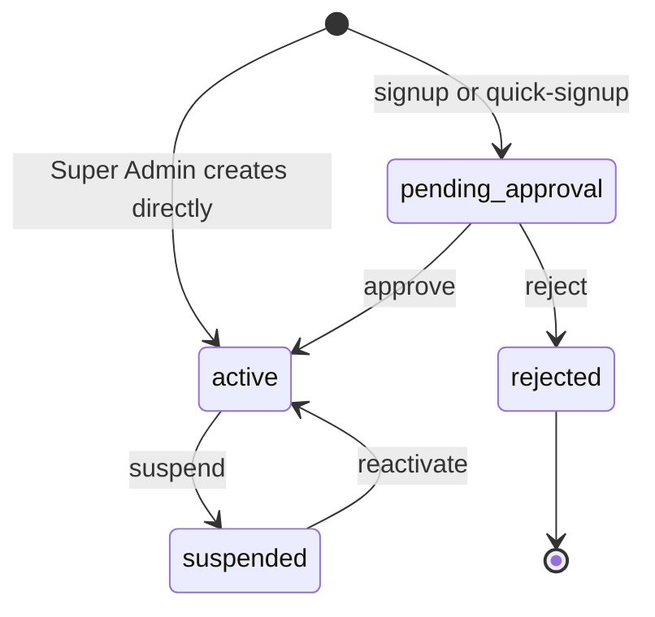
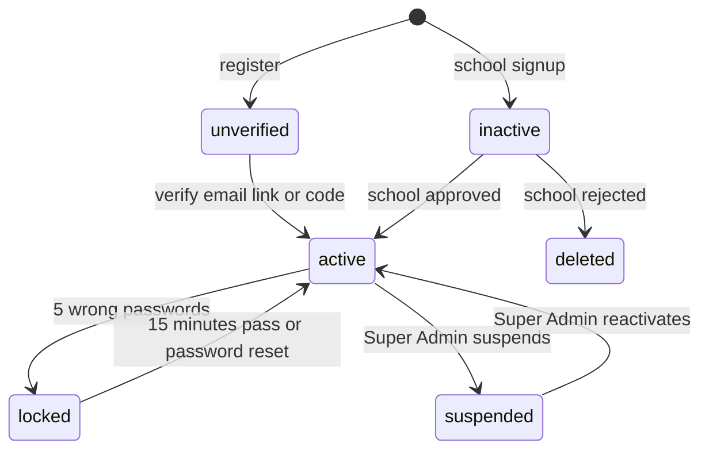
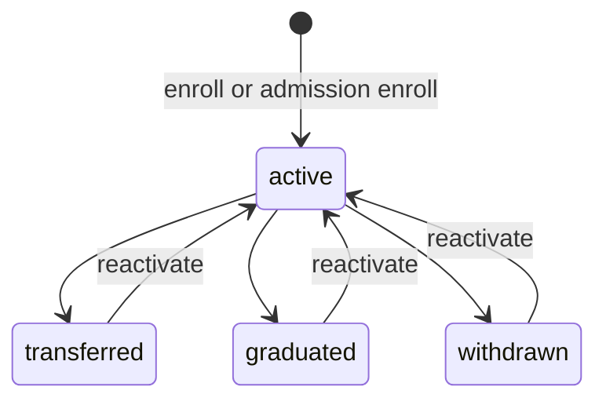
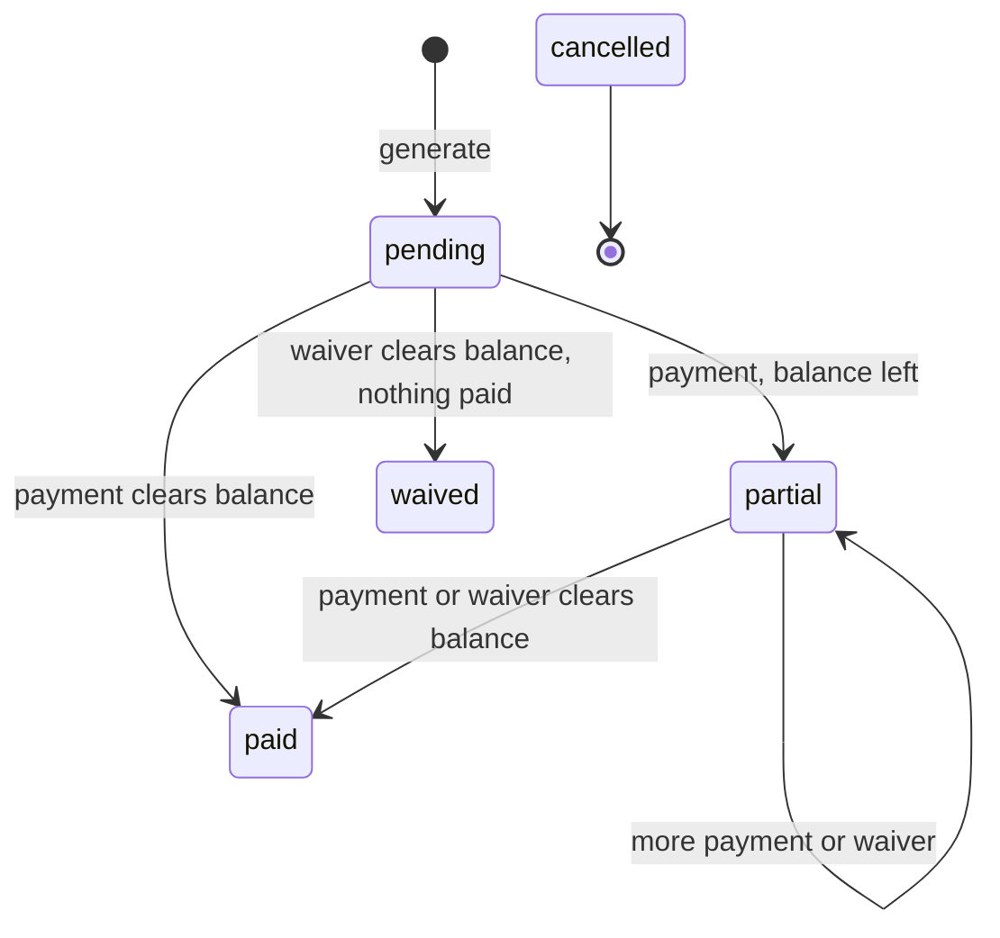
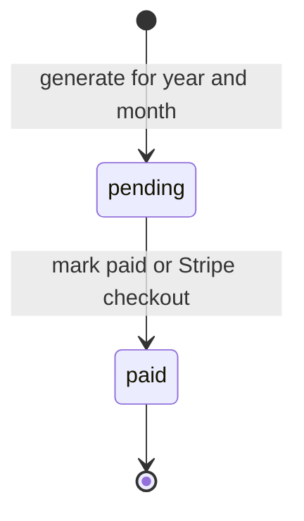
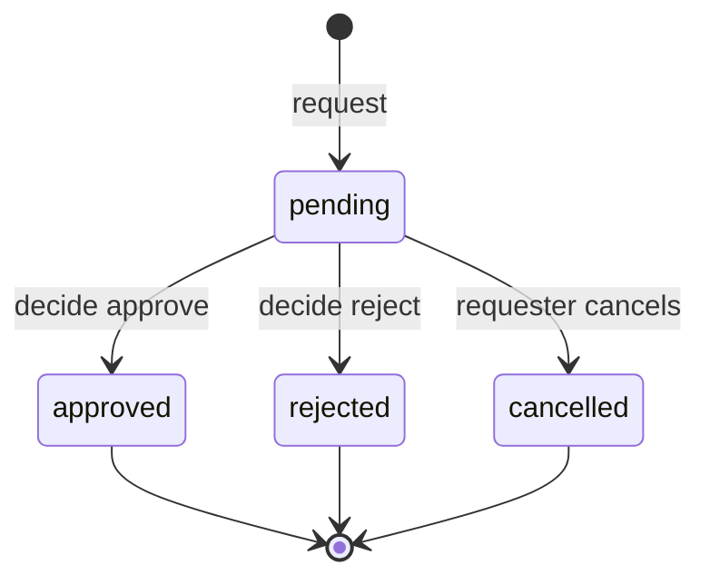
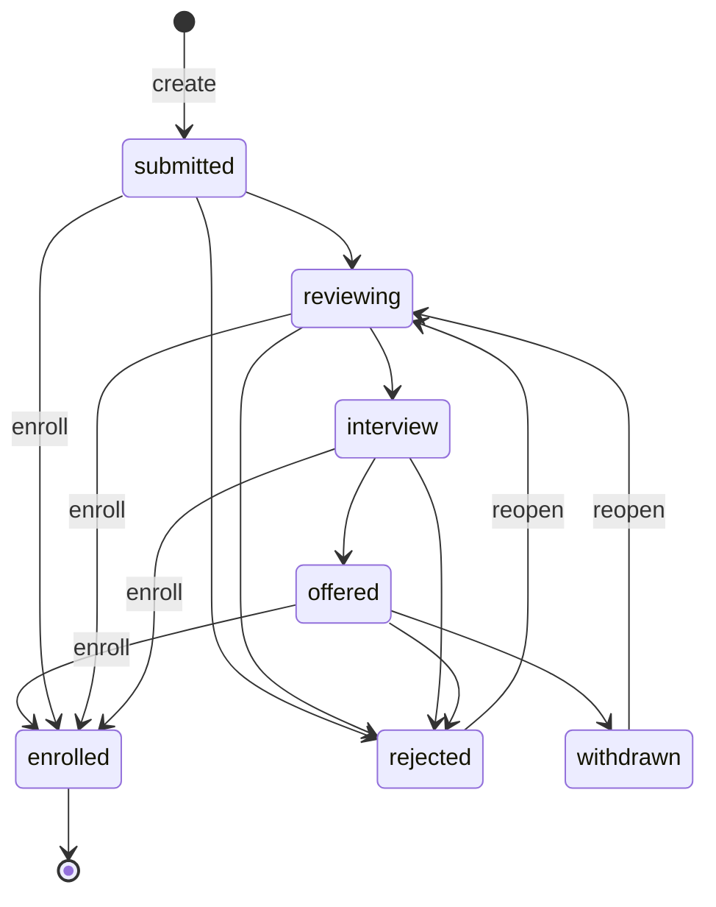
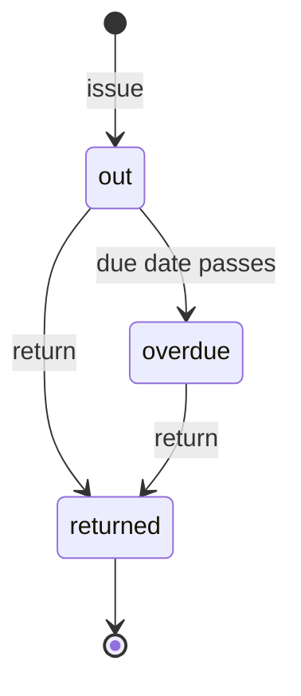

import { Aside, Card, CardGrid, LinkCard } from '@astrojs/starlight/components';
import Pipeline from '../../../components/Pipeline.astro';
import SourceFile from '../../../components/SourceFile.astro';
import Api from '../../../components/Api.astro';

Many Schola records carry a **status** — a field that can only hold one of a
fixed list of values, such as an invoice that is `pending`, `partial` or
`paid`. This page lists every such list (an *enum*) in the system, says what
each value means, and — where records move from one value to another — draws
the lifecycle and names the endpoint that causes each move.

The values come from the Mongoose models in `packages/db/src/models/` (the
`enum:` on each field), the shared constants in
<SourceFile path="packages/types/src/roles.ts" />, and the Zod schemas in
`packages/validation/src/`. Values are shown exactly as stored, in `code`
style. The web app shows most of them capitalised with underscores turned into
spaces.

## At a glance

| Record | Field | Values | Lifecycle |
| --- | --- | --- | --- |
| School | `status` | `pending_approval`, `active`, `suspended`, `rejected` | [yes](#school-status) |
| School | `type` | `school`, `college`, `institute`, `coaching` | — |
| User | flags | `isActive`, `emailVerifiedAt`, `lockedUntil`, `isPlatformUser`, `deletedAt` | [yes](#account-state) |
| User | `authProviders` | `password`, `google`, `facebook` | — |
| Enrollment | `status` | `active`, `transferred`, `graduated`, `withdrawn` | [yes](#enrollment-status) |
| Attendance, staff attendance | `status` | `present`, `absent`, `late`, `excused` | [rules](#attendance-marks) |
| Exam | — | no status field | [note](#exams) |
| Grade | `letter` | `A+`, `A`, `B`, `C`, `D`, `E`, `F` | [bands](#letter-grades) |
| Remark | `type` | `behavior`, `academic`, `attendance`, `general` | — |
| Remark | `visibility` | `private`, `parent`, `public` | [who reads](#remark-visibility) |
| Fee structure | `frequency` | `one_time`, `monthly`, `quarterly`, `yearly` | — |
| Fee invoice | `status` | `pending`, `partial`, `paid`, `waived`, `cancelled` | [yes](#invoice-status) |
| Fee payment | `method` | `cash`, `bank_transfer`, `online`, `cheque`, `other` | — |
| Salary component | `kind` | `earning`, `deduction` | — |
| Salary record | `status` | `pending`, `paid`, `cancelled` | [yes](#payslip-status) |
| Leave request | `status` | `pending`, `approved`, `rejected`, `cancelled` | [yes](#leave-status) |
| Leave request | `type` / `subject` | `sick`, `casual`, `family`, `other` / `student`, `teacher`, `staff` | — |
| Admission | `status` | `submitted`, `reviewing`, `interview`, `offered`, `enrolled`, `rejected`, `withdrawn` | [yes](#admission-status) |
| Library loan | derived | `out`, `overdue`, `returned` | [yes](#library-loan-state) |
| Hostel allocation | derived | current, vacated | [yes](#hostel-and-transport) |
| Hostel room | `gender` | `boys`, `girls`, `mixed` | — |
| Notification | `type` | 8 values | [list](#notification-types) |
| Single-use token | `purpose` | `password_reset`, `email_verification`, `admin_transfer` | [yes](#tokens-and-sessions) |
| System setting | `category` | `branding`, `locale`, `email_templates`, `feature_flags` | [list](#platform-settings) |

## School status

<SourceFile path="packages/db/src/models/school.ts" />
<SourceFile path="apps/api/src/modules/schools/schools.service.ts" />

| Value | Meaning |
| --- | --- |
| `pending_approval` | The application is waiting for the Super Admin. The owner's account exists but is inactive (`isActive: false`), so they cannot sign in yet. |
| `active` | The school is live. Its roles exist and its owner is the School Admin. |
| `suspended` | The Super Admin has paused the school, with a reason (`suspendedReason`). Its members cannot sign in and their open sessions end. |
| `rejected` | The application was turned down, with a reason (`rejectedReason`). The owner's account is deactivated and soft-deleted. Final. |

| Move | Endpoint | Allowed only from |
| --- | --- | --- |
| apply | <Api method="POST" path="schools/signup" /> or <Api method="POST" path="schools/quick-signup" /> | — |
| create directly | <Api method="POST" path="platform/schools" perm="school:create_direct" /> | — (born `active`) |
| approve | <Api method="POST" path="platform/schools/:id/approve" perm="school:approve" /> | `pending_approval` |
| reject | <Api method="POST" path="platform/schools/:id/reject" perm="school:reject" /> | `pending_approval` |
| suspend | <Api method="POST" path="platform/schools/:id/suspend" perm="school:suspend" /> | `active` |
| reactivate | <Api method="POST" path="platform/schools/:id/reactivate" perm="school:suspend" /> | `suspended` |

Any other move answers `409 CONFLICT` with the message
`Cannot <action> a school in status "<status>".` Approving also seeds the school's eight roles, makes the owner
School Admin, activates their account and marks their email verified.

### What the status means for sign-in

Only an `active` school can be used.
<SourceFile path="apps/api/src/services/school-status.ts" /> holds the rule:

- **Sign-in** (password, Google or Facebook) opens the session in the first of
  the person's schools that is `active`. If none is, it is refused with `403
  INACTIVE_ACCOUNT` and a message naming the status — for example "This school
  is suspended, so sign-in is paused for everyone there. Contact the platform
  team to restore access." Someone who also belongs to another, active school
  simply signs in there.
- **Open sessions** end too: `requireAuth` checks the session's school on every
  school request, and refresh repeats the sign-in check, both answering `401
  INACTIVE_ACCOUNT`. Sign-out (`POST /auth/logout`) still works.
- **Caching.** The status is cached in the API process for 10 seconds.
  Suspend, reactivate, approve and reject clear the cache entry, so on a single
  API instance the change is immediate; other instances catch up within 10
  seconds.

Suspension does not remove anyone's roles, so reactivating restores access
without further steps. The start-up role sync deliberately includes
`suspended` schools.

:::note[The web sign-in form shows the API's message]
The login form shows the `INACTIVE_ACCOUNT` message the API sends, so a member
of a suspended school reads the suspension wording above, and the owner of a
school still waiting for approval reads "Your school's application is waiting
for approval. You'll get an email when it's approved."
:::

### Institution type

`school.type` is one of `school`, `college`, `institute`, `coaching`
(`INSTITUTION_TYPES` in `packages/types/src/roles.ts`). It is chosen at sign-up
and editable on School settings. It changes no behaviour.

## Account state

A user account has no single status field. Its state is the combination of a
few flags on <SourceFile path="packages/db/src/models/user.ts" />:

| Field | Values | Effect at sign-in |
| --- | --- | --- |
| `isActive` | `true` / `false` | `false` → `403 INACTIVE_ACCOUNT` "Account is not active." — or, for the owner of a school still `pending_approval`, "Your school's application is waiting for approval. You'll get an email when it's approved." (also every later request: `401 INACTIVE_ACCOUNT`). |
| `deletedAt` | date or `null` | Set → treated as inactive. |
| `emailVerifiedAt` | date or `null` | `null` → password sign-in fails with `403 EMAIL_NOT_VERIFIED`. |
| `failedLoginAttempts` | number | Counts wrong passwords; reset to 0 on a successful sign-in or a password reset. |
| `lockedUntil` | date or `null` | In the future → `401` "Account temporarily locked. Try again later." Set after `LOGIN_LOCKOUT_THRESHOLD` (5) wrong passwords, for `LOGIN_LOCKOUT_MINUTES` (15). |
| `isPlatformUser` | `true` / `false` | Marks platform staff (Super Admins). Used by the platform user filter. |
| `authProviders` | `password`, `google`, `facebook` | An account with no password hash is told to use its provider button. |

"Suspended" here is `isActive: false` set by
<Api method="POST" path="platform/users/:id/suspend" perm="user:suspend" />.

## Enrollment status

An enrollment puts one student in one section for one academic year
(<SourceFile path="packages/db/src/models/enrollment.ts" />). Only one
enrollment per student per year may exist.

| Value | Meaning |
| --- | --- |
| `active` | The student sits in the section now. Counts against the section's capacity and appears on registers, gradebooks and rosters. |
| `transferred` | Left for another school. |
| `graduated` | Finished. |
| `withdrawn` | Left the school. |

Every move goes through
<Api method="PATCH" path="enrollments/:id" perm="student:update" />. Leaving
`active` stamps `endedAt`; returning to `active` clears it and checks for a
free seat first (capacity `0` = no limit). The non-active values are not
otherwise distinguished by the code.

Enrolling again with <Api method="POST" path="enrollments" perm="student:create" />
(for example from a class page's **Enroll students**) also works for a
student whose enrollment that year is `withdrawn` or `transferred`: the existing
enrollment is reopened in the chosen section and the change is audited as
`enrollment.reactivate`. Only an `active` enrollment in the same year is
refused ("Student is already enrolled for this academic year.").

## Attendance marks

Student attendance and staff attendance share one list
(`attendanceStatus` in `packages/validation/src/attendance.ts`).

| Value | Meaning | Badge |
| --- | --- | --- |
| `present` | Came in. | green |
| `absent` | Did not come in. | red |
| `late` | Came in late — counted as attended. | amber |
| `excused` | Absent with permission. Written automatically when leave is approved. | blue |

There is no lifecycle: a register can be re-saved and each mark replaced.
Approving a [leave request](#leave-status) writes `excused` for each school day
it covers, except days already marked `present` or `late`.

## Exams

Exams have **no status field** (<SourceFile path="packages/db/src/models/exam.ts" />).
Whether an exam is upcoming or finished follows only from its `startDate` and
`endDate`. Deleting an exam soft-deletes it and every mark entered for it.

## Letter grades

Each mark stores a percentage and a letter computed by `letterFor` in
<SourceFile path="packages/db/src/models/grade.ts" />:

| Percentage | Letter |
| --- | --- |
| 90 and above | `A+` |
| 80 – 89 | `A` |
| 70 – 79 | `B` |
| 60 – 69 | `C` |
| 50 – 59 | `D` |
| 40 – 49 | `E` |
| below 40 | `F` |

## Remark type and visibility

`type` labels what the remark is about: `behavior`, `academic`, `attendance`,
`general`.

### Remark visibility

| Value | Who can read it |
| --- | --- |
| `private` | School staff with `remark:read:all`, and the student's own teachers. Never printed on report cards. |
| `parent` | The above, plus the student's linked parents. The default for new remarks. |
| `public` | The above, plus the student. |

## Invoice status

<SourceFile path="packages/db/src/models/fee.ts" />
<SourceFile path="apps/api/src/modules/fees/fee-invoices.routes.ts" />

| Value | Meaning | Badge |
| --- | --- | --- |
| `pending` | Nothing paid yet. Every generated invoice starts here. | grey |
| `partial` | Some paid, some still owed. | amber |
| `paid` | Nothing left to pay (paid in full, or paid plus waived). | green |
| `waived` | The whole balance was waived and nothing was paid. | grey |
| `cancelled` | Void. Cannot be paid. | grey, struck through |

The balance is always `totalAmount − amountPaid − amountWaived`.

| Move | Caused by |
| --- | --- |
| → `pending` | <Api method="POST" path="fee-invoices/generate" perm="fee_structure:create" /> |
| → `partial` / `paid` | <Api method="POST" path="fee-payments" perm="fee:collect" /> (cash, bank transfer, cheque, other) or the Stripe webhook (`online`) |
| → `partial` / `paid` / `waived` | <Api method="POST" path="fee-invoices/:id/waive" perm="fee:waive" /> |

Online checkout is refused (`409`) for `paid`, `waived` and `cancelled`
invoices. A payment or waiver larger than the balance is a `400
VALIDATION_ERROR`.

:::caution[Nothing sets `cancelled`]
`cancelled` is in the enum, the list filters and the checks, but no endpoint
moves an invoice to it. It can only appear through direct database edits.
"Overdue" is not a status either: the web badge has an `overdue` style and the
reports compute overdue amounts from `dueDate`, but the stored value never says
`overdue`.
:::

### Fee frequency and payment method

| List | Values |
| --- | --- |
| `fee_structures.frequency` | `one_time`, `monthly`, `quarterly`, `yearly` |
| `fee_payments.method` | `cash`, `bank_transfer`, `online`, `cheque`, `other` |

`online` is what the Stripe webhook records. Receipts and invoice numbers are
generated by the API; a waiver adds to `amountWaived` and a note on the invoice
but does not create a payment row.

## Payslip status

<SourceFile path="packages/db/src/models/payroll.ts" />

| Value | Meaning |
| --- | --- |
| `pending` | Generated for the month, not paid. |
| `paid` | Paid. `paidAt`, `paymentMethod` (same five values as fees) and `paymentReference` are set. |
| `cancelled` | Void. |

| Move | Caused by |
| --- | --- |
| → `pending` | <Api method="POST" path="salary-records/generate" perm="salary_structure:create" /> — once per person per month |
| → `paid` | <Api method="POST" path="salary-records/:id/pay" perm="salary:pay" /> or the Stripe webhook (`metadata.kind = "salary"`, method `online`) |

Salary structure components are `earning` or `deduction`.

:::caution[Nothing sets `cancelled` on a payslip]
As with invoices, no endpoint moves a payslip to `cancelled`; it can only appear
through direct database edits. Both payment paths refuse a `cancelled` payslip:
`POST /salary-records/:id/pay` answers `409` "This payslip was cancelled and
can't be paid.", and Stripe Checkout refuses anything that is not `pending`.
:::

## Leave status

<SourceFile path="apps/api/src/modules/operations/leave.routes.ts" />

| Value | Meaning |
| --- | --- |
| `pending` | Asked, waiting for a decision. |
| `approved` | Granted. Attendance for the school days covered becomes `excused`. |
| `rejected` | Declined. |
| `cancelled` | Withdrawn by the person who asked. |

| Move | Endpoint | Rule |
| --- | --- | --- |
| request | <Api method="POST" path="leave" perm="leave:request" /> | For yourself, or as a parent for a linked child. |
| cancel | <Api method="POST" path="leave/:id/cancel" perm="leave:request" /> | Only the requester, only while `pending`. |
| decide | <Api method="POST" path="leave/:id/decide" perm="leave:approve" /> | Only `pending`; never your own request. |

Other lists on a leave request: `type` is `sick`, `casual`, `family` or
`other`; `subject` (whose leave it is) is `student`, `teacher` or `staff`.

## Admission status

<SourceFile path="packages/db/src/models/admission.ts" />
<SourceFile path="apps/api/src/modules/operations/admissions.routes.ts" />

<Pipeline
  caption="The usual path of an application. Rejected and withdrawn are side exits."
  steps={[
    { label: 'Submitted', icon: 'file-text', note: 'submitted' },
    { label: 'Reviewing', icon: 'search', note: 'reviewing' },
    { label: 'Interview', icon: 'calendar-clock', note: 'interview' },
    { label: 'Offered', icon: 'badge-check', note: 'offered' },
    { label: 'Enrolled', icon: 'user-plus', note: 'enrolled' },
  ]}
/>

| Value | Meaning |
| --- | --- |
| `submitted` | New application. The default. |
| `reviewing` | Being looked at. |
| `interview` | Interview arranged (`interviewAt` may be set). |
| `offered` | A place is offered. |
| `enrolled` | The applicant became a Student with an active enrollment. Final: the application can no longer be edited, moved or deleted. |
| `rejected` | Turned down. |
| `withdrawn` | The family pulled out. |

- <Api method="POST" path="admissions/:id/status" perm="admission:manage" /> can
  set any of the six non-`enrolled` values from any non-`enrolled` value — the
  pipeline order is a convention, not enforced. The diagram shows the common
  moves; "reopen" means setting it back to an open value.
- <Api method="POST" path="admissions/:id/enroll" perm="admission:manage" /> (also
  needs `student:create`) works from any open value except `rejected` and
  `withdrawn` ("Reopen the application before enrolling.").

Enrolling from admissions uses the same seat check as
`POST /enrollments` (<SourceFile path="apps/api/src/modules/people/_seats.ts" />):
a section with capacity `0` has no limit, any other capacity caps the number of
`active` enrollments.

## Library loan state

A loan has no status field; its state is derived from two dates
(<SourceFile path="packages/db/src/models/library.ts" />). The same three words
are the `status` filter on <Api method="GET" path="library/loans" perm="library:manage" />.

| State | Rule |
| --- | --- |
| `out` | `returnedAt` is `null` and `dueAt` is today or later. |
| `overdue` | `returnedAt` is `null` and `dueAt` has passed. |
| `returned` | `returnedAt` is set. |

A book's available copies are `copies` minus its loans not yet returned —
computed, never stored. Borrowers are a `student`, `teacher` or `staff`
member (`borrowerType`).

## Hostel and transport

| Record | State | Rule |
| --- | --- | --- |
| Hostel allocation | current | `vacatedAt` is `null`. One current bed per student (unique index). |
| Hostel allocation | vacated | `vacatedAt` is set by "Vacate", or by moving the student to another room. |
| Hostel room | `gender` | `boys`, `girls` or `mixed` (default). |
| Transport assignment | on the route | One route per student; assigning to another route moves them. |
| Transport assignment | removed | Soft-deleted by "Remove". |

Rooms and routes refuse a new occupant or rider when full (`409`).

## Notification types

<SourceFile path="packages/db/src/models/notification.ts" />

| Value | Created by |
| --- | --- |
| `school.signup` | A school applies (`/schools/signup` or `/schools/quick-signup`) — one per Super Admin. |
| `school.approved` | The Super Admin approves the school — to its owner. |
| `school.suspended` | The Super Admin suspends the school — to its owner. |
| `announcement` | A school sends an announcement — one per recipient. |
| `school.rejected` | Defined in the enum, but nothing creates it — a rejected owner gets an email only. |
| `admin_transfer.requested` | Defined in the enum, but nothing creates it — the transfer offer goes by email. |
| `admin_transfer.completed` | Defined in the enum, but nothing creates it. |
| `system` | Only the demo seed creates these (welcome and notice messages). |

A notification is unread while `readAt` is `null`.

## Tokens and sessions

| Record | Values / states | Notes |
| --- | --- | --- |
| Single-use token `purpose` | `password_reset`, `email_verification`, `admin_transfer` | Lives `PASSWORD_RESET_TTL_MIN` (60 min), `EMAIL_VERIFICATION_TTL_HOURS` (72 h) or `ADMIN_TRANSFER_TTL_HOURS` (24 h). Usable while `consumedAt` is `null` and `expiresAt` is ahead. Only the hash is stored; email verification also stores the hash of the 6-digit code. |
| Refresh token | active, rotated, revoked, expired | Rotated on every refresh (`replacedByTokenHash`); revoked on logout, password change and "sign out other devices" (`revokedAt`). |

## Platform settings

`system_settings.category` is one of `branding`, `locale`, `email_templates`,
`feature_flags` (<SourceFile path="packages/validation/src/admin.ts" />).

| List | Values |
| --- | --- |
| Email template keys | `invite`, `welcome`, `password_reset`, `verify_email` |
| Feature flags | `googleSignIn`, `selfServiceSignup`, `schoolDirectCreate` |

## People and other small lists

| Field | Values |
| --- | --- |
| Student / applicant `gender` | `male`, `female`, `other`, `unspecified` (default) |
| Parent / guardian `relation` | `father`, `mother`, `guardian` (default), `other` |
| Timetable `dayOfWeek` | `1` (Monday) … `7` (Sunday), ISO 8601 |
| Timetable `period` | `1` … `16` |
| Announcement audience | `school_admin`, `principal`, `vice_principal`, `teacher`, `accountant`, `staff`, `parent`, `student` |
| Roles a School Admin may grant | `principal`, `vice_principal`, `accountant` |
| Platform user list `status` filter | `active`, `inactive`, `all` |
| Academic year | `isCurrent` — at most one per school; setting it on one year clears it on the others. |

Every record also carries `deletedAt`: `null` while it exists, a date once
soft-deleted. Soft-deleted records are hidden from normal queries.

## Related pages

<CardGrid>
  <LinkCard title="API endpoints" description="The endpoints that move each status." href="/reference/api-endpoints/" />
  <LinkCard title="Data model" description="How the collections relate." href="/architecture/data-model/" />
  <LinkCard title="Fees" description="Invoices, payments and waivers in the app." href="/features/finance/fees/" />
  <LinkCard title="Admissions" description="The admissions pipeline screen by screen." href="/features/campus/admissions/" />
</CardGrid>
