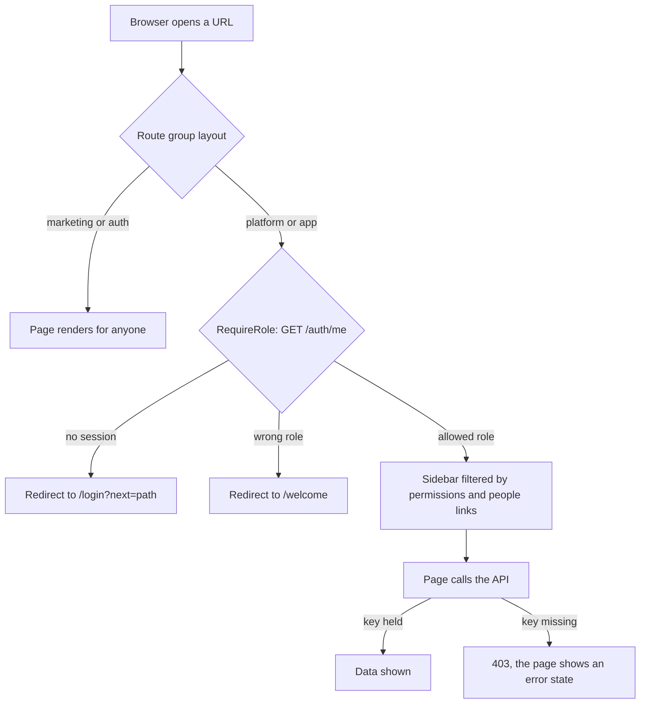

import { Aside, Card, CardGrid, LinkCard } from '@astrojs/starlight/components';
import Route from '../../../components/Route.astro';
import Perm from '../../../components/Perm.astro';
import Roles from '../../../components/Roles.astro';
import SourceFile from '../../../components/SourceFile.astro';

The web app (`apps/web`, Next.js 16 App Router) has **76 pages**. Each one is a
`page.tsx` file under `apps/web/src/app/`; the folder path is the URL, and
folders in brackets — `(marketing)`, `(auth)`, `(super-admin)`, `(tenant)` —
are *route groups*: they share a layout but do not appear in the URL. This page
lists every page, grouped the same way, with who can open it and what it does.

## At a glance

| Group | Folder | Pages | Layout guard |
| --- | --- | --- | --- |
| [Public website](#public-website) | `(marketing)` | 15 | none — anyone |
| [Sign-in pages](#sign-in-pages) | `(auth)` | 5 | none; `/login` and `/signup` bounce signed-in people |
| [Welcome and onboarding](#welcome-and-onboarding) | `welcome`, `onboarding`, `admin-transfer` | 3 | in-page redirects / `RequireRole` |
| [Platform console](#platform-console) | `(super-admin)/platform` | 13 | `RequireRole allow={["super_admin"]}` |
| [School app](#school-app) | `(tenant)/app` | 40 | `RequireRole` with the eight school roles |

Besides pages, the app serves three generated files: `/sitemap.xml`
(`app/sitemap.ts`), `/robots.txt` (`app/robots.ts`) and
`/manifest.webmanifest` (`app/manifest.ts`). There are no route handlers under
`app/api/` — every `/api/*` request is rewritten to the API server.

## How access is decided

1. **Layout guard.** `RequireRole` (<SourceFile path="apps/web/src/components/auth/require-role.tsx" />)
   waits for `GET /auth/me`. With no session it sends the person to
   `/login?next=<path>`; with a role outside its `allow` list it sends them to
   `/welcome` (which forwards Super Admins to `/platform` and school members
   to `/app`). It shows a "Checking access" card meanwhile.
2. **Sidebar.** Inside `/app`, each menu item has a permission (`permission`),
   a list of which any one is enough (`anyOf`), and/or a people link (`links`:
   the person has their own Teacher, Student, Parent or Staff record). An item
   is hidden unless the person passes. The rules are in `APP_GROUPS` in
   <SourceFile path="apps/web/src/components/layout/dashboard-shell.tsx" />.
3. **Buttons.** Pages hide write actions with `<Can permission="…">` and
   `useCan()`.
4. **The API decides.** No school page has its own page-level permission
   check. A person who types a URL that is not in their menu sees the page
   shell, and the API answers `403` for the data, so the page shows its error
   state. That is safe — the API is the security boundary — but it is why the
   "Who can open it" column below names the API key the data needs.

:::caution[`proxy.ts` is not active]
`apps/web/proxy.ts` is meant to be the first, edge-level check: send signed-out
visitors on `/app`, `/platform` and `/onboarding` to `/login`, bounce signed-in
people off `/login` and `/signup`, and rewrite `/api/*` to `INTERNAL_API_URL`.
But Next.js only looks for `proxy.ts` next to the `app` folder — in this
project that is `apps/web/src/`, because the app lives in `apps/web/src/app/`.
The file sits one level up, so Next never loads it (the built
`middleware-manifest.json` is empty). Everything still works because
`RequireRole`, `RedirectIfAuthenticated` and the `rewrites()` in
`next.config.ts` cover the same ground, but there is no server-side redirect:
protected pages render a "Checking access" card first and redirect in the
browser. Moving the file to `apps/web/src/proxy.ts` would activate it.
:::

## Public website

Route group `(marketing)`. Shared header and footer, full SEO metadata, listed
in the sitemap. Content comes from `apps/web/src/components/marketing/content`.
All documented on [Public website](/features/public-website/).

| Path | Who can open it | Purpose |
| --- | --- | --- |
| <Route path="/" /> | anyone | Landing page. |
| <Route path="/features" /> | anyone | Feature tour. |
| <Route path="/pricing" /> | anyone | Plans and pricing. |
| <Route path="/admissions" /> | anyone | Admissions information for families. |
| <Route path="/academics" /> | anyone | Academic programmes overview. |
| <Route path="/academics/[slug]" /> | anyone | One programme; slugs are pre-rendered with `generateStaticParams`. Unknown slugs get a noindex page. |
| <Route path="/events" /> | anyone | Events list. |
| <Route path="/events/[slug]" /> | anyone | One event (pre-rendered). |
| <Route path="/news" /> | anyone | News list. |
| <Route path="/news/[slug]" /> | anyone | One news item (pre-rendered). |
| <Route path="/about" /> | anyone | About Schola. |
| <Route path="/faq" /> | anyone | Frequently asked questions, searchable. |
| <Route path="/contact" /> | anyone | Contact form. It opens the visitor's email app with the message filled in; nothing is sent to the API. |
| <Route path="/legal/terms" /> | anyone | Terms of Service. |
| <Route path="/legal/privacy" /> | anyone | Privacy Policy. |

## Sign-in pages

Route group `(auth)`. Split-screen layout, `noindex`. Documented on
[Sign up and sign in](/features/accounts/sign-up-and-sign-in/).

| Path | Who can open it | Purpose |
| --- | --- | --- |
| <Route path="/login" /> | signed-out people; a signed-in person is redirected to `?next=` or their console | Email and password sign-in, Google and Facebook buttons. Errors from OAuth arrive as `?error=oauth_…`. `?next=` is honoured only for same-origin relative paths, and keeps its query string and hash. |
| <Route path="/signup" /> | signed-out people (same redirect) | Create a personal account, or apply to bring a school onboard. |
| <Route path="/verify" /> | anyone | Verify an email: `?token=` from the link is checked automatically, or enter the 6-digit code. "Send a new code" emails a fresh link and code to the address typed in the form. |
| <Route path="/forgot-password" /> | anyone | Ask for a password-reset email. |
| <Route path="/reset-password" /> | anyone with a `?token=` | Choose a new password, then go to `/login`. |

## Welcome and onboarding

Top-level folders outside any group. `noindex`. Documented on
[Onboarding and welcome](/features/accounts/onboarding-and-welcome/) and
[Admin transfer](/features/school/admin-transfer/).

| Path | Who can open it | Purpose |
| --- | --- | --- |
| <Route path="/welcome" /> | <Roles list={['user']} /> — Super Admins are sent to `/platform`, school members to `/app`, signed-out people to `/login` | The visitor dashboard: application status (`GET /schools/mine`), and the way to register a school. |
| <Route path="/onboarding/school" /> | <Roles list={['user']} /> (same redirects) | Register a school in one step (`POST /schools/quick-signup`). |
| <Route path="/admin-transfer" /> | the eight school roles and `user`; a Super Admin is sent to `/platform` | Open the link from an admin-transfer email (`?token=`), preview the school and accept. |

## Platform console

Route group `(super-admin)/platform`. Guarded by `RequireRole allow={["super_admin"]}`;
anyone else is sent to `/welcome`. Every menu item is shown to every Super Admin
— the platform sidebar has no permission conditions. The API checks the keys.

| Path | Who can open it | Purpose | Feature page |
| --- | --- | --- | --- |
| <Route path="/platform" /> | Super Admin · `school:read_all` | Platform dashboard: counts, recent sign-ups, sign-ups per month. | [Dashboard](/features/platform/dashboard/) |
| <Route path="/platform/approvals" /> | Super Admin · `school:read_all`, `school:approve`, `school:reject` | The queue of `pending_approval` schools (`GET /platform/schools?status=pending_approval`); approve or reject. | [Approvals](/features/platform/approvals/) |
| <Route path="/platform/schools" /> | Super Admin · `school:read_all` | Every school with its status. | [Schools](/features/platform/schools/) |
| <Route path="/platform/schools/new" /> | Super Admin · `school:create_direct` | Create an active school and its owner directly. | [Schools](/features/platform/schools/) |
| <Route path="/platform/schools/[id]" /> | Super Admin · `school:read_all` (+ `school:suspend`, `admin_transfer:force` for actions) | One school: details, approve / reject / suspend / reactivate, force an admin transfer. | [Schools](/features/platform/schools/) |
| <Route path="/platform/users" /> | Super Admin · `user:read_all` (+ `user:invite_platform`, `user:suspend`, `user:assign_role`) | User directory: invite, suspend, reactivate, grant and revoke roles. | [Users](/features/platform/users/) |
| <Route path="/platform/audit-log" /> | Super Admin · `audit_log:read:all` | The platform-wide audit trail. | [Notifications and audit](/features/platform/notifications-and-audit/) |
| <Route path="/platform/notifications" /> | Super Admin · `notification:read:own` | The Super Admin's own notifications (school sign-ups). | [Notifications and audit](/features/platform/notifications-and-audit/) |
| <Route path="/platform/settings" /> | Super Admin · `system_setting:read` | Settings hub linking the four categories. | [Settings](/features/platform/settings/) |
| <Route path="/platform/settings/branding" /> | Super Admin · `system_setting:read` to load, `system_setting:write` to save | Platform branding. | [Settings](/features/platform/settings/) |
| <Route path="/platform/settings/locale" /> | Super Admin · `system_setting:read` to load, `system_setting:write` to save | Default locale and currency. | [Settings](/features/platform/settings/) |
| <Route path="/platform/settings/email" /> | Super Admin · `system_setting:read` to load, `system_setting:write` to save | Email templates (`invite`, `welcome`, `password_reset`, `verify_email`). | [Settings](/features/platform/settings/) |
| <Route path="/platform/settings/flags" /> | Super Admin · `system_setting:read` to load, `system_setting:write` to save | Feature flags (`googleSignIn`, `selfServiceSignup`, `schoolDirectCreate`). | [Settings](/features/platform/settings/) |

## School app

Route group `(tenant)/app`. Guarded by `RequireRole` with `school_admin`,
`principal`, `vice_principal`, `teacher`, `accountant`, `student`, `parent`
and `staff`; anyone else (a Super Admin, a visitor) is sent to `/welcome`.

In the tables, **Menu** is the rule that shows the item in the sidebar, and
**Data** is what the page's main API call requires. "Link: teacher" means the
person has their own Teacher record. Role names in brackets are who passes
with the default bundles.

### Overview and account

| Path | Menu | Data | Purpose | Feature page |
| --- | --- | --- | --- | --- |
| <Route path="/app" /> | everyone | tenant | Dashboard. People with `school:read:tenant` get the school dashboard (`GET /dashboard/summary`); everyone else gets their own (`GET /me/summary`). | [School dashboard](/features/school/dashboard/) |
| <Route path="/app/reports" /> | any of `attendance:read:all`, `fee:read:tenant`, `grade:read:all` (Admin, Principal, VP, Accountant) | same | Charts and CSV exports (exports need `report:export`). | [Reports](/features/insight/reports/) |
| <Route path="/app/notifications" /> | everyone | `notification:read:own` | Own notifications; mark read. | [Notifications](/features/communication/notifications/) |
| <Route path="/app/profile" /> | everyone | session | Own name and phone, change password, signed-in devices. | [Settings and profile](/features/school/settings-and-profile/) |

### My school (own-scope pages)

| Path | Menu | Data | Purpose | Feature page |
| --- | --- | --- | --- | --- |
| <Route path="/app/my/classes" /> | link: teacher | any of the three `:own_classes` keys (`GET /me/sections`) | The teacher's sections, with shortcuts to the register, gradebook and remarks. | [Teacher portal](/features/portals/teacher/) |
| <Route path="/app/children" /> | link: parent | tenant (`GET /me/students`) | The parent's linked children. | [Parent portal](/features/portals/parent/) |
| <Route path="/app/children/[id]" /> | — (opened from My children) | student-record access as a parent | One child's record: profile, attendance, grades, remarks, fees, services; pay fees online. | [Parent portal](/features/portals/parent/) |
| <Route path="/app/my/attendance" /> | link: student, teacher or staff | student: record access; employee: `staff_attendance:read:own` | Own attendance calendar. | [Student portal](/features/portals/student/), [Staff portal](/features/portals/staff/) |
| <Route path="/app/my/grades" /> | link: student | record access (grades, remarks) | Own marks, report card PDF and remarks. | [Student portal](/features/portals/student/) |
| <Route path="/app/my/fees" /> | link: student | `fee:read:own` via the student record | Own invoices and payments; pay online. | [Student portal](/features/portals/student/) |
| <Route path="/app/my/payslips" /> | `salary:read:own` + link: teacher or staff | `salary:read:own` | Own payslips and PDFs. | [Staff portal](/features/portals/staff/) |

### School setup

| Path | Menu | Data | Purpose | Feature page |
| --- | --- | --- | --- | --- |
| <Route path="/app/academic-years" /> | `academic_year:read` (Admin, Principal, VP, Teacher, Accountant) | same | Academic years; set the current one. | [Academic years](/features/academics/academic-years/) |
| <Route path="/app/subjects" /> | `subject:read` (Admin, Principal, VP, Teacher, Accountant) | same | Subjects. | [Subjects](/features/academics/subjects/) |
| <Route path="/app/classes" /> | `class:read` (Admin, Principal, VP, Teacher, Accountant) | same | Classes per academic year. | [Classes and sections](/features/academics/classes-and-sections/) |
| <Route path="/app/classes/[id]" /> | — (opened from Classes) | `class:read`, `section:read`, `student:read` | One class: sections with seat counts, enroll and move students. | [Classes and sections](/features/academics/classes-and-sections/) |

### People

| Path | Menu | Data | Purpose | Feature page |
| --- | --- | --- | --- | --- |
| <Route path="/app/students" /> | `student:read` (Admin, Principal, VP, Teacher, Accountant) | same | Student list with class and section. | [Students](/features/people/students/) |
| <Route path="/app/students/[id]" /> | — (opened from Students) | `student:read`, then record access per tab | One student's full record. | [Students](/features/people/students/) |
| <Route path="/app/teachers" /> | `teacher:read` (Admin, Principal, VP, Accountant) | same | Teacher list. | [Teachers](/features/people/teachers/) |
| <Route path="/app/teachers/[id]" /> | — | `teacher:read` | Teacher profile: load, attendance, pay. | [Teachers](/features/people/teachers/) |
| <Route path="/app/parents" /> | `parent:read` (Admin, Principal, VP, Accountant) | same | Parent list. | [Parents](/features/people/parents/) |
| <Route path="/app/parents/[id]" /> | — | `parent:read` | Parent profile and linked children. | [Parents](/features/people/parents/) |
| <Route path="/app/staff" /> | `staff:read` (Admin, Principal, Accountant) | same | Non-teaching staff list. | [Staff](/features/people/staff/) |
| <Route path="/app/staff/[id]" /> | — | `staff:read` | Staff profile: attendance and pay. | [Staff](/features/people/staff/) |
| <Route path="/app/admissions" /> | `admission:read` (Admin, Principal, VP) | same; writes need `admission:manage` | The admissions pipeline; enroll an applicant. | [Admissions](/features/campus/admissions/) |

### Daily work

| Path | Menu | Data | Purpose | Feature page |
| --- | --- | --- | --- | --- |
| <Route path="/app/timetable" /> | `timetable:read` (everyone but Accountant and Staff) | staff view needs `section:read`; teacher: own week; student / parent: the student's week | Weekly timetables; edit periods with `timetable:manage`. | [Timetable](/features/daily/timetable/) |
| <Route path="/app/leave" /> | any of `leave:request`, `leave:read:all` (every school role) | same | Ask for leave, cancel, and — with `leave:approve` — decide. | [Leave](/features/daily/leave/) |
| <Route path="/app/attendance" /> | any of `attendance:read:all`, `attendance:mark` (Admin, Principal, VP, Teacher) | any of `attendance:read:all`, `attendance:read:own_classes` | Daily registers per section; mark with `attendance:mark`. | [Attendance](/features/daily/attendance/) |
| <Route path="/app/staff-attendance" /> | `staff_attendance:read:all` (Admin) | same; saving needs `staff_attendance:mark` | Daily attendance of teachers and staff. | [Staff attendance](/features/daily/staff-attendance/) |
| <Route path="/app/remarks" /> | any of `remark:read:all`, `remark:create` (Admin, Principal, VP, Teacher) | any of `remark:read:all`, `remark:read:own_classes` | Write and read remarks. | [Remarks](/features/daily/remarks/) |

### Academics

| Path | Menu | Data | Purpose | Feature page |
| --- | --- | --- | --- | --- |
| <Route path="/app/exams" /> | `exam:read` (Admin, Principal, VP, Teacher) | same | Exams; create, edit and delete with the matching keys. | [Exams](/features/assessment/exams/) |
| <Route path="/app/gradebook" /> | any of `grade:read:all`, `grade:enter` (Admin, Principal, VP, Teacher) | `exam:read`, `subject:read`, and any of `grade:read:all`, `grade:read:own_classes` | Enter and read marks per exam, section and subject. | [Gradebook](/features/assessment/gradebook/) |

### Facilities

| Path | Menu | Data | Purpose | Feature page |
| --- | --- | --- | --- | --- |
| <Route path="/app/library" /> | `library:read` (everyone but Parent) | same; loans list needs `library:manage` | Catalogue and own loans; issue and return with `library:manage`. | [Library](/features/campus/library/) |
| <Route path="/app/transport" /> | `transport:read` (Admin, Principal, VP, Accountant) | same | Bus routes and riders; edit with `transport:manage`. | [Transport](/features/campus/transport/) |
| <Route path="/app/hostel" /> | `hostel:read` (Admin, Principal, VP, Accountant) | same | Rooms and occupants; allocate with `hostel:manage`. | [Hostel](/features/campus/hostel/) |

### Finance

| Path | Menu | Data | Purpose | Feature page |
| --- | --- | --- | --- | --- |
| <Route path="/app/fees" /> | `fee:read:tenant` (Admin, Accountant) | same | Fee structures, invoices, payments, waivers, receipts, online checkout. | [Fees](/features/finance/fees/), [Online payments](/features/finance/online-payments/) |
| <Route path="/app/payroll" /> | `salary:read:all` (Admin, Accountant) | same | Salary structures, monthly payslips, payment. | [Payroll](/features/finance/payroll/) |

### Administration

| Path | Menu | Data | Purpose | Feature page |
| --- | --- | --- | --- | --- |
| <Route path="/app/announcements" /> | `notification:send:tenant` (Admin, Principal) | same | Send an announcement to chosen roles; see past ones. | [Announcements](/features/communication/announcements/) |
| <Route path="/app/members" /> | `user:assign_role:tenant` (Admin) | same | School members; grant or revoke Principal, Vice Principal, Accountant. | [Members and roles](/features/school/members-and-roles/) |
| <Route path="/app/audit-log" /> | `audit_log:read:tenant` (Admin, Principal) | same | The school's audit trail. | [Audit log](/features/insight/audit-log/) |
| <Route path="/app/settings" /> | `school:read:tenant` (Admin, Principal, VP, Accountant) | same; editing and admin transfer need `school:update:tenant` | School profile and the admin transfer card. | [Settings and profile](/features/school/settings-and-profile/) |

## What each role sees in the sidebar

Computed from `APP_GROUPS` and the default role bundles, assuming the usual
people links (a Teacher has a teacher record, and so on). Every role also gets
Dashboard, Notifications and My profile.

| Role | Extra sidebar items |
| --- | --- |
| <Roles list={['school_admin']} /> | Reports · Academic years, Subjects, Classes & sections · Students, Teachers, Parents, Staff, Admissions · Timetable, Leave · Student attendance, Staff attendance · Exams, Gradebook, Remarks · Library, Transport, Hostel · Fees, Payroll · Announcements, Members & roles, Audit log, School settings |
| <Roles list={['principal']} /> | Reports · Academic years, Subjects, Classes & sections · Students, Teachers, Parents, Staff, Admissions · Timetable, Leave · Student attendance · Exams, Gradebook, Remarks · Library, Transport, Hostel · Announcements, Audit log, School settings |
| <Roles list={['vice_principal']} /> | Reports · Academic years, Subjects, Classes & sections · Students, Teachers, Parents, Admissions · Timetable, Leave · Student attendance · Exams, Gradebook, Remarks · Library, Transport, Hostel · School settings |
| <Roles list={['teacher']} /> | My classes, My attendance, My payslips · Academic years, Subjects, Classes & sections · Students · Timetable, Leave · Student attendance · Exams, Gradebook, Remarks · Library |
| <Roles list={['accountant']} /> | Reports · Academic years, Subjects, Classes & sections · Students, Teachers, Parents, Staff · Leave · Library, Transport, Hostel · Fees, Payroll · School settings (plus My attendance when linked to a staff record, as in the demo) |
| <Roles list={['student']} /> | My attendance, My grades, My fees · Timetable, Leave · Library |
| <Roles list={['parent']} /> | My children · Timetable, Leave |
| <Roles list={['staff']} /> | My attendance, My payslips · Leave · Library |

## Edge cases and gotchas

- **Sample mode.** The "Load sample" switch only applies on pages the
  in-browser demo school (`apps/web/src/lib/demo/`) fully covers: `/app` (the
  dashboard), Academic years, Subjects, Classes, Students, Teachers, Parents,
  Staff, Student and Staff attendance, Exams, Gradebook, Remarks and Reports,
  plus `/platform`, `/platform/schools` and `/platform/approvals`. On any other
  page the button is disabled ("Sample data isn't available on this page."), and
  if sample mode is already on, the page shows real data under a "Real data on
  this page." notice.
- **Opening a detail page from the wrong side.** A parent who opens
  `/app/students/[id]` gets an error, because `GET /students/:id` needs
  `student:read`. Parents use `/app/children/[id]`, which reads through
  `/student-records`.
- **Typed routes.** `next.config.ts` turns on `typedRoutes`, so every `href`
  in the code must be one of these paths or the type check fails.

## Related pages

<CardGrid>
  <LinkCard title="API endpoints" description="What each page calls, endpoint by endpoint." href="/reference/api-endpoints/" />
  <LinkCard title="Roles" description="Landing page and menu for each role." href="/reference/roles/" />
  <LinkCard title="Web app architecture" description="Layouts, providers, data fetching and the API client." href="/architecture/web-app/" />
  <LinkCard title="Permissions" description="The keys the menu and the API check." href="/reference/permissions/" />
</CardGrid>
