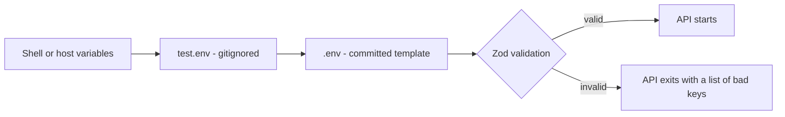

import { Aside, Steps, Tabs, TabItem, CardGrid, LinkCard, Badge } from '@astrojs/starlight/components';
import SourceFile from '../../../components/SourceFile.astro';
import Pipeline from '../../../components/Pipeline.astro';
import Api from '../../../components/Api.astro';

Schola reads its settings — database address, secrets, service keys — from
**environment variables**: `KEY=value` lines in an env file or set by the
host. This page explains where those values come from, what happens when one is
missing or wrong, and what every single variable does.

You only need a handful to get started: `MONGODB_URI`, `JWT_ACCESS_SECRET`,
`JWT_REFRESH_SECRET`, `CSRF_SECRET` and `ENCRYPTION_MASTER_KEY`.
[Installation](/setup/installation/) walks through setting them. Everything
else has a safe default or switches a feature off when blank.

## Where values come from

### The API

The API loads env files itself, before any other code runs, in
<SourceFile path="apps/api/src/load-env.ts" />. Which files it reads depends on
`NODE_ENV`, as set by your shell or host:

<Tabs>
  <TabItem label="Development (default)">
    1. Variables already set in your shell or by the host.
    2. `test.env` at the repository root — **gitignored**, your local values.
    3. `.env` at the repository root — **committed**, the template with every key.
  </TabItem>
  <TabItem label="Production (NODE_ENV=production)">
    1. Variables set by the host (Render, Railway, Fly, Docker…).
    2. `apps/api/.env.production.local` — **gitignored**, real secrets.
    3. `apps/api/.env.production` — **committed**, production values that are not secret, blank secrets.
  </TabItem>
</Tabs>



The rule is **first one wins**. The loader uses `dotenv`, which never
overwrites a variable that is already set. So a value in your shell beats
`test.env`, and `test.env` beats `.env`. That includes *empty* values: a line
`RESEND_API_KEY=` in `test.env` keeps any value in `.env` from being used.

The same loader runs for the CLI jobs (`pnpm seed`, `grant-role`,
`sync-role-keys`), so they always see the same settings as the API.

### The web app

The web app (`apps/web`) is a Next.js app, and Next.js loads env files from its
**own folder**, not the repository root.

- `next build` and `next start` read `apps/web/.env.production.local` (gitignored) and then `apps/web/.env.production` (committed).
- `NEXT_PUBLIC_*` values are copied into the browser bundle **at build time**. Change one, and you must rebuild.
- `INTERNAL_API_URL` and `GOOGLE_SITE_VERIFICATION` are read on the server only and never reach the browser.

:::caution[The web app does not read the root test.env in development]
The comments in `.env` and `docs/deployment.md` say every app shares the root
`.env` and `test.env` in development. That is true for the API, but nothing in
`apps/web` loads those files, so `next dev` never sees the `NEXT_PUBLIC_*`
values in them. The web app still runs, because every value it reads has a
built-in fallback (`/api/v1` for the API, `http://localhost:8000` for the proxy
target). To set one in development — for example the `NEXT_PUBLIC_FIREBASE_*`
keys — export it in your shell before `pnpm dev`, or put it in
`apps/web/.env.local` (Next.js reads that file in development, and Git ignores
it through the `.env*.local` rule).
:::

### The docs

This documentation site reads no variables at all. Its
`apps/docs/.env.production` exists only as a placeholder.

### Which file holds which key

| File | Committed? | Read by | Holds |
|---|---|---|---|
| `.env` | Yes | API in development (last) | Every key, with comments, sign-up links and safe defaults. Secrets must stay blank (today they are not — see the warning below). |
| `test.env` | No (gitignored) | API in development (first) | Your local values. Start with `cp .env test.env`. |
| `apps/api/.env.production` | Yes | API in production (last) | Only the keys the API reads; non-secret production values; secrets blank. |
| `apps/api/.env.production.local` | No | API in production (first) | Production secrets, if you do not set them in the host. |
| `apps/web/.env.production` | Yes | `next build`, `next start` | The web app's public settings (`NEXT_PUBLIC_*`) and `INTERNAL_API_URL`. |
| `apps/web/.env.production.local` | No | `next build`, `next start` | Per-deployment overrides. |

## The typed loader

The API never reads `process.env` directly for its settings. It calls
`loadServerEnv()` from <SourceFile path="packages/config/src/server.ts" />,
which checks every variable against a Zod schema and returns a typed object.

<Pipeline
  caption="What loadServerEnv() does, once per process (the result is cached)."
  steps={[
    { label: 'Blank to unset', icon: 'settings', note: 'KEY= is treated as missing' },
    { label: 'Fix the PEM', icon: 'key', note: 'FIREBASE_PRIVATE_KEY \\n to newlines' },
    { label: 'Validate', icon: 'shield', note: 'types, URLs, min lengths' },
    { label: 'Defaults', icon: 'layers', note: 'fill in what is missing' },
    { label: 'Production check', icon: 'lock', note: 'required keys present' },
  ]}
/>

1. **Blank means unset.** The template keeps optional keys as `KEY=` (an empty string). The loader turns every empty string into "not set" so optional keys and defaults behave as expected.
2. **The Firebase private key is repaired.** The literal `\n` sequences in a pasted service-account key become real line breaks.
3. **Validation.** Numbers are converted from text, URLs must be valid URLs, secrets must be at least 32 characters, enums must be one of their allowed values, and on/off flags such as `SMTP_SECURE` must be `true`, `false`, `1` or `0`. Any failure stops the API with:

   ```text
   Invalid server environment:
     - JWT_ACCESS_SECRET: Too small: expected string to have >=32 characters
     - APP_URL: Invalid URL
   ```

4. **Defaults** fill in anything not set (see the tables below).
5. **Production check.** With `NODE_ENV=production`, the API also refuses to start if any of these is missing, and names them in the error `Production env missing required values: …`:
   `MONGODB_URI`, `APP_URL`, `COOKIE_DOMAIN`, `JWT_ACCESS_SECRET`, `JWT_REFRESH_SECRET`, `CSRF_SECRET`, `ENCRYPTION_MASTER_KEY`, `RESEND_API_KEY`, `IMAGEKIT_PUBLIC_KEY`, `IMAGEKIT_PRIVATE_KEY`, `IMAGEKIT_URL_ENDPOINT`.

   `MONGODB_URI`, `APP_URL` and `COOKIE_DOMAIN` have localhost defaults for development, so in production they must be set *explicitly* — a default would silently point at localhost.

<SourceFile path="packages/config/src/client.ts" symbol="loadClientEnv" /> holds
a matching schema for the browser-safe `NEXT_PUBLIC_*` values. The web app does
not call it; it reads its few variables through
<SourceFile path="apps/web/src/lib/env.ts" /> and
<SourceFile path="apps/web/next.config.ts" />, which treat blank values as unset
in the same way.

:::caution[Stale defaults in the client schema]
`packages/config/src/client.ts` defaults `NEXT_PUBLIC_API_BASE_URL` to
`http://localhost:4000/api/v1`. The API actually listens on `API_PORT`, default
**8000** (the root `README.md` checks `http://localhost:8000/api/v1/health`),
and the web app falls back to `/api/v1`. The web app does not import this
schema, so the stale default has no effect today. Use port 8000.
:::

## Generating the secrets

Four values must be random and private. Generate each one separately:

| Key | Command | What it protects |
|---|---|---|
| `JWT_ACCESS_SECRET` | `openssl rand -hex 32` | Signs the 15-minute access token (HS256). Anyone with it can forge sessions. |
| `JWT_REFRESH_SECRET` | `openssl rand -hex 32` | Required in production (see the note in the Auth table). |
| `CSRF_SECRET` | `openssl rand -hex 32` | Signs the CSRF double-submit token. |
| `ENCRYPTION_MASTER_KEY` | `openssl rand -base64 32` | Wraps the per-record keys that encrypt phone numbers, birthdays and addresses. Must decode to exactly 32 bytes. |

`openssl rand -hex 32` prints 64 hexadecimal characters (32 random bytes) —
comfortably above the 32-character minimum the loader enforces. No OpenSSL?
Node does the same job:

```sh
node -e "console.log(require('crypto').randomBytes(32).toString('hex'))"     # hex secret
node -e "console.log(require('crypto').randomBytes(32).toString('base64'))"  # encryption key
```

<Aside type="danger" title="Treat these like passwords">
- Use a different value for each key, and different values for development and production.
- Never paste a production value into a committed file, a chat or a ticket.
- Changing `JWT_ACCESS_SECRET` or `CSRF_SECRET` signs everyone out — harmless.
- Changing `ENCRYPTION_MASTER_KEY` makes every encrypted field already in the database unreadable. There is no recovery. See [Encryption](/setup/services/encryption/).
</Aside>

## Every variable

Legend for the **Required** column: <Badge text="always" variant="danger" />
the API cannot work without it; <Badge text="prod" variant="caution" /> the
API refuses to start in production without it; <Badge text="optional" variant="note" />
the feature switches off when blank. "Default" is the value used when the key
is unset or blank.

### Branding

| Variable | Required | Default | What it does |
|---|---|---|---|
| `APP_NAME` | <Badge text="optional" variant="note" /> | `Schola` | Product name. Validated, but no API code reads it at the moment. |
| `APP_URL` | <Badge text="prod" variant="caution" /> | `http://localhost:3000` | Public address of the web app. Used to build the links in emails (verification, password reset, admin transfer) and the Stripe return URLs. Production: `https://schola.reactbd.com`. |
| `APP_SHORT_DESCRIPTION` | <Badge text="optional" variant="note" /> | `Multi-tenant school management platform.` | One-line description. Validated, but not read by any code at the moment. |

### Runtime

| Variable | Required | Default | What it does |
|---|---|---|---|
| `NODE_ENV` | <Badge text="optional" variant="note" /> | `development` | `development`, `test` or `production`. Production switches on secure cookies, the production env files, the strict rate limit on auth routes, the required-key check and JSON logs. |
| `LOG_LEVEL` | <Badge text="optional" variant="note" /> | `info` | pino level: `fatal`, `error`, `warn`, `info`, `debug` or `trace`. Development logs are pretty-printed. |

### API server

| Variable | Required | Default | What it does |
|---|---|---|---|
| `API_PORT` | <Badge text="optional" variant="note" /> | `8000` | Port the API listens on. If you change it, also change `INTERNAL_API_URL` for the web app and the port in the API's `dev` and `stripe:listen` scripts. |
| `CORS_ORIGIN` | <Badge text="optional" variant="note" /> | `http://localhost:3000` | Browser origins allowed to call the API directly, comma-separated. Requests without an `Origin` header (same-origin through the proxy, `curl`) are always allowed. |

### MongoDB

| Variable | Required | Default | What it does | Where to get it |
|---|---|---|---|---|
| `MONGODB_URI` | <Badge text="always" variant="danger" /> | `mongodb://localhost:27017/schola` | Connection string for all school data. | Local MongoDB: the default. Atlas: Database → Connect → Drivers. See [MongoDB](/setup/services/mongodb/). |

### Identity database and OAuth

| Variable | Required | Default | What it does | Where to get it |
|---|---|---|---|---|
| `DATABASE_URL` | <Badge text="optional" variant="note" /> | — | Neon Postgres connection string. When set, accounts, OAuth links and email verification are mirrored to Postgres. Must be a valid URL. Password sign-in works on MongoDB without it. | Neon console → project → Connect → pooled connection string. Create the tables once with `DATABASE_URL=… pnpm --filter @schola/db db:migrate` — that script reads the variable from the shell only, not from `test.env`. See [Neon Postgres](/setup/services/neon-postgres/). |
| `GOOGLE_OAUTH_CLIENT_ID` | <Badge text="optional" variant="note" /> | — | Google OAuth web client for "Continue with Google" (redirect flow). | Google Cloud console → APIs & Services → Credentials. |
| `GOOGLE_OAUTH_CLIENT_SECRET` | <Badge text="optional" variant="note" /> | — | Its client secret. | Same place. |
| `FACEBOOK_OAUTH_CLIENT_ID` | <Badge text="optional" variant="note" /> | — | Facebook Login app id. | Meta for Developers → your app. |
| `FACEBOOK_OAUTH_CLIENT_SECRET` | <Badge text="optional" variant="note" /> | — | Facebook Login app secret. | Same place. |

The OAuth callback URLs to register with Google and Facebook are
`http://localhost:3000/api/v1/auth/oauth/<provider>/callback` in development and
`https://schola.reactbd.com/api/v1/auth/oauth/<provider>/callback` in production,
where `<provider>` is `google` or `facebook`. See [Social sign-in](/setup/services/social-sign-in/).

### Auth: tokens, cookies, passwords

| Variable | Required | Default | What it does |
|---|---|---|---|
| `JWT_ACCESS_SECRET` | <Badge text="always" variant="danger" /> | — | Signs access tokens. At least 32 characters. Optional to the validator in development, but without it every sign-in fails with `JWT_ACCESS_SECRET is not set`. |
| `JWT_REFRESH_SECRET` | <Badge text="prod" variant="caution" /> | — | At least 32 characters. Required in production by the loader. |
| `CSRF_SECRET` | <Badge text="prod" variant="caution" /> | built-in development value | Signs CSRF tokens. At least 32 characters. Blank in development falls back to a fixed development secret. |
| `JWT_ACCESS_TTL` | <Badge text="optional" variant="note" /> | `15m` | Access token lifetime (`15m`, `1h`…). Also the access cookie's lifetime. |
| `JWT_REFRESH_TTL` | <Badge text="optional" variant="note" /> | `30d` | Refresh token lifetime. Also the refresh and CSRF cookies' lifetime. |
| `COOKIE_DOMAIN` | <Badge text="prod" variant="caution" /> | `localhost` | Cookie `Domain` attribute. The value `localhost` means "no Domain attribute" (host-only cookies). Production: `.schola.reactbd.com`. |
| `ARGON2_MEMORY_COST` | <Badge text="optional" variant="note" /> | `19456` | argon2id memory in KiB (19 MiB). |
| `ARGON2_TIME_COST` | <Badge text="optional" variant="note" /> | `2` | argon2id iterations. |
| `ARGON2_PARALLELISM` | <Badge text="optional" variant="note" /> | `1` | argon2id lanes. |
| `LOGIN_LOCKOUT_THRESHOLD` | <Badge text="optional" variant="note" /> | `5` | Wrong passwords in a row before the account locks. |
| `LOGIN_LOCKOUT_MINUTES` | <Badge text="optional" variant="note" /> | `15` | How long the lock lasts. |
| `PASSWORD_RESET_TTL_MIN` | <Badge text="optional" variant="note" /> | `60` | Lifetime of a password-reset link, in minutes. A new teacher's "set your password" link lasts 24 times this. |
| `EMAIL_VERIFICATION_TTL_HOURS` | <Badge text="optional" variant="note" /> | `72` | Lifetime of the email verification link and code. |
| `ADMIN_TRANSFER_TTL_HOURS` | <Badge text="optional" variant="note" /> | `24` | Lifetime of an admin-transfer acceptance link. |

:::note[JWT_REFRESH_SECRET is checked but not used]
Refresh tokens are random values stored as SHA-256 hashes, not signed JWTs
(`apps/api/src/utils/jwt.ts`), so no code reads `JWT_REFRESH_SECRET` today.
The production check still requires it, so set it anyway.
:::

### Field-level encryption

| Variable | Required | Default | What it does | Where to get it |
|---|---|---|---|---|
| `ENCRYPTION_MASTER_KEY` | <Badge text="always" variant="danger" /> | — | Master key for the envelope encryption of phone numbers, dates of birth and addresses. Base64 that decodes to exactly 32 bytes. Any request that saves or reads one of those fields fails without it, and `pnpm seed` refuses to run. | `openssl rand -base64 32`. See [Encryption](/setup/services/encryption/). |

### Email

The API picks one transport when it first sends an email: **Resend** if
`RESEND_API_KEY` is set, otherwise **SMTP** if `SMTP_HOST` is set, otherwise the
**console** transport, which writes the whole message — including links and
codes — to the API log as `[email/console] would have sent email`.

| Variable | Required | Default | What it does | Where to get it |
|---|---|---|---|---|
| `RESEND_API_KEY` | <Badge text="prod" variant="caution" /> | — | Resend API key (primary transport). | resend.com → API Keys, after verifying your sending domain. |
| `EMAIL_FROM` | <Badge text="optional" variant="note" /> | `Schola <noreply@schola.reactbd.com>` | Sender for every email. Must be on a verified Resend domain. | — |
| `SMTP_HOST` | <Badge text="optional" variant="note" /> | — | SMTP server, used only when there is no Resend key. Mailpit: `127.0.0.1`. | Any SMTP provider, or Mailpit locally. |
| `SMTP_PORT` | <Badge text="optional" variant="note" /> | `587` when unset | SMTP port. Mailpit: `1025`. | — |
| `SMTP_USER` | <Badge text="optional" variant="note" /> | empty | SMTP user name. | — |
| `SMTP_PASS` | <Badge text="optional" variant="note" /> | empty | SMTP password. Secret. | — |
| `SMTP_SECURE` | <Badge text="optional" variant="note" /> | `false` | Use TLS from the first byte (port 465). | — |

:::note[How `SMTP_SECURE` is read]
The loader parses `SMTP_SECURE` with `envBoolean` from
`packages/config/src/server.ts`: `true` / `1` turn TLS on, `false` / `0` (any
case) or an empty value turn it off, and any other text (`yes`, `off`) stops
the API at boot with a validation error. Use `true` only for port 465; the
template's `SMTP_SECURE=false` is right for 587 and for Mailpit on 1025.
:::

See [Email](/setup/services/email/).

### Media storage (ImageKit)

| Variable | Required | Default | What it does | Where to get it |
|---|---|---|---|---|
| `IMAGEKIT_PUBLIC_KEY` | <Badge text="prod" variant="caution" /> | — | Public key, sent to the browser for direct uploads. | ImageKit dashboard → Developer → API keys. |
| `IMAGEKIT_PRIVATE_KEY` | <Badge text="prod" variant="caution" /> | — | Private key. Secret. | Same place. |
| `IMAGEKIT_URL_ENDPOINT` | <Badge text="prod" variant="caution" /> | — | Your ImageKit URL endpoint. Must be a URL. | Same place. |

All three must be set; until then, upload endpoints answer `503`. See [ImageKit](/setup/services/imagekit/).

### Firebase (Google sign-in fallback)

| Variable | Required | Default | What it does | Where to get it |
|---|---|---|---|---|
| `FIREBASE_PROJECT_ID` | <Badge text="optional" variant="note" /> | — | Firebase project id, for verifying Google ID tokens on the server. | Firebase console → Project settings → Service accounts → Generate new private key; copy `project_id`. |
| `FIREBASE_CLIENT_EMAIL` | <Badge text="optional" variant="note" /> | — | Service-account email. Must be an email address. | `client_email` from the same JSON. |
| `FIREBASE_PRIVATE_KEY` | <Badge text="optional" variant="note" /> | — | Service-account private key. Paste it as it appears in the JSON, `\n` escapes included. Secret. | `private_key` from the same JSON. |

Set all three, or none. They power <Api method="POST" path="auth/google" />, which
the Firebase Google button uses. See [Social sign-in](/setup/services/social-sign-in/).

### Payments (Stripe)

| Variable | Required | Default | What it does | Where to get it |
|---|---|---|---|---|
| `STRIPE_SECRET_KEY` | <Badge text="optional" variant="note" /> | — | Server key for creating Checkout Sessions. Prefer a restricted key (`rk_…`). Without it, "Pay" answers `503 Stripe is not configured`. | Stripe Dashboard → Developers → API keys. |
| `STRIPE_WEBHOOK_SECRET` | <Badge text="optional" variant="note" /> | — | Signing secret that proves a webhook call came from Stripe. Without it, payments are never recorded. | In development, the `whsec_…` value printed by `stripe listen`. In production, the webhook endpoint in the Stripe Dashboard. |

See [Stripe](/setup/services/stripe/) and [Running locally](/setup/running-locally/#the-stripe-listener).

### Web app (Next.js)

| Variable | Read where | Default | What it does |
|---|---|---|---|
| `NEXT_PUBLIC_APP_NAME` | Browser | `Schola` | Product name in the UI and SEO metadata. |
| `NEXT_PUBLIC_APP_URL` | Browser and build | `https://schola.reactbd.com` | Public URL for canonical links, Open Graph tags and the sitemap. The fallback is the production URL even in development. |
| `NEXT_PUBLIC_API_BASE_URL` | Browser | `/api/v1` | Where the browser sends API calls. Keep it relative so calls stay same-origin and cookies stay first-party. Set a full URL only if the API lives on another host (then `CORS_ORIGIN` must allow the web origin). |
| `INTERNAL_API_URL` | Server only | `http://localhost:8000` | Where the web server forwards `/api/*`. Production: the API's private address, for example `http://schola-api.internal:8000`. |
| `NEXT_PUBLIC_FIREBASE_API_KEY` | Browser | — | Firebase web config. All four must be set to show the Firebase Google button. |
| `NEXT_PUBLIC_FIREBASE_AUTH_DOMAIN` | Browser | — | Part of the Firebase web config — see `NEXT_PUBLIC_FIREBASE_API_KEY`. |
| `NEXT_PUBLIC_FIREBASE_PROJECT_ID` | Browser | — | Part of the Firebase web config — see `NEXT_PUBLIC_FIREBASE_API_KEY`. |
| `NEXT_PUBLIC_FIREBASE_APP_ID` | Browser | — | Part of the Firebase web config — see `NEXT_PUBLIC_FIREBASE_API_KEY`. |
| `NEXT_PUBLIC_TWITTER_HANDLE` | Browser | `@schola` | Twitter / X handle for Twitter cards. |
| `GOOGLE_SITE_VERIFICATION` | Server only | — | Google Search Console verification token, added as a meta tag. |

The template also lists `NEXT_PUBLIC_DEFAULT_LOCALE`, `NEXT_PUBLIC_OG_IMAGE`,
`NEXT_PUBLIC_PLAUSIBLE_DOMAIN` and `NEXT_PUBLIC_UMAMI_WEBSITE_ID`. No web app
code reads them yet, so setting them has no effect.

### Tests only

| Variable | Used by | Default | What it does |
|---|---|---|---|
| `E2E_BASE_URL` | Playwright | `http://localhost:3000` | The web app the end-to-end tests drive. |
| `E2E_PASSWORD` | Playwright | `Schola@2026` | Password of the seeded demo accounts. |
| `CI` | Playwright | — | When set, Playwright retries a failed test once and writes an HTML report. |

The API's integration tests set their own `JWT_*`, `CSRF_SECRET`,
`ENCRYPTION_MASTER_KEY` and an in-memory `MONGODB_URI` — they never touch your
database.

## Adding a new variable

A new setting must be added in the same change to:

<Steps>

1. The Zod schema in `packages/config/src/server.ts` (API) — or the web app's `src/lib/env.ts` for a browser value.
2. The committed `.env`, with a comment block: **What**, **Where to get**, **Docs**, **Required**. Keep the value blank if it is a secret.
3. Your `test.env`.
4. The matching `apps/*/.env.production` template, if production needs it.
5. `globalEnv` in `turbo.json`, so Turborepo passes it to tasks and includes it in its cache key.
6. A service page under `docs/services/` if it belongs to a new external service — and this page.

</Steps>


:::note[Leftover keys in turbo.json]
`turbo.json` still lists `S3_ENDPOINT`, `S3_REGION`, `S3_BUCKET`,
`S3_ACCESS_KEY_ID` and `S3_SECRET_ACCESS_KEY` in `globalEnv`. No code or env
template uses them — media storage is ImageKit.
:::

## Related pages

<CardGrid>
  <LinkCard title="Environment variables reference" description="The same keys as one flat table." href="/reference/environment-variables/" />
  <LinkCard title="Deployment" description="Setting these variables on a real host." href="/operations/deployment/" />
  <LinkCard title="Encryption" description="How the master key protects personal data." href="/setup/services/encryption/" />
  <LinkCard title="Running locally" description="Start the apps and check they are healthy." href="/setup/running-locally/" />
</CardGrid>
