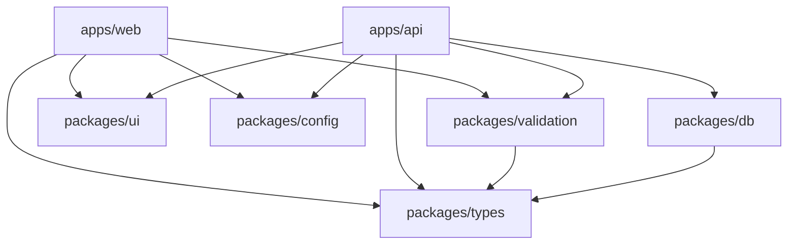

import { Aside, CardGrid, LinkCard, Card, FileTree, Tabs, TabItem } from '@astrojs/starlight/components';
import SourceFile from '../../../components/SourceFile.astro';
import Route from '../../../components/Route.astro';
import FeatureGrid from '../../../components/FeatureGrid.astro';

Schola is a **monorepo**: one Git repository holding three applications and
seven shared packages, wired together with pnpm workspaces and Turborepo. The
rule of thumb: code that runs in one place lives in `apps/`, code that two
places need lives in `packages/`. Every package is named `@schola/<name>`.

## The whole tree

<FileTree>
- schola/
  - _.github/
    - workflows/
      - ci.yml the CI pipeline (see the note on the folder name below)
  - .husky/
    - pre-commit runs lint-staged on commit
  - apps/
    - **api/** Express 5 API — `@schola/api`
    - **web/** Next.js 16 web app — `@schola/web`
    - **docs/** this documentation site — `@schola/docs`
  - packages/
    - config/ typed env loaders — `@schola/config`
    - db/ Mongoose models, encryption, connection — `@schola/db`
    - types/ roles, permissions, response envelope — `@schola/types`
    - validation/ shared Zod schemas — `@schola/validation`
    - ui/ PDF tokens and the `cn` helper — `@schola/ui`
    - eslint-config/ shared ESLint flat configs — `@schola/eslint-config`
    - tsconfig/ shared TypeScript presets — `@schola/tsconfig`
  - docs/ internal Markdown notes: architecture, permissions, services…
  - .env committed env template (blank secrets)
  - test.env your local values (gitignored, you create it)
  - eslint.config.js root ESLint config (used by the pre-commit hook)
  - .prettierrc
  - turbo.json task pipeline
  - pnpm-workspace.yaml `apps/*` and `packages/*`
  - package.json root scripts — `pnpm dev`, `pnpm seed`…
  - tsconfig.base.json
  - README.md
</FileTree>

### How the pieces depend on each other

The web app never imports `@schola/db`: it has no database access and talks to
the API over HTTP. Both apps share the same Zod schemas from
`@schola/validation`, so a form in the browser and the route on the server
validate with exactly the same rules.

The shared packages are **not compiled**. Each one's `package.json` points
straight at its TypeScript source (`"main": "./src/index.ts"`). The API runs
them with `tsx`; the web app compiles them through Next.js's
`transpilePackages`.

## The apps

### apps/api — the Express API

Everything the web app asks for goes through here: authentication, every
school module, PDFs, emails, payments. It listens on port 8000 under
`/api/v1`.

<FileTree>
- apps/api/
  - src/
    - index.ts boots: env, MongoDB, permission seed, listen
    - load-env.ts reads test.env / .env (or the production files)
    - app.ts Express app: security headers, CORS, parsers, every router
    - middleware/ auth, permission checks, validation, rate limits, request id, errors
    - **modules/** one folder per feature area — routes, controllers, services
      - academics/ academic years, subjects, classes, sections
      - admin-transfer/
      - attendance/ student and staff attendance
      - audit-logs/
      - auth/ sign-in, sign-up, sessions, OAuth, email verification
      - dashboard/
      - fees/ fee structures, invoices, payments
      - gradebook/ exams, grades, remarks
      - health/ `GET /api/v1/health`
      - me/ a member's own records and payslips
      - members/ the school's members and staff roles
      - notifications/ in-app notifications and announcements
      - operations/ timetable, leave, admissions, library, transport, hostel
      - payroll/ salary structures and salary records
      - people/ students, parents, teachers, staff, enrollments
      - platform/ the Super Admin's routes
      - platform-users/
      - reports/ overview and CSV exports
      - schools/ sign-up, approval lifecycle, school profile
      - stripe/ the Stripe webhook
      - student-records/ one student's record for staff, the student and parents
      - system-settings/ platform branding, locale, email templates, flags
    - repositories/ `withTenant`, `withSuperAdmin`, audit and membership helpers
    - services/
      - rbac/ default role bundles, seeding, permission resolver
      - email/ Resend, SMTP and console transports, templates
      - pdf/ receipt, payslip and report-card documents
      - stripe/ Checkout and payment fulfilment
      - scopes/ who may see which student; a teacher's sections
      - audit.service.ts writes audit log entries
      - csv.service.ts CSV exports
      - imagekit.service.ts uploads
      - firebase-admin.ts verifies Firebase Google sign-in
      - identity-store.ts the optional Neon identity mirror
    - jobs/ command-line jobs: `seed-demo`, `grant-role`, `sync-role-keys`
    - seed/ the demo dataset builders
    - test/ the integration test harness (in-memory MongoDB)
    - types/ request context type
    - utils/ envelope, JWT, cookies, argon2, logger, dates
  - .env.production committed production template
  - vitest.config.ts
</FileTree>

A module usually holds a `*.routes.ts` file (the Express router with its
permission checks and Zod validation) and, for the larger ones, a
`*.controller.ts` and a `*.service.ts`. Integration tests sit next to it in
`__tests__/`. Every router is mounted in
<SourceFile path="apps/api/src/app.ts" symbol="buildApp" />.

### apps/web — the Next.js web app

The public website, sign-in pages, the platform console and the school app, in
one Next.js App Router project on port 3000.

<FileTree>
- apps/web/
  - src/
    - app/
      - (marketing)/ the public site — home, features, pricing, about, academics, admissions, events, news, faq, contact, legal
      - (auth)/ login, signup, verify, forgot-password, reset-password
      - (super-admin)/
        - platform/ the platform console — `/platform/*`
      - (tenant)/
        - app/ the school app — `/app/*`, one folder per module
      - welcome/ the visitor's dashboard
      - onboarding/
        - school/ register a school from a signed-in account
      - admin-transfer/ accept a school admin transfer
      - layout.tsx root layout and site-wide SEO metadata
      - sitemap.ts
      - robots.ts
      - …
    - components/ layout (sidebar shell), ui (shadcn), forms, data tables, records, marketing…
    - lib/ API client, env, permissions helpers, formatting, demo (sample mode) data
    - providers/ auth, TanStack Query, sample mode
    - stores/ Zustand stores for session, UI and platform filters
    - hooks/
  - e2e/ Playwright specs
  - proxy.ts edge redirects for signed-in / signed-out visitors
  - next.config.ts `/api/*` rewrite, security headers
  - playwright.config.ts
  - .env.production committed production template
</FileTree>

Folders in brackets, like `(tenant)`, are Next.js **route groups**: they group
pages and share a layout without adding to the URL. So
`src/app/(tenant)/app/students/page.tsx` is the page at
<Route path="/app/students" />.

| Route group | URLs | Who | Layout guard |
|---|---|---|---|
| `(marketing)` | `/`, `/features`, `/pricing`, … | Anyone | none — public, indexed |
| `(auth)` | `/login`, `/signup`, `/verify`, `/forgot-password`, `/reset-password` | Signed-out visitors | `/login` and `/signup` send a signed-in user on to their dashboard |
| `(super-admin)` | `/platform/*` | Super Admin | `RequireRole allow={["super_admin"]}` |
| `(tenant)` | `/app/*` | The eight school roles | `RequireRole` with the eight tenant roles |
| — | `/welcome`, `/onboarding/school`, `/admin-transfer` | Signed-in accounts | checked inside the page |

### apps/docs — this site

An Astro + Starlight site on port 3002. Pages are MDX files under
`src/content/docs/`; the sidebar order is set in `astro.config.mjs`; custom
components live in `src/components/`. Read `WRITING_GUIDE.md` before editing a
page, and see [Editing the docs](/operations/editing-the-docs/).

`apps/docs/README.md` lists the docs scripts: `pnpm --filter @schola/docs dev`
(port 3002), `build` and `preview`.

## The shared packages

<CardGrid>
  <Card title="@schola/types" icon="puzzle">
    The vocabulary: the ten role keys and school statuses (`roles.ts`), all 95
    permission keys (`permissions.ts`) and the response envelope with its error
    codes (`envelope.ts`). No dependencies.
  </Card>
  <Card title="@schola/validation" icon="approve-check">
    Zod schemas for every request body and query, one file per area: `auth`,
    `schools`, `admin`, `academics`, `people`, `attendance`, `gradebook`,
    `finance`, `payroll`, `me`, `operations`, plus `common` (ids, email,
    phone, the password policy, pagination).
  </Card>
  <Card title="@schola/db" icon="database">
    Every Mongoose model (`src/models/`), the shared base fields and soft
    delete (`base.ts`), field encryption (`crypto.ts`), the connection
    (`connection.ts`) and the optional Neon Postgres identity store
    (`src/postgres/`, with `db:migrate`).
  </Card>
  <Card title="@schola/config" icon="setting">
    The typed env loaders: `server.ts` (the API's settings, validated at
    start) and `client.ts` (`NEXT_PUBLIC_*`). See
    [Environment variables](/setup/environment-variables/).
  </Card>
  <Card title="@schola/ui" icon="pencil">
    Brand tokens for PDFs (`pdf-tokens.ts`) and the `cn` class-name helper.
    The web app's shadcn components live in `apps/web/src/components/ui/`.
  </Card>
  <Card title="@schola/eslint-config" icon="list-format">
    Flat ESLint configs: `base`, `node` (the API) and `next` (the web app,
    with React, hooks and Next.js rules).
  </Card>
  <Card title="@schola/tsconfig" icon="document">
    TypeScript presets: `base.json` (strict settings), `node.json`
    (NodeNext modules for the API), `next.json` and `library.json`.
  </Card>
</CardGrid>

[Monorepo packages](/architecture/monorepo-packages/) goes deeper into each one.

## Where to find things

| You want to… | Look in |
|---|---|
| Add or change an API endpoint | `apps/api/src/modules/<area>/*.routes.ts` |
| Change who may do something | `packages/types/src/permissions.ts` and `apps/api/src/services/rbac/permissions.ts` |
| Change a data shape | `packages/db/src/models/<model>.ts` and the schema in `packages/validation/src/<area>.ts` |
| Change a page | `apps/web/src/app/<group>/…/page.tsx` |
| Change the sidebar | `apps/web/src/components/layout/dashboard-shell.tsx` |
| Change an email | `apps/api/src/services/email/templates.ts` |
| Change a PDF | `apps/api/src/services/pdf/` |
| Change the demo data | `apps/api/src/seed/` |
| Add an env var | `packages/config/src/server.ts`, `.env` — see [Environment variables](/setup/environment-variables/#adding-a-new-variable) |

## The docs/ folder

Markdown notes for contributors, kept next to the code. This site is built from
the code itself and goes further, but these remain useful references:

| File | About |
|---|---|
| `docs/architecture.md` | The system design |
| `docs/permissions.md` | The permission list and role matrix |
| `docs/design-system.md` | Colours, typography and components |
| `docs/seo.md` | SEO rules for public pages |
| `docs/deployment.md` | Hosting and production env files |
| `docs/testing.md` | Test layers and commands |
| `docs/demo-data.md` | The demo seed |
| `docs/page-roadmap.md` | Pages planned and built |
| `docs/services/*.md` | One page per external service: MongoDB Atlas, Neon, Resend, SMTP, ImageKit, Firebase, Stripe, encryption |

:::caution[The CI workflow is parked]
The workflow lives in `_.github/workflows/ci.yml`. GitHub Actions only runs
workflows from a folder named `.github`, so in the current repository CI does
not run. Rename the folder back to `.github` to switch it on. See
[CI](/operations/ci/).
:::

## Related pages

<CardGrid>
  <LinkCard title="Scripts and tooling" description="Every script, Turborepo, linting, formatting and tests." href="/setup/scripts-and-tooling/" />
  <LinkCard title="Architecture overview" description="How the apps and packages work together." href="/architecture/overview/" />
  <LinkCard title="Web routes" description="Every page of the web app." href="/reference/web-routes/" />
  <LinkCard title="API endpoints" description="Every endpoint of the API." href="/reference/api-endpoints/" />
</CardGrid>
