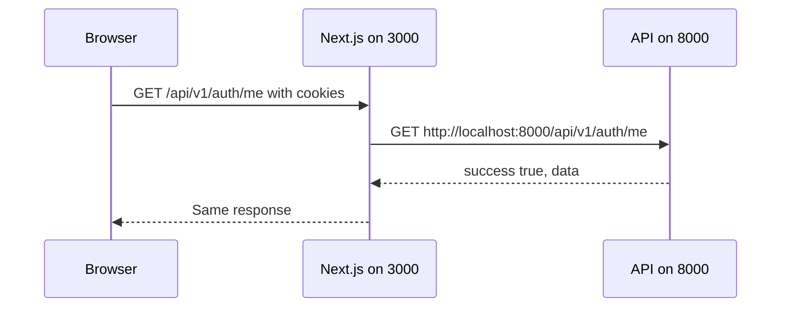

import { Aside, Steps, Tabs, TabItem, CardGrid, LinkCard, Card } from '@astrojs/starlight/components';
import SourceFile from '../../../components/SourceFile.astro';
import Api from '../../../components/Api.astro';
import Route from '../../../components/Route.astro';
import DemoLogin from '../../../components/DemoLogin.astro';
import Pipeline from '../../../components/Pipeline.astro';

Once Schola is [installed](/setup/installation/), one command runs the whole
platform on your machine. This page explains what that command starts, how to
run a single app, how the web app reaches the API, how to check the API is
healthy, and how to sign in for the first time — with the demo data or with an
account of your own.

## Start everything

```sh
pnpm dev
```

The root `dev` script first runs a port check (`scripts/dev-preflight.mjs`),
then `turbo run dev --continue`. Turborepo starts the `dev` script of every
workspace that has one, side by side, and prefixes each output line with the
workspace name.

- **Port check.** Before anything starts, `pnpm dev` checks that **3000**,
  **8000** and **3002** are free. If one is taken — usually by an earlier
  `pnpm dev` still running in another terminal — it stops with a message
  naming the process (pid and command) so you can close it. Set
  `SKIP_PORT_CHECK=1` to skip the check.
- **`--continue`.** If one app fails, the other two keep running instead of
  Turborepo shutting everything down, so a docs error never takes the web app
  or the API with it.

<CardGrid>
  <Card title="Web app — @schola/web" icon="laptop">
    `next dev --webpack` on **http://localhost:3000**. The public site,
    sign-in, the platform console and the school app.
  </Card>
  <Card title="API — @schola/api" icon="server">
    `tsx watch src/index.ts` on **http://localhost:8000/api/v1**, plus the
    Stripe webhook listener in the background. Restarts when you save a file.
  </Card>
  <Card title="Docs — @schola/docs" icon="open-book">
    `astro dev --port 3002` on **http://localhost:3002**. This site.
  </Card>
</CardGrid>

The shared packages (`packages/*`) have no dev server. The web app and the API
import their TypeScript source directly, so a change in, say,
`packages/validation` is picked up by both on the next reload.

<Aside type="note" title="Why webpack?">
The web app runs Next.js with `--webpack` instead of Turbopack. The shared
packages import each other with `.js` extensions on `.ts` files (so the API can
run them with `tsx`), and Turbopack does not honour the
`experimental.extensionAlias` setting that maps them. See the comment in
`apps/web/next.config.ts`.
</Aside>

### What a healthy start looks like

The API prints, in order:

```text
mongodb connected
permissions seeded            { count: 95 }
user role seeded
super_admin role seeded
Schola API listening          { port: 8000, env: "development" }
tenant roles seeded            { schoolId: … }   (once per approved school)
tenant role permissions synced { schools: … }
```

On every start, the API writes all permission keys and the platform roles to
the database (one bulk write each), then starts listening — a few seconds after
`mongodb connected`, even against Atlas. Straight after, in the background, it
re-applies the default permissions to the roles of every approved school. That
step only adds grants introduced since the last start, so it is safe to run
again and again, and it is how a new permission reaches existing schools.

## Run one app at a time

Use pnpm's `--filter` with the workspace name:

```sh
pnpm --filter @schola/web dev    # web app only  → :3000
pnpm --filter @schola/api dev    # API only (+ Stripe listener) → :8000
pnpm --filter @schola/docs dev   # docs only → :3002
```

The web app on its own shows the public pages, but sign-in and every dashboard
need the API. To run the API **without** the Stripe listener:

```sh
pnpm --filter @schola/api exec tsx watch src/index.ts
```

## How the web app reaches the API

The browser never calls port 8000. It calls the web app on port 3000 at
`/api/v1/…`, and Next.js forwards the request.



The forwarding rule lives in <SourceFile path="apps/web/next.config.ts" />:

```ts
const INTERNAL_API_URL = process.env.INTERNAL_API_URL || "http://localhost:8000";
// …
async rewrites() {
  return [{ source: "/api/:path*", destination: `${INTERNAL_API_URL}/api/:path*` }];
},
```

Because the browser sees one origin, the `schola_access`, `schola_refresh` and
`schola_csrf` cookies are first-party, and no CORS request is ever made. The web
app's API client uses the relative base `/api/v1` unless
`NEXT_PUBLIC_API_BASE_URL` says otherwise (<SourceFile path="apps/web/src/lib/env.ts" />).

If you run the API on another port, export `INTERNAL_API_URL` before starting
the web app (the web app does not read the root `test.env` — see
[Environment variables](/setup/environment-variables/#the-web-app)):

```sh
INTERNAL_API_URL=http://localhost:8100 pnpm --filter @schola/web dev
```

## Check the API is healthy

<Api method="GET" path="health" /> needs no sign-in. Call it directly or
through the web app's proxy:

```sh
curl http://localhost:8000/api/v1/health   # the API itself
curl http://localhost:3000/api/v1/health   # through the web app's /api proxy
```

Both return:

```json
{
  "success": true,
  "data": { "ok": true, "service": "schola-api", "version": "0.0.0", "timestamp": "2026-11-07T10:00:00.000Z" }
}
```

If the first works and the second does not, the web app is not running or
cannot reach `INTERNAL_API_URL`. CI uses the same endpoint to wait for the API
to come up. <SourceFile path="apps/api/src/modules/health/health.routes.ts" />

## First sign-in

<Tabs>
  <TabItem label="With the demo data">
    Load it once with `pnpm seed` ([Demo data](/setup/demo-data/)), then open
    `http://localhost:3000/login` and sign in with any demo account. The
    password is `Schola@2026`.

    | Sign in as | Email | Lands on |
    |---|---|---|
    | Super Admin | `superadmin@schola.example` | `/platform` |
    | School Admin | `admin@greenfield.example` | `/app` |
    | Teacher | `teacher@greenfield.example` | `/app` |
    | Parent | `parent@greenfield.example` | `/app` |

    The full list is in [Demo accounts](/reference/demo-accounts/).
  </TabItem>
  <TabItem label="With your own account">
    Without demo data, the database has no users at all. Create one and make
    it the platform's Super Admin:

    1. Open `http://localhost:3000/signup`, choose **Personal account**, and fill in your name, email and password.
    2. Verify the email. With no email service configured, the API prints the message to its terminal as `[email/console] would have sent email` — copy the link from it, or type the 6-digit code on the verification page.
    3. In a second terminal, grant yourself the Super Admin role:

       ```sh
       pnpm --filter @schola/api run grant-role -- --email you@example.com --role super_admin
       ```

    4. Sign in at `http://localhost:3000/login`. You land on `/platform`. If you were already signed in, sign out and back in first.
  </TabItem>
</Tabs>

<DemoLogin as="Super Admin" email="superadmin@schola.example" go="/platform" />

## Granting roles from the command line

`grant-role` is an operator tool for giving an **existing** account a role. It
connects to the database from your env files, so it works on any environment
you point it at. Source: <SourceFile path="apps/api/src/jobs/grant-role.ts" />.

```sh
# A platform role — no school:
pnpm --filter @schola/api run grant-role -- --email person@example.com --role super_admin

# A school role — needs the school's id (24 hex characters):
pnpm --filter @schola/api run grant-role -- --email person@example.com --role principal --school-id 65f1c0ffee0000000000c0de
```

| Flag | Required | Meaning |
|---|---|---|
| `--email <email>` | Yes | The account to change. It must already exist ("Sign up that account first"). |
| `--role <key>` | Yes | One of `super_admin`, `school_admin`, `principal`, `vice_principal`, `teacher`, `accountant`, `student`, `parent`, `staff`, `user`. |
| `--school-id <id>` | For school roles only | The school's MongoDB id. Required for the eight school roles, refused for `super_admin` and `user`. |

What it does:

<Steps>

1. Makes sure the permissions and the role exist (for a school role, it creates that school's roles if needed).
2. Adds the membership — running it twice changes nothing.
3. For `super_admin` only: activates the account, marks it a platform user, marks the email verified if it was not, and clears any login lockout.
4. Writes an audit log entry (`user.role.grant`, actor role `cli`).

</Steps>

It never creates accounts and never touches passwords. You can find a school's
id in the address bar of its page under <Route path="/platform/schools" />. A
Super Admin can also grant roles in the browser on
<Route path="/platform/users" />.

A companion job, `sync-role-keys`, rebuilds the role list cached on each user
document (used for display and search only):

```sh
pnpm --filter @schola/api run sync-role-keys
```

## The Stripe listener

The API's `dev` script starts two processes:

```sh
stripe listen --skip-update \
  --forward-to http://127.0.0.1:8000/api/v1/stripe/webhook \
  --events checkout.session.completed,checkout.session.async_payment_succeeded,checkout.session.async_payment_failed &
tsx watch src/index.ts
```

<Pipeline
  caption="How a test payment reaches your local API."
  steps={[
    { label: 'Pay', icon: 'credit-card', note: 'Stripe Checkout page' },
    { label: 'Stripe', icon: 'cloud-upload', note: 'sends an event' },
    { label: 'stripe listen', icon: 'terminal', note: 'forwards it' },
    { label: 'Webhook', icon: 'server', note: '/api/v1/stripe/webhook' },
    { label: 'Recorded', icon: 'receipt', note: 'payment or payslip paid' },
  ]}
/>

`stripe` is the CLI installed by `pnpm install` (`@stripe/cli`), so nothing
else is needed. To use it:

<Steps>

1. Sign in to Stripe once: `pnpm --filter @schola/api exec stripe login`.
2. Put a test secret key in `test.env` as `STRIPE_SECRET_KEY`.
3. Start the API. The listener prints `Your webhook signing secret is whsec_…`.
4. Copy that value into `test.env` as `STRIPE_WEBHOOK_SECRET`, then restart the API.
5. Pay a fee invoice or a payslip in the app with the test card `4242 4242 4242 4242`.

</Steps>

If the API is already running on its own, run only the listener:

```sh
pnpm --filter @schola/api stripe:listen
```

<Aside type="caution" title="The listener's port is fixed">
Both `dev` and `stripe:listen` forward to port **8000**. If you change
`API_PORT`, change the port in `apps/api/package.json` too, or webhooks will
not arrive.
</Aside>

If you do not use Stripe, ignore the listener's error message; the API runs
normally and the "Pay" buttons answer `503 Stripe is not configured`. More in
[Stripe](/setup/services/stripe/) and [Online payments](/features/finance/online-payments/).

## Stopping and restarting

- Press `Ctrl+C` in the `pnpm dev` terminal to stop all three servers.
- The API restarts by itself when you save a file under `apps/api/src`. Changes to `test.env` need a manual restart: the env files are read once, at start.
- The web app reloads in the browser on save. Changes to `NEXT_PUBLIC_*` values need a restart of `next dev`.

## Common problems

| Symptom | Cause | Fix |
|---|---|---|
| `pnpm dev can't start — these ports are already in use` | An earlier `pnpm dev` (or another app) still holds 3000, 8000 or 3002 | Stop the process the message names (`Ctrl+C` in its terminal, or `kill <pid>`), then run `pnpm dev` again. |
| `Port 8000 is already in use` from the API | You started the API alone while another copy runs | Same fix: stop the other copy. |
| Every page under `/app` bounces to `/login` | The API is not running, so the session check fails | Check `curl http://localhost:8000/api/v1/health`. |
| `403 Missing or invalid CSRF token` from a tool like `curl` | Signed-in writes need the `x-csrf-token` header | Call <Api method="GET" path="auth/csrf" /> first and send the `csrfToken` it returns as the header. The web app does this for you. |
| `429 Too many auth requests` | The auth rate limit (60 per minute per IP in development) | Wait a minute. |
| Emails never arrive | No email service is configured | Read them in the API terminal (`[email/console]`), or configure Mailpit or Resend — [Email](/setup/services/email/). |

## Related pages

<CardGrid>
  <LinkCard title="Demo data" description="What pnpm seed creates and how to reset it." href="/setup/demo-data/" />
  <LinkCard title="Scripts and tooling" description="Every script in every package, Turborepo, lint and tests." href="/setup/scripts-and-tooling/" />
  <LinkCard title="Request lifecycle" description="What happens to a request inside the API." href="/architecture/request-lifecycle/" />
  <LinkCard title="Troubleshooting" description="More problems and their fixes." href="/operations/troubleshooting/" />
</CardGrid>
