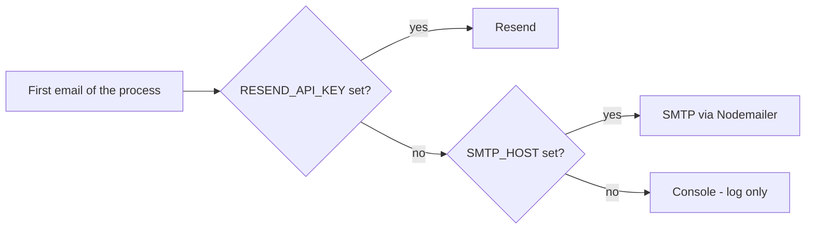

import { Aside, Steps, Tabs, TabItem, Card, CardGrid, LinkCard, Badge } from '@astrojs/starlight/components';
import Pipeline from '../../../../components/Pipeline.astro';
import SourceFile from '../../../../components/SourceFile.astro';
import Api from '../../../../components/Api.astro';
import Perm from '../../../../components/Perm.astro';
import Route from '../../../../components/Route.astro';
import DemoLogin from '../../../../components/DemoLogin.astro';

Schola sends a small set of **transactional emails** — messages triggered by
something a person did: confirm your email address, reset your password, your
school is approved, accept the admin role, a school announcement. It never
sends marketing email.

All sending goes through one function, `sendEmail()`, which hands the message
to one of three *transports* (delivery back-ends):

- **Resend** — an email API, the primary transport and the one production uses.
- **SMTP** via Nodemailer — any mail server or provider that speaks SMTP.
- **Console** — prints the email to the API's log instead of sending it. This
  is what you get in development when nothing is configured, so sign-up and
  password reset work with zero setup.

## At a glance

<CardGrid>
  <Card title="Environment variables" icon="setting">
    `RESEND_API_KEY`, `EMAIL_FROM`, and for SMTP `SMTP_HOST`, `SMTP_PORT`,
    `SMTP_USER`, `SMTP_PASS`, `SMTP_SECURE`.
  </Card>
  <Card title="Required?" icon="warning">
    <Badge text="Production: Resend key" variant="caution" /> The API refuses
    to start in production without `RESEND_API_KEY`. In development nothing is
    required.
  </Card>
  <Card title="Libraries" icon="puzzle">
    `resend` (official SDK) and `nodemailer`. Templates are plain HTML + text
    strings, no template engine.
  </Card>
  <Card title="Where it lives" icon="email">
    `apps/api/src/services/email/` — `index.ts` picks the transport,
    `templates.ts` holds every email.
  </Card>
</CardGrid>

## How the transport is chosen



`getEmailTransport()` makes this decision **once**, the first time the API
sends an email, and keeps the answer until the process restarts. It logs which
one it picked: `email transport selected` with `transport: "resend"`,
`"smtp"` or `"console"`. Change a key, then restart the API.

<Aside type="caution" title="SMTP is not an automatic failover">
The original spec describes SMTP as a "fallback" to Resend. In the code it is a fallback
**at configuration time only**: SMTP is used when there is no Resend key. If
Resend is configured and a send fails (outage, unverified domain, rate
limit), the send fails — Schola does not retry through SMTP. To use SMTP,
leave `RESEND_API_KEY` blank.
</Aside>

## What happens without it

| Situation | Result |
|---|---|
| Development, no keys | Console transport. Every email is printed to the API terminal as `[email/console] would have sent email`, including the subject, the text body and its links and codes. |
| Production, no `RESEND_API_KEY` | The API does not start: `Production env missing required values: RESEND_API_KEY`. |
| Resend set but the send fails | Every email that follows a saved change is best-effort: the failure is logged and the request still succeeds (see "Some details worth knowing" below). Only two requests whose whole point is the email answer `503`: a signed-in **Resend link** and an admin transfer. |

## Every email Schola sends

| Trigger | Subject | What is inside | Expires after |
|---|---|---|---|
| A visitor creates an account at <Route path="/signup" /> — <Api method="POST" path="auth/register" /> | Verify your Schola email | A link to `/verify?token=…` and a 6-digit code | `EMAIL_VERIFICATION_TTL_HOURS` (72 h) |
| **Resend link** on the "Verify your email address" banner (signed in, not yet verified), or **Send a new code** on <Route path="/verify" /> (signed out, for the email typed there) — <Api method="POST" path="auth/verify-email/resend" /> | Verify your Schola email | Same as above | 72 h |
| A school owner applies — <Api method="POST" path="schools/signup" /> | Verify your Schola email **and** Your Schola application is being reviewed | Verification link and code, then an "application received" note | 72 h |
| A signed-in person registers a school — <Api method="POST" path="schools/quick-signup" /> | Your Schola application is being reviewed | "Application received" note | — |
| The Super Admin approves a school — <Api method="POST" path="platform/schools/:id/approve" perm="school:approve" /> | *School name* is approved on Schola | "Log in to Schola" button to `/login` | — |
| The Super Admin rejects a school — <Api method="POST" path="platform/schools/:id/reject" perm="school:reject" /> | Update on your Schola application — *School name* | The rejection reason | — |
| The Super Admin creates a school directly — <Api method="POST" path="platform/schools" perm="school:create_direct" /> | Set your Schola password for *School name* (no password given) or the approval email (password given) | The set-password invite ("as the school admin") with a **Set password** link to `/reset-password?token=…` | 24 × `PASSWORD_RESET_TTL_MIN` (24 h) |
| The Super Admin invites a platform user — <Api method="POST" path="platform/users/invite" perm="user:invite_platform" /> | Set your Schola password | The set-password invite ("as a platform super admin") | 24 h |
| Anyone uses "Forgot?" on <Route path="/login" /> — <Api method="POST" path="auth/forgot-password" /> | Reset your Schola password | A `/reset-password?token=…` link | `PASSWORD_RESET_TTL_MIN` (60 min) |
| A School Admin adds a teacher, a staff member with an email, or a parent with a new email — <Api method="POST" path="teachers" perm="teacher:create" /> <Api method="POST" path="staff" perm="staff:create" /> <Api method="POST" path="parents" perm="parent:create" /> | Set your Schola password for *School name* | "You've been added to *School name* on Schola as a teacher / a staff member / a parent", the sign-in email and a **Set password** link to `/reset-password?token=…` | 24 × `PASSWORD_RESET_TTL_MIN` (24 h) |
| The School Admin hands over the school — <Api method="POST" path="admin-transfer/initiate" perm="school:update:tenant" /> | Accept the Schola admin role for *School name* | "Accept admin role" button to `/admin-transfer?token=…` | `ADMIN_TRANSFER_TTL_HOURS` (24 h) |
| An announcement with **Also send by email** ticked — <Api method="POST" path="notifications/announce" perm="notification:send:tenant" /> | *School name*: *title* | The announcement text and an "Open Schola" button | — |

Some details worth knowing:

- **Forgot password never reveals whether an email exists.** Unknown addresses
  get the same "If that email is registered…" answer and no email.
- **Sign-up is best-effort.** If the verification email fails after
  <Api method="POST" path="auth/register" />, the account is still created and
  the failure is logged; the person can resend later.
- **Announcements send after the response.** The API answers first, then
  emails each recipient one by one. A failed recipient is logged and skipped.
- **School sign-up, approval and rejection are best-effort too.** The
  database change is saved first; if the email then fails, the error is logged
  (`signup pending email failed`, `approval email failed`, `rejection email
  failed`) and the rest of the flow — notifications, audit entry — still runs.
  The request succeeds, but the person gets no email, so check the API log.
- **So are set-password invites and Forgot password.** Adding a teacher, staff
  member or parent, inviting a platform user and creating a school directly
  save first and then send the invite; a failure is logged (`account invite:
  email not delivered`) and recorded on the audit entry as `inviteEmail:
  "failed"` (`ownerEmail` for a direct school create), and the request still
  answers `201` — a retry would only say "already exists". Forgot password
  answers `202` either way (`forgot password: email not delivered` in the log,
  `email: "failed"` on `auth.password_reset.request`), so the reply never
  reveals which addresses have accounts.
- **Two requests report the failure.** A signed-in **Resend link** answers
  `503` "We couldn't send the verification email just now. Try again in a few
  minutes." An admin transfer that can't be emailed is not started — the token
  is deleted, nothing is audited — and answers `503` "We couldn't email
  *address*, so the transfer wasn't started. Try again in a few minutes."
- **The signed-out resend is rate-limited per address.** Asking for a new code
  from <Route path="/verify" /> sends at most one email per address per minute,
  and the API answers `202` whether or not the address has an account.

<Aside type="note" title="Expiry text follows the settings">
Every email states the lifetime the token really has, read from the same
settings that set the expiry (`apps/api/src/utils/token-ttl.ts`): verification
`EMAIL_VERIFICATION_TTL_HOURS`, reset `PASSWORD_RESET_TTL_MIN`, admin transfer
`ADMIN_TRANSFER_TTL_HOURS`, and set-password invites 24 ×
`PASSWORD_RESET_TTL_MIN`. Whole hours read "1 hour" / "24 hours", anything else
"90 minutes". The web pages no longer quote a duration ("The email says how
long it stays valid.").
</Aside>

## Pricing in short

- **Console** and a local SMTP catcher such as Mailpit cost nothing.
- **Resend** has a free tier with daily and monthly sending limits and a
  single verified domain, and paid plans above that. Check
  [resend.com/pricing](https://resend.com/pricing) for current numbers.
- **SMTP providers** (Amazon SES, Postmark, Mailgun, SendGrid and others) each
  price differently — check the provider.

## Set up Resend (production and real inboxes)

<Steps>

1. Sign up at [resend.com/signup](https://resend.com/signup).

2. Open **Domains → Add Domain** and enter the domain you will send from —
   for production, `schola.reactbd.com`.

3. Resend shows DNS records (SPF and DKIM, and optionally DMARC and a
   return-path record). Add each one at your DNS provider exactly as shown.

4. Wait until the domain shows **Verified** in Resend. This usually takes
   minutes, sometimes longer while DNS propagates.

5. Open **API Keys → Create API Key**. Name it (for example `schola-prod` or
   `schola-dev`) and give it **sending access** — Schola only sends.

6. Copy the key (it starts with `re_`; Resend shows it only once) into
   **`RESEND_API_KEY`**: `test.env` for development, the API host's
   environment or `apps/api/.env.production.local` for production.

7. Set **`EMAIL_FROM`** to a sender on the verified domain, in
   `Name <address>` form:

   ```sh title="test.env"
   RESEND_API_KEY=re_xxxxxxxxxxxxxxxx
   EMAIL_FROM="Schola <noreply@schola.reactbd.com>"
   ```

   `EMAIL_FROM` defaults to exactly that value, so you only set it to use a
   different sender.

8. Restart the API. The log shows `email transport selected` with
   `transport: "resend"` the first time an email goes out.

</Steps>

<Aside type="tip" title="Testing Resend before your domain is verified">
Resend's shared test sender works without a domain:
`EMAIL_FROM="Schola <onboarding@resend.dev>"`. It only delivers to the email
address of your own Resend account, so sign up in Schola with that address to
receive the messages.
</Aside>

## Set up SMTP (self-hosted, or a local inbox)

SMTP is used only when **`RESEND_API_KEY` is blank** and `SMTP_HOST` is set.

<Tabs>
  <TabItem label="Mailpit (local inbox)">
    <Steps>

    1. Run [Mailpit](https://mailpit.axllent.org/), which catches every email
       and shows it in a web inbox:

       ```sh
       docker run -d --rm --name schola-mailpit -p 1025:1025 -p 8025:8025 axllent/mailpit
       ```

    2. In `test.env`, blank the Resend key and point SMTP at Mailpit, with
       TLS off (`SMTP_SECURE=false`, or empty):

       ```sh title="test.env"
       RESEND_API_KEY=
       SMTP_HOST=127.0.0.1
       SMTP_PORT=1025
       SMTP_USER=
       SMTP_PASS=
       SMTP_SECURE=false
       ```

    3. Restart the API and trigger an email. Open the inbox at
       `http://localhost:8025`.

    </Steps>
  </TabItem>
  <TabItem label="A provider (SES, Postmark, Mailgun…)">
    <Steps>

    1. In your provider's console, create SMTP credentials and note the host
       and port.

    2. Fill the SMTP keys (and keep `RESEND_API_KEY` blank):

       | Key | Value |
       |---|---|
       | `SMTP_HOST` | The provider's SMTP host |
       | `SMTP_PORT` | `587` (STARTTLS) or `465` (TLS from the first byte). Default `587`. |
       | `SMTP_USER` / `SMTP_PASS` | The SMTP credentials. If `SMTP_USER` is blank, Schola connects without authentication. |
       | `SMTP_SECURE` | `false` (or empty) for port 587; `true` only for port 465. |
       | `EMAIL_FROM` | A sender the provider allows. |

    3. Restart the API and send a test email (see "Verify it works").

    </Steps>
  </TabItem>
</Tabs>

<Aside type="note" title="How SMTP_SECURE is read">
`SMTP_SECURE` accepts `true`, `false`, `1` or `0` (any case); an empty value
means `false`. Any other text stops the API at boot with a validation error.
`SMTP_SECURE=false` — the value in the committed `.env` — keeps TLS off, which
is right for port 587 (STARTTLS) and for Mailpit on 1025. Use `true` only for
port 465.
</Aside>

## The templates

Every email is built in `apps/api/src/services/email/templates.ts`. Each
template returns `{ subject, html, text }` — an HTML version with a simple
card layout, a "Schola" header and a footer link to `APP_URL`, and a
plain-text version for mail clients that do not show HTML. Every value that
comes from a person (names, school names, announcement text) is HTML-escaped.

| Template | Used for |
|---|---|
| `verifyEmailTemplate` | Email verification (with the 6-digit code) |
| `passwordResetTemplate` | Forgot password |
| `accountInviteTemplate` | Set-password invite for a sign-in an admin created: teachers, staff, parents, directly created school owners, platform users |
| `schoolPendingTemplate` | School application received |
| `schoolApprovedTemplate` | School approved |
| `schoolRejectedTemplate` | School rejected, with the reason |
| `adminTransferTemplate` | Admin-transfer nomination |
| `announcementTemplate` | School announcements sent by email |

Links in emails are built from **`APP_URL`** (the web app's public address),
so set it to `https://schola.reactbd.com` in production or every link points
at localhost.

## How the code uses it

- <SourceFile path="apps/api/src/services/email/index.ts" symbol="getEmailTransport" /> — picks and caches the transport; `sendEmail()` is the only function the rest of the API calls.
- <SourceFile path="apps/api/src/services/email/transport.resend.ts" /> — calls Resend; on an error it logs the full reason (for example "domain is not verified") and throws `Resend send failed: …`.
- <SourceFile path="apps/api/src/services/email/transport.smtp.ts" /> — a Nodemailer transporter built from the `SMTP_*` keys.
- <SourceFile path="apps/api/src/services/email/transport.console.ts" /> — logs the whole message at `info` level.
- <SourceFile path="apps/api/src/services/email/templates.ts" /> — every subject and body.
- <SourceFile path="apps/api/src/services/email/deliver.ts" symbol="trySendEmail" /> — best-effort sending: logs a failure and returns `false` instead of throwing.
- <SourceFile path="apps/api/src/services/account-invite.ts" symbol="sendAccountInvite" /> — the set-password invite (token + email) used for teachers, staff, parents, direct school owners and platform users.
- <SourceFile path="apps/api/src/utils/token-ttl.ts" /> — token lifetimes and the "24 hours" wording.
- Callers: `auth.service.ts`, `schools.service.ts`, `schools.admin.service.ts`, `platform-users.service.ts`, `admin-transfer.service.ts`, `people/teachers.routes.ts`, `people/staff.routes.ts`, `people/parents.routes.ts`, `notifications/notifications.routes.ts`.

In-app notifications (the bell icon) are a separate system stored in MongoDB;
see [Email and notifications](/architecture/email-and-notifications/).

## Verify it works

<DemoLogin as="any demo account" email="admin@greenfield.example" go="/forgot-password" />

<Steps>

1. Start the API and watch its terminal.

2. Open <Route path="/forgot-password" /> (or click **Forgot?** on the sign-in
   page), type an email address and click **Send reset link**. The page
   answers "If that email is registered, you'll receive a reset link
   shortly."

3. Check where the email went:
   - **Console:** the API log shows `email transport selected` with
     `transport: "console"`, then `[email/console] would have sent email` with
     the subject "Reset your Schola password" and the reset link.
   - **Mailpit:** the message appears at `http://localhost:8025`.
   - **Resend:** the message appears under **Emails** in the Resend
     dashboard, with its delivery status.

4. Open the link. You land on <Route path="/reset-password" /> with the token
   filled in.

</Steps>

<Aside type="note">
The demo accounts use reserved `*.example` domains, which have no real
inboxes. With Resend or a real SMTP provider, test with an account whose
address you can actually read.
</Aside>

## Troubleshooting

| Symptom | Cause and fix |
|---|---|
| API log: `[email/resend] send failed` … `domain is not verified` | `EMAIL_FROM` uses a domain Resend has not verified. Finish the DNS steps, or use `onboarding@resend.dev` for testing. |
| Resend accepted the email but it never arrived | Check **Emails** in the Resend dashboard for bounces. `*.example` addresses always bounce. |
| Emails still print to the console after adding a key | The transport is chosen once per process — restart the API. Also check the key is in `test.env`, which wins over `.env`. |
| SMTP error `wrong version number` / `ssl3_get_record` | `SMTP_SECURE=true` on a port that expects STARTTLS or plain text. Use `SMTP_SECURE=false` for ports 587 and 1025. |
| API stops at boot: `SMTP_SECURE: must be "true", "false", "1" or "0"` | Another spelling such as `yes` or `off`. Use one of the four values, or leave it empty. |
| SMTP `EAUTH` / `535 Authentication failed` | Wrong `SMTP_USER` / `SMTP_PASS`. |
| SMTP connection timeout | Wrong host or port, or a firewall blocks outgoing SMTP. |
| SMTP is ignored | `RESEND_API_KEY` is set somewhere (perhaps in `.env`). Resend always wins; blank it in `test.env`. |
| A school was approved or rejected but the owner got no email | The email failed after the change was saved; the API logs `approval email failed` or `rejection email failed` and carries on. Fix email, then contact the owner yourself. |
| A new teacher, staff member or parent got no set-password email | The invite failed after the record was saved; the API logs `account invite: email not delivered` and the audit entry says `inviteEmail: "failed"`. Fix email, then have them use **Forgot?** on the sign-in page. |
| Links in emails point to `http://localhost:3000` in production | `APP_URL` is not set on the API host. |

## Related pages

<CardGrid>
  <LinkCard title="Email and notifications" description="How email and the in-app bell fit together." href="/architecture/email-and-notifications/" />
  <LinkCard title="Sign-up and sign-in" description="Verification codes, password reset and the screens around them." href="/features/accounts/sign-up-and-sign-in/" />
  <LinkCard title="Announcements" description="Send a notice to roles in a school, optionally by email." href="/features/communication/announcements/" />
  <LinkCard title="Environment variables" description="Every key Schola reads, in one table." href="/reference/environment-variables/" />
</CardGrid>
