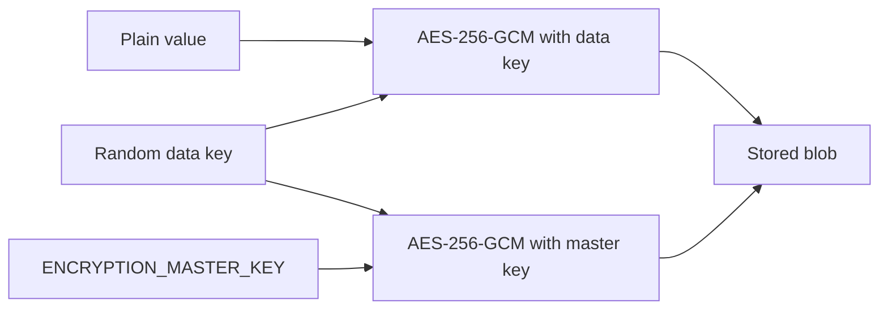

import { Aside, Steps, Card, CardGrid, LinkCard, Badge } from '@astrojs/starlight/components';
import Pipeline from '../../../../components/Pipeline.astro';
import SourceFile from '../../../../components/SourceFile.astro';
import Api from '../../../../components/Api.astro';
import Route from '../../../../components/Route.astro';
import DemoLogin from '../../../../components/DemoLogin.astro';

Schola stores some personal details **encrypted** in MongoDB: phone numbers,
dates of birth and home addresses — the PII (personally identifiable
information) that would do the most harm if a database copy leaked. Anyone
who reads the raw database, a backup or a stolen dump sees scrambled blobs,
not the values. Only the running API, which holds the master key, can turn
them back into text.

This is not a third-party service — it uses Node's built-in `crypto` module —
but it needs one secret, `ENCRYPTION_MASTER_KEY`, and getting that secret
wrong is the most common reason the student, teacher, parent and staff
screens fail. The original spec (question 2) made this a v1 requirement.

## At a glance

<CardGrid>
  <Card title="Environment variable" icon="setting">
    `ENCRYPTION_MASTER_KEY` — 32 random bytes, base64-encoded. Read by the API
    and the demo seed.
  </Card>
  <Card title="Required?" icon="warning">
    <Badge text="Production: yes" variant="danger" /> The API refuses to start
    without it. <Badge text="Development: in practice" variant="caution" /> —
    the API boots, but any screen with people's details fails.
  </Card>
  <Card title="Algorithm" icon="padlock">
    AES-256-GCM, twice: once for the value with a per-value data key, once to
    wrap that data key with the master key.
  </Card>
  <Card title="Create a key" icon="pencil">
    `openssl rand -base64 32`
  </Card>
</CardGrid>

## How envelope encryption works

[Envelope encryption](/start-here/glossary/#encrypted-fields) means every value gets its own fresh key (the **data
key**), and only that small data key is locked with the **master key**. The
master key never touches the data directly.

<Pipeline
  caption="What happens when the API saves a phone number. Decryption runs the same steps backwards."
  steps={[
    { label: 'Plain value', icon: 'user', note: '"+1 555 030 1351"' },
    { label: 'Data key', icon: 'key', note: '32 random bytes' },
    { label: 'Encrypt value', icon: 'lock', note: 'AES-256-GCM' },
    { label: 'Wrap data key', icon: 'shield', note: 'With the master key' },
    { label: 'Store blob', icon: 'database', note: 'In MongoDB' },
  ]}
/>



The stored field is an object like this (all values base64):

```json
{
  "v": 1,
  "keyId": "3f9a…",
  "iv": "…",
  "tag": "…",
  "ciphertext": "…",
  "wrappedKey": { "iv": "…", "tag": "…", "data": "…" }
}
```

- `iv` is a random 12-byte nonce, so the same phone number encrypts
  differently every time.
- `tag` is GCM's authentication tag: any tampering makes decryption fail
  instead of returning wrong data.
- `keyId` names the master key that wrapped the data key. It is the first 8
  bytes of the master key, written in hex.
- Encryption happens in a Mongoose setter: assigning a plain string to an
  encrypted path encrypts it on the spot; assigning an empty string or `null`
  stores `null`.

## Which fields are encrypted

| Model (collection) | Encrypted fields |
|---|---|
| `User` (`users`) | `phone`, `dateOfBirth`, `address` |
| `Student` (`students`) | `phone`, `dateOfBirth`, `address` |
| `Parent` (`parents`) | `phone`, `address` |
| `Teacher` (`teachers`) | `phone`, `dateOfBirth`, `address` |
| `Staff` (`staffs`) | `phone`, `dateOfBirth`, `address` |
| `AdmissionApplication` (`admissionapplications`) | `dateOfBirth`, `address`, `guardianPhone` |

Names, email addresses, admission numbers, marks and fees are **not**
encrypted — the app needs to search, sort and index them.

### When values are decrypted

Encrypted blobs never leave the API by accident: every one of these models
removes its encrypted fields in `toJSON()`, so they cannot slip into an API
response or an audit log entry. The API decrypts on purpose, at the edge of
each module:

- **Detail views** (one student, teacher, parent, staff member, admission
  application) decrypt every PII field — `withDecryptedPii()`.
- **List views** (students, teachers, parents, staff) decrypt the phone
  number only; birthdays and addresses stay hidden — `withListPii()`.
- **My profile** (<Route path="/app/profile" />) decrypts the signed-in
  person's own phone number.

## What happens without the key

| Situation | Result |
|---|---|
| Production, key blank | The API does not start: `Production env missing required values: ENCRYPTION_MASTER_KEY`. |
| `pnpm seed`, key blank | Stops at once: "ENCRYPTION_MASTER_KEY is not set. Generate one with `openssl rand -base64 32` and put it in test.env". |
| Development API, key blank | The API starts and sign-in works. Creating or opening a student, teacher, parent, staff member or admission application that has a phone, birthday or address fails with **"Something went wrong."** (500); the API log shows `EncryptionError: missing ENCRYPTION_MASTER_KEY`. |
| Key is not 32 bytes | Same 500s, with `ENCRYPTION_MASTER_KEY must decode to 32 bytes (got N)` in the log. |

## Create the key

<Steps>

1. Generate 32 random bytes, base64-encoded:

   ```sh
   openssl rand -base64 32
   ```

   The output is 44 characters ending in `=`. Do **not** use
   `openssl rand -hex 32` here — 64 hex characters decode to 48 bytes and are
   rejected. (The JWT and CSRF secrets use `-hex`; this key uses `-base64`.)

2. Put it in **`ENCRYPTION_MASTER_KEY`**:
   - Development: `test.env` at the repo root (gitignored). Leave the
     committed `.env` blank.
   - Production: the API host's secret settings, or
     `apps/api/.env.production.local`.

   ```sh title="test.env"
   ENCRYPTION_MASTER_KEY=PASTE_THE_44_CHARACTER_VALUE_HERE
   ```

3. Optional check — confirm it decodes to 32 bytes without printing it:

   ```sh
   node -e 'console.log(Buffer.from(process.argv[1], "base64").length)' "$(grep '^ENCRYPTION_MASTER_KEY=' test.env | cut -d= -f2-)"
   ```

   It should print `32`.

4. Restart the API, then run `pnpm seed` (or `pnpm seed -- --reset` if demo
   data already exists).

5. **Store a copy of the key somewhere safe** (a password manager or secret
   store), separate from your database backups. There is no recovery without
   it.

</Steps>

## Why the seed and the API must share one key

`pnpm seed` encrypts the phone numbers, birthdays and addresses of the 500
demo students, their parents, the teachers and the staff with whatever
`ENCRYPTION_MASTER_KEY` *it* sees. The API later decrypts them with whatever
key *it* sees. Both load the same files (`test.env`, then `.env`), so on one
machine they agree automatically.

They stop agreeing when you seed a remote database (for example Atlas) from
your laptop while the hosted API has a different key — or when you generate a
new key after seeding. The keys produce different `keyId`s, and every
decryption fails with:

```
EncryptionError: key rotation required: payload encrypted with keyId=…, current=…
```

In the app that shows up as "Something went wrong." on the student, teacher,
parent and staff lists and profiles — while screens without PII (attendance,
fees, grades) keep working. Fix it by running the API with the key that wrote
the data, or, for demo data only, re-seeding with `pnpm seed -- --reset` using
the API's key.

## Key rotation and loss

<Aside type="danger" title="Losing or changing the key loses the data">
Schola supports **one master key at a time**. There is no secondary key and
no rotation command yet — `docs/services/encryption.md` mentions a future
`rotate:keys` script, but it does not exist in `apps/api/package.json`. If you
replace `ENCRYPTION_MASTER_KEY`, every value encrypted with the old key
becomes unreadable (the `keyId` check rejects it). If you lose the key, those
values are gone for good.
</Aside>

If you must rotate today, it takes a one-off maintenance script: with the
**old** key loaded, read and decrypt every encrypted field listed above, then
re-assign the plain values with the **new** key loaded so the setters
re-encrypt them, and save. Take a backup first and run it while the API is
stopped.

<Aside type="caution" title="keyId reveals part of the key">
`keyId` is the first 8 bytes of the master key in plain hex, stored next to
every encrypted value. Anyone with a database copy therefore learns 64 of the
key's 256 bits. The remaining 192 bits are still far beyond brute force, but a
derived identifier (for example a hash of the key) would leak nothing. Treat
this as a known weakness when you assess the design.
</Aside>

## Production checklist

- Generate the production key once, on a trusted machine, and keep it only in
  the host's secret store and your password manager.
- Use the **same** key on every API instance that serves the same database,
  and a **different** key for staging.
- Never log it, never put it in a `NEXT_PUBLIC_*` variable — the web app does
  not need it.
- Back up the key with the same care as the database. A database backup
  without its key cannot be read.
- Seeding production is blocked unless you pass `--allow-production` and your
  own `--password`. If you do, run the seed with the production key.

## How the code uses it

- <SourceFile path="packages/db/src/crypto.ts" symbol="encryptField" /> — generates the data key, encrypts, wraps; `decryptField()` checks `keyId` and reverses it. Reads `process.env.ENCRYPTION_MASTER_KEY` directly and caches the decoded key.
- <SourceFile path="packages/db/src/models/encrypted-field.ts" symbol="encryptedPathOptions" /> — the sub-schema and the setter that encrypts on assignment; `decryptIfPresent()` for readers.
- <SourceFile path="apps/api/src/modules/people/_pii.ts" /> — `withDecryptedPii()`, `withListPii()` and `piiDateInput()` (dates are stored as ISO strings before encryption).
- <SourceFile path="packages/db/src/models/student.ts" /> and the other models listed above — `encryptedPathOptions()` on each PII path and a `toJSON` transform that strips them.
- <SourceFile path="apps/api/src/jobs/seed-demo.ts" /> and <SourceFile path="apps/api/src/seed/run-demo-seed.ts" /> — refuse to run without a key.
- <SourceFile path="packages/config/src/server.ts" /> — requires the key when `NODE_ENV=production`.

## Verify it works

<DemoLogin as="School Admin" email="admin@greenfield.example" go="/app/students" />

<Steps>

1. Run `pnpm seed` (with the key set), then sign in as the School Admin and
   open **Students**. Phone numbers appear in the list for older students.

2. Open any student. The profile shows the phone number, date of birth and
   address in plain text — decrypted by the API.

3. Look at the same student in the database:

   ```sh
   mongosh "mongodb://localhost:27017/schola" --quiet --eval 'db.students.findOne({ address: { $ne: null } }, { firstName: 1, address: 1 })'
   ```

   `address` is an object with `v`, `keyId`, `iv`, `tag`, `ciphertext` and
   `wrappedKey` — not readable text.

</Steps>

## Troubleshooting

| Symptom | Cause and fix |
|---|---|
| `EncryptionError: missing ENCRYPTION_MASTER_KEY` in the API log | The key is blank in the file that wins (`test.env` beats `.env`). Add it and restart. |
| `ENCRYPTION_MASTER_KEY must decode to 32 bytes (got 48)` | You used `openssl rand -hex 32`. Generate it with `-base64` instead. |
| `got 31` / `got 33` or similar | The value was cut or has extra characters (quotes, spaces, a line break). Paste the 44-character string exactly. |
| `key rotation required: payload encrypted with keyId=…` | The data was written with a different key. Use the original key, or re-seed demo data with `pnpm seed -- --reset`. |
| People lists fail, attendance and fees still work | Same as above — only screens that decrypt PII are affected. |
| `Production env missing required values: ENCRYPTION_MASTER_KEY` | Set it on the production host. |

## Related pages

<CardGrid>
  <LinkCard title="Security" description="Passwords, sessions, CSRF and the rest of Schola's defences." href="/architecture/security/" />
  <LinkCard title="Demo data" description="What the seed encrypts and how to reset it." href="/setup/demo-data/" />
  <LinkCard title="MongoDB" description="Backups — and why they need this key too." href="/setup/services/mongodb/" />
  <LinkCard title="Students" description="The screens that show decrypted details." href="/features/people/students/" />
</CardGrid>
