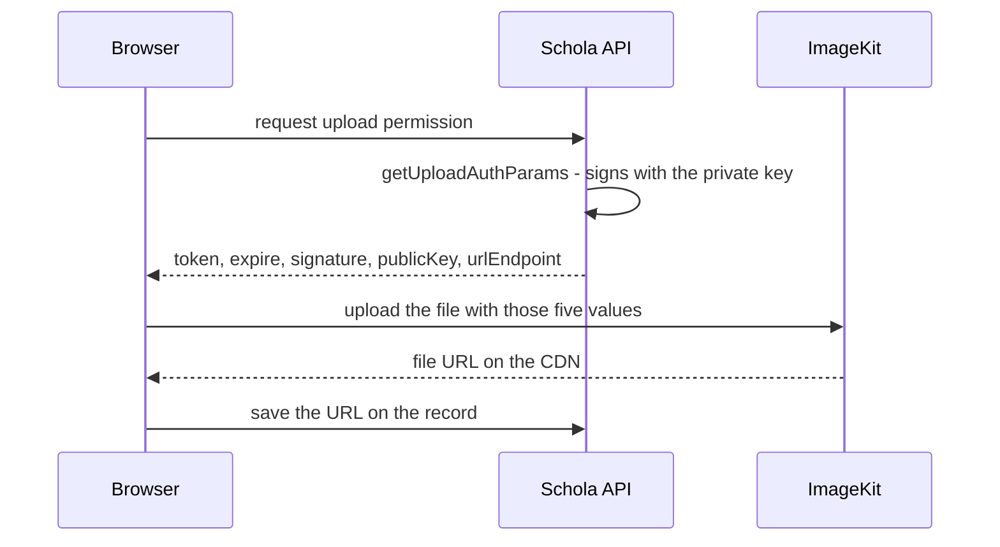

import { Aside, Steps, Card, CardGrid, LinkCard, Badge } from '@astrojs/starlight/components';
import Pipeline from '../../../../components/Pipeline.astro';
import SourceFile from '../../../../components/SourceFile.astro';
import Route from '../../../../components/Route.astro';

[ImageKit](https://imagekit.io) stores images and videos, serves them from a
global CDN (content delivery network — servers close to the reader), and
resizes, crops or converts them on the fly from URL parameters. The original spec chose
it as Schola's media store: avatars, school logos and any image or video a
school publishes.

The API already contains a small ImageKit wrapper that is ready for **signed
browser uploads**. No screen or endpoint uses it yet, so today ImageKit is a
configured-but-idle service. This page explains what is in place, how to get
the keys, and what to expect.

## At a glance

<CardGrid>
  <Card title="Environment variables" icon="setting">
    `IMAGEKIT_PUBLIC_KEY`, `IMAGEKIT_PRIVATE_KEY`, `IMAGEKIT_URL_ENDPOINT` —
    read by the API only.
  </Card>
  <Card title="Required?" icon="warning">
    <Badge text="Production: yes" variant="caution" /> The API refuses to start
    in production without all three. <Badge text="Development: no" variant="success" />
  </Card>
  <Card title="Library" icon="puzzle">
    `@imagekit/nodejs` in `apps/api`, wrapped by
    `apps/api/src/services/imagekit.service.ts`.
  </Card>
  <Card title="Status" icon="information">
    Wired, not used. No route calls the wrapper and the web app has no upload
    control.
  </Card>
</CardGrid>

<Aside type="caution" title="No upload feature exists yet">
Some comments (the committed `.env`, `docs/services/imagekit.md`) say "image
upload endpoints respond 503 until set". There are no such endpoints:
nothing in `apps/api/src/modules` calls `getUploadAuthParams()` or
`isImageKitConfigured()`, and `apps/web` never talks to ImageKit. Yet the
production env check still demands the three keys. Set them before a
production deploy (any valid ImageKit account works), or the API will not
boot.
</Aside>

## Where images come from today

| Image | Source today |
|---|---|
| A person's avatar | The profile picture URL Google or Facebook returns at social sign-in (stored in `users.avatarUrl`). Password-only accounts have none. |
| The platform logo | A URL the Super Admin pastes into **Logo URL** on <Route path="/platform/settings" /> (branding). Blank means the default Schola mark. |
| Receipts, report cards, payslips | Generated as PDFs by the API on request; nothing is stored. See [PDFs and media](/architecture/pdfs-and-media/). |

## How signed browser uploads are meant to work

ImageKit's recommended pattern keeps file bytes off your server. The API only
signs a short-lived permission slip; the browser uploads straight to
ImageKit.

<Pipeline
  caption="The upload design the wrapper supports. Steps 1 and 2 need an API endpoint that does not exist yet."
  steps={[
    { label: 'Ask the API', icon: 'log-in', note: 'Signed-in browser' },
    { label: 'Sign', icon: 'key', note: 'getUploadAuthParams()' },
    { label: 'Upload', icon: 'cloud-upload', note: 'Browser to ImageKit' },
    { label: 'Get a URL', icon: 'badge-check', note: 'CDN address' },
    { label: 'Save it', icon: 'database', note: 'On the record' },
  ]}
/>



- `getUploadAuthParams()` returns `{ token, expire, signature, publicKey, urlEndpoint }`.
  The token is single-use and the SDK's default expiry is about 30 minutes,
  so the browser should ask right before each upload.
- The **private key never leaves the API**. The public key and URL endpoint
  are safe to send to the browser.
- Delivery URLs are built from `IMAGEKIT_URL_ENDPOINT` plus the file path;
  ImageKit transformations are added as URL parameters.

## What happens without the keys

| Environment | Result |
|---|---|
| Development, CI, tests | Nothing visible. `getImageKitClient()` returns `null` when any of the three keys is missing, and since nothing calls it, no feature changes. |
| Production (`NODE_ENV=production`) | The API exits at boot with `Production env missing required values: IMAGEKIT_PUBLIC_KEY, IMAGEKIT_PRIVATE_KEY, IMAGEKIT_URL_ENDPOINT`. |

## Pricing in short

ImageKit has a free plan with monthly storage and bandwidth allowances, and
paid plans with higher limits and overage pricing. The numbers change — check
[imagekit.io/plans](https://imagekit.io/plans) before you plan real media
volumes.

## Get the keys

<Steps>

1. Create an account at [imagekit.io/registration](https://imagekit.io/registration).

2. During sign-up, choose an **ImageKit ID** (the URL endpoint identifier).
   It becomes part of every delivery URL, for example
   `https://ik.imagekit.io/your_id`. It cannot easily be changed later.

3. In the dashboard open **Developer options → API keys**
   ([imagekit.io/dashboard/developer/api-keys](https://imagekit.io/dashboard/developer/api-keys)).

4. Copy the three values into the matching variables:

   | ImageKit shows | Put it in |
   |---|---|
   | Public key (`public_…`) | **`IMAGEKIT_PUBLIC_KEY`** |
   | Private key (`private_…`) | **`IMAGEKIT_PRIVATE_KEY`** — secret |
   | URL endpoint (`https://ik.imagekit.io/your_id`) | **`IMAGEKIT_URL_ENDPOINT`** — must be a full URL |

5. Store them where the API reads them: `test.env` at the repo root for
   development; the API host's environment or
   `apps/api/.env.production.local` for production. Never put the private key
   in a committed file or in a `NEXT_PUBLIC_*` variable.

   ```sh title="test.env"
   IMAGEKIT_PUBLIC_KEY=public_xxxxxxxx
   IMAGEKIT_PRIVATE_KEY=private_xxxxxxxx
   IMAGEKIT_URL_ENDPOINT=https://ik.imagekit.io/your_id
   ```

6. Restart the API.

</Steps>

<Aside type="tip" title="Staging">
Use a separate ImageKit account — or at least a separate folder such as
`staging/` in the media library — for staging, so test uploads never mix with
production media (see `docs/deployment.md`).
</Aside>

## How the code uses it

- <SourceFile path="apps/api/src/services/imagekit.service.ts" symbol="getImageKitClient" /> — creates the SDK client lazily, only when all three keys are set, and logs `imagekit: configured` the first time.
- <SourceFile path="apps/api/src/services/imagekit.service.ts" symbol="isImageKitConfigured" /> — `true` when the client can be created.
- <SourceFile path="apps/api/src/services/imagekit.service.ts" symbol="getUploadAuthParams" /> — the signed upload parameters, or `null` when not configured.
- <SourceFile path="packages/config/src/server.ts" symbol="loadServerEnv" /> — validates the keys (`IMAGEKIT_URL_ENDPOINT` must be a URL) and enforces them in production.

When an upload feature is added, the expected shape is a small authenticated
API route that returns `getUploadAuthParams()` (or a 503 when it is `null`),
plus an upload control in the web app. Follow the
[API conventions](/architecture/api-conventions/) and add an audit entry when
the resulting URL is saved on a record.

## Verify it works

Because no screen uses ImageKit yet, check the configuration directly.

<Steps>

1. Confirm the API sees all three keys (prints one line, no secrets):

   ```sh
   cd apps/api
   LOG_LEVEL=warn pnpm exec tsx -e 'import("./src/load-env.ts").then(() => import("./src/services/imagekit.service.ts")).then((m) => console.log(m.isImageKitConfigured() ? "ImageKit is configured" : "ImageKit is NOT configured"))'
   ```

2. Confirm the keys belong to a working account: upload any image in the
   ImageKit dashboard's **Media Library** and open its URL. It should start
   with your `IMAGEKIT_URL_ENDPOINT`.

3. For production, boot the API with `NODE_ENV=production` on the host. If it
   starts, the ImageKit check passed.

</Steps>

## Troubleshooting

| Symptom | Cause and fix |
|---|---|
| `Production env missing required values: IMAGEKIT_…` | One or more keys is blank on the production host. All three are required there. |
| `Invalid server environment: IMAGEKIT_URL_ENDPOINT: Invalid URL` | The endpoint was pasted without `https://`, or with quotes or spaces. |
| The check prints "NOT configured" | A key is blank in the file that wins (`test.env` beats `.env`), or only one or two of the three are set. |
| Browser upload rejected with an expired-token error (once an upload feature exists) | Ask the API for fresh parameters right before each upload; they are single-use and short-lived. |

## Related pages

<CardGrid>
  <LinkCard title="PDFs and media" description="Receipts, report cards and payslips, and where media fits." href="/architecture/pdfs-and-media/" />
  <LinkCard title="Platform settings" description="The branding form with the Logo URL field." href="/features/platform/settings/" />
  <LinkCard title="Deployment" description="Which keys each host needs before the API will boot." href="/operations/deployment/" />
  <LinkCard title="Environment variables" description="Every key Schola reads, in one table." href="/reference/environment-variables/" />
</CardGrid>
