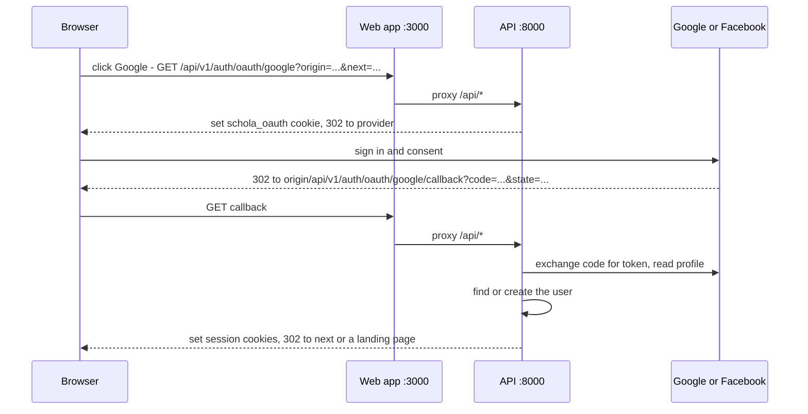

import { Aside, Steps, Tabs, TabItem, Card, CardGrid, LinkCard, Badge } from '@astrojs/starlight/components';
import Pipeline from '../../../../components/Pipeline.astro';
import ScreenAnatomy from '../../../../components/ScreenAnatomy.astro';
import SourceFile from '../../../../components/SourceFile.astro';
import Api from '../../../../components/Api.astro';
import Route from '../../../../components/Route.astro';
import Roles from '../../../../components/Roles.astro';

Besides email and password, people can sign in to Schola with their
**Google** or **Facebook** account. Schola uses the standard *OAuth 2.0
redirect flow*: the browser leaves Schola for the provider's sign-in page,
the provider sends the browser back with a one-time code, and the API swaps
that code for the person's verified email and name. The person ends up with
exactly the same session cookies as a password sign-in.

There is also a second, older path for Google: **Firebase Authentication**,
where the browser gets a Google ID token from Firebase and posts it to the
API. The API still accepts it, but the current sign-in screens do not use it
(see [Firebase Google endpoint](#the-firebase-google-endpoint-optional)).

## At a glance

<CardGrid>
  <Card title="Redirect flow keys" icon="setting">
    `GOOGLE_OAUTH_CLIENT_ID`, `GOOGLE_OAUTH_CLIENT_SECRET`,
    `FACEBOOK_OAUTH_CLIENT_ID`, `FACEBOOK_OAUTH_CLIENT_SECRET` (API only).
  </Card>
  <Card title="Firebase keys" icon="setting">
    API: `FIREBASE_PROJECT_ID`, `FIREBASE_CLIENT_EMAIL`,
    `FIREBASE_PRIVATE_KEY`. Web: `NEXT_PUBLIC_FIREBASE_API_KEY`,
    `…_AUTH_DOMAIN`, `…_PROJECT_ID`, `…_APP_ID`.
  </Card>
  <Card title="Required?" icon="information">
    <Badge text="No" variant="success" /> Every key is optional, in
    development and production. Each provider works on its own.
  </Card>
  <Card title="Who uses it" icon="star">
    <Roles list={['public', 'user']} note="Anyone on the sign-in or sign-up page." />
  </Card>
</CardGrid>

## The screen

<ScreenAnatomy
  title="Log in"
  path="/login"
  regions={[
    { label: 'Error banner', desc: 'Appears when the provider sends the browser back with ?error=… (for example "That sign-in method is not configured yet").', tone: 'warn' },
    { label: 'Google · Facebook', desc: 'Two buttons. Each is a plain link to /api/v1/auth/oauth/google or /facebook. They are always shown, configured or not.', tone: 'accent' },
    { label: 'or', desc: 'Divider between social sign-in and the password form.', tone: 'muted' },
    { label: 'Email · Password · Log in', desc: 'The normal password form.' },
  ]}
/>

The same two buttons sit at the top of <Route path="/signup" />. Signing in
and signing up with a provider are the same action: Schola finds the account
or creates it.

## How the redirect flow works

Step by step:

1. **Start.** The button links to
   <Api method="GET" path="auth/oauth/:provider" /> with the page's own
   `origin` and, if present, the `?next=` path from the sign-in page.
2. **State.** The API generates a random `state` and (for Google) a PKCE
   verifier — a one-time secret that proves the same browser finishes the
   flow. It stores both in a short-lived, httpOnly `schola_oauth` cookie
   (10 minutes) and redirects to the provider.
3. **Consent.** Google asks for `openid email profile`; Facebook asks for
   `email,public_profile` (Graph API v21.0).
4. **Callback.** The provider redirects to
   <Api method="GET" path="auth/oauth/:provider/callback" />. The API checks the
   `state` against the cookie, exchanges the code, and reads the profile.
   Google profiles whose email is not verified are refused; Facebook profiles
   without an email are refused.
5. **Account.** Schola looks the person up by provider id, then by email:
   - **New person** → a new account with no password, email already
     verified, and the platform `user` role (a [visitor](/start-here/glossary/#visitor)).
   - **Existing account** → the provider is linked to it (`googleId` or
     `facebookId` is saved, the provider is added to `authProviders`) and the
     email is marked verified.
6. **Session.** The API sets `schola_access` (the [access token](/start-here/glossary/#access-token)), `schola_refresh` and
   `schola_csrf`, writes an audit entry (`auth.google.login`,
   `auth.facebook.register`, …), mirrors the account to
   [Neon](/setup/services/neon-postgres/) if configured, and redirects:
   to `?next=` if it was a safe in-app path, otherwise to
   <Route path="/platform" /> for a Super Admin, <Route path="/app" /> for a
   school member, or <Route path="/onboarding/school" /> for a new visitor.

### Why the callback is on the web app's address

The browser only ever talks to the web app (port 3000 in development,
`https://schola.reactbd.com` in production). Next.js forwards every `/api/*`
request to the API, so cookies stay first-party. That is why the callback URL
you register is the **web origin plus `/api/v1/auth/oauth/<provider>/callback`**,
not the API's own port 8000.

The API builds the callback from the `origin` the button sends, but only
accepts origins it knows: `http://localhost:3000`, `http://127.0.0.1:3000`,
`https://schola.reactbd.com`, or the configured `APP_URL`. Anything else falls
back to `APP_URL`.

## What happens without keys

The buttons are always visible. When a provider's client ID or secret is
missing, clicking it sends the person straight back to
`/login?error=oauth_unconfigured`, and the banner reads "That sign-in method
is not configured yet. Add the OAuth keys in test.env." Nothing else breaks —
password sign-in is unaffected.

## The URLs to register

Register **both** development and production values with each provider. Use
them exactly — no trailing slash, and `http` vs `https` matters.

| Setting | Development | Production |
|---|---|---|
| Google — Authorized JavaScript origins | `http://localhost:3000` | `https://schola.reactbd.com` |
| Google — Authorized redirect URIs | `http://localhost:3000/api/v1/auth/oauth/google/callback` | `https://schola.reactbd.com/api/v1/auth/oauth/google/callback` |
| Facebook — Valid OAuth Redirect URIs | `http://localhost:3000/api/v1/auth/oauth/facebook/callback` | `https://schola.reactbd.com/api/v1/auth/oauth/facebook/callback` |
| Firebase — Authorized domains | `localhost` | `schola.reactbd.com` |

If you open the app at `http://127.0.0.1:3000` instead of `localhost`, also
register the `127.0.0.1` variants — and do not mix the two in one sign-in
(the `schola_oauth` cookie is tied to the host name you started on).

## Pricing in short

Google OAuth clients and Facebook Login are free to use for sign-in. Firebase
Authentication's Google provider is available on Firebase's free plan.
Providers change their terms — check
[Google Cloud](https://cloud.google.com/), [Meta for Developers](https://developers.facebook.com/)
and [Firebase pricing](https://firebase.google.com/pricing) if in doubt.

## Set up Google

<Steps>

1. Open the [Google Cloud console](https://console.cloud.google.com/) and
   create (or pick) a project, for example `schola`.

2. Configure the **OAuth consent screen** (in newer consoles: **Google Auth
   Platform → Branding / Audience**). Choose **External**, set the app name
   "Schola", a support email and the developer contact. While the app is in
   **Testing**, only the test users you list can sign in; publish it for
   everyone.

3. Go to **APIs & Services → Credentials → Create credentials → OAuth client
   ID**, and choose **Web application**.

4. Under **Authorized JavaScript origins** add `http://localhost:3000` and
   `https://schola.reactbd.com`.

5. Under **Authorized redirect URIs** add
   `http://localhost:3000/api/v1/auth/oauth/google/callback` and
   `https://schola.reactbd.com/api/v1/auth/oauth/google/callback`. Click
   **Create**.

6. Copy the **Client ID** into **`GOOGLE_OAUTH_CLIENT_ID`** and the **Client
   secret** into **`GOOGLE_OAUTH_CLIENT_SECRET`** — in `test.env` for
   development, on the API host (or `apps/api/.env.production.local`) for
   production.

7. Restart the API, open <Route path="/login" /> and click **Google**.

</Steps>

## Set up Facebook

<Steps>

1. Open [developers.facebook.com/apps](https://developers.facebook.com/apps)
   and click **Create app**. Choose the use case for authenticating users with
   **Facebook Login**, and name the app "Schola".

2. In the app's **Facebook Login → Settings**, add both callback URLs to
   **Valid OAuth Redirect URIs**:
   `http://localhost:3000/api/v1/auth/oauth/facebook/callback` and
   `https://schola.reactbd.com/api/v1/auth/oauth/facebook/callback`. Save.

3. Make sure the **email** permission is available to the app (it is part of
   the Facebook Login use case, alongside `public_profile`).

4. Open **App settings → Basic**. Copy the **App ID** into
   **`FACEBOOK_OAUTH_CLIENT_ID`** and the **App secret** into
   **`FACEBOOK_OAUTH_CLIENT_SECRET`**.

5. While the app is in **Development** mode, only people with a role on the
   app (admins, developers, testers) can sign in. Before switching it to
   **Live**, Meta asks for a privacy policy URL — Schola has one at
   `https://schola.reactbd.com/legal/privacy`. Check Meta's current rules for
   plain-`http` localhost redirects.

6. Restart the API, open <Route path="/login" /> and click **Facebook**.

</Steps>

## The Firebase Google endpoint (optional)

Firebase is a separate way to do Google sign-in: the browser opens a Google
popup with the Firebase Web SDK, receives a Google **ID token**, and posts it
to <Api method="POST" path="auth/google" />. The API verifies the token with
the Firebase Admin SDK (including a revocation check) and then signs the
person in exactly like the redirect flow.

<Aside type="caution" title="No screen uses it today">
The web app still contains the Firebase helper
(`apps/web/src/lib/firebase.ts`, `startGoogleSignIn()`), but no button calls
it — the sign-in and sign-up pages only render the redirect buttons. Some
comments in `.env` and older notes say "the Google button is hidden until
Firebase is set"; that is no longer true. Configure Firebase only if you are
building a client that posts ID tokens to <Api method="POST" path="auth/google" />.
Also note that this endpoint does not write to the Neon identity mirror.
</Aside>

<Steps>

1. Open the [Firebase console](https://console.firebase.google.com/) and
   **Add project** (you can attach it to the same Google Cloud project).

2. **Authentication → Get started → Sign-in method → Google → Enable**, set a
   support email, and save.

3. **Authentication → Settings → Authorized domains**: add `localhost` and
   `schola.reactbd.com`.

4. **Project settings → General → Your apps → Add app → Web**. Copy
   `apiKey`, `authDomain`, `projectId` and `appId` into
   **`NEXT_PUBLIC_FIREBASE_API_KEY`**, **`NEXT_PUBLIC_FIREBASE_AUTH_DOMAIN`**,
   **`NEXT_PUBLIC_FIREBASE_PROJECT_ID`** and **`NEXT_PUBLIC_FIREBASE_APP_ID`**.
   These are public by design. They belong to the **web app**: in production
   `apps/web/.env.production` or the web host; locally
   `apps/web/.env.local` (see the note below). The web app treats Firebase as
   configured only when all four are set.

5. **Project settings → Service accounts → Generate new private key**. From
   the downloaded JSON copy `project_id` → **`FIREBASE_PROJECT_ID`**,
   `client_email` → **`FIREBASE_CLIENT_EMAIL`**, and `private_key` →
   **`FIREBASE_PRIVATE_KEY`** (API side: `test.env` or the API host). Paste
   the key in double quotes, `\n` escapes included — the loader turns them
   into real newlines. All three must be set, or the endpoint answers
   `503 Google sign-in is not configured.`

6. Restart the API (and rebuild the web app if you changed `NEXT_PUBLIC_*` for
   production — those values are baked in at build time).

</Steps>

<Aside type="note" title="Where the web app reads NEXT_PUBLIC_* from">
Next.js only loads env files from its own folder, `apps/web/`. The repo-root
`test.env` and `.env` are loaded by the API, not by `next dev`. To give the
web app `NEXT_PUBLIC_FIREBASE_*` locally, put them in `apps/web/.env.local`
(gitignored) or export them in the shell that runs the web app.
</Aside>

## Accounts, linking and security

- **One account per email.** A social sign-in with an email that already has
  a password account links to that account instead of creating a second one.
  The person can then use either method.
- **Social-only accounts have no password.** Trying the password form on such
  an account answers "This account uses google sign-in. Use that button
  instead of a password." They can set one with **Forgot?** — completing the
  reset adds `password` to the account's sign-in methods.
- **A social sign-in never re-opens a closed account.** An existing account
  that a Super Admin suspended
  (<Api method="POST" path="platform/users/:id/suspend" perm="user:suspend" />),
  or a school owner still waiting for approval, is refused with
  `INACTIVE_ACCOUNT`; the redirect flow lands on `/login` with "The sign-in was
  cancelled or rejected. Try again." The same happens to a member whose only
  school is suspended. Only brand-new accounts are created active.
- **Email is trusted from the provider.** Because Google and Facebook have
  verified the address, a social sign-in marks the email verified — including
  on an existing, still-unverified password account.

## How the code uses it

- <SourceFile path="apps/api/src/modules/auth/auth.routes.ts" /> — mounts `GET /oauth/:provider`, `GET /oauth/:provider/callback` and `POST /google` (all rate-limited).
- <SourceFile path="apps/api/src/modules/auth/auth.controller.ts" symbol="oauthStart" /> and `oauthCallback` — turn every failure into a redirect to `/login?error=…`.
- <SourceFile path="apps/api/src/modules/auth/oauth.service.ts" /> — `beginOAuth()`, the Google and Facebook code exchanges, `finishOAuth()` and the landing-page choice.
- <SourceFile path="apps/api/src/modules/auth/oauth-urls.ts" /> — authorize URLs, PKCE, `oauthRedirectUri()` and the origin allowlist.
- <SourceFile path="apps/api/src/modules/auth/auth.service.ts" symbol="signInWithOAuthProfile" /> — find-or-create, linking, session and audit; `googleSignIn()` is the Firebase variant.
- <SourceFile path="apps/api/src/services/firebase-admin.ts" /> — `isGoogleSignInEnabled()` and `verifyGoogleIdToken()`.
- <SourceFile path="apps/web/src/app/(auth)/google-sign-in-button.tsx" symbol="OAuthButtons" /> — the two buttons and the error messages.
- <SourceFile path="apps/web/src/lib/firebase.ts" /> and <SourceFile path="apps/web/src/lib/env.ts" symbol="isFirebaseConfigured" /> — the unused Firebase popup helper.

## Verify it works

<Steps>

1. Start the API and the web app, then open <Route path="/login" /> in a
   private browser window.

2. Click **Google** (or **Facebook**). You should land on the provider's
   account picker — not back on the login page with an error.

3. Sign in. A brand-new person lands on <Route path="/onboarding/school" />;
   someone who already belongs to a school lands on <Route path="/app" />.

4. As a Super Admin, open <Route path="/platform/users" />: the account is
   there, and the audit log shows `auth.google.register` or
   `auth.google.login` (or the Facebook equivalents).

</Steps>

## Troubleshooting

| What you see | Cause and fix |
|---|---|
| `/login?error=oauth_unconfigured` | The client ID or secret for that provider is blank in the file that wins (`test.env` beats `.env`). Restart the API after adding them. |
| Google: `Error 400: redirect_uri_mismatch` | The callback is not registered exactly. Compare with the table above — host, port, `http`/`https` and the full `/api/v1/auth/oauth/google/callback` path. |
| Facebook: "URL blocked" / "Can't load URL" | The callback is missing from **Valid OAuth Redirect URIs**, or the app domain settings do not include the host. |
| `/login?error=oauth_state` ("That sign-in expired") | More than 10 minutes passed, cookies are blocked, or you started on `localhost` and came back on `127.0.0.1`. Start again on one host. |
| `/login?error=oauth_email` | Facebook did not share an email (the person declined it, or the account has none), or Google reported the email as unverified. |
| `/login?error=oauth_denied` | The person cancelled, or the code exchange failed — often a wrong client secret. Check the API log. |
| Only some people can sign in | The Google consent screen is in **Testing**, or the Facebook app is in **Development** mode. Add testers or publish the app. |
| `POST /auth/google` returns 503 | One of the three `FIREBASE_*` server keys is missing. |
| `POST /auth/google` returns 401 "token is invalid or expired" | The ID token is older than an hour, was revoked, or comes from a different Firebase project than `FIREBASE_PROJECT_ID`. |
| Firebase popup error `auth/unauthorized-domain` | Add the host under **Authentication → Settings → Authorized domains**. |

## Related pages

<CardGrid>
  <LinkCard title="Sign-up and sign-in" description="Every sign-in screen, step by step." href="/features/accounts/sign-up-and-sign-in/" />
  <LinkCard title="Onboarding and welcome" description="Where a new visitor goes after a first social sign-in." href="/features/accounts/onboarding-and-welcome/" />
  <LinkCard title="Authentication" description="Cookies, tokens, refresh rotation and CSRF." href="/architecture/authentication/" />
  <LinkCard title="Neon Postgres" description="Where OAuth account links are mirrored." href="/setup/services/neon-postgres/" />
</CardGrid>
