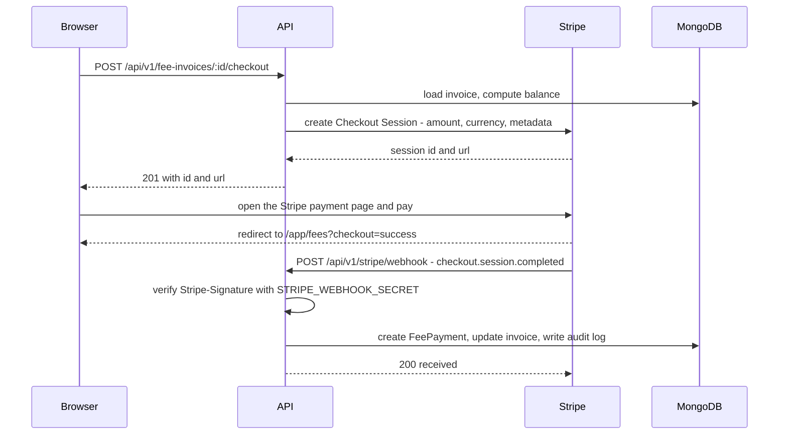

import { Aside, Steps, Tabs, TabItem, Card, CardGrid, LinkCard, Badge } from '@astrojs/starlight/components';
import Pipeline from '../../../../components/Pipeline.astro';
import ScreenAnatomy from '../../../../components/ScreenAnatomy.astro';
import SourceFile from '../../../../components/SourceFile.astro';
import Api from '../../../../components/Api.astro';
import Perm from '../../../../components/Perm.astro';
import Roles from '../../../../components/Roles.astro';
import Route from '../../../../components/Route.astro';
import DemoLogin from '../../../../components/DemoLogin.astro';

Schola takes online payments with **Stripe Checkout** — a payment page hosted
by Stripe. When someone clicks **Pay**, the API asks Stripe for a *Checkout
Session* (a one-time payment page for an exact amount) and sends the browser
there. The person types their card on Stripe's page, never on Schola's, so
card numbers never touch Schola's servers.

The money is recorded only when Stripe confirms it through a **webhook** — a
signed message Stripe sends to the API. Coming back to Schola's "success" page
does not record anything by itself. This keeps the school ledger correct even
if someone closes the tab or fakes the return URL.

## At a glance

<CardGrid>
  <Card title="Environment variables" icon="setting">
    `STRIPE_SECRET_KEY` (create Checkout Sessions) and
    `STRIPE_WEBHOOK_SECRET` (verify webhooks). API only.
  </Card>
  <Card title="Required?" icon="information">
    <Badge text="No" variant="success" /> Without them the Pay buttons answer
    with an error and payments are recorded by hand.
  </Card>
  <Card title="Who pays" icon="star">
    <Roles list={['accountant', 'school_admin', 'parent', 'student']} note="Staff with fee:collect or salary:pay, and students or parents for their own invoices." />
  </Card>
  <Card title="Library" icon="puzzle">
    `stripe` Node SDK in `apps/api` (no API version pinned, so the SDK's
    default applies).
  </Card>
</CardGrid>

## How a payment works

<Pipeline
  caption="A fee payment from click to receipt. Payslips follow the same path."
  steps={[
    { label: 'Pay', icon: 'credit-card', note: 'Button in the school app' },
    { label: 'Session', icon: 'server', note: 'API asks Stripe' },
    { label: 'Checkout', icon: 'lock', note: 'Card on stripe.com' },
    { label: 'Return', icon: 'log-in', note: '?checkout=success' },
    { label: 'Webhook', icon: 'send', note: 'Stripe signs the event' },
    { label: 'Recorded', icon: 'receipt', note: 'Payment and receipt' },
  ]}
/>



## The three ways to start a payment

| Where | Button | API route | Who can use it | Returns to |
|---|---|---|---|---|
| <Route path="/app/fees" />, **Invoices** tab, on a `pending` or `partial` invoice | **Pay** | <Api method="POST" path="fee-invoices/:id/checkout" perm="fee:collect" /> | School staff with <Perm name="fee:collect" /> (Accountant, School Admin) | `/app/fees?checkout=success` or `…=cancel` |
| <Route path="/app/my/fees" /> (student), a child's **Fees** tab under <Route path="/app/children" /> (parent), a student's **Fees** tab | **Pay online** | <Api method="POST" path="student-records/:id/invoices/:invoiceId/checkout" /> | <Perm name="fee:collect" />, or <Perm name="fee:read:own" /> for your own record or your child's | The page you started on |
| <Route path="/app/payroll" />, **Payroll runs** tab, on a `pending` payslip | **Pay** | <Api method="POST" path="salary-records/:id/checkout" perm="salary:pay" /> | Staff with <Perm name="salary:pay" /> (Accountant, School Admin) | `/app/payroll?checkout=success` or `…=cancel` |

Every route returns `{ id, url }` in the standard envelope; the web app then
sends the browser to `url`. What goes into the session:

- **Amount** — the invoice's remaining balance (`total − paid − waived`), or
  the payslip's net amount, converted to cents.
- **Currency** — the school's currency (USD by default).
- **Name** — "Invoice INV-…" or "Payslip PAY-…", shown on Stripe's page.
- **Metadata** — `kind` (`fee` or `salary`), the invoice or salary record id,
  and the `schoolId`. The webhook uses these to find the right record in the
  right school.

The routes refuse invoices that are `paid`, `waived` or `cancelled` or have no
balance, and payslips that are not `pending` (409 `CONFLICT`). The
student-record route also writes a `fee.checkout.open` audit entry.

## What the webhook does

<Api method="POST" path="stripe/webhook" /> is mounted **before** the JSON body
parser, because Stripe signs the raw request body. It needs no session cookie;
the `Stripe-Signature` header is the proof.

| Stripe event | What Schola does |
|---|---|
| `checkout.session.completed` | If `payment_status` is not `unpaid`, record the payment (see below). |
| `checkout.session.async_payment_succeeded` | Same as above — for payment methods that settle later. |
| `checkout.session.async_payment_failed` | Logs it. Nothing is recorded. |
| Anything else | Ignored, answered with 200. |

**Fee invoice** (`kind` is `fee`):

1. If a `FeePayment` with this session id as its `reference` already exists,
   stop — Stripe may deliver an event more than once.
2. Record `min(amount charged, balance still due)` as a payment with method
   `online`, a new receipt number, and the note "Paid with Stripe Checkout."
3. Add it to the invoice's `amountPaid` and set the status to `paid` or
   `partial`.
4. Write an audit entry `fee.collect` with the actor role `stripe`.

**Payslip** (`kind` is `salary`):

1. Skip if the record is already `paid` or `cancelled`.
2. Skip (and log `stripe salary underpaid`) if Stripe charged less than the net
   amount.
3. Mark it `paid` with method `online` and the session id as its reference, and
   write a `salary.pay` audit entry.

The webhook answers `503` when `STRIPE_WEBHOOK_SECRET` is blank, `400` when the
signature is missing or wrong, and `200` otherwise. If recording throws (for
example the database is down), the API answers `500` and Stripe retries the
event later.

<Aside type="caution" title="One Stripe account for the whole platform">
Schola uses a single `STRIPE_SECRET_KEY` — there is no Stripe Connect. Every
school's online payments land in that one Stripe account, which belongs to
whoever runs the platform. Paying a payslip through Checkout **charges the
payer's card into that account**; it does not send money to the employee's
bank. Settle with schools and staff outside Schola until per-school accounts
exist.
</Aside>

## What happens without the keys

| Missing | Result |
|---|---|
| `STRIPE_SECRET_KEY` | The **Pay** / **Pay online** buttons still show. Clicking one shows the error "Stripe is not configured. Set STRIPE_SECRET_KEY." (the API answers 503). Accountants can still record cash, bank and cheque payments by hand. |
| `STRIPE_WEBHOOK_SECRET` | Checkout works and Stripe takes the money, but the webhook answers 503, so **the invoice stays unpaid in Schola**. Always set both together. |

## Pricing in short

Stripe charges a fee per successful payment, which depends on the country,
card type and payment method — there is no monthly fee for Checkout. Test
mode is free and moves no real money. See
[stripe.com/pricing](https://stripe.com/pricing).

## Set up for local development

<Steps>

1. Create an account at [dashboard.stripe.com/register](https://dashboard.stripe.com/register).
   You do not need to activate payments to use test mode. A
   [sandbox](https://docs.stripe.com/sandboxes) keeps test data separate.

2. In test mode, open **Developers → API keys**
   ([dashboard.stripe.com/apikeys](https://dashboard.stripe.com/apikeys)).
   Copy the **Secret key** (`sk_test_…`), or create a **restricted key**
   (`rk_test_…`) with write access to Checkout Sessions — all Schola calls is
   "create a Checkout Session".

3. Put it in **`STRIPE_SECRET_KEY`** in `test.env`:

   ```sh title="test.env"
   STRIPE_SECRET_KEY=sk_test_xxxxxxxx
   ```

4. Install the [Stripe CLI](https://docs.stripe.com/stripe-cli) and log in
   once:

   ```sh
   brew install stripe/stripe-cli/stripe
   stripe login
   ```

5. Start the API the usual way. Its `dev` script starts the webhook listener
   for you, in the background, next to the API:

   ```sh
   pnpm --filter @schola/api dev
   ```

   Under the hood it runs:

   ```sh
   stripe listen --skip-update \
     --forward-to http://127.0.0.1:8000/api/v1/stripe/webhook \
     --events checkout.session.completed,checkout.session.async_payment_succeeded,checkout.session.async_payment_failed
   ```

   If the API is already running in another terminal, start only the listener
   with `pnpm --filter @schola/api stripe:listen`.

6. The listener prints `Your webhook signing secret is whsec_…`. Copy it into
   **`STRIPE_WEBHOOK_SECRET`** in `test.env`. It normally stays the same for
   your machine and Stripe account between runs.

7. Restart the API so it reads the new secret (env values are read once at
   boot).

</Steps>

<Aside type="note">
If the Stripe CLI is not installed, the `dev` script prints
`stripe: command not found` and carries on — the API itself still starts.
Online payments will then never be recorded, because no webhook arrives.
</Aside>

## Test cards

In test mode use any future expiry date, any three-digit CVC and any postal
code.

| Card number | Result |
|---|---|
| `4242 4242 4242 4242` | Succeeds immediately. |
| `4000 0025 0000 3155` | Asks for 3-D Secure authentication, then succeeds. |
| `4000 0000 0000 9995` | Declined (insufficient funds). Nothing is recorded. |

Stripe lists many more in its [testing docs](https://docs.stripe.com/testing).

## Try it: pay a fee invoice

<DemoLogin as="Accountant" email="accountant@greenfield.example" go="/app/fees" />

<ScreenAnatomy
  title="Fees"
  path="/app/fees"
  regions={[
    { label: 'Sidebar', area: 'sidebar', desc: 'Finance → Fees.' },
    { label: 'Top bar', area: 'top', desc: 'Sidebar toggle, sample-data button, notification bell, theme toggle and profile menu.' },
    { label: 'Structures · Invoices · Payments', desc: 'Tabs. Returning from Stripe opens Payments (success) or Invoices (cancel).', tone: 'accent' },
    { label: 'Invoice rows with Pay', desc: 'A Pay button on every pending or partial invoice.', tone: 'warn', size: 2 },
  ]}
/>

<Steps>

1. Make sure the API, the web app and the Stripe listener are running and
   both Stripe keys are set.

2. Sign in as the Accountant and open **Fees**. Click the **Invoices** tab.

3. Find an invoice with status `pending` or `partial` and click **Pay**. The
   button reads "Opening…" and the browser moves to Stripe's checkout page,
   showing "Invoice INV-…" and the balance in USD.

4. Enter `4242 4242 4242 4242`, a future date, any CVC and postal code, and
   click **Pay**.

5. Stripe sends you back to <Route path="/app/fees" />. A toast says "Stripe
   accepted the payment. It appears here once the webhook records it." and the
   **Payments** tab opens.

6. In the listener's terminal you see `checkout.session.completed` and
   `[200] POST http://127.0.0.1:8000/api/v1/stripe/webhook`.

7. Refresh the **Payments** tab: the new payment is there with method
   `online`, and the invoice is now `paid`. The audit log shows a
   `fee.collect` entry by `stripe`.

</Steps>

For the family side, sign in as `parent@greenfield.example`, open **My
children**, pick a child, open the **Fees** tab and click **Pay online**. After
paying, the toast reads "Payment received. The receipt appears here once Stripe
confirms it."

## Going live

<Steps>

1. Activate your Stripe account (business details, bank account for payouts)
   and switch the Dashboard out of test mode.

2. Create a live **secret** or **restricted** key and set it as
   **`STRIPE_SECRET_KEY`** on the API host (never in a committed file).

3. In the Dashboard's webhook settings (**Developers → Webhooks**), add an
   endpoint:
   - URL: `https://schola.reactbd.com/api/v1/stripe/webhook` (the web app
     forwards `/api/*` to the API; you can also point at the API host directly
     if it is public).
   - Events: `checkout.session.completed`,
     `checkout.session.async_payment_succeeded`,
     `checkout.session.async_payment_failed`.

4. Reveal the endpoint's **signing secret** (`whsec_…`) and set it as
   **`STRIPE_WEBHOOK_SECRET`** on the API host. It is different from the CLI's
   secret.

5. Make sure `APP_URL` is `https://schola.reactbd.com` — the success and cancel
   URLs are built from it.

6. Restart the API, make one small real payment, and confirm the event shows
   as delivered (200) in the Dashboard and the payment appears in Schola.

</Steps>

## How the code uses it

- <SourceFile path="apps/api/src/services/stripe/client.ts" symbol="stripeClient" /> — creates the Stripe client, or throws 503 "Stripe is not configured" when the key is blank.
- <SourceFile path="apps/api/src/services/stripe/checkout.ts" symbol="openCheckout" /> — builds the Checkout Session (`mode: "payment"`, one line item, success and cancel URLs from `APP_URL`, metadata).
- <SourceFile path="apps/api/src/services/stripe/money.ts" /> — dollars to cents and back, and `shouldFulfillCheckout()` (anything but `unpaid`).
- <SourceFile path="apps/api/src/modules/stripe/stripe.webhook.ts" symbol="stripeWebhook" /> — signature check and event routing.
- <SourceFile path="apps/api/src/services/stripe/fulfill.ts" /> — `fulfillCheckoutSession()` (fees) and `fulfillSalaryCheckout()` (payslips), both idempotent.
- <SourceFile path="apps/api/src/app.ts" /> — mounts `/api/v1/stripe/webhook` with `express.raw()` before `express.json()`.
- <SourceFile path="apps/api/src/modules/fees/fee-invoices.routes.ts" />, <SourceFile path="apps/api/src/modules/student-records/student-records.routes.ts" />, <SourceFile path="apps/api/src/modules/payroll/salary-records.routes.ts" /> — the three checkout routes.
- <SourceFile path="apps/web/src/lib/stripe-checkout.ts" symbol="startStripeCheckout" /> — posts to a checkout route and sends the browser to Stripe; <SourceFile path="apps/web/src/components/records/checkout-notice.tsx" /> shows the result toast.

Amounts are multiplied by 100 to get Stripe's minor units, which is correct
for USD and other two-decimal currencies.

## Troubleshooting

| Symptom | Cause and fix |
|---|---|
| Toast "Stripe is not configured. Set STRIPE_SECRET_KEY." | The key is blank in the file that wins (`test.env` beats `.env`). Add it and restart the API. |
| Paid on Stripe, but the invoice is still `pending` | No webhook arrived or it was rejected. Check that the listener is running, that `STRIPE_WEBHOOK_SECRET` matches what it printed, and that you restarted the API after setting it. |
| Listener shows `[503]` | `STRIPE_WEBHOOK_SECRET` is blank on the API. |
| Listener or Dashboard shows `[400]` | The signing secret does not match this endpoint (the CLI and the Dashboard endpoint have different secrets), or a proxy changed the body. |
| 409 "This invoice cannot be paid." | The invoice is already `paid`, `waived` or `cancelled`, or has no balance. |
| 409 "This payroll run cannot be paid." | The payslip is not `pending`. |
| Payslip stays `pending` after paying | Stripe charged less than the net amount; the API logs `stripe salary underpaid`. |
| `stripe: command not found` when starting the API | Install the Stripe CLI and run `stripe login`, or ignore it if you are not testing payments. |
| Stripe error about permissions | A restricted key lacks a permission. The error names it; grant it on the key. |

## Related pages

<CardGrid>
  <LinkCard title="Online payments" description="The feature from the user's side, screen by screen." href="/features/finance/online-payments/" />
  <LinkCard title="Fees" description="Fee structures, invoices, receipts and manual payments." href="/features/finance/fees/" />
  <LinkCard title="Payroll" description="Salary structures, payslips and paying them." href="/features/finance/payroll/" />
  <LinkCard title="Fees and payments tutorial" description="Collect fees in the demo school, start to finish." href="/tutorial/fees-and-payments/" />
</CardGrid>
