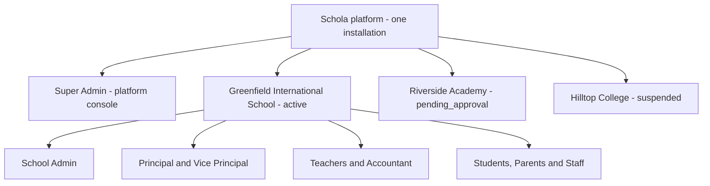
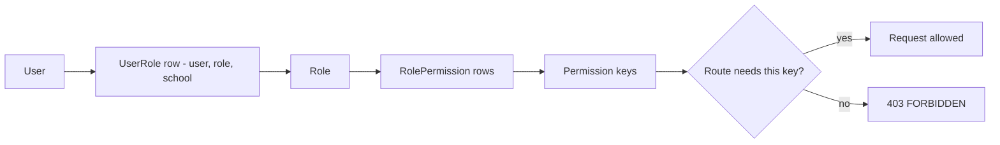
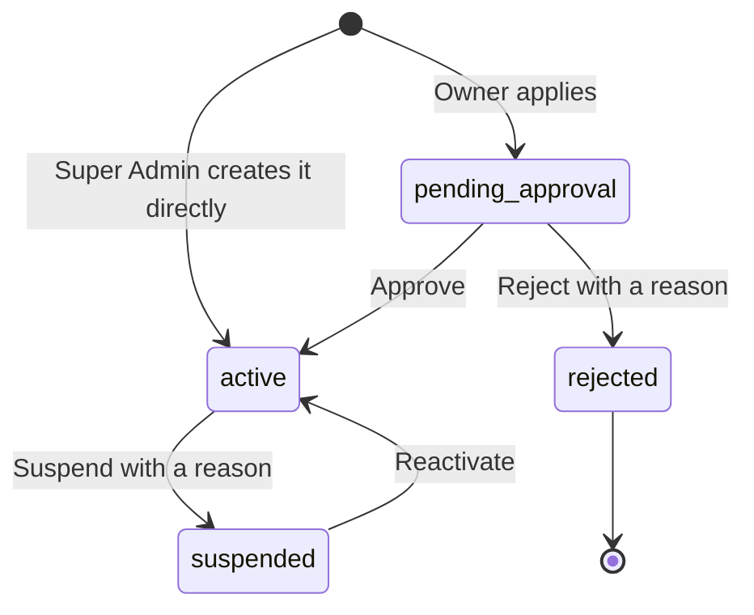
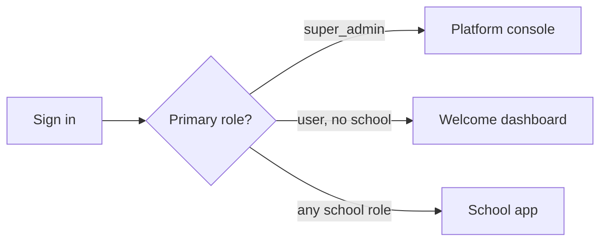
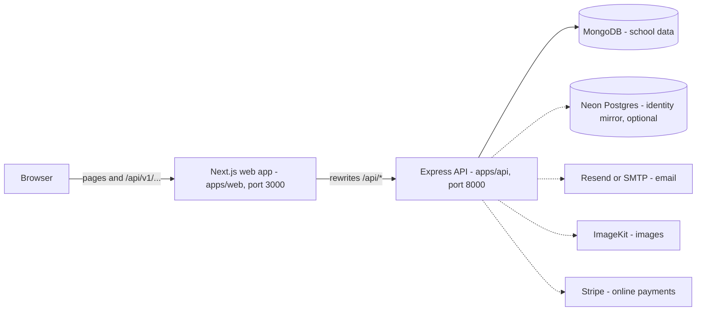
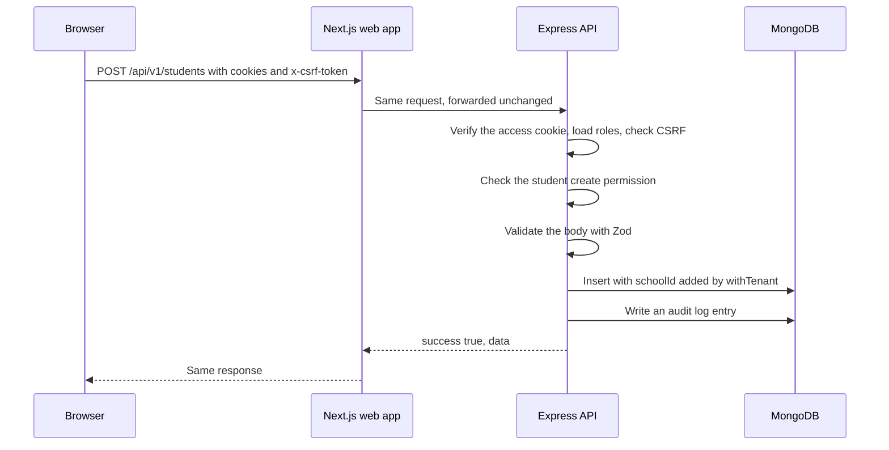

import { Aside, Card, CardGrid, LinkCard, Tabs, TabItem } from '@astrojs/starlight/components';
import Pipeline from '../../../components/Pipeline.astro';
import ScreenAnatomy from '../../../components/ScreenAnatomy.astro';
import Roles from '../../../components/Roles.astro';
import Route from '../../../components/Route.astro';
import Api from '../../../components/Api.astro';
import Perm from '../../../components/Perm.astro';
import SourceFile from '../../../components/SourceFile.astro';
import DemoLogin from '../../../components/DemoLogin.astro';

One Schola installation serves many schools at once. The company that runs
Schola sits on top as the **platform**. Each school is a separate
[tenant](/start-here/glossary/#tenant) with its own people and its own data.
Inside a school, every person holds one or more
[roles](/start-here/glossary/#role), and each role is a bundle of
[permissions](/start-here/glossary/#permission) that decides what they can see
and do. This page explains those three layers, the life of a school, the places
people work, and how a click in the browser reaches the database.

## Three layers: platform, school, role

The diagram uses the schools from the [demo data](/setup/demo-data/).

<CardGrid>
  <Card title="1. The platform" icon="server">
    The whole installation. It is owned by the <Roles list={['super_admin']} />,
    whose role has no school attached (`schoolId: null`). The Super Admin
    approves schools, suspends them, manages platform users and settings, and
    reads every audit log entry.
  </Card>
  <Card title="2. The school (tenant)" icon="laptop">
    One institution: a school, college, institute or coaching centre (the
    `type` field). Every record that belongs to a school — a student, an
    invoice, a timetable period — carries that school's `schoolId`. The API
    never returns a record from another school.
  </Card>
  <Card title="3. The role" icon="approve-check">
    A named bundle of permissions, created per school when the school is
    approved. A person's membership is a row that links *user*, *role* and
    *school*. One person can hold several roles in a school; the highest one
    becomes their primary role.
  </Card>
</CardGrid>

### How a school keeps its data separate

All schools share one MongoDB database and the same collections. What keeps
them apart is a single field: `schoolId`. When a person signs in, the API puts
their school's id in the session token. Every request then runs with that
`schoolId`, and every query on school data goes through a helper called
[`withTenant`](/start-here/glossary/#withtenant) that adds `schoolId` to the
filter automatically. A teacher at one school cannot ask for — or even guess
the id of — a student at another school and get it back.

[Multi-tenancy](/architecture/multi-tenancy/) explains this in depth.

### How roles become permissions

Roles are never checked by name on the server. Each API route asks for a
**permission key**, such as <Perm name="student:create" /> or
<Perm name="fee:collect" />, and the API looks up whether any of the person's
roles in the current school grants it.

The default bundles live in code and are written to the database every time
the API starts, so a new permission reaches every existing school on the next
boot. [Roles at a glance](/start-here/roles-at-a-glance/) lists what each role
gets; [RBAC](/architecture/rbac/) explains the mechanism.

## The life of a school

<Pipeline
  caption="The normal path. A school can also be rejected at the review step, or suspended and reactivated later."
  steps={[
    { label: 'Apply', icon: 'user-plus', note: 'pending_approval' },
    { label: 'Review', icon: 'clipboard-check', note: 'Super Admin decides' },
    { label: 'Approve', icon: 'badge-check', note: 'active' },
    { label: 'Run the school', icon: 'building', note: 'every module unlocked' },
  ]}
/>

A school's `status` is always one of four values:
`pending_approval`, `active`, `suspended` or `rejected`.

### 1. Apply

There are two ways to apply. Both create a school with status
`pending_approval` and send the platform's Super Admins an in-app notification
("New school application").

<Tabs>
  <TabItem label="Bring a school (new account)">
    On <Route path="/signup" />, the "Bring a school" tab asks for the
    institution's name, type, address, contact email, contact phone, expected
    student count, and the owner's name, email and password.

    - Calls <Api method="POST" path="schools/signup" /> (public, no sign-in).
    - Creates the owner's account **inactive** (`isActive: false`), so they
      cannot sign in yet.
    - Emails the owner a verification link and a "your application is pending"
      message.
  </TabItem>
  <TabItem label="Register a school (signed-in account)">
    Someone who already has an account — for example after signing in with
    Google — opens <Route path="/onboarding/school" /> ("Register a school" on
    the welcome dashboard) and fills in the same school fields, without the
    password.

    - Calls <Api method="POST" path="schools/quick-signup" /> (signed in).
    - The signed-in account becomes the school's owner.
    - One account can own only one school that is pending, active or
      suspended. A second attempt gets `409 CONFLICT`.
  </TabItem>
</Tabs>

While the school waits, a signed-in owner sees "Application under review" on
<Route path="/welcome" />.

### 2. Approve or reject

The Super Admin reviews the application on <Route path="/platform/approvals" />
or the school's page under <Route path="/platform/schools" />.

| Decision | API | What happens |
|---|---|---|
| Approve | <Api method="POST" path="platform/schools/:id/approve" perm="school:approve" /> | Status becomes `active`. The school's eight [tenant roles](/start-here/roles-at-a-glance/) are created. The owner's account is activated and marked email-verified, and gets the `school_admin` role. The owner receives an approval email and an in-app "Your school is live" notification. |
| Reject | <Api method="POST" path="platform/schools/:id/reject" perm="school:reject" /> | Status becomes `rejected` and the reason is stored. The owner's account is deactivated and [soft-deleted](/start-here/glossary/#soft-delete), and the reason is emailed to them. |

Only a `pending_approval` school can be approved or rejected; anything else
returns `409 CONFLICT`. Both decisions write an
[audit log](/start-here/glossary/#audit-log) entry (`school.approve`,
`school.reject`).

### 3. Run the school

An `active` school uses every module. The School Admin sets up the academic
year, subjects, classes and sections, then adds people. The
[Tutorial](/tutorial/overview/) walks through this from start to finish.

### 4. Suspend and reactivate

| Action | API | What happens |
|---|---|---|
| Suspend | <Api method="POST" path="platform/schools/:id/suspend" perm="school:suspend" /> | Only an `active` school. Status becomes `suspended`, the reason is stored, and the owner gets an in-app "Your school has been suspended" notification. Nobody at the school can sign in any more, and open sessions end on their next request. |
| Reactivate | <Api method="POST" path="platform/schools/:id/reactivate" perm="school:suspend" /> | Only a `suspended` school. Status returns to `active`, the reason is cleared, and members can sign in again with the roles they had. |

:::note[How the lock-out works]
The API only lets people use an `active` school. Sign-in picks the first of a
person's schools that is `active` and refuses with `403 INACTIVE_ACCOUNT` if
there is none; every school request and every session refresh re-checks the
school and answers `401` once it is suspended. The status is cached for 10
seconds per API process (<SourceFile path="apps/api/src/services/school-status.ts" />),
and suspending or reactivating clears that cache. Signing out still works.
:::

### The shortcut: create a school directly

A Super Admin can skip the application. On <Route path="/platform/schools/new" />
they enter the school and its owner, and
<Api method="POST" path="platform/schools" perm="school:create_direct" />
creates the school already `active`, with the owner as School Admin. If no
password was given, the owner is emailed a link to set one.

## Where people work

Schola is one web app with four kinds of pages. Where you land after signing
in depends on your primary role.

<CardGrid>
  <Card title="Public website" icon="open-book">
    `/`, `/features`, `/pricing`, `/about`, `/faq`, `/contact`, news and
    events, plus `/login` and `/signup`. Open to anyone and fully indexed by
    search engines. See [Public website](/features/public-website/).
  </Card>
  <Card title="Platform console" icon="star">
    <Route path="/platform" /> — schools, approvals, platform users, the
    platform-wide audit log, notifications and settings. Only for
    <Roles list={['super_admin']} />.
  </Card>
  <Card title="School app" icon="laptop">
    <Route path="/app" /> — every school module. For the eight school roles;
    the sidebar shows only what the person's permissions allow.
  </Card>
  <Card title="Welcome dashboard" icon="information">
    <Route path="/welcome" /> — for a signed-in account that belongs to no
    school yet (a visitor). Verify the email, register a school, or wait to be
    added to one.
  </Card>
</CardGrid>

The login form sends the Super Admin to `/platform` and a visitor to
`/welcome`. Everyone else goes to `/app`, or to the page they were trying to
open (the `?next=` parameter). If someone ends up on a surface that is not
theirs, the page sends them to the right one.

<ScreenAnatomy
  title="The school app"
  path="/app"
  regions={[
    { label: 'Sidebar', desc: 'Grouped modules: Overview, My school, School setup, People, Daily, Attendance, Academics, Facilities, Finance, Administration, Account. Each link appears only if the role holds its permission.', area: 'sidebar' },
    { label: 'Top bar', desc: 'Notification bell, the "Load sample" switch, theme toggle and the account menu.', area: 'top' },
    { label: 'Page content', desc: 'The school dashboard for School Admin, Principal, Vice Principal and Accountant; a personal dashboard for Teacher, Student, Parent and Staff.', size: 4, tone: 'accent' },
  ]}
/>

The platform console uses the same frame with its own sidebar (Dashboard, All
schools, Approvals, Users, Audit log, Notifications, Settings, Branding,
Locale, Email, Feature flags). The welcome dashboard shows only "Dashboard",
"Register a school", "Pricing" and "Contact".

<DemoLogin as="Super Admin" email="superadmin@schola.example" go="/platform/approvals">
  Two demo schools are waiting for approval. Approve Riverside Academy, then
  sign in as its owner, `owner@riverside.example`.
</DemoLogin>

## How a request travels

The browser only ever talks to the web app. The web app forwards every
`/api/*` request to the API, so the API looks like part of the same website.
That keeps the session cookies first-party and removes the need for CORS in
production.

Dashed lines are optional services: the API runs without them and the matching
feature switches off (email goes to the console, uploads and online payments
return `503`).

Every response uses the same [envelope](/start-here/glossary/#envelope):
`{ "success": true, "data": … }` or
`{ "success": false, "error": { "code", "message" } }`.
[Request lifecycle](/architecture/request-lifecycle/) follows this path through
every middleware.

### The pieces in the code

- <SourceFile path="apps/web/next.config.ts" /> — the `/api/:path*` rewrite to `INTERNAL_API_URL` (default `http://localhost:8000`).
- <SourceFile path="apps/api/src/app.ts" symbol="buildApp" /> — Helmet, CORS, the Stripe webhook, JSON parsing, request ids, logging, then every router under `/api/v1`.
- <SourceFile path="apps/api/src/middleware/auth.ts" symbol="requireAuth" /> — reads the `schola_access` cookie, resolves roles for the current school, checks the CSRF header on writes.
- <SourceFile path="apps/api/src/middleware/permission.ts" symbol="requirePermission" /> — the per-route permission check.
- <SourceFile path="apps/api/src/repositories/with-tenant.ts" symbol="withTenant" /> — adds `schoolId` to every query on school data.
- <SourceFile path="apps/api/src/services/rbac/permissions.ts" symbol="ROLE_PERMISSIONS" /> — the default role bundles.
- <SourceFile path="apps/api/src/modules/schools/schools.service.ts" /> — sign-up, approve, reject, suspend and reactivate.

:::caution[The edge sign-in check may not be running]
`apps/web/proxy.ts` is meant to send signed-out visitors from `/app`,
`/platform` and `/onboarding` to `/login` before the page loads. Next.js only
picks up `proxy.ts` next to the `app` folder — here that is `apps/web/src/` —
but the file sits one level up in `apps/web/`. The pages are still protected:
each surface's layout checks the session in the browser and redirects, and the
API refuses every unauthenticated request.
:::

## Related pages

<CardGrid>
  <LinkCard title="Roles at a glance" description="All nine roles plus the visitor state, with demo accounts." href="/start-here/roles-at-a-glance/" />
  <LinkCard title="Architecture overview" description="The full system design, package by package." href="/architecture/overview/" />
  <LinkCard title="Approvals" description="The Super Admin's approval queue, screen by screen." href="/features/platform/approvals/" />
  <LinkCard title="Statuses" description="Every status value in the system, including school statuses." href="/reference/statuses/" />
</CardGrid>
